<p align="center"></p>

:information_source: &nbsp;该仓库包含多个技术主题的问题与练习，其中一部分与 DevOps 和 SRE 相关

:globe_with_meridians: &nbsp;语言版本：[English](README_EN.md) | [Português do Brasil](README-pt-BR.md)

:bar_chart: &nbsp;目前有 **2624** 练习和问题

:warning: &nbsp;你可以用这些内容准备面试，但大多数问题和练习并不等同于真实面试题。更多说明请阅读 [FAQ 页面](faq.md)

:stop_sign: &nbsp;如果你希望成为 DevOps 工程师，学习这里提到的一些概念会很有帮助；但这并不意味着需要掌握本仓库中的所有主题和技术

:pencil: &nbsp;你可以通过提交 Pull Request 添加更多练习 :) 贡献指南见 [这里](CONTRIBUTING.md)

****

<!-- ALL-TOPICS-LIST:START -->
<!-- prettier-ignore-start -->
<!-- markdownlint-disable -->
<center>
<table>
  <tr>
    <td align="center"><a href="topics/devops/README.md"><br /><b>DevOps</b></a></td>
    <td align="center"><a href="topics/git/README.md"><br /><b>Git</b></a></td>
    <td align="center"><a href="#network"><br /><b>网络</b></a></td>
    <td align="center"><a href="#hardware"><br /><b>硬件</b></a></td>
    <td align="center"><a href="topics/kubernetes/README.md"><br /><b>Kubernetes</b></a></td>
  </tr>

  <tr>
    <td align="center"><a href="topics/software_development/README.md"><br /><b>软件开发</b></a></td>
    <td align="center"><a href="https://github.com/bregman-arie/python-exercises">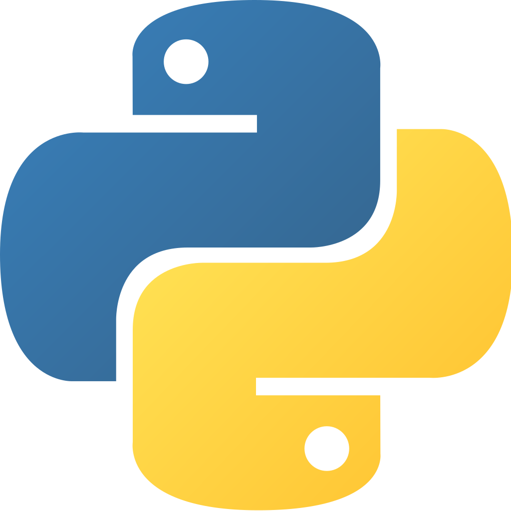<br /><b>Python</b></a></td>
    <td align="center"><a href="https://github.com/bregman-arie/go-exercises"><br /><b>Go</b></a></td>
    <td align="center"><a href="topics/perl/README.md"><br /><b>Perl</b></a></td>
    <td align="center"><a href="#regex"><br /><b>Regex</b></a></td>
  </tr>

  <tr>
      <td align="center"><a href="topics/cloud/README.md"><br /><b>云</b></a></td>
      <td align="center"><a href="topics/aws/README.md"><br /><b>AWS</b></a></td>
      <td align="center"><a href="topics/azure/README.md">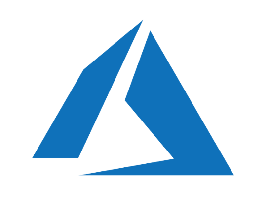<br /><b>Azure</b></a></td>
      <td align="center"><a href="topics/gcp/README.md"><br /><b>Google Cloud Platform</b></a></td>
      <td align="center"><a href="#openstack/README.md"><br /><b>OpenStack</b></a></td>
  </tr>

  <tr>
      <td align="center"><a href="#operating-system"><br /><b>操作系统</b></a></td>
      <td align="center"><a href="topics/linux/README.md"><br /><b>Linux</b></a></td>
      <td align="center"><a href="#virtualization"><br /><b>虚拟化</b></a></td>
      <td align="center"><a href="topics/dns/README.md">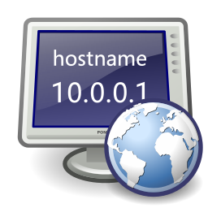<br /><b>DNS</b></a></td>
      <td align="center"><a href="topics/shell/README.md"><br /><b>Shell 脚本</b></a></td>
  </tr>

  <tr>
      <td align="center"><a href="topics/databases/README.md"><br /><b>数据库</b></a></td>
      <td align="center"><a href="#sql">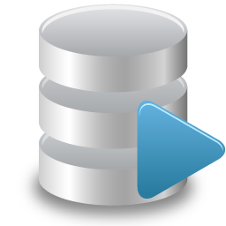<br /><b>SQL</b></a></td>
      <td align="center"><a href="#mongo"><br /><b>Mongo</b></a></td>
      <td align="center"><a href="#testing"><br /><b>测试</b></a></td>
      <td align="center"><a href="#big-data"><br /><b>Big Data</b></a></td>

  </tr>

  <tr>
      <td align="center"><a href="topics/cicd/README.md"><br /><b>CI/CD</b></a></td>
      <td align="center"><a href="#certificates"><br /><b>证书</b></a></td>
      <td align="center"><a href="topics/containers/README.md"><br /><b>容器</b></a></td>
      <td align="center"><a href="topics/openshift/README.md"><br /><b>OpenShift</b></a></td>
      <td align="center"><a href="#storage"><br /><b>存储</b></a></td>
  </tr>

  <tr>
      <td align="center"><a href="topics/terraform/README.md"><br /><b>Terraform</b></a></td>
      <td align="center"><a href="#puppet"><br /><b>Puppet</b></a></td>
      <td align="center"><a href="#distributed"><br /><b>分布式</b></a></td>
      <td align="center"><a href="#questions-you-ask"><br /><b>你可以问的问题</b></a></td>
      <td align="center"><a href="topics/ansible/README.md"><br /><b>Ansible</b></a></td>
  </tr>

  <tr>
      <td align="center"><a href="topics/observability/README.md">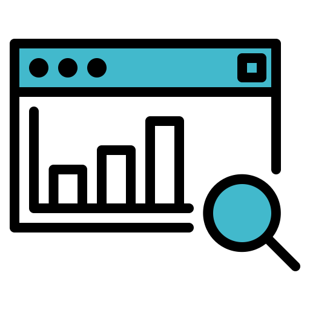<br /><b>Observability</b></a></td>
      <td align="center"><a href="#prometheus"><br /><b>Prometheus</b></a></td>
      <td align="center"><a href="topics/circleci/README.md"><br /><b>Circle CI</b></a></td>
      <td align="center"><a href="topics/datadog/README.md">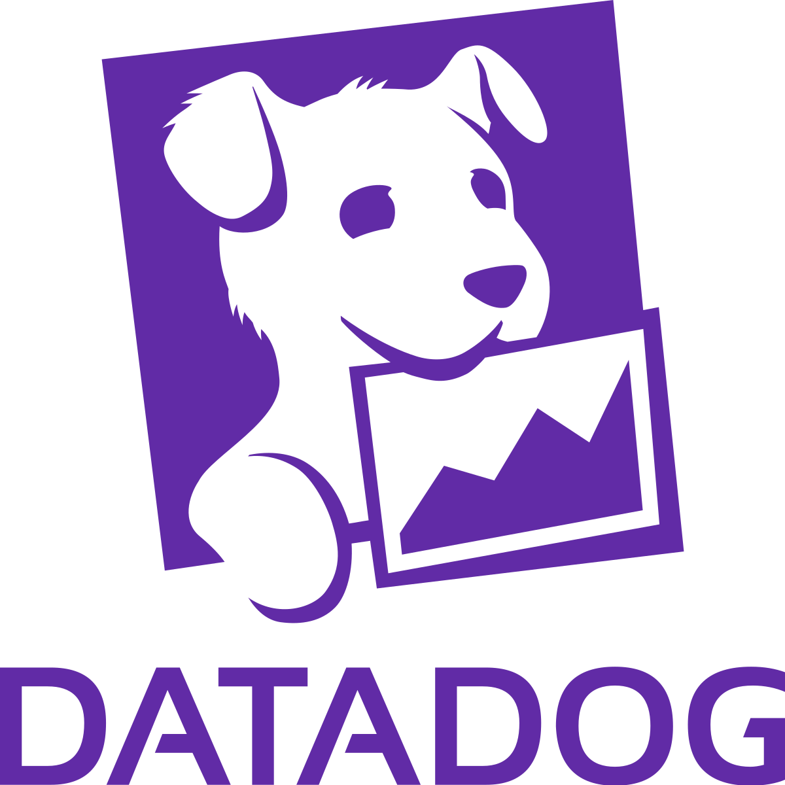<br /><b></b></a></td>
      <td align="center"><a href="topics/grafana/README.md"><br /><b>Grafana</b></a></td>
  </tr>

  <tr>
    <td align="center"><a href="topics/argo/README.md"><br /><b>Argo</b></a></td>
    <td align="center"><a href="topics/soft_skills/README.md"><br /><b>软技能</b></a></td>
    <td align="center"><a href="topics/security/README.md"><br /><b>安全</b></a></td>
    <td align="center"><a href="#system-design"><br /><b>系统设计</b></a></td>
   </tr>

   <tr>
    <td align="center"><a href="topics/chaos_engineering/README.md"><br /><b>混沌工程</b></a></td>
    <td align="center"><a href="#Misc"><br /><b>杂项</b></a></td>
    <td align="center"><a href="#elastic"><br /><b>Elastic</b></a></td>
    <td align="center"><a href="topics/kafka/README.md"><br /><b>Kafka</b></a></td>
    <td align="center"><a href="topics/node/node_questions_basic.md">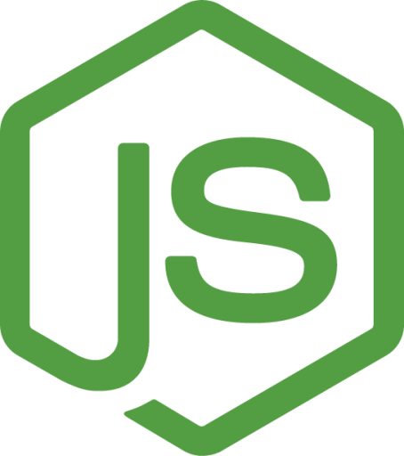<br /><b>NodeJs</b></a></td>
   </tr>
   
</table>
</center>
<!-- markdownlint-enable -->
<!-- prettier-ignore-end -->
<!-- ALL-TOPICS-LIST:END -->

<a name="devops-applications"></a>
## DevOps 应用领域

<table>
<tr>
  <td align="center"><a href="https://play.google.com/store/apps/details?id=com.codingshell.kubeprep"><br /><b>KubePrep</b></a></td>
  <td align="center"><a href="https://play.google.com/store/apps/details?id=com.codingshell.linuxmaster"><br /><b>Linux Master</b></a></td>
  <td align="center"><a href="https://play.google.com/store/apps/details?id=com.codingshell.system_design_hero"><br /><b>System Design Hero</b></a></td>
</tr>
</table>


<a name="network"></a>
## 网络

<details>
<summary>一般来说，为了沟通你需要什么？</summary><br><b>

  - 共同语言（两端都能理解）
  - 一种标识通信对象的方式
  - 连接（以便通信内容可以到达收件人）

</b></details>

<details>
<summary>什么是 TCP/IP?</summary><br><b>

定义两个或多个设备如何相互通信的一组协议。

要了解更多 TCP/IP 相关内容，可以阅读 [这里](http://www.penguintutor.com/linux/basic-network-reference)

</b></details>

<details>
<summary>什么是以太网？</summary><br><b>

以太网是今天最常见的局域网（LAN）技术。LAN 指较小范围内的计算机互联网络，例如办公室、大学校园或家庭网络；与之相对，WAN（广域网）覆盖更大的地理范围。

</b></details>

<details>
<summary>什么是 MAC 地址？它有什么用？</summary><br><b>

一个 MAC 地址是用于识别网络上各个设备的唯一标识号或代码。

在以太网上发送的数据包始终来自 MAC 地址并发送至 MAC 地址。如果网络适配器正在接收数据包，它会比较数据包的目的地 MAC 适配器自己的地址 MAC 地址。

</b></details>

<details>
<summary>MAC 地址 ff:ff:ff:ff:ff:ff 在什么场景下使用？</summary><br><b>

当设备向广播 MAC 地址（FF:FF:FF:FF:FF:FF）发送数据包时，该数据包会被传递给本地网络中的所有主机。以太网广播常用于在数据链路层通过 ARP 解析 IP 地址对应的 MAC 地址。
</b></details>

<details>
<summary>什么是 IP 地址？</summary><br><b>

互联网协议地址（IP address）是分配给网络中设备的数字标识，用于基于 Internet Protocol 通信。IP 地址主要有两个作用：标识主机或网络接口，以及提供网络位置寻址。
</b></details>

<details>
<summary>解释子网掩码并举例</summary><br><b>

子网掩码是一个 32 位值，用于把 IP 地址划分为网络部分和主机部分。子网掩码中网络位为 `1`，主机位为 `0`。在一个给定子网中，通常会保留两个地址，不能分配给主机：第一个地址作为 network address，最后一个地址作为 broadcast address。

[示例](https://github.com/philemonnwanne/projects/tree/main/exercises/exe-09)

</b></details>

<details>
<summary>什么是私有 IP 地址？在哪些场景/系统设计中应该使用它？</summary><br><b>
私有 IP 地址分配给同一私有网络内的主机，用于内部通信。顾名思义，拥有私有 IP 的设备无法直接被外部网络访问。例如，如果我在同一个宿舍网络里托管游戏服务器，可以让同一局域网内的朋友通过服务器的私有 IP 加入，因为这些设备都在同一个本地网络中。
</b></details>

<details>
<summary>什么是公网 IP 地址？在哪些场景/系统设计中应该使用它？</summary><br><b>
公网 IP 地址是可以从公共互联网访问的 IP 地址。如果你托管了一个希望朋友从外网加入的游戏服务器，就需要把公网 IP 提供给他们，让他们的设备能够定位到你的网络和服务器。只有当对方与你在同一个本地网络中时，才通常使用私有 IP。若要让外部用户访问内网中的服务，通常还需要在路由器上配置端口转发，允许对应流量进入内网。
</b></details>

<details>
<summary>解释一下 OSI 模型。有哪几层？每层负责什么？</summary><br><b>

- 应用：用户端（HTTP 在这里）
- 表示：在应用层实体之间建立上下文（加密在这里）
- 会话：建立、管理和终止连接
- 传输：将可变长度数据序列从源主机传输到目标主机（TCP & UDP 在这里）
- 网络：将数据报从一个网络传输到另一个网络（IP 在这里）
- 数据链路：提供两个直接相连的节点之间的链路（MAC 在这里）
- 物理：数据连接的电气和物理规格（位在这里）

可以在 [PenguinTutor](http://www.penguintutor.com/linux/basic-network-reference) 阅读更多 OSI 模型相关内容。
</b></details>

<details>
<summary>对于以下每一项，确定 OSI 它所属的层：

  * 纠错
  * 数据包路由
  * 电缆和电信号
  * MAC 地址
  * IP 地址
  * 终止连接
  * 3次握手</summary><br><b>
  * 纠错 - 数据链路
  * 数据包路由 - 网络
  * 电缆和电信号 - 物理
  * MAC 地址 - 数据链路
  * IP 地址 - 网络
  * 终止连接 - 会话
  * 3 次握手 - 传输
</b></details>

<details>
<summary>您熟悉哪些交付方案？</summary><br><b>

单播：一对一通信，其中有一个发送者和一个接收者。

广播：向网络中的每个人发送消息。地址 ff:ff:FF:ff:ff:ff 用于广播。
           Two common protocols which use broadcast are ARP and DHCP.

组播：向一组订阅者发送消息。它可以是一对多或多对多。
</b></details>

<details>
<summary>什么是 CSMA/CD？它在现代以太网中使用吗？</summary><br><b>

CSMA/CD 代表载波侦听多路访问/冲突检测。
其主要重点是管理对共享介质/总线的访问，其中在给定时间点只有一台主机可以进行传输。

CSMA/CD 算法：

1. 在发送帧之前，它会检查另一台主机是否已经在发送帧。
2. 如果没有人在传输，则它开始传输该帧。
3. 如果两个主机同时传输，就会发生冲突。
4. 两台主机都停止发送帧，并向每个人发送“堵塞信号”，通知每个人发生了冲突
5. 他们正在等待随机时间，然后再次发送
6. 一旦每个主机等待随机时间，它们就会尝试再次发送帧，因此循环再次开始
</b></details>

<details>
<summary>描述以下网络设备以及它们之间的区别：

  * 路由器
  * 交换机
  * 集线器（Hub）</summary><br><b>

路由器、交换机和集线器都是用于连接局域网中设备的网络设备（LAN）。然而，每种设备的操作方式不同，并且有其特定的用例。以下是每个设备的简要说明以及它们之间的差异：

1. 路由器：连接多个网段的网络设备。它工作在 OSI 模型的网络层（第 3 层），并使用路由协议在网络之间转发数据。路由器使用 IP 地址识别设备，并将数据包路由到正确目的地。
2. 交换机：连接同一 LAN 中多个设备的网络设备。它工作在 OSI 模型的数据链路层（第 2 层），并使用 MAC 地址识别设备，将数据帧转发到正确目的地。交换机可以让同一网络中的设备更高效地通信，并减少多个设备同时发送数据时可能发生的冲突。
3. 集线器（Hub）：通过一根电缆连接多个设备的网络设备，用于连接多个设备而不需要对网络进行分段。然而，与交换机不同的是，它在物理层（第 1 层）运行 OSI 模型并简单地将数据包广播到与其连接的所有设备，无论该设备是否是预期接收者。这意味着可能会发生数据冲突，从而导致网络效率受到影响。现代网络设置中通常不使用集线器，因为交换机效率更高并提供更好的网络性能。
</b></details>

<details>
<summary>什么是“冲突域”？</summary><br><b>
冲突域是一个网段，其中设备可能会因同时尝试传输数据而相互干扰。当两个设备同时传输数据时，可能会引起冲突，从而导致数据丢失或损坏。在冲突域中，所有设备共享相同的带宽，并且任何设备都可能干扰其他设备的数据传输。
</b></details>

<details>
<summary>什么是“广播域”？</summary><br><b>
广播域是一个网段，其中所有设备都可以通过发送广播消息来相互通信。广播消息是发送到网络中的所有设备而不是特定设备的消息。在广播域中，所有设备都可以接收和处理广播消息，无论该消息是否是发给它们的。
</b></details>

<details>
<summary>三台计算机连接到一个交换机。有多少个冲突域？有多少个广播域？</summary><br><b>

3个冲突域和1个广播域
</b></details>

<details>
<summary>路由器如何工作？</summary><br><b>

路由器是在两个或多个数据包交换计算机网络之间传递信息的物理或虚拟设备。路由器检查给定数据包的目标互联网协议地址（IP 地址），计算其到达目的地的最佳方式，然后相应地转发。

</b></details>

<details>
<summary>什么是 NAT?</summary><br><b>

 网络地址转换（NAT）是一个过程，其中一个或多个本地 IP 地址被翻译成一个或多个全局地址 IP 地址，反之亦然，以便为本地主机提供 Internet 访问。

</b></details>

<details>
<summary>什么是代理？它是如何运作的？我们需要它做什么？</summary><br><b>

代理服务器充当您和互联网之间的网关。它是一个中间服务器，将最终用户与他们浏览的网站分开。

如果您使用代理服务器，互联网流量将通过代理服务器流向您请求的地址。然后，请求通过同一个代理服务器返回（此规则也有例外），然后代理服务器将从网站收到的数据转发给您。

代理服务器会根据你的使用场景、需求或公司 policy 提供不同级别的功能、安全性和隐私保护。
</b></details>

<details>
<summary>什么是 TCP？它是如何运作的？什么是3次握手？</summary><br><b>

TCP 三次握手是在 TCP/IP 网络中用于在客户端和服务器之间建立连接的过程。

三向握手主要用于创建 TCP 套接字连接。它在以下情况下起作用：

- 客户端节点通过 IP 网络向同一网络或外部网络中的服务器发送 SYN packet，用于请求建立新连接。
- 目标服务器必须有一个可接受新连接的开放端口。当服务器收到客户端发来的 SYN 包后，会响应确认包，即 ACK 包或 SYN/ACK 包。
- 客户端节点收到服务器的 SYN/ACK 后，再发送 ACK packet 作为响应。
</b></details>

<details>
<summary>什么是往返延迟或往返时间？</summary><br><b>

来自 [维基百科](https://en.wikipedia.org/wiki/Round-trip_delay)：“发送信号所需的时间加上接收信号确认所需的时间”

额外问题：什么是 RTT 的 LAN?
</b></details>

<details>
<summary>SSL/TLS 握手是如何工作的？</summary><br><b>
SSL 握手是在客户端和服务器之间建立安全连接的过程。

1. 客户端向服务器发送 Client Hello，其中包含客户端支持的 SSL/TLS 协议版本、加密套件列表以及随机值。
2. 服务器用 Server Hello 响应，其中包含服务器选择的 SSL/TLS 协议版本、随机值和 session ID。
3. 服务器发送证书消息，其中包含服务器的证书。
4. 服务器发送 Server Hello Done 消息，表示服务器已完成发送 Server Hello 阶段的消息。
5. 客户端发送客户端密钥交换消息，其中包含客户端的公钥。
6. 客户端发送 Change Cipher Spec 消息，通知服务器客户端即将发送使用新密码规范加密的消息。
7. 客户端发送加密握手消息，其中包含使用服务器公钥加密的预主密钥。
8. 服务器发送 Change Cipher Spec 消息，通知客户端服务器即将发送使用新密码规范加密的消息。
9. 服务器发送加密握手消息，其中包含使用客户端公钥加密的预主密钥。
10. 客户端和服务器现在可以交换应用程序数据。
</b></details>

<details>
<summary>TCP 和 UDP 有什么区别？</summary><br><b>

TCP 会在客户端和服务器之间建立连接，并保证 packet 顺序和可靠传输；UDP 不建立连接，也不保证 packet 顺序或可靠性。因此 UDP 比 TCP 更轻量，常用于流媒体、实时音视频、游戏等对低延迟更敏感的场景。

[企鹅导师网](http://www.penguintutor.com/linux/basic-network-reference) 提供了很好的解释。
</b></details>

<details>
<summary>你熟悉哪些 TCP/IP 协议？</summary><br><b>
</b></details>

<details>
<summary>解释一下“默认网关”</summary><br><b>

默认网关充当接入点或 IP 联网计算机用来向另一个网络或互联网中的计算机发送信息的路由器。
</b></details>

<details>
<summary>什么是 ARP？它是如何运作的？</summary><br><b>

ARP 是 Address Resolution Protocol（地址解析协议）。当你尝试 ping 本地网络中的某个 IP 地址，例如 `192.168.1.1` 时，系统需要把这个 IP 地址解析为对应的 MAC 地址，这个过程就会用到 ARP。

系统会维护 ARP table，记录 IP 地址与 MAC 地址的对应关系。发送 packet 到某个 IP 地址前，系统会先查询 ARP table；如果已有缓存记录，就不需要再次发起 ARP 请求。
</b></details>

<details>
<summary>什么是 TTL？它有助于预防什么？</summary><br><b>

- TTL （生存时间）是一个值 IP （互联网协议）数据包，确定数据包在被丢弃之前可以经过多少跳或路由器。路由器每次转发数据包时， TTL 值减一。当 TTL 值达到零，数据包被丢弃，并且 ICMP （互联网控制消息协议）消息被发送回发送方，表明数据包已过期。
- TTL 用于防止数据包在网络中无限循环，这可能导致拥塞并降低网络性能。
- 它还有助于防止数据包陷入路由环路，即数据包在同一组路由器之间连续传输而永远不会到达目的地。
- 此外， TTL 可用于帮助检测和预防 IP 欺骗攻击，攻击者试图通过使用虚假或假冒的设备来冒充网络上的另一台设备 IP 地址。通过限制数据包可以传输的跳数， TTL 可以帮助防止数据包被路由到不合法的目的地。
</b></details>

<details>
<summary>什么是 DHCP？它是如何运作的？</summary><br><b>

它代表动态主机配置协议并分配 IP 主机的地址、子网掩码和网关。它是这样工作的：

* 主机在进入网络时会广播一条消息来搜索 DHCP 服务器（DHCP DISCOVER)
* 报价消息由 DHCP 服务器作为包含租用时间、子网掩码的数据包， IP 地址等（DHCP OFFER)
* 根据接受的报价，客户端发回一个回复广播，让所有 DHCP 服务器知道（DHCP REQUEST)
* 服务器发送确认（DHCP ACK)

了解更多 [这里](https://linuxjourney.com/lesson/dhcp-overview)
</b></details>

<details>
<summary>你可以有两个吗 DHCP 服务器在同一网络上？它是如何运作的？</summary><br><b>

可以有两个 DHCP 但是，不建议将服务器放在同一网络上，并且仔细配置它们以防止冲突和配置问题非常重要。
- 当两个 DHCP 服务器配置在同一网络上，存在两台服务器都会分配的风险 IP 地址和其他网络配置设置到同一设备，这可能会导致冲突和连接问题。另外，如果 DHCP 服务器配置有不同的网络设置或选项，网络上的设备可能会收到冲突或不一致的配置设置。
- 然而，在某些情况下，可能需要有两个 DHCP 同一网络上的服务器，例如在大型网络中，其中一台 DHCP 服务器可能无法处理所有请求。在这种情况下， DHCP 服务器可以配置为服务不同的 IP 地址范围或不同子网，因此它们不会相互干扰。
</b></details>

<details>
<summary>什么是 SSL 隧道？它是如何运作的？</summary><br><b>

- SSL （安全套接字层）隧道是一种用于通过不安全网络（例如 Internet）在两个端点之间建立安全加密连接的技术。的 SSL 隧道是通过将流量封装在一个 SSL 连接，提供机密性、完整性和身份验证。

方法如下 SSL 隧道工程：

1. 客户端发起一个 SSL 与服务器的连接，这涉及建立连接的握手过程 SSL 会议。
2. 一旦 SSL 会话建立后，客户端和服务器协商加密参数，例如加密算法和密钥长度，然后交换数字证书以相互验证。
3. 然后客户端通过 SSL 到服务器的隧道，服务器解密流量并将其转发到目的地。
4. 服务器通过 SSL 到客户端的隧道，客户端解密流量并将其转发到应用程序。
</b></details>

<details>
<summary>什么是套接字？在哪里可以看到系统中的套接字列表？</summary><br><b>

- 套接字是一种软件端点，可通过网络在进程之间进行双向通信。套接字为网络通信提供标准化接口，允许应用程序通过网络发送和接收数据。查看打开的套接字列表 Linux 系统： 
***netstat-an***
- 此命令显示所有打开的套接字的列表，以及它们的协议、本地地址、外部地址和状态。
</b></details>

<details>
<summary>什么是 IPv6？如果我们有 IPv4，为什么还要考虑使用它？</summary><br><b>

- IPv6（互联网协议版本 6）是互联网协议的最新版本（IP），用于识别网络上的设备并与其通信。 IPv6地址是128位地址，用十六进制表示，如2001:0db8:85a3:0000:0000:8a2e:0370:7334.

我们应该考虑使用 IPv6 而不是 IPv4 有几个原因：

1. 地址空间：IPv4的地址空间有限，在世界许多地方已经耗尽。 IPv6 提供了更大的地址空间，允许数万亿个唯一地址 IP 地址。
2. 安全性：IPv6 包括对 IPsec 的内置支持，它为网络流量提供端到端加密和身份验证。
3. 性能：IPv6 包含有助于提高网络性能的功能，例如多播路由，它允许将单个数据包同时发送到多个目的地。
4. 简化网络配置：IPv6 包含可简化网络配置的功能，例如无状态自动配置，允许设备自动配置自己的 IPv6 地址，而无需网络配置。 DHCP 服务器。
5. 更好的移动性支持：IPv6 包含可以改善移动性支持的功能，例如移动 IPv6，它允许设备在不同网络之间移动时保留其 IPv6 地址。
</b></details>

<details>
<summary>什么是 VLAN?</summary><br><b>

- 一个 VLAN （虚拟局域网）是一种逻辑网络，它将物理网络上的一组设备组合在一起，无论其物理位置如何。 VLAN 是通过配置网络交换机来分配特定的 VLAN 来创建的。 VLAN ID 连接到交换机上特定端口或端口组的设备发送的帧。
</b></details>

<details>
<summary>什么是 MTU?</summary><br><b>
	
MTU 代表最大传输单元。这是最大的尺寸 PDU （协议数据单元）可以在单个事务中发送。
</b></details>

<details>
<summary>如果您发送的数据包大于 MTU?</summary><br><b>
	
通过 IPv4 协议，路由器可以对数据进行分片 PDU 然后发送所有的分片 PDU 通过交易。
	
使用 IPv6 协议，它会向用户的计算机发出错误。
</b></details>

<details>
<summary>判断题：Ping 使用 UDP，因为它不关心可靠连接</summary><br><b>

错误。Ping 使用的是 ICMP（Internet Control Message Protocol，互联网控制消息协议），它用于发送与网络通信相关的诊断消息和控制消息。
</b></details>

<details>
<summary>什么是 SDN?</summary><br><b>

- SDN 代表软件定义网络。它是一种强调网络控制集中化的网络管理方法，使管理员能够通过软件抽象来管理网络行为。
- 在传统网络中，路由器、交换机和防火墙等网络设备是使用专用软件或命令行界面单独配置和管理的。相比之下， SDN 将网络控制平面与数据平面分开，允许管理员通过集中式软件控制器管理网络行为。
</b></details>

<details>
<summary>什么是 ICMP？它有什么用？</summary><br><b>

- ICMP 代表互联网控制消息协议。它是用于诊断和控制目的的协议 IP 网络。它是互联网协议套件的一部分，在网络层运行。

ICMP 消息有多种用途，包括：
1. 错误报告： ICMP 消息用于报告网络中发生的错误，例如无法传递到目的地的数据包。
2. 平： ICMP 用于发送 ping 消息，用于测试主机或网络是否可达以及测量数据包的往返时间。
3. 路径 MTU 发现： ICMP 用于发现最大传输单元（MTU）的路径，这是在不分片的情况下可以传输的最大数据包大小。
4. 跟踪路线： ICMP 由traceroute 实用程序用来跟踪数据包通过网络的路径。
5. 路由器发现： ICMP 用于发现网络中的路由器。
</b></details>

<details>
<summary>什么是 NAT？它是如何运作的？</summary><br><b>

NAT 代表网络地址转换。这是一种在传输信息之前将多个本地专用地址映射到公共地址的方法。希望多个设备使用单个设备的组织 IP 地址使用 NAT，大多数家用路由器的那些。
例如，你的计算机私有 IP 可能是 `192.168.1.100`，而路由器会把出站流量映射到它的公网 IP（例如 `1.1.1.1`）。互联网上的其他设备看到的是公网 IP，而不是内网中的私有 IP。
</b></details>

<details>
<summary>以下每个协议使用哪个端口号？：

  * SSH
  * SMTP
  * HTTP
  * DNS
  * HTTPS
  * FTP
  * SFTP
</summary><br><b>

  * SSH - 22
  * SMTP - 25
  * HTTP - 80
  * DNS - 53
  * HTTPS - 443
  * FTP - 21
  * SFTP - 22
</b></details>

<details>
<summary>哪些因素影响网络性能？</summary><br><b>

有几个因素会影响网络性能，包括：

1. 带宽：网络连接的可用带宽会显着影响其性能。带宽有限的网络可能会遇到数据传输速率慢、延迟高和响应能力差的情况。
2. 延迟：延迟是指数据从网络中的一点传输到另一点时发生的延迟。高延迟可能会导致网络性能下降，尤其是对于视频会议和在线游戏等实时应用程序。
3. 网络拥塞：当太多设备同时使用网络时，可能会发生网络拥塞，导致数据传输速率慢和网络性能差。
4. 丢包：当数据包在传输过程中丢失时，就会发生丢包。这可能会导致网络速度变慢并降低整体网络性能。
5. 网络拓扑：网络的物理布局（包括交换机、路由器和其他网络设备的放置）可能会影响网络性能。
6. 网络协议：不同的网络协议具有不同的性能特征，这会影响网络性能。例如， TCP 是一种可靠的协议，可以保证数据的传送，但由于错误检查和重传所需的开销，它也会导致性能下降。
7. 网络安全：防火墙和加密等安全措施可能会影响网络性能，特别是当它们需要大量处理能力或引入额外延迟时。
8. 距离：网络上设备之间的物理距离会影响网络性能，尤其是对于信号强度和干扰会影响连接和数据传输速率的无线网络。
</b></details>

<details>
<summary>什么是 APIPA？</summary><br><b>

APIPA 是一组 IP 设备分配的地址
当主要 DHCP 服务器无法访问

</b></details>

<details>
<summary>什么 IP 范围确实 API暂停？</summary><br><b>

APIPA 使用 IP 范围：169.254.0.1 - 169.254.255.254。

</b></details>

<a name="control-plane-and-data-plane"></a>
#### 控制平面和数据平面

<details>
<summary>“控制平面”指的是什么？</summary><br><b>

控制平面是网络的一部分，决定如何将数据包路由和转发到不同的位置。
</b></details>

<details>
<summary>“数据平面”指的是什么？</summary><br><b>

数据平面是实际转发数据/数据包的网络的一部分。
</b></details>

<details>
<summary>“管理平面”指的是什么？</summary><br><b>

它指的是监控和管理功能。
</b></details>

<details>
<summary>创建路由表属于哪个平面（数据、控制……）？</summary><br><b>

控制平面。
</b></details>

<details>
<summary>解释生成树协议（STP).</summary><br><b>
</b></details>

<details>
<summary>什么是链路聚合？为什么使用它？</summary><br><b>
</b></details>

<details>
<summary>什么是非对称路由？怎么处理呢？</summary><br><b>
</b></details>

<details>
<summary>您熟悉哪些覆盖（隧道）协议？</summary><br><b>
</b></details>

<details>
<summary>什么是 GRE？它是如何运作的？</summary><br><b>
</b></details>

<details>
<summary>什么是 VXLAN？它是如何运作的？</summary><br><b>
</b></details>

<details>
<summary>什么是SNAT?</summary><br><b>
</b></details>

<details>
<summary>解释一下 OSPF.</summary><br><b>


OSPF（Open Shortest Path First，开放式最短路径优先）是一种可在多种路由器上实现的路由协议。一般来说，大多数现代路由器都支持 OSPF，包括 Cisco、Juniper 和华为等厂商的路由器。OSPF 适用于基于 IP 的 IPv4 和 IPv6 网络，并采用分层网络设计：路由器被划分到多个 area，每个 area 都有自己的拓扑图和路由表。这种设计有助于减少路由器之间需要交换的路由信息量，提高网络可扩展性。

OSPF 的 4 种路由器类型有：
  * 内部路由器
  * 区域边界路由器
  * 自治系统边界路由器
  * 骨干路由器

  了解更多 OSPF 路由器类型： https://www.educba.com/ospf-router-types/
</b></details>

<details>
<summary>什么是延迟？</summary><br><b>
	
延迟是信息从源到达目的地所花费的时间。
</b></details>

<details>
<summary>什么是带宽？</summary><br><b>
	
带宽是通信通道的容量，用于衡量后者在特定时间段内可以处理多少数据。更多的带宽意味着更多的流量处理，从而意味着更多的数据传输。
</b></details>

<details>
<summary>什么是吞吐量？</summary><br><b>
	
吞吐量是指在一定时间内通过任何传输通道传输的实际数据量的测量。
</b></details>

<details>
<summary>执行搜索查询时，延迟和吞吐量哪个更重要？如何确保我们管理全球基础设施？
</summary><br><b>

延迟。为了获得良好的延迟，搜索查询应转发到最近的数据中心。
</b></details>

<details>
<summary>上传视频时，延迟和吞吐量哪个更重要？以及如何保证这一点？</summary><br><b>

吞吐量。为了获得良好的吞吐量，上传流应路由到未充分利用的链接。
</b></details>

<details>
<summary>转发请求时还有哪些其他考虑因素（延迟和吞吐量除外）？</summary><br><b>

* 保持缓存更新（这意味着请求可能不会转发到最近的数据中心）
</b></details>

<details>
<summary>解释 Spine & Leaf 网络架构</summary><br><b>
Spine & Leaf 是数据中心环境中常用的一种网络拓扑，用于连接多台交换机并高效承载网络流量。它也常被称为 spine-leaf 架构或 leaf-spine 拓扑。该设计提供高带宽、低延迟和良好的可扩展性，因此适合承载大量数据和流量的现代数据中心。

在 Spine & Leaf 网络中，主要有两类交换机：

* Spine Switch：Spine 层中的高性能交换机，作为网络核心转发层。通常每台 Spine Switch 都会连接到数据中心内的所有 Leaf Switch。
* Leaf Switch：Leaf 层交换机连接服务器、存储阵列和其他网络设备等终端设备。每台 Leaf Switch 会连接到每台 Spine Switch，从而在 Leaf 与 Spine 之间形成非阻塞的全网状连接，确保任意 Leaf Switch 之间都可以以较高吞吐量通信。

Spine & Leaf 架构能够满足云计算、虚拟化和大数据应用对可扩展性、高性能和可靠网络基础设施的需求，因此在数据中心场景中非常常见。
</b></details>

<details>
<summary>什么是网络拥塞？什么可能导致它？</summary><br><b>

当网络上传输的数据过多而没有足够的容量来处理需求时，就会发生网络拥塞。 </br>
这可能会导致延迟增加和数据包丢失。原因可能有多种，例如网络使用率高、文件传输量大、恶意软件、硬件问题或网络设计问题。 </br>
为了防止网络拥塞，监控网络使用情况并实施限制或管理需求的策略非常重要。
</b></details>

<details>
<summary>你能告诉我什么关于 UDP 数据包格式？那又怎样呢 TCP 数据包格式？有什么不同？</summary><br><b>
</b></details>

<details>
<summary>什么是指数退避算法？它用在哪里？</summary><br><b>
</b></details>

<details>
<summary>使用汉明码，以下数据字 100111010001101 的代码字是什么？</summary><br><b>

00110011110100011101
</b></details>

<details>
<summary>给出应用层协议的示例</summary><br><b>

* 超文本传输协议（HTTP) - 用于互联网上的网页
* 简单邮件传输协议（SMTP) - 电子邮件传输
* 电信网络 - (TELNET) - 终端仿真允许客户端访问 telnet 服务器
* 文件传输协议（FTP) - 方便在任意两台机器之间传输文件
* 域名系统（DNS) - 域名翻译
* 动态主机配置协议（DHCP) - 分配 IP 主机的地址、子网掩码和网关
* 简单网络管理协议（SNMP) - 收集网络设备上的数据
</b></details>

<details>
<summary>给出网络层协议的示例</summary><br><b>

* 互联网协议（IP) - 协助将数据包从一台机器路由到另一台机器
* 互联网控制消息协议（ICMP) - 让人们知道发生了什么，例如错误消息和调试信息
</b></details>

<details>
<summary>什么是 HSTS?</summary><br><b>
HTTP 严格传输安全是一个 Web 服务器指令，它通知用户代理和 Web 浏览器如何通过在最开始发送并返回到浏览器的响应标头来处理其连接。这会强制连接 HTTPS 加密，忽略任何脚本调用以加载该域中的任何资源 HTTP.

了解更多 [这里](https://www.globalsign.com/en/blog/what-is-hsts-and-how-do-i-use-it#:~:text=HTTP%20Strict%20Transport%20Security%20(HSTS,and%20back%20to%20the%20browser.)
</b></details>

<a name="network---misc"></a>
#### 网络 - 杂项

<details>
<summary>什么是互联网？它与万维网相同吗？</summary><br><b>

互联网是指网络中的网络，在全球范围内传输大量数据。<br>
万维网是一个运行在互联网之上的数百万台服务器上的应用程序，通过所谓的网络浏览器进行访问
</b></details>

<details>
<summary>什么是 ISP?</summary><br><b>

ISP （互联网服务提供商）是当地的互联网公司提供商。
</b></details>

<a name="operating-system"></a>
## 操作系统

<a name="operating-system-exercises"></a>
### 操作系统练习

|名称|主题|目的与说明|解决方案|评论|
|--------|--------|------|----|----|
|fork 101|fork|[链接](topics/os/fork_101.md)|[链接](topics/os/solutions/fork_101_solution.md)
|fork 102|fork|[链接](topics/os/fork_102.md)|[链接](topics/os/solutions/fork_102_solution.md)

<a name="operating-system---self-assessment"></a>
### 操作系统 - 自我评估

<details>
<summary>什么是操作系统？</summary><br><b>

来自《操作系统：三个简单的部分》一书：

“负责使运行程序变得容易（甚至允许您看似同时运行多个程序），允许程序共享内存，使程序能够与设备交互，以及其他类似的有趣的东西”。
</b></details>

<a name="operating-system---process"></a>
#### 操作系统-进程

<details>
<summary>你能解释一下什么是进程吗？</summary><br><b>

进程是一个正在运行的程序。程序是一条或多条指令，程序（或进程）由操作系统执行。
</b></details>

<details>
<summary>如果你必须设计一个 API 对于操作系统中的进程来说，这会是什么 API 看起来像？</summary><br><b>

它将支持以下内容：

* 创建 - 允许创建新进程
* 删除 - 允许删除/销毁进程
* 状态 - 允许检查进程的状态，是否正在运行、已停止、正在等待等。
* 停止 - 允许停止正在运行的进程
</b></details>

<details>
<summary>流程是如何创建的？</summary><br><b>

* 的 OS 正在读取程序代码和任何其他相关数据
* 程序的代码被加载到内存中，或更具体地说，加载到进程的地址空间中。
* 内存分配给程序的堆栈（也称为运行时堆栈）。堆栈也由 OS 带有 argv、argc 和 main() 参数等数据
* 内存分配给程序的堆，这是动态分配数据（例如数据结构链表和哈希表）所需的
* 执行 I/O 初始化任务，如 Unix/Linux 基于系统，每个进程有 3 个文件描述符（输入、输出和错误）
* OS 正在运行程序，从 main() 开始
</b></details>

<details>
<summary>判断题：将程序加载到内存中是急切地完成的（一次全部完成）</summary><br><b>

错误。过去确实如此，但今天的操作系统执行延迟加载，这意味着仅首先加载进程运行所需的相关部分。
</b></details>

<details>
<summary>进程的不同状态有哪些？</summary><br><b>

* 运行 - 正在执行指令
* 就绪 - 已准备好运行，但由于不同原因被搁置
* 阻塞 - 正在等待某些操作完成，例如 I/O 磁盘请求
</b></details>

<details>
<summary>进程被阻塞的原因有哪些？</summary><br><b>

  - I/O 操作（例如从磁盘读取）
  - 等待来自网络的数据包
</b></details>

<details>
<summary>什么是进程间通信（IPC)?</summary><br><b>

进程间通信（IPC）是指操作系统提供的允许进程管理共享数据的机制。
</b></details>

<details>
<summary>什么是“分时”？</summary><br><b>

即使使用具有一个物理设备的系统 CPU，可以允许多个用户处理它并运行程序。这可以通过时间共享来实现，其中计算资源以用户认为的方式共享，系统有多个 CPU，但实际上它只是一个 CPU 通过应用多道程序和多任务来共享。
</b></details>

<details>
<summary>什么是“空间共享”？</summary><br><b>

与时间共享有点相反。在时间共享中，一个资源由一个实体使用一段时间，然后同一资源可以由另一个资源使用，而在空间共享中，空间由多个实体共享，但空间不会在它们之间转移。<br>
它由一个实体使用，直到该实体决定摆脱它。以存储为例。在存储中，文件是您的，直到您决定删除它。
</b></details>

<details>
<summary>哪个组件决定在给定时刻运行哪个进程？</summary><br><b>

CPU Scheduler
</b></details>

<a name="operating-system---memory"></a>
#### 操作系统 - 内存

<details>
<summary>什么是“虚拟内存”以及它的用途是什么？</summary><br><b>

虚拟内存结合了您计算机的 RAM 硬盘上有临时空间。当 RAM 运行较低时，虚拟内存有助于将数据从 RAM 到称为分页文件的空间。将数据移至分页文件可以释放 RAM，这样您的计算机就可以完成其工作。一般来说，越 RAM 你的电脑有，程序运行得越快。
https://www.minitool.com/lib/virtual-memory.html
</b></details>

<details>
<summary>什么是请求分页？</summary><br><b>

请求分页是一种内存管理技术，仅当进程访问页面时才将页面加载到物理内存中。它通过按需加载页面来优化内存使用，减少启动延迟和空间开销。然而，它在第一次访问页面时会引入一些延迟。总的来说，这是一种经济高效的操作系统内存资源管理方法。 
</b></details>

<details>
<summary>什么是写时复制？</summary><br><b>
写时复制 (COW）是一个资源管理概念，其目标是减少不必要的信息复制。这是一个概念，例如在 POSIX fork syscall，它创建调用进程的重复进程。

想法：
1. 如果资源在 2 个或多个实体之间共享（例如，2 个进程之间的共享内存段），则不需要为每个实体复制资源，而是每个实体都有一个 READ 对共享资源的操作访问权限。 （共享段被标记为只读） 
（想象每个实体都有一个指向共享资源位置的指针，可以取消引用该指针以读取其值）
2. 如果一个实体执行一项 WRITE 对共享资源进行操作时，就会出现问题，因为资源也会永久更改为 ALL 其他共享它的实体。
（想想一个进程修改堆栈上的一些变量，或者在堆上动态分配一些数据，这些对共享资源的更改也适用于 ALL 其他进程，这绝对是不良行为）
3. 仅作为解决方案，如果 WRITE 操作即将在共享资源上执行，该资源获取 COPIED 首先，然后应用更改。
</b></details>

<details>
<summary>什么是内核，它有什么作用？</summary><br><b>

内核是操作系统的一部分，负责执行以下任务：

  * 分配内存
  * 安排流程
  * 控制 CPU
</b></details>

<details>
<summary>判断题：内核中的某些代码片段被加载到内存的受保护区域中，因此应用程序无法覆盖它们。</summary><br><b>

正确。
</b></details>

<details>
<summary>什么是 POSIX?</summary><br><b>

POSIX （便携式操作系统接口）是一组定义操作系统之间接口的标准。 Unix类似操作系统和应用程序。
</b></details>

<details>
<summary>解释什么是信号量以及它在操作系统中的作用。</summary><br><b>

信号量是操作系统和并发编程中使用的同步原语，用于控制对共享资源的访问。它是一种变量或抽象数据类型，充当计数器或信号机制，用于管理多个进程或线程对资源的访问。
</b></details>

<details>
<summary>什么是缓存？什么是缓冲区？</summary><br><b>

高速缓存：高速缓存通常在进程读取和写入磁盘时使用，通过使不同程序使用的相似数据易于访问来提高进程速度。
缓冲区：保留位置 RAM，用于临时保存数据。
</b></details>

<a name="virtualization"></a>
## 虚拟化

<details>
<summary>什么是虚拟化？</summary><br><b>

虚拟化使用软件在计算机硬件上创建一个抽象层，允许将单个计算机的硬件元素（处理器、内存、存储等）划分为多个虚拟计算机，通常称为虚拟机 (VM)。
</b></details>

<details>
<summary>什么是虚拟机管理程序？</summary><br><b>

Red Hat：“Hypervisor 是用于创建和运行虚拟机 (VM) 的软件。Hypervisor 有时也称为虚拟机监视器 (VMM)，它将 hypervisor 所在主机的操作系统和资源与虚拟机隔离开来，并支持创建和管理这些 VM。”

更多信息见 [Red Hat 文章](https://www.redhat.com/en/topics/virtualization/what-is-a-hypervisor)
</b></details>

<details>
<summary>有哪些类型的虚拟机管理程序？</summary><br><b>

托管虚拟机管理程序和裸机虚拟机管理程序。
</b></details>

<details>
<summary>与托管虚拟机管理程序相比，裸机虚拟机管理程序有哪些优点和缺点？</summary><br><b>

由于拥有自己的驱动程序并且可以直接访问硬件组件，裸机管理程序通常会具有更好的性能以及稳定性和可扩展性。

另一方面，加载（任何）驱动程序可能会受到一些限制，因此托管虚拟机管理程序通常会受益于更好的硬件兼容性。
</b></details>

<details>
<summary>有哪些类型的虚拟化？</summary><br><b>

操作系统虚拟化
网络功能虚拟化
桌面虚拟化
</b></details>

<details>
<summary>容器化是虚拟化的一种吗？</summary><br><b>

是的，它是操作系统级虚拟化，其中内核是共享的，并允许使用多个独立的用户空间实例。
</b></details>

<details>
<summary>虚拟机的引入如何改变了行业和应用程序的部署方式？</summary><br><b>

虚拟机的引入允许公司在同一硬件上部署多个业务应用程序，而每个应用程序以安全的方式彼此分离，每个应用程序都在自己单独的操作系统上运行。
</b></details>

<a name="virtual-machines"></a>
#### 虚拟机

<details>
<summary>容器时代我们还需要虚拟机吗？它们仍然相关吗？</summary><br><b>

是的，即使在容器时代，虚拟机仍然很重要。虽然容器提供了虚拟机的轻量级且可移植的替代方案，但它们确实有一定的局限性。虚拟机仍然很重要，因为它们提供隔离和安全性，可以运行不同的操作系统，并且适合遗留应用程序。例如，容器的限制是共享主机内核。
</b></details>

<a name="prometheus"></a>
## Prometheus

<details>
<summary>什么是 Prometheus？Prometheus 有哪些主要特点？</summary><br><b>

Prometheus 是一个流行的开源系统监控和告警工具包，最初由 SoundCloud 开发。它用于采集和存储时间序列数据，并支持使用 PromQL 这种强大的查询语言对数据进行查询和分析。Prometheus 常用于监控云原生应用、微服务和其他现代基础设施。

Prometheus 的一些主要特点包括：

    1. 数据模型：Prometheus 使用灵活的数据模型，允许用户以适合具体场景的方式组织并标记时间序列数据。Label 用于标识数据的不同维度，例如数据来源或采集环境。

    2. Pull 模型架构：Prometheus 使用 pull-based 模型从 target 采集数据，也就是 Prometheus Server 会定期主动抓取目标暴露的 metrics。这种架构通常比要求每个目标主动推送数据的 push-based 模型更易扩展，也更可靠。

    3. 时间序列数据库：Prometheus 将数据存储在时间序列数据库中，支持按时间范围查询，并以多种方式聚合和分析数据。该存储针对写入密集型工作负载优化，可以以较低延迟处理大量数据。

    4. 告警：Prometheus 包含强大的告警能力，用户可以基于 metrics 定义规则，并在满足特定条件时触发告警。告警可以通过邮件、聊天工具或其他渠道发送，也可以附带问题的具体上下文。

    5. 可视化：Prometheus 提供基础的图形与可视化能力，也可以与 Grafana 等工具集成，用于创建监控系统和应用的 dashboard。

总体而言，Prometheus 是一个强大而灵活的系统与应用监控分析工具，在云原生监控和可观测性场景中被广泛使用。

</b></details>

<details>
<summary>在哪些情况下可能不适合使用 Prometheus？</summary><br><b>

Prometheus 文档中提到，如果需要 100% 准确性，例如按每个请求计费，Prometheus 可能不是合适选择。
</b></details>

<details>
<summary>描述 Prometheus 架构和组件</summary><br><b>

Prometheus 架构主要由四个部分组成：

    1. Prometheus Server：负责采集和存储 metrics 数据。它内置一个简单的存储层，用于保存按时间排序的 time series 数据。

    2. Client Libraries：Prometheus 提供多种客户端库，应用可以用它们以 Prometheus Server 可抓取的格式暴露 metrics。这些库支持 Java、Python、Go 等多种语言。

    3. Exporters：Exporter 用于把第三方系统已有的指标转换并暴露成 Prometheus 可抓取的格式。Prometheus 生态中有很多常用 exporter，例如 MySQL、PostgreSQL 和 Apache exporter。

    4. Alertmanager：负责处理 Prometheus Server 触发的 alerts。它可以接收来自多个来源的告警，并支持去重、分组，以及将告警路由到合适的通知渠道。

总体而言，Prometheus 架构强调可扩展性和弹性。Server、client libraries 与 exporters 可以按分布式方式部署，以支持大规模、高动态环境中的监控。
</b></details>

<details>
<summary>你能将 Prometheus 与 InfluxDB 等其他方案做一下比较吗？</summary><br><b>

与 InfluxDB 等其他监控方案相比，Prometheus 通常以高性能、可扩展性和云原生生态集成能力见长。它可以处理大量 time series 数据，并且很容易与监控生态中的其他工具集成。InfluxDB 则更强调易用性和简洁体验，提供便于采集与查询数据的 API。

另一种常见方案 Nagios 更偏传统监控系统，依赖 push-based 模型采集数据。Nagios 历史较长，以稳定性和可靠性著称；但与 Prometheus 相比，它缺少一些更现代的能力，例如多维数据模型和强大的查询语言。

总体来说，监控方案的选择取决于组织的具体需求。Prometheus 很适合大规模监控和告警场景；InfluxDB 可能更适合偏重简单易用的小型环境；如果组织更看重成熟稳定而非高级查询和云原生特性，Nagios 仍然是一个可靠选择。
</b></details>

<details>
<summary>什么是警报？</summary><br><b>
在 Prometheus 中，alert 是在特定条件或阈值满足时触发的通知。可以配置为当某些 metrics 超过阈值或特定事件发生时触发。触发后，alert 通常会交给 Alertmanager，并被路由到邮件、值班系统或聊天工具等渠道，通知相关团队采取行动。告警是监控系统的关键组成部分，因为它能帮助团队在问题影响用户或导致停机之前主动发现并响应问题。
</b></details>

<details>
<summary>什么是实例？什么是工作？</summary><br><b>

在 Prometheus 中，instance 指正在被监控的单个 target，例如一台服务器或一个服务实例。job 是执行相同功能的一组 instances，例如服务于同一应用的一组 Web 服务器。job 让你可以一起定义和管理一组 targets。

本质上，instance 是 Prometheus 采集 metrics 的单个目标，job 是可以作为一组管理的相似 instances 集合。
</b></details>

<details>
<summary>核心指标类型有哪些 Prometheus 支持？</summary><br><b>
Prometheus 支持多种类型的指标，包括：

    1. 计数器：用于跟踪事件或样本计数的单调递增值。示例包括处理的请求数或遇到的错误总数。

    2. Gauge：可以上升或下降的值，例如 CPU 使用率或内存使用量。与 Counter 不同，Gauge 的值可以任意变化，会随着被监控系统状态上下波动。

    3. 直方图：一组观察值或事件，根据其值分为不同的桶。直方图有助于分析指标的分布，例如请求延迟或响应大小。

    4. Summary：Summary 类似 Histogram，但它不暴露 bucket，而是提供观察值的一组分位数。Summary 对监控请求延迟或响应大小的分布很有用。

Prometheus 还支持用于聚合和操作指标的各种函数和运算符，例如总和、最大值、最小值和速率。这些功能使其成为监控系统指标并发出警报的强大工具。
</b></details>

<details>
<summary>什么是 Exporter？它有什么用？</summary><br><b>
Exporter 是第三方系统或应用与 Prometheus 之间的桥梁，使 Prometheus 能够从这些系统或应用中采集 metrics。

Exporter 通常作为一个服务运行，监听特定端口，等待 Prometheus 抓取指标。它从第三方系统或应用收集数据，并转换成 Prometheus exposition format，然后通过 HTTP endpoint 暴露给 Prometheus，用于采集和分析。

Exporter 常用于监控各种基础设施组件，例如数据库、Web 服务器和存储系统。常见例子包括 MySQL exporter、PostgreSQL exporter，以及 Apache、Nginx 等 Web 服务器 exporter。

总体而言，Exporter 是 Prometheus 生态的重要组成部分，让 Prometheus 可以覆盖更广泛的系统和应用，并保持很高的灵活性和可扩展性。
</b></details>

<details>
<summary>有哪些 Prometheus 最佳实践？</summary><br><b>
以下是其中三个：

    1. 仔细标记：仔细且一致的指标标记对于有效的查询和警报至关重要。标签应该清晰、简洁，并包含有关指标的所有相关信息。

    2. 保持指标简单：导出器公开的指标应该简单，并且专注于被监控系统的单个方面。这有助于避免混淆，并确保团队所有成员都能轻松理解指标。

    3. 谨慎使用告警：告警很重要，但应该只用于真正需要响应的问题。设置太多告警会导致告警疲劳，让重要告警被忽略。建议只保留高价值告警，并根据实际触发频率持续调整阈值。
</b></details>

<details>
<summary>如何获取给定时间段内的请求总数？</summary><br><b>
要获取给定时间段内的总请求数，可以在 Prometheus 中结合使用 *sum* 和 *rate* 函数。下面的示例查询会返回过去一小时内的请求总数：

```
sum(rate(http_requests_total[1h]))
```
在此查询中，*http_requests_total* 是跟踪请求总数的指标名称 HTTP 请求，*rate* 函数计算过去一小时内每秒的请求率。然后，*sum* 函数将所有请求相加，得出过去一小时内的请求总数。

可以通过调整 *rate* 函数中的时间范围来改变统计窗口。例如，如果想获取最近一天的请求总数，可以改为 *rate(http_requests_total[1d])*。
</b></details>

<details>
<summary>Prometheus 中的 HA 是什么意思？</summary><br><b>

HA 是 High Availability（高可用）的缩写，表示系统即使遇到故障也尽量保持可用。在 Prometheus 场景中，这通常意味着部署多个 Prometheus instances，并通过负载均衡、复制、远程存储或故障转移机制，让监控数据和告警能力尽量保持可用。
</b></details>

<details>
<summary>如何连接两个指标？</summary><br><b>
在 Prometheus 中，可以通过 label matching 和 vector matching 组合两个 metrics。下面示例沿用原问题中的 *join()* 写法：它根据 label value 组合两个或多个 time series。

以下是如何使用 *join()* 函数连接两个指标的示例：

```
sum_series(
  join(
    on(service, instance) request_count_total,
    on(service, instance) error_count_total,
  )
)
```
在此示例中，*join()* 函数根据*service* 和*instance* 标签值组合*request_count_total* 和*error_count_total* 时间序列。然后 *sum_series()* 函数计算结果时间序列的总和
</b></details>

<details>
<summary>如何编写返回标签值的查询？</summary><br><b>
在 Prometheus/Grafana 查询中，可以使用 *label_values* 函数返回 label value。*label_values* 通常接收 metric name 和 label name。

例如，如果有一个名为 *http_requests_total* 的 metric，其中包含名为 *method* 的 label，并且想返回 *method* 的所有取值，可以使用以下查询：

```
label_values(http_requests_total, method)
```

这会返回 *http_requests_total* 中 *method* label 的所有取值，后续可以用这些值继续查询或过滤数据。
</b></details>

<details>
<summary>如何将 cpu_user_seconds 转换为 cpu 使用百分比？</summary><br><b>
要将 *cpu_user_seconds* 转换为 CPU 使用率百分比，需要除以总运行时间和 CPU core 数量，然后乘以 100。计算公式如下：

```
100 * sum(rate(process_cpu_user_seconds_total{job="<job-name>"}[<time-period>])) by (instance) / (<time-period> * <num-cpu-cores>)
```

这里的 *<job-name>* 是要查询的 job name，*<time-period>* 是查询时间范围（例如 *5m*、*1h*），*<num-cpu-cores>* 是被查询机器的 CPU core 数量。

例如，要获取名为 *my-job* 的 job 在最近 5 分钟内、4 核机器上的 CPU 使用率百分比，可以使用以下查询：

```
100 * sum(rate(process_cpu_user_seconds_total{job="my-job"}[5m])) by (instance) / (5m * 4)
```
</b></details>

<a name="go"></a>
## Go

<details>
<summary>有哪些特点 Go 编程语言？</summary><br><b>

  * 强静态类型 - 变量的类型不能随时间改变，必须在编译时定义
  * 简单性
  * 快速编译时间
  * 内置并发
  * 垃圾收集
  * 平台无关
  * 编译为独立的二进制文件 - 运行应用程序所需的任何内容都将编译为一个二进制文件。对于运行时的版本管理非常有用。

Go 还有良好的社区。
</b></details>

<details>
<summary>有什么区别 <code>变量 x 整数 = 2</code> 和 <code>x := 2</code>?</summary><br><b>

结果是相同的，变量的值为 2。

与 <code>变量 x 整数 = 2</code> 我们将变量类型设置为整数，同时使用 <code>x := 2</code> 我们正在让 Go 自己找出类型。
</b></details>

<details>
<summary>判断题：在 Go 我们可以重新声明变量，一旦声明我们就必须使用它。</summary>

错误。我们不能重新声明变量，但是，我们必须使用声明的变量。
</b></details>

<details>
<summary>有哪些图书馆 Go 你用过吗？</summary><br><b>

这应该根据您的使用情况来回答，但一些示例是：

  * fmt——格式化I/O
</b></details>

<details>
<summary>下面的代码块有什么问题？如何修复它？

```
func main() {
    var x float32 = 13.5
    var y int
    y = x
}
```
</summary><br><b>
</b></details>

<details>
<summary>以下代码块尝试将整数 101 转换为字符串，但我们得到的是“e”。这是为什么呢？如何修复它？


```go
package main

import "fmt"

func main() {
    var x int = 101
    var y string
    y = string(x)
    fmt.Println(y)
}
```
</summary><br><b>

它查看设置为 101 的 unicode 值，并使用它将整数转换为字符串。
如果你想获得“101”，你应该使用包“strconv”并替换 <code>y = 字符串(x)</code> 与 <code>y = strconv.Itoa(x)</code>
</b></details>

<details>
<summary>下面的代码有什么问题？：

```
package main

func main() {
    var x = 2
    var y = 3
    const someConst = x + y
}
```
</summary><br><b>

常数在 Go 只能使用常量表达式来声明。
但是 `x`, `y` 并且它们的总和是可变的。
<br>
<code>const 初始值设定项 x + y 不是常量</code>
</b></details>

<details>
<summary>以下代码块的输出是什么？：

```go
package main

import "fmt"

const (
	x = iota
	y = iota
)
const z = iota

func main() {
	fmt.Printf("%v\n", x)
	fmt.Printf("%v\n", y)
	fmt.Printf("%v\n", z)
}
```
</summary><br><b>

Go的 iota 标识符在 const 声明中使用，以简化递增数字的定义。因为它可以在表达式中使用，所以它提供了超越简单枚举的通用性。
<br>
`x` 和 `y` 在第一个 iota 组中， `z` 在第二个。
<br>
[埃奥塔页面 Go 维基百科](https://github.com/golang/go/wiki/Iota)
</b></details>

<details>
<summary>_ 的用途是什么 Go?</summary><br><b>

它避免了必须为返回值声明所有变量。
它被称为 [空白标识符](https://golang.org/doc/effective_go.html#blank).
<br>
[回答在 SO](https://stackoverflow.com/questions/27764421/what-is-underscore-comma-in-a-go-declaration#answer-27764432)
</b></details>

<details>
<summary>以下代码块的输出是什么？：

```go
package main

import "fmt"

const (
	_ = iota + 3
	x
)

func main() {
	fmt.Printf("%v\n", x)
}
```
</summary><br><b>

由于第一个 iota 是用值声明的 `3` (` + 3`），下一个有值 `4`
</b></details>

<details>
<summary>以下代码块的输出是什么？：

```go
package main

import (
	"fmt"
	"sync"
	"time"
)

func main() {
	var wg sync.WaitGroup

	wg.Add(1)
	go func() {
		time.Sleep(time.Second * 2)
		fmt.Println("1")
		wg.Done()
	}()

	go func() {
		fmt.Println("2")
	}()

	wg.Wait()
	fmt.Println("3")
}
```
</summary><br><b>

Output: 2 1 3

[关于sync/waitgroup的算法](https://tutorialedge.net/golang/go-waitgroup-tutorial/)

[Golang 包同步](https://golang.org/pkg/sync/)
</b></details>

<details>
<summary>以下代码块的输出是什么？：

```go
package main

import (
	"fmt"
)

func mod1(a []int) {
	for i := range a {
		a[i] = 5
	}

	fmt.Println("1:", a)
}

func mod2(a []int) {
	a = append(a, 125) // !

	for i := range a {
		a[i] = 5
	}

	fmt.Println("2:", a)
}

func main() {
	s1 := []int{1, 2, 3, 4}
	mod1(s1)
	fmt.Println("1:", s1)

	s2 := []int{1, 2, 3, 4}
	mod2(s2)
	fmt.Println("2:", s2)
}
```
</summary><br><b>

Output: <code><br>
1 [5 5 5 5]<br>
1 [5 5 5 5]<br>
2 [5 5 5 5 5]<br>
2 [1 2 3 4]<br>
</code>

在 `mod1` a 是链接，当我们使用 `a[i]`，我们正在改变 `s1` 值到.
但在 `mod2`, `append` 创建新切片，我们只改变 `a` 值，不 `s2`.

[关于数组的算术](https://golangbot.com/arrays-and-slices/),
[博客文章关于 `append`](https://blog.golang.org/slices)
</b></details>

<details>
<summary>以下代码块的输出是什么？：

```go
package main

import (
	"container/heap"
	"fmt"
)

// An IntHeap is a min-heap of ints.
type IntHeap []int

func (h IntHeap) Len() int           { return len(h) }
func (h IntHeap) Less(i, j int) bool { return h[i] < h[j] }
func (h IntHeap) Swap(i, j int)      { h[i], h[j] = h[j], h[i] }

func (h *IntHeap) Push(x interface{}) {
	// Push and Pop use pointer receivers because they modify the slice's length,
	// not just its contents.
	*h = append(*h, x.(int))
}

func (h *IntHeap) Pop() interface{} {
	old := *h
	n := len(old)
	x := old[n-1]
	*h = old[0 : n-1]
	return x
}

func main() {
	h := &IntHeap{4, 8, 3, 6}
	heap.Init(h)
	heap.Push(h, 7)

  fmt.Println((*h)[0])
}
```
</summary><br><b>

Output: 3

[Golang 容器/堆包](https://golang.org/pkg/container/heap/)
</b></details>

<a name="mongo"></a>
## MongoDB

<details>
<summary>MongoDB 有哪些优点？换句话说，为什么选择 MongoDB，而不是其他 NoSQL 实现？</summary><br><b>

MongoDB 优点如下：
- Schema-less（无固定模式）
- 易于横向扩展
- 不需要复杂的 join
- 单个对象的数据结构清晰

</b></details>

<details>
<summary>SQL 和 NoSQL 有什么区别？</summary><br><b>

主要区别在于 SQL 数据库通常是结构化的，数据以带有行和列的表形式存储，类似电子表格。NoSQL 数据库更灵活，具体数据模型取决于数据库类型，例如 key-value、document、column-family 或 graph 等。
</b></details>

<details>
<summary>在哪些场景下你会优先选择 NoSQL/MongoDB，而不是 SQL？</summary><br><b>

  * 经常变化的异构数据
  * 数据一致性和完整性不是重中之重
  * 如果数据库需要快速扩展，这是最好的选择
</b></details>

<details>
<summary>什么是文档？什么是集合？</summary><br><b>

  * Document 是 MongoDB 中的一条记录，以 BSON（Binary JSON）格式存储，是 MongoDB 的基本数据单位。
  * Collection 是 MongoDB 单个数据库中一组相关 Document 的集合。
</b></details>

<details>
<summary>什么是聚合器？</summary><br><b>

  * Aggregation 是 MongoDB 中用于对一组数据执行处理并返回计算结果的框架。
</b></details>

<details>
<summary>什么更好？嵌入文档或引用？</summary><br><b>

  * 哪个更好没有明确的答案，这取决于具体的用例和要求。一些解释：嵌入文档提供原子更新，而引用文档则允许更好的规范化。
</b></details>

<details>
<summary>你是否做过 MongoDB 数据检索优化？如果没有，你会如何优化慢查询？</summary><br><b>

  * MongoDB 数据检索优化的一些常见方式包括：建立合适的索引、合理设计 schema、优化查询语句，以及根据场景做分片或负载均衡。
</b></details>

<a name="queries"></a>
##### 查询

<details>
<summary>解释这个查询： <code>db.books.find({"name": /abc/})</code></summary><br><b>
</b></details>

<details>
<summary>解释一下这个查询： <code>db.books.find().sort({x:1})</code></summary><br><b>
</b></details>

<details>
<summary>find() 和 find_one() 有什么区别？</code></summary><br><b>
	
  * `find()` 返回所有符合查询条件的 document。
  * `find_one()` 只返回一个与查询条件匹配的 document（如果没有匹配则返回 `null`）。
</b></details>

<details>
<summary>如何从 MongoDB 导出数据？</code></summary><br><b>

* `mongoexport`
* 使用编程语言调用驱动或 API 导出
</b></details>

<a name="sql"></a>
## SQL

<a name="sql-exercises"></a>
### SQL 练习

|名称|主题|目的与说明|解决方案|评论|
|--------|--------|------|----|----|
| 功能与比较 | 查询改进 | [练习](topics/sql/improve_query.md) | [解决方案](topics/sql/solutions/improve_query.md)

<a name="sql-self-assessment"></a>
### SQL 自我评估

<details>
<summary>什么是 SQL?</summary><br><b>

SQL （结构化查询语言）是关系数据库的标准语言（例如 MySQL、MariaDB、...）。<br>
它用于读取、更新、删除和创建关系数据库中的数据。
</b></details>

<details>
<summary>SQL 和 NoSQL 有什么不同？</summary><br><b>

主要区别在于 SQL 数据库是结构化的：数据通常存储在带有行和列的表中，类似 Excel 表格。NoSQL 数据库通常不要求固定表结构，数据模型会根据数据库类型而变化，例如 key-value、document、wide-column 或 graph 等。
</b></details>

<details>
<summary>什么时候更适合使用 SQL？什么时候更适合使用 NoSQL？</summary><br><b>

SQL：当数据完整性非常重要时更适合使用。许多金融系统和强事务业务会选择 SQL 数据库，因为它们通常支持 ACID。

NoSQL：当你需要快速横向扩展、处理灵活数据结构或高吞吐读写时很有用。许多 NoSQL 数据库面向 Web 应用和分布式场景设计，适合在多台服务器之间扩展数据访问。

另外，由于 NoSQL 不要求像关系数据库那样遵守严格的表、列、行结构，可以更灵活地存储不同形态的数据。
</b></details>

<a name="practical-sql---basics"></a>
##### SQL 实践基础

对于这些问题，我们将使用如下所示的客户和订单表：

**CUSTOMERS**

Customer_ID | Customer_Name | Items_in_cart | Cash_spent_to_Date
------------ | ------------- | ------------- | -------------
100204 | John Smith | 0 | 20.00
100205 | Jane Smith | 3 | 40.00
100206 | Bobby Frank | 1 | 100.20

**ORDERS**

Customer_ID | Order_ID | Item | Price | Date_sold
------------ | ------------- | ------------- | ------------- | -------------
100206 | A123 | Rubber Ducky | 2.20 | 2019-09-18
100206 | A123 | Bubble Bath | 8.00 | 2019-09-18
100206 | Q987 | 80 Pack TP | 90.00 | 2019-09-20
100205 | Z001 | Cat Food - Tuna | 10.00 | 2019-08-05
100205 | Z001 | Cat Food - Chicken | 10.00 | 2019-08-05
100205 | Z001 | Cat Food - Beef | 10.00 | 2019-08-05
100205 | Z001 | Cat Food - Kitty Quesadilla | 10.00 | 2019-08-05
100204 | X202 | Coffee | 20.00 | 2019-04-29

<details>
<summary>如何从这个表中选择所有字段？</summary><br><b>

```sql
SELECT *
FROM CUSTOMERS;
```
</b></details>

<details>
<summary>约翰的购物车中有多少件商品？</summary><br><b>

```sql
SELECT Items_in_cart
FROM CUSTOMERS
WHERE Customer_Name = 'John Smith';
```
</b></details>

<details>
<summary>所有客户花费的现金总和是多少？</summary><br><b>

```sql
SELECT SUM(Cash_spent_to_Date) AS SUM_CASH
FROM CUSTOMERS;
```
</b></details>

<details>
<summary>有多少人的购物车中有商品？</summary><br><b>

```sql
SELECT COUNT(1) AS Number_of_People_w_items
FROM CUSTOMERS
WHERE Items_in_cart > 0;
```
</b></details>

<details>
<summary>如何将客户表连接到订单表？</summary><br><b>

使用两个表共有的唯一键关联它们。本例中，`CUSTOMERS` 表和 `ORDERS` 表共有的键是 `Customer_ID`。
</b></details>

<details>
<summary>如何显示每个客户订购了哪些商品？</summary><br><b>

```sql
SELECT c.Customer_Name, o.Item
FROM CUSTOMERS c
LEFT JOIN ORDERS o
  ON c.Customer_ID = o.Customer_ID;
```

</b></details>

<details>
<summary>使用 WITH 语句，如何显示谁订购了猫粮以及花费的总金额？</summary><br><b>

```sql
WITH cat_food AS (
  SELECT Customer_ID, SUM(Price) AS TOTAL_PRICE
  FROM ORDERS
  WHERE Item LIKE '%Cat Food%'
  GROUP BY Customer_ID
)
SELECT c.Customer_Name, f.TOTAL_PRICE
FROM CUSTOMERS c
INNER JOIN cat_food f
  ON c.Customer_ID = f.Customer_ID
WHERE c.Customer_ID IN (SELECT Customer_ID FROM cat_food);
```

虽然这是一个简单示例，但 `WITH` 子句在需要先对某个表执行复杂查询、再把结果 join 到另一个表时非常有用。它可以在查询执行期间创建一个临时结果集，而不是额外创建一张真实表。

这里先用 `WITH` 得到每个客户购买 Cat Food 的总金额，再把这个结果与 `CUSTOMERS` 表关联。
</b></details>

<details>
<summary>您会使用以下哪个查询？

```
SELECT count(*)                             SELECT count(*)
FROM shawarma_purchases                     FROM shawarma_purchases
WHERE                               vs.     WHERE
  YEAR(purchased_at) == '2017'              purchased_at >= '2017-01-01' AND
                                            purchased_at < '2018-01-01'
```
</summary><br><b>

```
SELECT count(*)
FROM shawarma_purchases
WHERE
  purchased_at >= '2017-01-01' AND
  purchased_at < '2018-01-01'
```

建议使用右侧的范围查询。对列调用 `YEAR(purchased_at)` 通常会让数据库难以直接利用 `purchased_at` 上的索引，而范围条件可以按索引顺序定位数据。这里使用半开区间 `< '2018-01-01'`，也能避免时间戳字段在 `2017-12-31` 当天不同时间点上的边界问题。
</b></details>

<a name="openstack"></a>
## OpenStack

<details>
<summary>你熟悉哪些 OpenStack 组件/项目？</summary><br><b>
我最熟悉的几个核心 OpenStack 组件：

- Nova 用于计算资源配置，包括 VM 生命周期管理。
- Neutron 用于网络，专注于创建和管理网络、子网和路由器。
- 用于块存储的 Cinder，用于附加和管理存储卷。
- Keystone 用于身份服务，处理身份验证和授权。

我在过去的项目中实现了这些，配置它们的可扩展性和安全性以支持多租户环境。
 
</b></details>

<details>
<summary>你能说明以下每个 OpenStack 服务/项目分别负责什么吗？

  - Nova
  - Neutron
  - Cinder
  - Glance
  - Keystone</summary><br><b>

  * Nova - 管理虚拟实例
  * Neutron - 通过提供网络即服务 (NaaS) 来管理网络
  * Cinder - 块存储
  * Glance - 管理虚拟机和容器的镜像（搜索、获取和注册）
  * Keystone - 跨云的身份验证服务
</b></details>

<details>
<summary>确定用于以下各项的服务/项目：

  * 复制或快照实例
  * GUI 用于查看和修改资源
  * 块存储
  * 管理虚拟实例
</summary><br><b>

  * Glance - Image Service，也用于复制实例或创建实例快照
  * Horizon - 用于查看和修改资源的 Web GUI
  * Cinder - 块存储
  * Nova - 管理虚拟实例
</b></details>

<details>
<summary>什么是租户/项目？</summary><br><b>
在 OpenStack 中，Project（早期称为 Tenant）是虚拟机、存储卷和网络等资源的所有权与隔离边界。每个 Project 由特定用户或用户组拥有，用于在共享云环境中管理并隔离资源。除非显式共享，否则一个 Project 的资源不能被另一个 Project 访问。
</b></details>

<details>
<summary>判断真假：

  * OpenStack 可以免费使用
  * 负责网络的服务是 Glance
  * 租户/项目的目的是在不同项目和用户之间共享资源 OpenStack</summary><br><b>
  * OpenStack 可以免费使用 - **正确**。OpenStack 是基于 Apache 2.0 许可证发布的开源软件。
  * 负责网络的服务是 Glance - **错误**。Neutron 才是负责网络的服务；Glance 是 Image Service。
  * Tenant/Project 的目的是在不同 OpenStack 项目和用户之间共享资源 - **错误**。它的主要目的是隔离资源。
</b></details>

<details>
<summary>详细描述如何使用浮动启动实例 IP</summary><br><b>
要为实例配置 Floating IP，通常按以下步骤操作：
1.  **创建网络和子网：** 首先，确保您的实例拥有专用网络和子网。
2.  **创建路由器：** 创建路由器并将其连接到公共（外部）网络和您的私有子网。
3.  **启动实例：** 启动一个新实例，并将其连接到你的私有网络。实例会从子网获得一个 private IP。
4.  **分配 Floating IP：** 从公网地址池中为你的 Project 分配一个新的 Floating IP。
5.  **关联 Floating IP：** 将 Floating IP 关联到实例的 private IP。完成后，该实例即可从外部网络访问。
</b></details>

<details>
<summary>您接到客户的电话说：“我可以 ping 我的实例，但无法连接 (ssh) 它”。可能是什么问题？</summary><br><b>
如果可以 ping 通实例但无法 SSH，问题可能来自以下几个方向：
*   **Security Group 规则：** 实例绑定的 Security Group 可能没有允许 TCP 22 端口入站流量。
*   **实例内防火墙：** 实例内的防火墙（例如 `iptables` 或 `firewalld`）可能阻塞了 SSH 端口。
*   **SSH 服务：** 实例内的 SSH daemon（`sshd`）可能未运行，或配置有误。
*   **SSH key 不正确：** 你可能使用了错误的私钥连接实例。
</b></details>

<details>
<summary>有哪些类型的网络 OpenStack 支持？</summary><br><b>
OpenStack Neutron 支持多种网络类型：
*   **Local：** Local 网络隔离在单个计算节点内，不能跨节点共享。
*   **Flat：** Flat 网络是一种简单的、无 VLAN tag 的网络，可在所有计算节点之间共享。
*   **VLAN：** VLAN 网络使用 802.1Q tag 创建隔离的二层广播域。
*   **VXLAN：** VXLAN（Virtual Extensible LAN）是一种 overlay 网络技术，将二层帧封装到 UDP 数据包中，可支持大量隔离网络。
*   **GRE：** GRE（Generic Routing Encapsulation）是另一种 overlay 网络技术，可用于在公共网络上构建私有网络。
</b></details>

<details>
<summary>你如何调试 OpenStack 存储问题？ （工具、日志……）</summary><br><b>
调试 OpenStack 存储问题（Cinder）时，可以查看：
*   **日志：** 检查 Cinder 服务日志（例如 `/var/log/cinder/cinder-volume.log`、`/var/log/cinder/cinder-api.log`）中的错误信息。
*   **Cinder CLI：** 使用 `cinder` 命令行工具检查 volume、snapshot 和存储后端状态。
*   **数据库：** 检查 Cinder 数据库，确认 volume 状态或元数据是否不一致。
*   **后端存储：** 检查底层存储系统的日志和状态（例如 LVM、Ceph、NFS），定位存储系统自身的问题。
</b></details>

<details>
<summary>你如何调试 OpenStack 计算问题？ （工具、日志……）</summary><br><b>
调试 OpenStack 计算问题（Nova）时，可以查看：
*   **日志：** 检查 Nova 服务日志（例如 `/var/log/nova/nova-compute.log`、`/var/log/nova/nova-api.log`、`/var/log/nova/nova-scheduler.log`）中的错误信息。
*   **Nova CLI：** 使用 `nova` 命令行工具检查实例、主机和服务状态。
*   **实例控制台日志：** 查看特定实例的 console log，确认启动消息和其他输出。
*   **Hypervisor：** 检查底层 hypervisor 的日志和状态（例如 KVM、QEMU），定位虚拟化层问题。
</b></details>

<a name="openstack-deployment-tripleo"></a>
#### OpenStack Deployment & TripleO

<details>
<summary>你部署了吗 OpenStack 过去？如果是，您能描述一下您是如何做到的吗？</summary><br><b>
有多种部署方式 OpenStack，取决于环境的规模和复杂性。一些常见的方法包括：
*   **DevStack：** 专为开发和测试目的而设计的基于脚本的安装程序。它部署 OpenStack 来自最新的源代码。
*   **Packstack：** 使用 Puppet 模块进行部署的实用程序 OpenStack 在 CentOS 或 RHEL。它适用于概念验证和小规模生产环境。
*   **Kolla-Ansible：** 一组用于将 OpenStack 服务部署为 Docker 容器的 Ansible Playbook。该方式扩展性较好，常用于生产部署。
*   **OpenStack-Ansible：** 一组 Ansible Playbook，用于将 OpenStack 服务直接部署到裸机或虚拟机上。
</b></details>

<details>
<summary>你熟悉TripleO吗？它与 Devstack 或 Packstack 有什么不同？</summary><br><b>

您可以阅读有关 TripleO 的内容。 [这里](https://docs.openstack.org/tripleo-docs/latest)
</b></details>

<a name="openstack-compute"></a>
#### OpenStack 计算

<details>
<summary>能详细描述一下 Nova 吗？</summary><br><b>

  * 用于配置和管理虚拟实例
  * 它支持不同级别的多租户——日志记录、最终用户控制、审计等。
  * 高度可扩展
  * 可以使用内部系统或 LDAP
  * 支持多种类型的块存储
  * 尝试与硬件和管理程序无关
</b></details>

<details>
<summary>您对 Nova 架构和组件了解多少？</summary><br><b>

  * nova-api - 提供 metadata 和 compute API
  * 不同的 Nova 组件通过使用队列（通常是 Rabbitmq）和数据库进行通信
  * 创建实例的请求由 nova-scheduler 检查，确定实例将在哪里创建和运行
  * nova-compute 是负责与虚拟机管理程序通信以创建实例并管理其生命周期的组件
</b></details>

<a name="openstack-networking-neutron"></a>
#### OpenStack 网络（中子）

<details>
<summary>详细解释 Neutron</summary><br><b>

  * Neutron 是 OpenStack 的核心组件之一，也是一个独立项目
  * Neutron 专注于提供网络即服务
  * 借助 Neutron，用户可以在云端设置网络并配置和管理各种网络服务
  * Neutron 会与以下组件交互：
      * Keystone - 对 API 调用进行授权
      * Nova - Nova 与 Neutron 通信，将实例的 NIC 接入网络
      * Horizon - 在 dashboard 中支持网络实体，并提供包含网络详情的拓扑视图
</b></details>

<details>
<summary>解释以下每个组件：

  - neutron-dhcp-agent
  - neutron-l3-agent
  - neutron-metering-agent
  - neutron-*-agent
  - neutron-server</summary><br><b>


  * neutron-l3-agent - L3/NAT 转发，例如为虚拟机提供外部网络访问
  * neutron-dhcp-agent - 提供 DHCP 服务
  * neutron-metering-agent - 提供 L3 流量计量
  * neutron-*-agent - 基于所选插件管理每个计算节点上的本地 vSwitch 配置
  * neutron-server - 暴露 Network API，并按需将请求传递给后端插件
</b></details>

<details>
<summary>解释一下这些网络类型：

  - 管理网络
  - 访客网络
  - API 网络
  - 外部网络</summary><br><b>

  * 管理网络 - 用于 OpenStack 组件之间的内部通信。该网络中的 IP 通常只在数据中心内部可访问。
  * Guest 网络 - 用于实例/虚拟机之间的通信。
  * API 网络 - 用于服务 API 通信。该网络中的 IP 可以对外公开访问。
  * 外部网络 - 用于公网通信。该网络中的 IP 可被互联网访问。
</b></details>

<details>
<summary>您应按什么顺序删除以下实体：

  * 网络
  * 端口
  * 路由器
  * 子网</summary><br><b>

  - 端口
  - 子网
  - 路由器
  - 网络

原因有很多。例如：如果有分配给路由器的活动端口，则无法删除路由器。
</b></details>

<details>
<summary>什么是提供商网络？</summary><br><b>
Provider Network 是由 OpenStack 管理员创建，并直接映射到数据中心现有物理网络的网络。它允许实例直接接入二层网络，通常用于提供外部网络访问，或连接到特定物理网络。
</b></details>

<details>
<summary>组件和服务的用途是什么 L2 和 L3?</summary><br><b>
*   **L2（Layer 2）：** 主要 L2 组件是 `neutron-openvswitch-agent`（或其他插件对应的 agent），它运行在每个计算节点上并管理本地虚拟交换机（例如 Open vSwitch）。它负责将实例接入虚拟网络，并执行 Security Group 规则。
*   **L3（Layer 3）：** `neutron-l3-agent` 负责提供 L3 路由和 Floating IP 等服务。它管理将私有网络连接到外部网络的虚拟路由器。
</b></details>

<details>
<summary>什么是 ML2 插件？解释它的架构</summary><br><b>
ML2 （模块化层 2）是一个框架，允许 OpenStack 同时利用多种第二层网络技术。它取代了单个网络类型的整体插件，并提供了更灵活和可扩展的架构。 ML2 结合使用 `Type` 驱动程序（适用于网络类型，例如 VLAN, VXLAN等）和 `Mechanism` 驱动程序（用于连接到不同的网络机制，例如 Open vSwitch、 Linux 桥等）。
</b></details>

<details>
<summary>什么是 L2 代理？它如何运作以及负责什么？</summary><br><b>
L2 Agent 是运行在每个计算节点上的服务，负责将虚拟网络连接到实例。它会与 Neutron Server 通信以获取网络拓扑，然后配置本地虚拟交换机（例如 Open vSwitch），将实例连接到正确的网络。它也会通过虚拟交换机配置来执行 Security Group 规则。
</b></details>

<details>
<summary>什么是 L3 代理？它如何运作以及负责什么？</summary><br><b>
L3 Agent 负责提供三层网络服务，例如路由和 Floating IP。它运行在网络节点上，管理用于连接私有网络和外部网络的虚拟路由器。L3 Agent 会为每个路由器创建 network namespace 以提供隔离，然后配置路由规则和 NAT，使流量可以在网络之间转发。
</b></details>

<details>
<summary>解释元数据代理的职责</summary><br><b>
元数据代理负责提供元数据（例如，实例 ID、主机名、公钥）到实例。它在网络节点上运行，并充当实例和 Nova 元数据服务之间的代理。当实例请求元数据时，请求将转发到元数据代理，然后元数据代理从 Nova 检索信息并将其返回给实例。
</b></details>

<details>
<summary>Neutron 支持哪些网络实体？</summary><br><b>
Neutron 支持各种网络实体，包括：
*   **网络：** 隔离的二层广播域。
*   **子网：** 一块 IP 可以分配给实例的地址。
*   **端口：** 用于将单个设备（例如实例）连接到虚拟网络的连接点。
*   **路由器：**连接多个二层网络的逻辑实体。
*   **浮动 IP：** 可与实例关联、用于提供外部连接的公网 IP 地址。
*   **安全组：** 控制实例的入站和出站流量的防火墙规则的集合。
</b></details>

<details>
<summary>你如何调试 OpenStack 网络问题？ （工具、日志……）</summary><br><b>
调试 OpenStack 网络问题（Neutron）时，可以查看：
*   **日志：** 检查 Neutron 服务日志（例如 `/var/log/neutron/neutron-server.log`、`/var/log/neutron/openvswitch-agent.log`、`/var/log/neutron/l3-agent.log`）中的错误信息。
*   **Neutron CLI：** 使用 `neutron` 命令行工具检查 network、subnet、port、router 和其他网络实体的状态。
*   **`ip netns`：** 使用 `ip netns` 命令检查网络命名空间及其内的网络配置。
*   **`ovs-vsctl` 和 `ovs-ofctl`:** 使用这些工具检查 Open vSwitch 网桥的配置和流表。
*   **`tcpdump`：** 使用 `tcpdump` 捕获和分析各种接口上的网络流量以识别连接问题。
</b></details>

<a name="openstack---glance"></a>
#### OpenStack - Glance

<details>
<summary>详细解释 Glance</summary><br><b>

  * Glance 是 OpenStack 的 Image Service
  * 它处理与实例磁盘和 image 相关的请求
  * Glance 也可用于创建 snapshot，以便快速备份实例
  * 用户可以使用 Glance 创建新的 image，或上传已有 image
</b></details>

<details>
<summary>描述 Glance 架构</summary><br><b>

  * glance-api - 负责处理 image API 调用，例如 image 检索和存储。它包含两类 API：1. registry API，负责内部请求；2. user API，可对外公开访问。
  * glance-registry - 负责处理 image metadata 请求（例如大小、类型等）。该组件是私有组件，不对外公开。
  * metadata definition service - 提供自定义 metadata 的 API
  * database - 用于存储 image metadata
  * image repository - 用于存储 image，可以是文件系统、Swift object storage、HTTP 等
</b></details>

<a name="openstack---swift"></a>
#### OpenStack - Swift

<details>
<summary>详细解释 Swift</summary><br><b>

  * Swift 是对象存储服务，提供高可用、分布式、最终一致的存储，专为存放大量数据而设计
  * Swift 将数据分布在多个服务器上，同时将其写入多个磁盘
  * 可以通过添加更多服务器来扩展集群，同时由 Swift 负责维护数据复制和一致性。
</b></details>

<details>
<summary>用户可以默认存储100GB大小的对象吗？</summary><br><b>

默认情况下不是。对象存储 API 每个对象的最大限制为 5GB，但可以调整。
</b></details>

<details>
<summary>解释以下有关 Swift 的内容：

  * 容器
  * 账户
  * 对象
</summary><br><b>

  - Container - 定义 object 的命名空间
  - Account - 定义 container 的命名空间
  - 对象 - 数据内容（例如图像、文档……）
</b></details>

<details>
<summary>判断题：同一个 Swift container 中可以有两个同名 object，但两个不同 container 中不能有两个同名 object</summary><br><b>

错误。如果两个 object 位于不同的 container 中，它们可以具有相同名称。
</b></details>

<a name="openstack---cinder"></a>
#### OpenStack - Cinder

<details>
<summary>详细解释Cinder</summary><br><b>

  * Cinder 是 OpenStack 的 Block Storage 服务
  * 它提供可供其他服务（例如 Nova）使用的存储资源
  * Cinder 支持的最常用的存储实现之一是 LVM
  * 从用户的角度来看，这是透明的，这意味着用户不知道存储位于幕后的位置或使用什么类型的存储
</b></details>

<details>
<summary>描述 Cinder 的组件</summary><br><b>

  * cinder-api - 接收 API 请求
  * cinder-volume - 管理挂载的块设备
  * cinder-scheduler - 负责调度 volume
</b></details>

<a name="openstack---keystone"></a>
#### OpenStack - Keystone

<details>
<summary>你能描述一下 Keystone 中的以下概念吗？

  - Role
  - Tenant/Project
  - Service
  - Endpoint
  - Token
</summary><br><b>

  - Role - 权限集合，用于决定用户或 Project 可以执行哪些操作
  - Tenant/Project - 一组与其他资源集合隔离的资源逻辑边界，可以对应账户、组织等
  - Service - 用户用于访问不同资源能力的服务入口
  - Endpoint - 用于访问某个 OpenStack 服务的网络地址
  - Token - 用于访问资源的凭证，同时描述其访问 scope
</b></details>

<details>
<summary>服务有哪些属性？换句话说，如何识别服务？</summary><br><b>

使用：
  - name
  - ID
  - type
  - description
</b></details>

<details>
<summary>解释以下内容：
  - PublicURL
  - InternalURL
  - AdminURL</summary><br><b>

  - PublicURL - 通过公共互联网公开访问
  - InternalURL - 用于服务之间的通信
  - AdminURL - 用于管理操作
</b></details>

<details>
<summary>什么是服务目录？</summary><br><b>

服务及其端点的列表
</b></details>

<a name="openstack-advanced---services"></a>
#### OpenStack 高级 - 服务

<details>
<summary>描述以下每项服务

  * Swift
  * Sahara
  * Ironic
  * Trove
  * Aodh
  * Ceilometer
</summary><br><b>

  * Swift - 高度可用、分布式、最终一致的对象/blob 存储
  * Sahara - 管理 Hadoop 集群
  * Ironic - 裸机配置
  * Trove - Database as a Service for OpenStack
  * Aodh - 告警服务
  * Ceilometer - 跟踪和监控使用情况
</b></details>

<details>
<summary>确定用于以下各项的服务/项目：

  * Database as a Service for OpenStack
  * 裸机配置
  * 跟踪和监控使用情况
  * 告警服务
  * 管理 Hadoop 集群
  * 高可用、分布式、最终一致的对象/blob 存储
</summary><br><b>

  * Database as a Service for OpenStack - Trove
  * 裸机配置 - Ironic
  * 跟踪和监控使用情况 - Ceilometer
  * 告警服务 - Aodh
  * 管理 Hadoop 集群
  * 管理 Hadoop 集群 - Sahara
  * 高可用、分布式、最终一致的对象/blob 存储 - Swift
</b></details>

<a name="openstack-advanced---keystone"></a>
#### OpenStack 高级 - Keystone

<details>
<summary>你能详细描述一下 Keystone 服务吗？</summary><br><b>

  * OpenStack 部署通常离不开 Keystone
  * Keystone 提供 Identity、Policy 和 Token 服务
    * 身份认证同时适用于用户和服务
    * 支持基于 Token 和基于用户的授权
  * Keystone 可以基于 RBAC 定义 policy，并将其存储在 JSON 文件中；文件中的每一行用于定义对应的访问级别
</b></details>

<details>
<summary>描述 Keystone 架构</summary><br><b>

  * Keystone 通过 service API 和 admin API 接收请求
  * Keystone 有四个后端：
    * Token Backend - 用户和服务的临时 Token
    * Policy Backend - 规则管理和授权
    * Identity Backend - 用户和组（独立 DB、LDAP 等）
    * Catalog Backend - Endpoint
  * Keystone 支持可插拔后端，可以集成：
    * LDAP
    * KVS （键值存储）
    * SQL
    * PAM
    * Memcached
</b></details>

<details>
<summary>描述 Keystone 认证流程</summary><br><b>

  * Keystone 收到调用/请求后，会使用用户名、密码和 authURL 校验请求是否来自授权用户
  * 校验通过后，Keystone 会签发一个 Token
  * Token 包含用户的 Project 信息，因此后续请求可以携带 Token，而不需要每次都重新认证
</b></details>

<a name="openstack-advanced---compute-nova"></a>
#### OpenStack 高级 - 计算 (Nova)

<details>
<summary>以下各项的作用是什么？：

  * nova-api
  * nova-compute
  * nova driver
  * nova-cert
  * nova-consoleauth
  * nova-scheduler
</summary><br><b>

  * nova-api - 负责管理请求/调用
  * nova-compute - 负责管理实例生命周期
  * nova-conductor - 在 nova-compute 和数据库之间进行中介，因此 nova-compute 不会直接访问它
  * nova-cert - 管理 X509 安全通信的证书。
  * nova-consoleauth - 授权用户访问实例控制台的令牌。
  * nova-scheduler - 根据一组过滤器和权重确定应在哪个计算主机上启动实例。
</b></details>

<details>
<summary>您熟悉哪些类型的 Nova 代理？</summary><br><b>

  * nova-novncproxy - 通过 noVNC 访问 VNC console
  * nova-spicehtml5proxy - 通过 HTML5 客户端访问 SPICE console
  * nova-xvpvncproxy - 通过 XVP 访问 VNC console
</b></details>

<a name="openstack-advanced---networking-neutron"></a>
#### OpenStack 高级 - 网络（Neutron）

<details>
<summary>解释一下 BGP 动态路由</summary><br><b>
BGP（Border Gateway Protocol，边界网关协议）是一种标准化的外部网关协议，用于在互联网自治系统之间交换路由和可达性信息。在 OpenStack 中，BGP 可用于动态宣告 Floating IP 网段并将其发布到物理路由器，从而减少对静态路由的依赖，并实现更可扩展、更有弹性的网络架构。
</b></details>

<details>
<summary>网络命名空间的作用是什么 OpenStack?</summary><br><b>
Network namespace 是 Linux 内核提供的隔离网络栈能力。在 OpenStack 中，network namespace 用于隔离不同虚拟路由器和其他网络服务的网络资源，确保每个路由器都有独立的接口、路由表和防火墙规则，避免冲突并提供安全的多租户环境。
</b></details>

<a name="openstack-advanced---horizon"></a>
#### OpenStack 高级 - Horizon

<details>
<summary>你能详细描述一下 Horizon 吗？</summary><br><b>

  * Horizon 是基于 Django 的项目，专注于提供 OpenStack Dashboard，并支持创建自定义 dashboard
  * 你可以通过它访问不同 OpenStack 服务的资源，例如 instance、image、network 等
    * 用户可以通过 dashboard 列出、创建、删除和修改不同资源
  * Horizon 也具备较强的可定制性，可以按需修改或扩展
</b></details>

<details>
<summary>关于 Horizon 架构，你了解哪些内容？</summary><br><b>

  * API 向后兼容
  * Dashboard 分为三种类型：用户、系统和设置
  * Horizon 开箱即用地支持 Neutron、Nova 等 OpenStack 核心项目，无需额外安装插件
  * 任何人都可以扩展 dashboard 并添加新组件
  * Horizon 提供模板和核心类，开发者可以基于它们构建自己的 dashboard
</b></details>

<a name="puppet"></a>
## Puppet

<details>
<summary>什么是 Puppet？它是如何工作的？</summary><br><b>

  * Puppet 是一种配置管理工具，可确保所有系统都配置为所需且可预测的状态。
</b></details>
<details>
<summary>解释 Puppet 架构</summary><br><b>

  * Puppet 采用 primary-secondary 节点架构。客户端分布在网络中，并与包含 Puppet modules 的 primary-secondary 环境通信。client agent 会把带有自身 ID 的证书发送给 server；server 签署证书后再发回 client。这种认证机制让 client 与 primary server 之间的通信安全且可验证。
</b></details>

<details>
<summary>你能将 Puppet 与其他配置管理工具进行比较吗？为什么选择使用 Puppet？</summary><br><b>

  * Puppet 经常与 Chef、Ansible、SaltStack、CFEngine 等配置管理工具进行比较。是否选择 Puppet 通常取决于组织需求，例如易用性、可扩展性和社区支持。
</b></details>

<details>
<summary>解释以下内容：

  * Module
  * Manifest
  * Node
</summary><br><b>
  
  * Module - manifests、templates 和 files 的集合
  * Manifest - 用于配置 client 的实际代码
  * Node - 允许你把特定配置分配给特定节点
</b></details>

<details>
<summary>解释 Facter</summary><br><b>

  * Facter 是 Puppet 中的独立工具，用于收集系统及其配置的信息，例如操作系统、IP 地址、内存和网络接口。这些信息可以在 Puppet manifests 中使用，用来决定如何管理资源，并根据系统特征定制 Puppet 行为。Facter 已集成到 Puppet 中，其 facts 可在 Puppet manifests 中用于资源管理决策。
</b></details>

<details>
<summary>什么是 MCollective？</summary><br><b>

  * MCollective 是一个与 Puppet 集成的中间件系统，提供编排、远程执行和并行作业执行功能。
</b></details>

<details>
<summary>你有编写 Puppet module 的经验吗？你创建了哪个 module，为什么？</summary><br><b>
</b></details>

<details>
<summary>解释一下什么是 Hiera</summary><br><b>

  * Hiera 是 Puppet 中的分层数据存储，用于将数据与代码分离，使数据能够更轻松地分离、管理和重用。
</b></details>

<a name="elastic"></a>
## Elastic

<details>
<summary>什么是 Elastic Stack？</summary><br><b>

Elastic Stack 包括：

  * Elasticsearch
  * Kibana
  * Logstash
  * Beats
  * Elasticsearch Hadoop
  * APM Server

Elasticsearch、Logstash 和 Kibana 也被称为 ELK Stack。
</b></details>

<details>
<summary>解释一下 Elasticsearch 是什么</summary><br><b>

来自官方 [文档](https://www.elastic.co/guide/en/elasticsearch/reference/current/documents-indices.html):

"Elasticsearch 是一个分布式 document store。它不是把信息存储为列式数据行，而是存储序列化为 JSON documents 的复杂数据结构。"
</b></details>

<details>
<summary>什么是 Logstash?</summary><br><b>
	
从 [博客](https://logit.io/blog/post/the-top-50-elk-stack-and-elasticsearch-interview-questions):

"Logstash 是一个强大、灵活的管道，用于收集、丰富和传输数据。它的作用是提取、转换和加载（ETL）用于收集日志消息的工具。”
</b></details>

<details>
<summary>解释一下什么是 Beats</summary><br><b>

Beats 是轻量级数据传送器。这些数据传送器安装在数据所在的客户端上。
Beats 示例：Filebeat、Metricbeat、Auditbeat，还有更多。<br>
</b></details>

<details>
<summary>什么是 Kibana?</summary><br><b>

来自官方文档：

"Kibana 是一个开源分析和可视化平台，设计用于和 Elasticsearch 配合使用。你可以用 Kibana 搜索、查看并交互存储在 Elasticsearch indices 中的数据，也可以执行高级数据分析，并用图表、表格和地图等形式进行可视化。"
</b></details>

<details>
<summary>描述使用 Elastic stack 时，从应用程序记录一些信息到在仪表板中向用户显示信息时发生的情况</summary><br><b>

该过程可能会根据所选架构以及您可能想要应用于日志的处理而有所不同。一种可能的工作流程是：

1. 应用程序记录的数据由 Filebeat 采集并发送到 Logstash
2. Logstash 根据定义的过滤器处理日志。完成后，输出将发送到 Elasticsearch
2. Elasticsearch 存储它获得的文档，并对文档建立索引以便将来快速访问
4. 用户在 Kibana 中基于 indexed data 创建 visualization
5. 用户创建一个由上一步中创建的可视化组成的仪表板
</b></details>

<a name="elasticsearch"></a>
##### Elasticsearch

<details>
<summary>什么是数据节点？</summary><br><b>

这是存储数据的地方，也是进行不同处理的地方（例如，当您搜索数据时）。
</b></details>

<details>
<summary>什么是主节点？</summary><br><b>

主节点的部分职责：
  * 跟踪集群中所有节点的状态
  * 验证副本是否正常工作并且数据可从每个数据节点获取。
  * 没有热节点（没有比其他节点更努力工作的数据节点）

虽然现实中可以有多个主节点，但只有其中一个是当选的主节点。
</b></details>

<details>
<summary>什么是摄取节点？</summary><br><b>

负责根据摄取管道处理数据的节点。如果您不需要使用 
然后该节点可以从beats接收数据并对其进行处理，类似于处理它的方式 
在 Logstash.
</b></details>

<details>
<summary>什么是仅协调节点？</summary><br><b>

来自官方文档：

仅协调节点可以通过从数据和符合主资格的节点卸载协调节点角色来使大型集群受益。它们加入集群并接收完整的集群状态，就像每个其他节点一样，它们使用集群状态将请求直接路由到适当的位置。

</b></details>

<details>
<summary>数据如何存储在 Elasticsearch?</summary><br><b>

* 数据存储在索引中
* 索引使用分片分布在集群中
</b></details>

<details>
<summary>什么是索引？</summary><br><b>

在 Elasticsearch 中，index 大致可以类比为 SQL/NoSQL 世界中的一个 database。<br>
你可以选择用一个 index 保存应用的全部数据，也可以使用多个 index，让每个 index 保存应用中的不同数据类型，例如为应用运行的每个服务分别建立一个 index。

官方文档还提供了很好的解释（总的来说，这是非常好的文档，每个项目都应该有）：

“索引可以被认为是文档的优化集合，每个文档都是字段的集合，这些字段是包含数据的键值对”
</b></details>

<details>
<summary>解释一下碎片</summary><br><b>

Index 会被拆分成多个 shard，document 会根据路由规则分配到特定 shard。每个 shard 可能位于集群中的不同节点上，并且每个 shard 本身都是一个完整的 Lucene index。<br>
这允许 Elasticsearch 扩展到整个服务器集群。
</b></details>

<details>
<summary>什么是倒排索引？</summary><br><b>

来自官方文档：

“倒排索引列出了任何文档中出现的每个唯一单词，并标识了每个单词出现的所有文档。”
</b></details>

<details>
<summary>什么是文档？</summary><br><b>

继续沿用 SQL/NoSQL 的类比，Elasticsearch 中的 document 可以理解为 SQL 表中的一行，或者 NoSQL collection 中的一条 document。
类似 NoSQL，document 通常是一个 JSON object，用来保存应用中某个业务实体的数据。这个实体是什么取决于应用本身：如果应用和图书相关，每个 document 可以描述一本书；如果应用和商品相关，每个 document 可以描述一件商品。
</b></details>

<details>
<summary>你检查 Elasticsearch 集群健康状态时发现是 red。这是什么意思？什么情况下状态会是 yellow 而不是 green？</summary><br><b>

Red 表示集群中有部分数据不可用，通常是某些 primary shard 未分配。
集群还有一些其他状态。
Yellow 表示 primary shard 已分配，但仍有 replica shard 未分配。如果只有单节点集群，同时 index 配置了 replica，就很容易处于这种状态。
Green 表示集群中的所有 primary shard 和 replica shard 都已分配，集群健康状态正常。
</b></details>

<details>
<summary>判断题： Elasticsearch 索引每个字段的所有数据，每个索引字段具有相同的数据结构，具有统一、快速的查询能力</summary><br><b>

错误。
来自官方文档：

“每个索引字段都有一个专用的、优化的数据结构。例如，文本字段存储在倒排索引中，数字和地理字段存储在 BKD 树。”
</b></details>

<details>
<summary>文档有哪些保留字段？</summary><br><b>

  * _index
  * _id
  * _type
</b></details>

<details>
<summary>解释映射</summary><br><b>
</b></details>

<details>
<summary>定义自己的映射有什么优点？ （或者：你什么时候会使用你自己的映射？）</summary><br><b>

* 您可以优化部分匹配的字段
* 您可以定义已知字段的自定义格式（例如日期）
* 您可以执行特定于语言的分析
</b></details>

<details>
<summary>解释副本</summary><br><b>

在随时可能出现故障的网络/云环境中，强烈建议采用故障转移机制，以防分片/节点因某种原因离线或消失。
为此， Elasticsearch 允许您将索引分片的一份或多份副本制作为所谓的副本分片，简称副本。
</b></details>

<details>
<summary>您能解释一下术语频率和文档频率吗？</summary><br><b>

术语频率是术语在给定文档中出现的频率，文档频率是术语在所有文档中出现的频率。它们都用于通过计算术语频率/文档频率来确定术语的相关性。
</b></details>

<details>
<summary>您检查“索引生命周期管理”下的“当前阶段”，您会看到它设置为“热”。这是什么意思？</summary><br><b>

“正在积极写入索引”。
有关阶段的更多信息 [这里](https://www.elastic.co/guide/en/elasticsearch/reference/7.6/ilm-policy-definition.html)
</b></details>

<details>
<summary>这个命令的作用是什么？ <code>卷曲-X PUT "localhost:9200/customer/_doc/1?pretty" -H '内容类型：application/json' -d'{ "name": "John Doe" }'</code></summary><br><b>

如果客户索引不存在，它会创建该索引，并添加一个字段名称设置为“John Dow”的新文档。另外，如果它是第一个文档，它将获得 ID 1.
</b></details>

<details>
<summary>如果运行前面的命令两次会发生什么？运行100次怎么样？</code></summary><br><b>

1. 如果名称值不同，则会将“名称”更新为新值
2. 无论如何，它都会将版本字段增加一
</b></details>

<details>
<summary>什么是散装 API？你会用它做什么？</code></summary><br><b>

散装 API 当您需要索引多个文档时使用。对于大量文档，使用它比使用单个请求要快得多，因为网络往返较少。
</b></details>

<a name="query-dsl"></a>
##### 查询 DSL

<details>
<summary>解释一下 Elasticsearch 查询语法（布尔值、字段、范围）</summary><br><b>
</b></details>

<details>
<summary>解释什么是相关性分数</summary><br><b>
</b></details>

<details>
<summary>解释查询上下文和过滤上下文</summary><br><b>

来自官方文档：

“在查询上下文中，查询子句回答“此文档与此查询子句的匹配程度如何？”除了确定文档是否匹配之外，查询子句还会计算 _score 元字段中的相关性分数。”

“在过滤器上下文中，查询子句回答“此文档与此查询子句匹配吗？”的问题。答案是简单的“是”或“否”——“不计算分数”。过滤上下文主要用于过滤结构化数据”
</b></details>

<details>
<summary>描述具有大量数据的生产环境的架构与小规模环境的架构有何不同</summary><br><b>

这个问题有几种可能的答案。其中之一如下：

小型 Elastic 架构将由 Elastic Stack 组成。这意味着我们将拥有beats、logstash、elastcsearch 和kibana。<br>
具有大量数据的生产环境可以包括某种缓冲组件（例如 Reddis 或 RabbitMQ）以及安全组件（例如 Nginx）。
</b></details>

<a name="logstash"></a>
##### Logstash

<details>
<summary>什么是 Logstash 插件？有哪些插件类型？</summary><br><b>

  * 输入插件 - 如何从不同来源收集数据
  * 过滤器插件 - 处理数据
  * 输出插件 - 将数据推送到不同的输出/服务/平台
</b></details>

<details>
<summary>什么是格鲁克？</summary><br><b>

一个logstash插件，它修改一种格式的信息并将其浸入另一种格式。
</b></details>

<details>
<summary>格罗克是如何工作的？</summary><br><b>
</b></details>

<details>
<summary>您熟悉哪些 Grok 模式？</summary><br><b>
</b></details>

<details>
<summary>什么是 `_grokparsefailure?`</summary><br><b>
</b></details>

<details>
<summary>如何测试或调试 grok 模式？</summary><br><b>
</b></details>

<details>
<summary>什么是 Logstash 编解码器？有哪些编解码器？</summary><br><b>
</b></details>

<a name="kibana"></a>
##### Kibana

<details>
<summary>您可以在“发现”下找到什么 Kibana?</summary><br><b>

原始数据存储在索引中。您可以搜索并过滤它。
</b></details>

<details>
<summary>你看到在 Kibana，点击“发现”后，“561 次点击”。这意味着什么？</summary><br><b>

与搜索结果匹配的文档总数。如果不使用查询，则仅显示文档总数。
</b></details>

<details>
<summary>在“可视化”下你能找到什么？</summary><br><b>

“可视化”是您可以为数据创建可视化表示的地方（饼图、图表……）
</b></details>

<details>
<summary>支持/包含哪些可视化类型 Kibana?</summary><br><b>
</b></details>

<details>
<summary>您会使用什么可视化类型来显示统计异常值</summary><br><b>
</b></details>

<details>
<summary>详细描述如何创建仪表板 Kibana</summary><br><b>
</b></details>

<a name="filebeat"></a>
#### Filebeat

<details>
<summary>什么是 Filebeat？</summary><br><b>

Filebeat 用于监视虚拟机内部的日志记录目录，或者如果从容器导出日志则作为 sidecar 挂载，然后转发这些日志以进行进一步处理，通常转发到 Logstash。
</b></details>

<details>
<summary>如果已经使用 ELK，是否也必须使用 Filebeat？Filebeat 在什么场景下有用？</summary><br><b>

Filebeat 是 ELK Stack 中常见的组件，因为它由 Elastic 开发，设计上就是与 Logstash、Kibana 等产品配合使用。也可以把日志直接发送到 Logstash，但这通常需要修改应用代码。对于测试覆盖率较少的遗留应用，使用 Filebeat 往往更合适，因为不需要改动应用代码。
</b></details>

<details>
<summary>什么是 harvester？</summary><br><b>

阅读 [这里](https://www.elastic.co/guide/en/beats/filebeat/current/how-filebeat-works.html#harvester)
</b></details>

<details>
<summary>判断题：单个 harvester 会根据 filebeat.yml 中设置的限制采集多个文件</summary><br><b>

错误。一个 harvester 只采集一个文件。
</b></details>

<details>
<summary>什么是 Filebeat module？</summary><br><b>

这些是针对特定日志来源（例如 Traefik、Fargate、HAProxy）的预配置 module，用于简化 Filebeat 日志转发配置。根据日志来源不同，它们会提供不同配置。
</b></details>

<a name="elastic-stack"></a>
#### Elastic Stack

<details>
<summary>如何保护 Elastic Stack 的安全？</summary><br><b>

可以使用 Elastic 提供的工具生成证书，并修改配置以通过证书启用安全能力。
</b></details>

<a name="distributed"></a>
## 分布式

<details>
<summary>解释分布式计算（或分布式系统）</summary><br><b>

根据马丁·克莱普曼的说法：

“许多进程在许多机器上运行......仅通过具有可变延迟的不可靠网络进行消息传递，并且系统可能会遭受部分故障、不可靠时钟和进程暂停的影响。”

另一个定义：“物理上分离但逻辑上连接的系统”
</b></details>

<details>
<summary>什么会导致系统失败？</summary><br><b>

* 网络
* CPU
* 记忆
* 磁盘
</b></details>

<details>
<summary>你知道什么是“CAP 定理”？（又名布鲁尔定理）</summary><br><b>

根据 CAP 根据定理，分布式数据存储不可能同时提供以下两项以上：

* 可用性：每个请求都会收到响应（不一定是最新的数据）
* 一致性：每个请求都会收到包含最新/最新数据的响应
* 分区容错性：即使部分数据丢失/丢失，系统仍保持运行
</b></details>

<details>
<summary>下面的设计有什么问题？如何改进呢？<br>
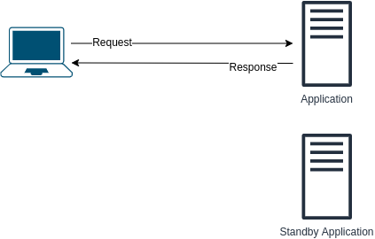
</summary><br><b>
1. 这种转变可能需要时间。换句话说，明显的停机时间。
2. 备用服务器浪费资源 - 如果第一个应用程序服务器正在运行，则备用服务器不执行任何操作
</b></details>

<details>
<summary>下面的设计有什么问题？如何改进呢？<br>
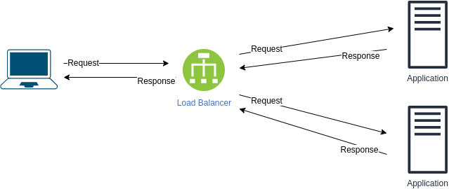
</summary><br><b>
问题：
如果负载均衡器挂掉，我们就失去了与应用程序通信的能力。

改善方法：
* 添加另一个负载均衡器
* 使用 DNS 两个负载均衡器的记录
* 使用消息队列
</b></details>

<details>
<summary>什么是“无共享”架构？</summary><br><b>

在这种架构中，数据通常只连接到一个节点，并且从单个非共享源检索数据，而不是请求可以到达多个节点之一并且从一个共享位置（存储、内存等）检索数据的架构。
</b></details>

<details>
<summary>解释 Sidecar 模式（或 Sidecar 代理）</summary><br><b>
</b></details>

<a name="misc"></a>
## 杂项

|名称|主题|目的与说明|解决方案|评论|
|--------|--------|------|----|----|
| 高可用性“Hello World” | [练习](topics/devops/ha_hello_world.md) | [解决方案](topics/devops/solutions/ha_hello_world.md)

<details>
<summary>当您输入 a 时会发生什么 URL 在浏览器的地址栏中？</summary><br><b>

1. 浏览器搜索域名的记录 IP 地址在 DNS 按以下顺序：
  * 浏览器缓存
  * 操作系统缓存
  * 的 DNS 在用户系统上配置的服务器（可以是 ISP DNS, 公共 DNS, ...)
2. 如果找不到 DNS 本地录制，完整 DNS 决议开始。
3. 它使用以下方式连接到服务器 TCP 协议
4. 浏览器发送一个 HTTP 向服务器请求
5. 服务器发送一个 HTTP 返回浏览器的响应
6. 浏览器呈现响应（例如 HTML)
7. 然后浏览器根据需要向服务器发送后续请求，以获取嵌入的链接、javascript、图像 HTML 然后重复步骤3至5。

TODO: add more details!
</b></details>

<a name="api"></a>
#### API

<details>
<summary>解释一下什么是 API</summary><br><b>

我喜欢这个定义 [博客.christianposta.com](https://blog.christianposta.com/microservices/api-gateways-are-going-through-an-identity-crisis):

“一个明确且有目的地定义的接口，旨在通过网络调用，使软件开发人员能够以受控且舒适的方式以编程方式访问组织内的数据和功能。”
</b></details>

<details>
<summary>什么是 API 规格？</summary><br><b>

来自 [swagger.io](https://swagger.io/resources/articles/difference-between-api-documentation-specification):

“API 规范描述 API 的行为方式，以及它如何与其他 API 建立关联。它解释 API 的功能，以及使用该 API 时可以预期的结果。”
</b></details>

<details>
<summary>判断题： API 定义与 API 规格</summary><br><b>

错误。来自 [swagger.io](https://swagger.io/resources/articles/difference-between-api-documentation-specification):

“API 定义类似于 API 规范，同样描述 API 的组织方式和功能。但 API 定义面向机器消费，而不是面向人类阅读。”
</b></details>

<details>
<summary>什么是 API 网关？</summary><br><b>

API Gateway 就像一个入口守卫，控制不同组件如何相互通信以及如何交换信息。

API Gateway 为所有客户端提供统一入口点，可以执行多项任务，包括将请求路由到合适的后端服务、负载均衡、安全与身份验证、限流、缓存和监控。

通过使用 API 网关，组织可以简化其管理 API确保一致的安全性和治理，并提高后端服务的性能和可扩展性。它们也常用于微服务架构，其中有许多小型、独立的服务需要由不同的客户端访问。
</b></details>

<details>
<summary>使用/实施的优点是什么 API 网关？</summary><br><b>

优点：

  - 简化 API 管理：为所有请求提供单一入口点，简化了多个请求的管理和监控 APIs。
  - 提高安全性：能够实现认证、授权、加密等安全功能，保护后端服务免遭未经授权的访问。
  - 增强可扩展性：可以处理流量峰值并将请求分配给后端服务，从而最大限度地提高资源利用率并提高整体系统性能。
  - 实现服务组合：可以将不同的后端服务组合成一个 API，对客户端可以访问的服务提供更精细的控制。
  - 促进与外部系统的集成：可用于向外部合作伙伴或客户公开内部服务，从而更容易与外部系统集成并启用新的业务模型。

</b></details>

<details>
<summary>什么是有效负载 API?</summary><br><b>
</b></details>

<details>
<summary>什么是自动化？它与 Orchestration 有什么关系或不同？</summary><br><b>

自动化是自动化任务的行为，以减少人为干预或交互 IT 技术和系统。<br>
虽然自动化侧重于任务级别，但编排是自动化流程和/或工作流程的过程，其中包含通常跨多个系统的多个任务。
</b></details>

<details>
<summary>告诉我您发现并修复的有趣错误</summary><br><b>
</b></details>

<details>
<summary>什么是调试器以及它如何工作？</summary><br><b>
</b></details>

<details>
<summary>应用程序可能有哪些服务？</summary><br><b>

  * 授权
  * 记录
  * 认证
  * 订购
  * 前端
  * 后端
  ...
</b></details>

<details>
<summary>什么是元数据？</summary><br><b>

日期就日期。基本上，它描述了基础数据将保存的信息类型。
</b></details>

<details>
<summary>您可以使用以下格式之一： JSON, YAML, XML。您会使用哪一个？为什么？</summary><br><b>

我无法回答你这个问题:)
</b></details>

<details>
<summary>什么是 KPI?</summary><br><b>
</b></details>

<details>
<summary>什么是 OKR?</summary><br><b>
</b></details>

<details>
<summary>什么是 DSL （领域特定语言）？</summary><br><b>

领域特定语言 (DSL) 用于创建代表领域的定制语言，以便领域专家可以轻松解释它。
</b></details>

<details>
<summary>有什么区别 KPI 和 OKR?</summary><br><b>
</b></details>

<a name="yaml"></a>
#### YAML

<details>
<summary>什么是 YAML?</summary><br><b>

当今许多技术使用的数据序列化语言，例如 Kubernetes, Ansible等
</b></details>

<details>
<summary>判断题：任何有效的 JSON 文件也是有效的 YAML 文件</summary><br><b>

正确。因为 YAML 是的超集 JSON.
</b></details>

<details>
<summary>以下数据的格式是什么？

```
{
    applications: [
        {
            name: "my_app",
            language: "python",
            version: 20.17
        }
    ]
}
```
</summary><br><b>
JSON
</b></details>

<details>
<summary>以下数据的格式是什么？

```
applications:
  - app: "my_app"
    language: "python"
    version: 20.17
```
</summary><br><b>
YAML
</b></details>

<details>
<summary>如何编写多行字符串 YAML？它适合什么用例？</summary><br><b>

```
someMultiLineString: |
  look mama
  I can write a multi-line string
  I love YAML
```

它非常适合编写 shell 脚本等用例，其中脚本的每一行都是不同的命令。
</b></details>

<details>
<summary>有什么区别 <code>一些多行字符串： |</code> 到 <code>一些多行字符串：></code>?</summary><br><b>

使用 `>` 将使多行字符串折叠成单行

```
someMultiLineString: >
  This is actually
  a single line
  do not let appearances fool you
```
</b></details>

<details>
<summary>什么是占位符 YAML?</summary><br><b>

它们允许您引用值而不是直接写入它们，其使用方式如下：

```
username: {{ my.user_name }}
```
</b></details>

<details>
<summary>如何定义多个 YAML 组件在一个文件中？</summary><br><b>

使用这个： `---`
例如：

```
document_number: 1
---
document_number: 2
```
</b></details>

<a name="firmware"></a>
#### 固件

<details>
<summary>解释一下什么是固件</summary><br><b>

[维基百科](https://en.wikipedia.org/wiki/Firmware)：“在计算中，固件是一类特定的计算机软件，它为设备的特定硬件提供低级控制。固件，例如 BIOS 个人计算机的，可能包含设备的基本功能，并且可以为操作系统等更高级别的软件提供硬件抽象服务。”
</b></details>

<a name="cassandra"></a>
## Cassandra

<details>
<summary>运行 Cassandra 集群时，需要多久运行一次 nodetool repair 才能保持集群一致？

  * 在 column family 的 gc_grace_seconds 周期内至少运行一次
  * 小于 compaction partition minimum bytes
  * 取决于压缩策略
</summary><br><b>
</b></details>

<a name="http"></a>
## HTTP

<details>
<summary>什么是 HTTP?</summary><br><b>

[阿维网络公司](https://avinetworks.com/glossary/layer-7/): HTTP 代表超文本传输协议。 HTTP 使用 TCP 端口 80 以启用互联网通信。它是应用层的一部分（L7) 在 OSI 模型。 
</b></details>

<details>
<summary>描述 HTTP 请求生命周期</summary><br><b>

* 通过请求解析主机 DNS 解析器
* 客户 SYN
* 服务器 SYN+ACK
* 客户 SYN
* HTTP 要求
* HTTP 反应
</b></details>

<details>
<summary>判断题： HTTP 是有状态的</summary><br><b>

错误。它不维护传入请求的状态。
</b></details>

<details>
<summary>如何 HTTP 请求看起来像？</summary><br><b>

它包括：

 * 请求行 - 请求类型
 * 标头 - 内容信息，如长度、编码等。
 * 身体（并不总是包括在内）
</b></details>

<details>
<summary>什么 HTTP 方法类型有哪些？</summary><br><b>

* GET
* POST
* HEAD
* PUT
* DELETE
* CONNECT
* OPTIONS
* TRACE
</b></details>

<details>
<summary>什么 HTTP 有响应代码吗？</summary><br><b>

* 1xx - 信息性
* 2xx - 成功
* 3xx - 重定向
* 4xx - 错误，客户端故障
* 5xx - 错误，服务器故障
</b></details>

<details>
<summary>什么是 HTTPS?</summary><br><b>


HTTPS 是一个安全版本 HTTP 用于在 Web 浏览器和 Web 服务器之间传输数据的协议。它使用加密通信 SSL/TLS 加密以确保数据的私密性和安全性。

了解更多： https://www.cloudflare.com/learning/ssl/why-is-http-not-secure/
</b></details>

<details>
<summary>解释一下 HTTP Cookie</summary><br><b>

HTTP 是无状态协议。为了在请求之间共享状态，可以使用 Cookie。

TODO: 解释一下什么是 Cookie
</b></details>

<details>
<summary>什么是 HTTP 管道化？</summary><br><b>
</b></details>

<details>
<summary>收到 HTTP 服务器返回的 “504 Gateway Timeout” 错误是什么意思？</summary><br><b>

服务器未及时收到与其通信的另一台服务器的响应。
</b></details>

<details>
<summary>什么是代理？</summary><br><b>

代理服务器位于客户端设备和目标服务器之间，充当中间层。它可以隐藏客户端 IP、过滤内容、缓存常访问的数据，从而提升隐私性、安全性和性能。
  - 代理也可用于负载均衡，将流量分发到多个服务器，避免单台服务器过载并提升网站或应用性能。它还可以记录请求和流量，用于数据分析，帮助了解用户行为和访问模式。
</b></details>

<details>
<summary>什么是反向代理？</summary><br><b>

反向代理也是位于客户端和服务器之间的代理，但它管理的是进入服务端的流量。正向代理代表客户端访问目标服务器；反向代理则代表后端服务器接收客户端请求，并在请求到达后端之前进行转发、过滤或调度。
  - 反向代理常用于提升 Web 服务性能、提供高可用和容错能力，并通过避免后端服务器直接暴露来增强安全性。大型 Web 应用和高流量站点常用反向代理管理请求，并把请求分发到多个后端服务器，以提升可扩展性和可靠性。
</b></details>

<details>
<summary>发布项目时通常会附带许可证。你熟悉哪些许可证？你更倾向使用哪一种？</summary><br><b>
</b></details>

<details>
<summary>解释什么是“X-Forwarded-For”</summary><br><b>

[Wikipedia](https://en.wikipedia.org/wiki/X-Forwarded-For)：`X-Forwarded-For`（XFF）是一个 HTTP header，常用于识别通过 HTTP proxy 或 load balancer 连接到 Web server 的客户端原始 IP 地址。
</b></details>

<a name="load-balancers"></a>
#### 负载均衡器

<details>
<summary>什么是负载均衡器？</summary><br><b>

负载均衡器接收（或拒绝）来自客户端的入站网络流量，并根据应用层或网络层条件，把请求分发到一个或多个后端服务器。
</b></details>

<details>
<summary>为什么要使用负载均衡器？</summary><br><b>

* 可扩展性 - 使用负载均衡器后，可以在后端添加更多服务器来处理更多请求/流量，而不是依赖单台服务器。
* 冗余 - 如果后端某台服务器故障，负载均衡器会继续把流量转发到其他健康服务器，用户通常不会感知到单台后端服务器下线。
</b></details>

<details>
<summary>你熟悉哪些负载均衡技术或算法？</summary><br><b>

  * Round Robin
  * Weighted Round Robin
  * 最少连接
  * 加权最少连接
  * 基于资源
  * 固定权重
  * 加权响应时间
  * Source IP Hash
  * URL Hash
</b></details>

<details>
<summary>负载均衡中循环算法有哪些缺点？</summary><br><b>

  * 简单 Round Robin 不关心每台服务器当前负载和硬件规格。多个重请求可能连续落到同一台服务器，而其他服务器只处理轻请求，导致负载不均，严重时会压垮某台服务器。
  * 客户端的每个请求都可能被转发到不同后端。对需要会话连续性的场景来说，这可能成为问题：第一个请求在服务器 X 上处理，第二个请求却到达服务器 Y，并要求继续处理服务器 X 上的上下文。
</b></details>

<details>
<summary>什么是应用程序负载均衡器？</summary><br><b>
</b></details>

<details>
<summary>你会在哪些场景下使用 ALB?</summary><br><b>
</b></details>

<details>
<summary>负载均衡器可以在哪些层运行？</summary><br><b>

L4 和 L7
</b></details>

<details>
<summary>可以在不使用专用负载均衡器实例的情况下做负载均衡吗？</summary><br><b>

可以。可以使用 DNS 做基础的负载均衡。
</b></details>

<details>
<summary>什么是 DNS 负载均衡？它的优点是什么？你什么时候会使用它？</summary><br><b>
</b></details>

<a name="load-balancers---sticky-sessions"></a>
#### 负载均衡器 - 粘性会话

<details>
<summary>什么是粘性会话？他们的优点和缺点是什么？</summary><br><b>

推荐阅读：
  * [Red Hat 文章](https://access.redhat.com/solutions/900933)

缺点：
  * 可能会导致实例负载不均匀（因为请求路由到同一实例）
优点：
  * 确保创建新请求时进程内会话不会丢失
</b></details>

<details>
<summary>说出使用 sticky session 的一个用例</summary><br><b>

希望确保用户不会丢失当前 session data。
</b></details>

<details>
<summary>Sticky session 用什么机制实现“粘性”？</summary><br><b>

Cookie。有 application-based cookie 和 duration-based cookie。
</b></details>

<details>
<summary>解释基于应用程序的 cookie</summary><br><b>

* 由应用程序和/或负载均衡器生成
* 通常允许包含自定义数据
</b></details>

<details>
<summary>解释基于持续时间的 cookie</summary><br><b>

* 由负载均衡器生成
* 一旦持续时间过去，会话就不再粘滞
</b></details>

<a name="load-balancers---load-balancing-algorithms"></a>
#### 负载均衡器 - 负载均衡算法

<details>
<summary>解释以下每项负载平衡技术

  * Round Robin
  * Weighted Round Robin
  * 最少连接
  * 加权最少连接
  * 基于资源
  * 固定权重
  * 加权响应时间
  * Source IP Hash
  * URL Hash
</summary><br><b>
</b></details>

<details>
<summary>解释一下连接耗尽的用例？</summary><br><b>
要确保 Classic Load Balancer 停止向正在取消注册或运行状况不佳的实例发送请求，同时保持现有连接打开，请使用连接耗尽。这使负载均衡器能够完成对正在取消注册或运行状况不佳的实例发出的正在进行的请求。

最大超时值可设置在 1 到 3,600 秒之间 GCP 和 AWS.

</b></details>

<a name="licenses"></a>
#### 许可证

<details>
<summary>您熟悉“知识共享”吗？你对此了解多少？</summary><br><b>

知识共享许可证是一组版权许可证，允许创作者与公众分享他们的作品，同时保留对其使用方式的一些控制。该许可证是为了回应传统版权法的限制性标准而制定的，传统版权法限制了创意作品的获取。其创作者可以选择其作品可供他人共享、分发和使用的条款。它们是知识共享许可证的六种主要类型，每种类型都有不同级别的限制和权限，这六种许可证是：

  * 归因（CC BY）：允许其他人分发、重新混合和基于作品进行创作，甚至是商业性的，只要他们注明原始创作者。
  * 归属-相同方式共享 (CC BY-SA）：允许其他人对作品进行重新混合和构建，甚至是商业性的，只要他们注明原始创作者并在同一许可下发布任何新作品。
  * 归因-禁止衍生 (CC BY-ND）：允许其他人分发作品，甚至是商业分发，但他们不能以任何方式重新混合或更改它，并且必须注明原始创作者。
  * 署名-非商业性 (CC BY-NC）：允许其他人重新混合并在作品的基础上进行构建，但他们不能将其用于商业用途，并且必须归功于原始创作者。
  * 署名-非商业性-相同方式共享 (CC BY-NC-SA）：允许其他人重新混合并在作品的基础上进行构建，但他们不能将其用于商业用途，必须归功于原始创作者，并且必须在同一许可下发布任何新创作。
  * 署名-非商业性-禁止衍生 (CC BY-NC-ND）：允许其他人下载和分享作品，但不能将其用于商业用途、重新混合或以任何方式更改，并且必须注明原始作者。

简而言之，知识共享许可是创作者与公众分享其作品的一种方式，同时保留对其使用方式的一些控制。这些许可证促进创造力、创新和协作，同时尊重创作者的权利，同时仍然鼓励负责任地使用创意作品。

更多信息： https://creativecommons.org/licenses/
</b></details>

<details>
<summary>解释 Copyleft 和许可许可之间的区别</summary><br><b>

在 Copyleft 中，任何衍生作品都必须使用相同的许可，而在许可许可中则没有这样的条件。 GPL-3 是 Copyleft 许可证的示例，而 BSD 是许可的一个例子。
</b></details>

<a name="random"></a>
#### 随机

<details>
<summary>搜索引擎如何工作？</summary><br><b>
</b></details>

<details>
<summary>自动完成如何工作？</summary><br><b>
</b></details>

<details>
<summary>什么比 RAM?</summary><br><b>

CPU 缓存。
[来源](https://www.enterprisestorageforum.com/hardware/cache-memory/)
</b></details>

<details>
<summary>什么是内存泄漏？</summary><br><b>

内存泄漏是一种编程错误，当程序无法释放不再需要的内存时发生，导致程序随着时间的推移消耗越来越多的内存。

泄漏可能会导致各种问题，包括系统崩溃、性能下降和不稳定。通常发生在旧系统维护失败以及随着时间的推移与新组件兼容之后。
</b></details>

<details>
<summary>您最喜欢的协议是什么？</summary><br><b>

SSH
HTTP
DHCP
DNS
...
</b></details>

<details>
<summary>什么是缓存 API?</summary><br><b>
</b></details>

<details>
<summary>什么是 C10K 问题？今天是否相关？</summary><br><b>

https://idiallo.com/blog/c10k-2016
</b></details>

<a name="storage"></a>
## 存储

<details>
<summary>有哪些类型的存储？</summary><br><b>

  * 文件
  * 块
  * 对象
</b></details>

<details>
<summary>解释对象存储</summary><br><b>

- 数据被划分为独立的对象
- 对象可以包含元数据
</b></details>

<details>
<summary>对象存储的优点和缺点是什么？</summary><br><b>

优点：
  - 通常，使用对象存储时，您需要为使用的内容付费，而其他存储类型则需要为分配的存储空间付费
  - 可扩展存储：对象存储主要基于一个模型，您使用什么，就得到什么，并且可以根据需要添加存储
缺点：
  - 通常比其他类型的存储执行得慢
  - 没有细粒度的修改：要更改对象，您必须重新创建它
</b></details>

<details>
<summary>使用对象存储有哪些用例？</summary><br><b>
</b></details>

<details>
<summary>解释文件存储</summary><br><b>

- 文件存储用于以分层结构将数据存储在文件中
- 一些文件存储设备：硬盘、闪存驱动器、基于云的文件存储
- 文件通常组织在目录中
</b></details>

<details>
<summary>文件存储的优点和缺点是什么？</summary><br><b>

优点：
- 用户可以完全控制自己的文件，并可以对文件进行各种操作：删除、读取、写入和移动。
- 安全机制允许用户更好地控制文件锁定等事情
</b></details>

<details>
<summary>文件存储有哪些示例？</summary><br><b>

本地文件系统
Dropbox
Google Drive
</b></details>

<details>
<summary>有哪些类型的存储设备？</summary><br><b>
</b></details>

<details>
<summary>解释一下 IOPS</summary><br><b>
</b></details>

<details>
<summary>解释存储吞吐量</summary><br><b>
</b></details>

<details>
<summary>什么是文件系统？</summary><br><b>

文件系统是计算机和其他电子设备组织和存储数据文件的一种方式。它提供了一种结构，有助于将数据组织到文件和目录中，从而更轻松地查找和管理信息。文件系统对于提供一种以有组织的方式存储和管理数据的方法至关重要。

常用的归档系统：
  窗户：
  * NTFS
  * 外FAT

  麦克 OS:
  * HFS+
  *APFS

</b></details>

<details>
<summary>解释暗数据</summary><br><b>
</b></details>

<details>
<summary>解释一下 MBR</summary><br><b>
</b></details>

<a name="questions-you-ask"></a>
<a name="questions-you-can-ask"></a>
## 向你提问 CAN 问

作为候选人，您可以在面试期间或面试后向面试官提出的问题列表。
这些只是建议，请谨慎使用。并非每个面试官都能回答这些问题（或乐意回答），这可能是对您在这样的地方工作的危险信号警告，但这实际上取决于您。

<details>
<summary>你喜欢在这里工作什么？</summary><br><b>
</b></details>

<details>
<summary>公司如何促进个人成长？</summary><br><b>
</b></details>

<details>
<summary>您目前正在处理的技术债务水平是多少？</summary><br><b>

提出这个问题时要小心——所有公司，无论规模大小，都存在一定程度的技术债务。
鉴于所有公司都有处理此问题的能力，但你想了解当前的情况，来表述这个问题
他们正在处理的痛点 <br>

这是了解管理者如何处理计划外工作以及他们的擅长程度的好方法
对项目设定期望。
</b></details>

<details>
<summary>为什么我应该 NOT 加入你吗？ （或者“你不喜欢在这里工作什么？”）</summary><br><b>
</b></details>

<details>
<summary>你做过的最喜欢的项目是什么？</summary><br><b>

这可以让您深入了解公司正在开展的一些很酷的项目，如果
你会喜欢从事这样的项目。这也是一个好方法，看看是否
经理们允许员工在公司之外的项目中学习和成长
你会做的正常工作。
</b></details>

<details>
<summary>如果你可以改变你日常生活中的一件事，它会是什么？</summary><br><b>

与技术债务问题类似，这可以帮助您识别公司的任何痛点。
此外，这也是展示你如何成为团队资产的好方法。<br>

例如，如果他们提到他们有问题 X，而你过去已经解决了这个问题，
您可以展示如何能够缓解该问题。
</b></details>

<details>
<summary>假设我们同意，您雇用我担任这个职位，X 个月后，您期望我取得什么成就？</summary><br><b>

这不仅会告诉您对您的期望，还会为您在工作的头几个月中要做的工作类型提供重要提示。
</b></details>

<a name="testing"></a>
## 测试

<details>
<summary>解释白盒测试</summary><br><b>
</b></details>

<details>
<summary>解释黑盒测试</summary><br><b>
</b></details>

<details>
<summary>什么是单元测试？</summary><br><b>

单元测试是一种软件测试技术，涉及系统地分解系统并测试组件的每个单独部分。这些测试是自动化的，可以重复运行，以便开发人员在开发时快速捕获边缘情况或错误。

单元测试的主要目标是验证每个函数在给定一组输入的情况下产生正确的输出。
</b></details>

<details>
<summary>您将运行什么类型的测试来测试 Web 应用程序？</summary><br><b>
</b></details>

<details>
<summary>解释一下测试工具？</summary><br><b>
</b></details>

<details>
<summary>什么是 A/B 测试？</summary><br><b>
</b></details>

<details>
<summary>什么是网络模拟以及如何执行它？</summary><br><b>
</b></details>

<details>
<summary>您熟悉哪些类型的性能测试？</summary><br><b>
</b></details>

<details>
<summary>解释以下类型的测试：

  * 负载测试
  * 压力测试
  * 容量测试
  * 容量测试
  * 耐力测试
</summary><br><b>
</b></details>

<a name="regex"></a>
## Regex

给定一个文本文件，执行以下练习

<a name="extract"></a>
#### 提取物

<details>
<summary>提取所有数字</summary><br><b>

  - “\d+”
</b></details>

<details>
<summary>提取每行的第一个单词</summary><br><b>

  - “^\w+”
奖励：提取每行的最后一个单词

  - “\w+(?=\W*$)”（在大多数情况下，取决于行格式）
</b></details>

<details>
<summary>全部提取 IP 地址</summary><br><b>

  - "\b(?:\d{1,3}\ .){3}\d{1,3}\b" IPV4:(此格式查找 1 到 3 位数字序列 3 次)
</b></details>

<details>
<summary>以 yyyy-mm-dd 或 yyyy-dd-mm 格式提取日期</summary><br><b>
</b></details>

<details>
<summary>提取电子邮件地址</summary><br><b>

  - "\b[A-Za-z0-9._%+-]+@[A-Za-z0-9.-]+\ .[A-Za-z]{2,}\b"
</b></details>

<a name="replace"></a>
#### 更换

<details>
<summary>将制表符替换为四个空格</summary><br><b>
</b></details>

<details>
<summary>将“红色”替换为“绿色”</summary><br><b>
</b></details>

<a name="system-design"></a>
## 系统设计

<details>
<summary>解释什么是“单点故障”。 </summary><br><b>
系统或组织中的“单点故障”如果发生故障，将导致整个系统故障或严重扰乱其运行。换句话说，这是一个漏洞
没有适当的备份来弥补故障。
</b></details>

<details>
<summary>什么是 CD尼？</summary><br><b>

CDN（内容分发网络）负责按地理位置分发内容。其中一部分是所谓的边缘位置，也称为缓存代理，它允许用户由于缓存功能和地理分布而快速获取其内容。
</b></details>

<details>
<summary>解释多CD氮</summary><br><b>

在单人 CDN、全部内容来源于内容分发网络。<br>
在多CDN、内容分布在多个不同的 CD我们每个人都可能位于完全不同的提供商/云上。
</b></details>

<details>
<summary>多方位有什么好处CDN 过单 CD尼？</summary><br><b>

* 弹性：依靠一个 CDN表示无冗余。与多个 CD我们不需要担心你的 CDN 正在下降
* 成本灵活性：使用一个 CDN 强制你达到特定的比率 CDN. 多个 CD我们可以考虑使用更便宜的 CD我们来传递内容。
* 性能：具有多CDN 选择更靠近询问内容的客户的更好位置有更大的潜力
* 规模： 多个 CDNS，您可以扩展服务以支持更极端的条件
</b></details>

<details>
<summary>解释“三层架构”（包括优点和缺点）</summary><br><b>
“3 层架构”是软件开发中用于设计和构建应用程序的模式。它将应用程序分为 3 个互连的层：表示层、业务逻辑层和数据存储层。  
PROS: 
* 可扩展性
* 安全性
* 可重复使用性
CONS:
* 复杂性
* 性能开销
* 成本和开发时间
</b></details>

<details>
<summary>解释 Mono-repo 与 Multi-repo。每种方法的优缺点是什么？</summary><br><b>
在 Mono-repo 中，组织的所有代码都存储在单个集中式存储库中。
PROS （单一仓库）：
* 统一工具
* 代码共享
CONS （单一仓库）：
* 复杂性增加
* 克隆速度较慢

在多存储库设置中，每个组件都存储在其自己的单独存储库中。每个存储库都有自己的版本控制历史记录。
PROS （多仓库）：
* 管理简单
* 不同的团队和开发人员可以独立处理项目的不同部分，从而使并行开发变得更加容易。
CONS （多仓库）：
* 代码重复
* 整合挑战
</b></details>

<details>
<summary>单体架构有哪些缺点？</summary><br><b>

* 不适合频繁更改代码和部署新功能的能力
* 不是为当今的基础设施（如公共云）而设计的
* 扩展团队以使用整体架构更具挑战性
* 如果该架构中的单个组件发生故障，则整个应用程序都会发生故障。
</b></details>

<details>
<summary>微服务架构相对于单体架构有哪些优势？</summary><br><b>

* 每个服务单独失败，但不会升级为应用程序范围的中断。
* 每个服务都可以由单独的团队开发和维护，并且该团队可以选择自己的工具和编码语言
</b></details>

<details>
<summary>什么是服务网格？</summary><br><b>
它是一个促进容器化应用程序中微服务之间的通信管理和控制的层。它处理负载平衡、加密和监控等任务。
</b></details>

<details>
<summary>解释一下“松耦合”</summary><br><b>
在“松耦合”中，系统的组件在稍微了解彼此内部工作原理的情况下相互通信。这提高了复杂系统的可扩展性和修改的便利性。
</b></details>

<details>
<summary>什么是消息队列？什么时候使用？</summary><br><b>
它是分布式系统中使用的一种通信机制，用于实现不同组件之间的异步通信。它通常在系统使用微服务方法时使用。
</b></details>

<a name="scalability"></a>
#### 可扩展性

<details>
<summary>解释可扩展性</summary><br><b>

该功能可以根据需求和使用情况轻松增加大小和容量。
</b></details>

<details>
<summary>解释弹性</summary><br><b>

能够根据需要增长但也能减少
</b></details>

<details>
<summary>解释灾难恢复</summary><br><b>


灾难恢复是在发生破坏性事件后恢复关键业务系统和数据的过程。目标是尽量减少影响并迅速恢复正常业务活动。这包括创建计划、测试计划、备份关键数据并将其存储在安全位置。如果发生灾难，则会执行计划，恢复备份，并有望使系统恢复在线状态。恢复过程可能需要数小时或数天，具体取决于基础设施的损坏程度。这使得业务规划变得非常重要，因为精心设计和测试的灾难恢复计划可以最大限度地减少灾难的影响并保持运营正常进行。
</b></details>

<details>
<summary>解释容错和高可用性</summary><br><b>

容错——自我修复并恢复正常能力的能力。还有承受故障并保持功能的能力。

高可用性 - 能够访问资源（在某些用例中，使用不同的平台）
</b></details>

<details>
<summary>高可用性和灾难恢复有什么区别？</summary><br><b>

[wintellect.com](https://www.wintellect.com/high-availability-vs-disaster-recovery)：“简单地说，高可用性就是消除单点故障，而灾难恢复是当系统无法运行时使系统恢复到运行状态的过程。本质上，灾难恢复是在高可用性出现故障时恢复的，因此 HA 首先。”
</b></details>

<details>
<summary>解释垂直缩放</summary><br><b>

垂直扩展是添加资源以增强现有服务器能力的过程。例如，添加更多CPU、添加更多 RAM等
</b></details>

<details>
<summary>垂直缩放有什么缺点？</summary><br><b>

仅在垂直扩展的情况下，组件仍然存在单点故障。
此外，它还有硬件限制，如果您没有更多资源，您可能无法垂直扩展。
</b></details>

<details>
<summary>哪种类型的云服务通常支持垂直扩展？</summary><br><b>

数据库、缓存。这对于非分布式系统来说很常见。
</b></details>

<details>
<summary>解释水平缩放</summary><br><b>

水平扩展是添加更多资源的过程，这些资源将能够作为一个单元处理请求
</b></details>

<details>
<summary>水平缩放的缺点是什么？为了执行水平缩放通常需要什么？</summary><br><b>

负载均衡器。您可以添加更多资源，但如果您希望它们成为流程的一部分，则必须向它们提供请求/响应。
此外，数据不一致也是水平扩展的一个问题。
</b></details>

<details>
<summary>解释在哪些用例中将使用垂直缩放以及在哪些用例中将使用水平缩放</summary><br><b>
</b></details>

<details>
<summary>解释弹性以及有哪些方法可以使系统更具弹性</summary><br><b>
</b></details>

<details>
<summary>解释“一致性哈希”</summary><br><b>
</b></details>

<details>
<summary>如何在不导致应用程序 (foo.com) 停机的情况下更新下图中的每项服务？<br>
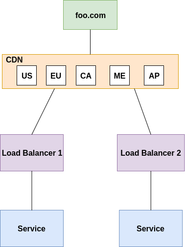
</summary><br><b>
</b></details>

<details>
<summary>以下架构有什么问题以及您将如何解决它？<br>
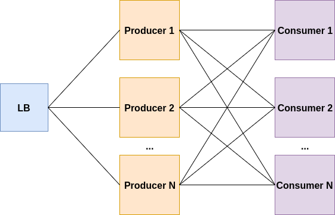
</summary><br><b>

生产者或消费者的负载可能很高，这将导致他们挂起或崩溃。<br>
消费者不是在“推送模式”下工作，而是只有在准备好处理任务时才能拉取任务。它可以通过使用流媒体平台来修复，例如 Kafka、Kinesis 等。该平台将确保处理高负载/流量，并仅在准备好接收任务/消息时才将任务/消息传递给消费者。

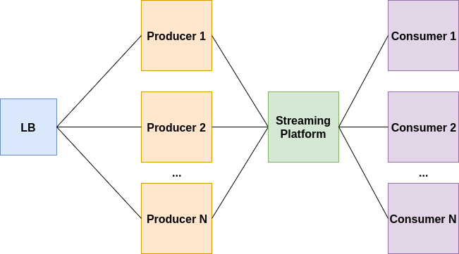
</b></details>

<details>
<summary>用户报告说，当添加一点点数据作为输入进行处理时，处理时间会大幅增加。可能是什么问题？<br>

</summary><br><b>
</b></details>

<details>
<summary>您如何将上一个问题的架构扩展到数百个用户？</summary><br><b>
</b></details>

<a name="cache"></a>
#### 缓存

<details>
<summary>什么是“缓存”？在什么情况下你会使用它？</summary><br><b>
</b></details>

<details>
<summary>什么是“分布式缓存”？</summary><br><b>
</b></details>

<details>
<summary>什么是“缓存替换策略”？</summary><br><b>

看看 [这里](https://en.wikipedia.org/wiki/Cache_replacement_policies)
</b></details>

<details>
<summary>您熟悉哪些缓存替换策略？</summary><br><b>

你可以找到一个列表 [这里](https://en.wikipedia.org/wiki/Cache_replacement_policies)
</b></details>

<details>
<summary>解释一下以下缓存策略：

  * FIFO
  * LIFO
  * LRU</summary><br><b>

阅读相关内容 [这里](https://en.wikipedia.org/wiki/Cache_replacement_policies)
</b></details>

<details>
<summary>为什么不将所有内容写入缓存而不是数据库/数据存储？</summary><br><b>
缓存和数据库有不同的用途，并针对不同的用例进行了优化。

缓存用于通过将频繁访问的数据存储在内存或快速存储介质上来加速读取操作。通过使数据靠近应用程序，缓存可以减少从较慢、较远的存储系统（例如数据库或磁盘）访问数据的延迟和开销。

另一方面，数据库针对存储和管理持久数据进行了优化。数据库旨在处理并发读写操作，强制一致性和完整性约束，并提供索引和查询等功能。
</b></details>

<a name="migrations"></a>
#### 迁移

<details>
<summary>您如何准备迁移？ （或计划迁移）</summary><br><b>

您可以提及：

后滚和前滚
切换
彩排
DNS 重定向
</b></details>

<details>
<summary>解释“抽象分支”技术</summary><br><b>
</b></details>

<a name="design-a-system"></a>
#### 设计一个系统

<details>
<summary>你能设计一个视频流网站吗？</summary><br><b>
</b></details>

<details>
<summary>你能设计一个照片上传网站吗？</summary><br><b>
</b></details>

<details>
<summary>你会如何建立一个 URL 缩短器？</summary><br><b>
</b></details>

<a name="more-system-design-questions"></a>
#### 更多系统设计问题

其他练习可以在 [系统设计笔记本存储库](https://github.com/bregman-arie/system-design-notebook).

<p align="center"><a href="https://github.com/bregman-arie/system-design-notebook"></a></p>

<a name="hardware"></a>
## 硬件

<details>
<summary>什么是 CPU?</summary><br><b>

中央处理单元（CPU）执行程序中指令指定的基本算术、逻辑、控制和输入/输出（I/O）操作。这与主存储器和 I/O 电路等外部组件以及图形处理单元 (GPU) 等专用处理器形成鲜明对比。
</b></details>

<details>
<summary>什么是 RAM?</summary><br><b>

RAM （随机存取存储器）是计算设备中的硬件，其中操作系统（OS），保留当前使用的应用程序和数据，以便设备的处理器可以快速访问它们。 RAM 是计算机中的主存储器。与其他类型的存储（例如硬盘驱动器）相比，它的读取和写入速度要快得多（HDD）、固态硬盘（SSD）或光驱。
</b></details>

<details>
<summary>什么是 GPU?</summary><br><b>
一个 GPU或图形处理单元，是一种专门的电子电路，旨在加速图像和视频处理以在计算机屏幕上显示。

</b></details>

<details>
<summary>什么是嵌入式系统？</summary><br><b>

嵌入式系统是一种计算机系统——计算机处理器、计算机存储器和输入/输出外围设备的组合——在较大的机械或电子系统中具有专用功能。它作为完整设备的一部分嵌入，通常包括电气或电子硬件和机械部件。 
</b></details>

<details>
<summary>您能举一个嵌入式系统的例子吗？</summary><br><b>

嵌入式系统的一个常见示例是微波炉的数字控制面板，它由微控制器管理。

当致力于某个目标时，Raspberry Pi 可以充当嵌入式系统。

</b></details>

<details>
<summary>有哪些类型的存储？</summary><br><b>

存储有多种类型，包括硬盘驱动器 (HDD)、固态驱动器 (SSD) 和光盘驱动器 (CD/DVD/蓝光）。其他类型的存储包括 USB 闪存驱动器、存储卡和网络附加存储（NAS).
</b></details>

<details>
<summary>有哪些注意事项 DevOps 团队在为其工作选择硬件时是否应该牢记这一点？</summary><br>

选择正确的 DevOps 硬件对于确保精简至关重要 CI/CD 管道、及时的反馈循环以及一致的服务可用性。这是关于什么的精炼指南 DevOps 团队应该考虑：

1. **了解工作负载**：
    - **CPU**：根据您的任务考虑对多核或高频 CPU 的需求。
    - **RAM**：足够的内存对于大规模编码或密集自动化等活动至关重要。
    - **存储**：评估存储速度和容量。 SSD 可能更适合快速操作。

2. **可扩展性**：
    - **横向增长**：检查是否可以通过添加更多设备来提高容量。
    - **垂直增长**：确定是否升级（例如 RAM, CPU）对于单个机器来说是可行的。

3. **连接注意事项**：
    - **数据传输**：确保代码检索和数据传输等活动的高速网络连接。
    - **速度**：以低延迟网络为目标，这对于分布式任务尤其重要。
    - **备份路由**：考虑使用备份网络路由以避免停机。

4. **一致的正常运行时间**：
    - 规划硬件备份，例如 RAID 配置、备用电源或备用网络连接，以确保连续服务。

5. **系统兼容性**：
    - 确保您的硬件与您的软件、操作系统和目标平台保持一致。

6. **电源效率**：
    - 从长远来看，高效利用能源的硬件可以降低成本，尤其是在大型设备中。

7. **安全措施**：
    - 探索硬件级安全功能，例如 TPM，加强防护。

8. **监督和控制**：
    - 类似的工具 ILOM 有利于远程处理。
    - 确保可以无缝监控硬件的运行状况和性能。

9. **预算**：
    - 制定预算时要考虑初始费用和长期成本。

10. **支持和社区**：
    - 选择来自以可靠支持而闻名的信誉良好的供应商的硬件。
    - 检查有关硬件的可用驱动程序、更新和社区讨论。

11. **提前计划**：
    - 选择能够满足当前和未来需求的硬件。

12. **运行环境**：
    - **温度控制**：确保冷却系统能够管理高性能设备的热量。
    - **空间管理**：考虑可用机架空间评估硬件尺寸。
    - **可靠的电源**：考虑到一致的备用电源。

13. **云协调**：
    - 如果您倾向于混合云设置，请重点关注本地硬件如何与云资源相结合。

14. **硬件的使用寿命**：
    - 请注意硬件的预期使用寿命以及何时可能需要更换或升级。

15. **针对虚拟化进行了优化**：
    - 如果使用虚拟机或容器，请确保硬件兼容并针对此类工作负载进行了优化。

16. **适应性**：
    - 模块化硬件允许更换单独的组件，从而提供更大的灵活性。

17. **避免单一供应商依赖**：
    - 除非有明显的优势，否则应尽量避免依赖单一供应商。

18. **环保选择**：
    - 优先考虑以可持续方式生产的节能且对环境负责的硬件。

本质上， DevOps 团队应该选择与他们的任务兼容、多功能、具有良好性能并且不超出预算的硬件。此外，必须优先考虑维护、潜在升级以及与即将发生的技术转变的兼容性等长期考虑。

</details>

<details>
<summary>硬件在灾难恢复规划和实施中的作用是什么？</summary><br>

硬件在灾难恢复中至关重要（DR）解决方案。虽然范围更广 DR 包括标准流程、规范和人员角色等内容，它是保持业务流程顺利运行的硬件。以下是硬件如何工作的概述 DR:

1. **存储数据并确保其重复**：
    - **备份设备**：磁带存储、备份服务器和外部 HDD 等设备将重要数据安全地存储在不同位置。
    - **磁盘阵列**：诸如此类的系统 RAID 提供安全网。如果其中一个磁盘崩溃，其他磁盘会进行补偿。

2. **替代恢复系统**：
    - **备份服务器**：当主服务器发生故障时，这些服务器会介入，维持服务流。
    - **流量分配器**：负载均衡器等设备在服务器之间共享流量。如果服务器崩溃，他们会将用户重新路由到可运行的服务器。

3. **备用运营中心**：
    - **现成可用的中心**：已装备好并准备好在主中心发生故障时立即接管的位置。
    - **基础设施**：拥有必要设备但缺乏最新数据，启动时间较长的地点。
    - **半准备设施**：使用选定的系统和数据进行一些准备的位置，需要适度的时间来激活。

4. **备用电源机制**：
    - **即时电源备份**：诸如 UPS 在短暂断电期间提供电力，确保不会突然停机。
    - **长期电力解决方案**：发电机在长时间断电期间保持重要系统运行。

5. **网络设备**：
    - **备份互联网连接**：即使某一提供商面临问题，拥有替代方案也能确保连接。
    - **安全连接工具**：确保安全远程访问的设备，尤其是在 DR 情况。

6. **现场物理设置**：
    - **有序的住房**：像机架这样的结构，可以整齐地存储和管理硬件。
    - **紧急温度控制**：备用冷却机制，以应对服务器过热 HVAC 故障。

7. **替代沟通渠道**：
    - **基于轨道的电话**：当常规通信方式出现问题时非常方便。
    - **直接通信设备**：当主系统出现故障时，无线电等设备很有用。

8. **保护机制**：
    - **电子屏障和警报系统**：防火墙和入侵检测等设备维护 DR 系统受到保护。
    - **物理进入控制**：控制进入和监控的系统，确保只有经过许可的人员才能进入。

9. **硬件的一致性和兼容性**：
    - 如果硬件配置一致且兼容，则在紧急情况下管理和更换设备会更简单。

10. **试用和维护设备**：
    - DR 演习可能会使用特定设备来确保主要系统不受影响。这验证了设备的准备情况和处理实际危机的能力。

总之，虽然软件和人工干预在灾难恢复操作中很重要，但提供底层支持的是硬件。对于高效的灾难恢复计划来说，保持硬件的弹性、重复性和定期评估至关重要。

</details>

<details>
<summary>什么是 RAID?</summary><br>
<b>
RAID 是“独立磁盘冗余阵列”的缩写。它是一种将多个硬盘驱动器组合成单个设备（称为阵列）的技术，以提高性能、扩展存储容量和/或提供冗余以防止数据丢失。 RAID 级别（例如， RAID 0, RAID 1、和 RAID 5) 在性能、冗余和存储效率方面提供各种优势。

</b></details>

<details>
<summary>什么是微控制器？</summary><br>
<b>
微控制器是一种小型集成电路，用于控制嵌入式系统中的某些任务。它通常包括一个 CPU、存储器和输入/输出外围设备。

</b></details>

<details>
<summary>什么是网络接口控制器或 NIC?</summary><br><b>
网络接口控制器（NIC）是将计算机连接到网络并允许其与其他设备通信的硬件。

</b></details>

<details>
<summary>什么是 DMA?</summary><br><b>

直接内存访问（DMA）是计算机系统的一项功能，允许某些硬件子系统独立于中央处理单元（CPU).DMA 使设备能够共享和接收计算机主存储器中的数据。它这样做的同时仍然允许 CPU 执行其他任务。
</b></details>

<details>
<summary>什么是实时操作系统？</summary><br><b>

实时操作系统（RTOS）是一类用于实时计算场景的操作系统，面向具有严格时间约束的数据和事件处理。RTOS 不同于 Unix 这类分时操作系统：它更关注任务调度、缓冲区、固定优先级等资源管理在确定时间内完成。实时系统需要明确理解并约束处理时间，而不仅仅是让平均处理时间尽量短。RTOS 通常是事件驱动且支持抢占的，系统会根据任务优先级在任务之间切换；分时系统则通常根据时钟中断进行切换。
</b></details>

<details>
<summary>中断类型列表</summary><br><b>

有六类可能的中断：
* 外部
* 机器检查
* I/O
* 节目
* 重新启动
* 主管呼叫 (SVC)
</b></details>

<a name="big-data"></a>
## 大数据

<details>
<summary>解释一下什么是大数据</summary><br><b>

正如 Doug Laney 所定义的：

* 数据量：非常大的数据量
* 速度：实时、批量、数据流
* 多样性：各种形式的数据，结构化、半结构化和非结构化
* 准确性或变异性：不一致、有时不准确、变化的数据
</b></details>

<details>
<summary>什么是数据运营？它有什么关系 DevOps?</summary><br><b>

 DataOps 旨在缩短数据分析的端到端周期时间，从创意的起源到创造价值的图表、图形和模型的实际创建。 
 DataOps 结合了敏捷开发、 DevOps 和统计过程控制并将其应用于数据分析。
</b></details>

<details>
<summary>什么是数据架构？</summary><br><b>

来自的回答 [talend.com](https://www.talend.com/resources/what-is-data-architecture):

“数据架构是标准化组织如何收集、存储、转换、分发和使用数据的过程。目标是在需要时向需要的人提供相关数据，并帮助他们理解数据。”
</b></details>

<details>
<summary>解释不同的数据格式</summary><br><b>

* 结构化 - 已定义格式和长度的数据（例如数字、单词）
* 半结构化 - 不符合特定格式，但具有自我描述性（例如 XML, SWIFT)
* 非结构化 - 不遵循特定格式（例如图像、测试消息）
</b></details>

<details>
<summary>什么是数据仓库？</summary><br><b>

[维基百科对数据仓库的解释](https://en.wikipedia.org/wiki/Data_warehouse)
[Amazon 对 Data Warehouse 的解释](https://aws.amazon.com/data-warehouse)
</b></details>

<details>
<summary>什么是数据湖？</summary><br><b>

[数据湖 - 维基百科](https://en.wikipedia.org/wiki/Data_lake)
</b></details>

<details>
<summary>您能解释一下数据湖和数据仓库之间的区别吗？</summary><br><b>
</b></details>

<details>
<summary>什么是“数据版本控制”？ “数据版本控制”有哪些模型？</summary><br><b>
</b></details>

<details>
<summary>什么是 ETL?</summary><br><b>
</b></details>

<a name="apache-hadoop"></a>
#### Apache Hadoop

<details>
<summary>解释一下什么是 Hadoop</summary><br><b>

[Apache Hadoop - 维基百科](https://en.wikipedia.org/wiki/Apache_Hadoop)
</b></details>

<details>
<summary>解释 Hadoop YARN</summary><br><b>

负责管理集群中的计算资源并调度用户的应用程序
</b></details>

<details>
<summary>解释 Hadoop MapReduce</summary><br><b>

大规模数据处理的编程模型
</b></details>

<details>
<summary>解释 Hadoop 分布式文件系统 (HDFS)</summary><br><b>

* 分布式文件系统在整个集群中提供高聚合带宽。
* 对于用户来说，它看起来像一个常规的文件系统结构，但在幕后它分布在集群中的多台机器上
* 典型的文件大小是 TB 它可以扩展并支持数百万个文件
* 它具有容错能力，这意味着它可以从故障中自动恢复
* 它最适合运行长批量操作而不是实时分析
</b></details>

<details>
<summary>你知道什么 HDFS 架构？</summary><br><b>

[HDFS 架构](http://hadoop.apache.org/docs/current/hadoop-project-dist/hadoop-hdfs/HdfsDesign.html)

* 主从架构
* 名称节点 - 主节点，数据节点 - 从节点
* 文件分成块
* 存储在数据节点上的块
* Namenode控制所有元数据
</b></details>

<a name="ceph"></a>
## Ceph

<details>
<summary>解释一下什么是Ceph</summary><br><b>
Ceph 是一个开源分布式存储系统，旨在提供卓越的性能、可靠性和可扩展性。它通常用于云计算环境和数据中心。
</b></details>

<details>
<summary>判断题： Ceph 更看重一致性和正确性而不是性能</summary><br><b>
正确。
</b></details>

<details>
<summary>Ceph 支持哪些服务或存储类型？</summary><br><b>

* 对象（RGW)
* 块（RBD)
* 文件（CephFS）
</b></details>

<details>
<summary>什么是 RADOS?</summary><br><b>

* 可靠的自主分布式对象存储
* 提供底层数据对象存储服务
* 一致性强
* 简化更高层（块、文件、对象）的设计和实现
</b></details>

<details>
<summary>描述 RADOS 软件组件</summary><br><b>

* 监视器
  * 身份验证、数据放置、策略的中央机构
  * 所有其他集群组件的协调点
  * 使用 Paxos 保护关键集群状态
* 经理
  * 聚合实时指标（吞吐量、磁盘使用情况等）
  * 可插拔管理功能的主机
  * 每个集群 1 个活动节点、1 个以上备用节点
* OSD （对象存储守护进程）
  * 将数据存储在 HDD 或 SSD
  * 客户服务 IO 要求
</b></details>

<details>
<summary>从 Ceph 检索数据的工作流程是怎样的？</summary><br><b>
工作流程如下：

1. 客户端向ceph集群发送请求检索数据：
> **客户端可以是以下任何一个**
>> * Ceph 块设备
>> * Ceph对象网关
>> * 任何第三方 ceph 客户端


2. 客户端从Ceph Monitor检索最新的集群图
3. 客户端使用 CRUSH 将对象映射到置放群组的算法。然后将归置组分配给 OSD.
4. 一旦安置组和 OSD 守护进程确定后，客户端就可以从相应的地方检索数据 OSD


</b></details>

<details>
<summary>向Ceph写入数据的流程是怎样的？</summary><br><b>
工作流程如下：

1. 客户端向ceph集群发送请求获取数据
2. 客户端从Ceph Monitor检索最新的集群图
3. 客户端使用 CRUSH 将对象映射到置放群组的算法。然后将归置组分配给 Ceph OSD 动态守护进程。
4. 客户端将数据发送给primary OSD 确定的归置组。如果数据存储在纠删码池中，则主 OSD 负责将对象编码成数据块和编码块，并将它们分发给其他OSD。 

</b></details>

<details>
<summary>什么是“安置组”？</summary><br><b>
</b></details>

<details>
<summary>详细描述以下内容：对象 -> 池 -> 归置组 -> OSD</summary><br><b>
</b></details>

<details>
<summary>什么是 OMAP?</summary><br><b>
</b></details>

<details>
<summary>什么是元数据服务器？它是如何运作的？</summary><br><b>
</b></details>

<a name="packer"></a>
## Packer

<details>
<summary>Packer 是什么？它有什么用？</summary><br><b>

一般来说，Packer 会自动创建机器映像。
它允许您在制作映像时专注于部署之前的配置。在大多数情况下，这使您可以更快地启动实例。
</b></details>

<details>
<summary>Packer 遵循“配置->部署”模型还是“部署->配置”模型？</summary><br><b>

配置->部署具有一些优点，例如：

1. Deployment 速度 - 您在部署之前配置一次，而不是每次部署时都配置。这使您可以更快地启动实例/服务。
2. 更不可变的基础设施 - 通过配置->部署，不太可能有非常不同的部署，因为大多数配置是在部署之前完成的。在此模型中部署之前会处理/发现依赖项错误等问题。
</b></details>

<a name="release"></a>
## 发布

<details>
<summary>解释语义版本控制</summary><br><b>

[这个](https://semver.org/) 页面完美地解释了这一点：

```
Given a version number MAJOR.MINOR.PATCH, increment the:

MAJOR version when you make incompatible API changes
MINOR version when you add functionality in a backwards compatible manner
PATCH version when you make backwards compatible bug fixes
Additional labels for pre-release and build metadata are available as extensions to the MAJOR.MINOR.PATCH format.
```
</b></details>

<a name="certificates"></a>
## 证书

如果你正在准备某项认证考试，可以从本节开始。这里列出了一组认证，每个条目都会链接到对应文件，其中包含有助于备考的重点问题。祝你好运 :)

<a name="aws"></a>
#### AWS

* [云实践者](certificates/aws-cloud-practitioner.md) （最新更新：2020）
* [解决方案架构师助理](certificates/aws-solutions-architect-associate.md) （最新更新：2021）
* [云系统运营管理助理](certificates/aws-cloud-sysops-associate.md) （最新更新：2022 年 10 月）


<a name="azure"></a>
#### Azure

* [AZ-900](certificates/azure-fundamentals-az-900.md) （最新更新：2021）

<a name="kubernetes"></a>
#### Kubernetes

* [已认证 Kubernetes 管理员（CKA)](topics/kubernetes/CKA.md) （最新更新：2022）

<a name="additional-devops-and-sre-projects"></a>
## 附加 DevOps 和 SRE 项目

<p align="center"><a href="https://github.com/bregman-arie/sre-checklist">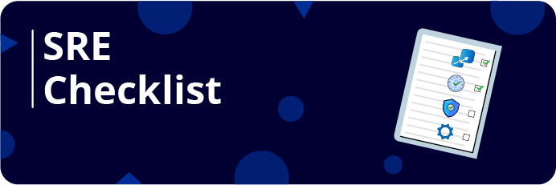</a></p>

<p align="center"><a href="https://github.com/bregman-arie/howtheydevops"></a></p>
<p align="center"><a href="https://github.com/bregman-arie/devops-resources"></a></p>
<p align="center"><a href="https://github.com/bregman-arie/infraverse"></a></p>

<a name="credits"></a>
## 制作人员

感谢我们所有令人惊叹的 [贡献者](https://github.com/bregman-arie/devops-exercises/graphs/contributors) 他们让每个人都能轻松学习新事物:)

可以找到徽标学分 [这里](credits.md)

<a name="license"></a>
## 许可证

[！[许可证： CC BY-NC-ND 3.0](https://img.shields.io/badge/License-CC%20BY--NC--ND%203.0-lightgrey.svg)](https://creativecommons.org/licenses/by-nc-nd/3.0/)
