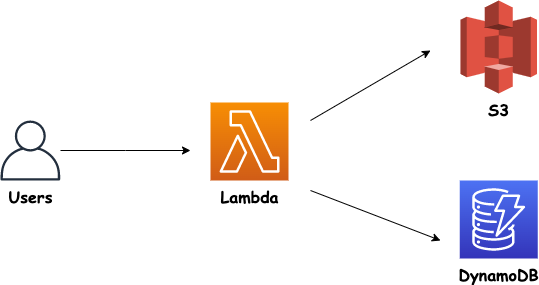
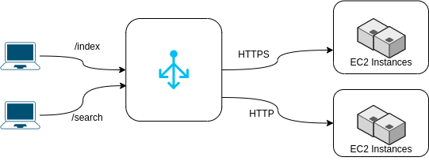

<a name="aws"></a>
# AWS

**注意**：一些练习 <b>成本$$$</b> 并且无法使用免费套餐或资源执行

**第二个注释**：提供的解决方案正在使用 AWS 控制台。建议您使用 IaC 技术来解决练习（例如， Terraform，普鲁米）。<br>

- [AWS](#aws)
  - [练习](#exercises)
    - [IAM](#iam)
    - [EC2](#ec2)
    - [S3](#s3)
    - [ELB](#elb)
    - [Auto Scaling组] (#auto-scaling-groups)
    - [VPC](#vpc)
    - [数据库](#databases)
    - [DNS](#dns)
    - [容器](#containers)
    - [Lambda](#lambda)
    - [Elastic Beanstalk](#elastic-beanstalk)
    - [CodePipeline](#codepipeline)
    - [CDK](#cdk)
    - [杂项](#misc)
  - [问题](#questions)
    - [全球基础设施](#global-infrastructure)
    - [IAM](#iam-1)
    - [EC2](#ec2-1)
    - [AMI](#ami)
    - [EBS](#ebs)
    - [实例存储](#instance-store)
    - [EFS](#efs)
    - [定价模型](#pricing-models)
    - [启动模板](#launch-template)
    - [ENI](#eni)
    - [归置组](#placement-groups)
    - [VPC](#vpc-1)
      - [默认 VPC](#default-vpc)
    - [Lambda](#lambda-1)
    - [容器](#containers-1)
      - [ECS](#ecs)
      - [Fargate](#fargate)
    - [S3](#s3-1)
      - [基础知识](#basics)
      - [桶 101](#buckets-101)
      - [对象](#objects)
      - [S3 安全性](#s3-security)
      - [杂项](#misc-1)
    - [灾难恢复](#disaster-recovery)
    - [CloudFront](#cloudfront)
    - [ELB](#elb-1)
      - [NLB](#nlb)
      - [ALB](#alb)
    - [弹性伸缩组](#auto-scaling-group)
    - [安全性](#security)
    - [数据库](#databases-1)
      - [RDS](#rds)
      - [Aurora](#aurora)
      - [DynamoDB](#dynamodb)
      - [ElastiCache](#elasticache)
      - [Redshift](#redshift)
    - [识别服务](#identify-the-service)
    - [DNS (Route 53)](#dns-route-53)
    - [SQS](#sqs)
    - [SNS](#sns)
    - [监控和记录](#monitoring-and-logging)
    - [计费和支持](#billing-and-support)
    - [AWS 组织机构](#aws-organizations)
    - [自动化](#automation)
    - [杂项](#misc-2)
    - [高可用性](#high-availability)
    - [生产运营和迁移](#production-operations-and-migrations)
    - [应用场景](#scenarios)
    - [架构设计](#architecture-design)
    - [杂项](#misc-3)

<a name="exercises"></a>
## 练习

<a name="iam"></a>
### IAM

|名称|主题|目的与说明|解决方案|评论|
|--------|--------|------|----|----|
| 创建用户 | IAM | [练习](exercises/create_user/exercise.md) | [解决方案](exercises/create_user/solution.md) | |
| 密码策略 | IAM | [练习](exercises/password_policy_and_mfa/exercise.md) | [解决方案](exercises/password_policy_and_mfa/solution.md) | |
| 创建角色 | IAM | [练习](exercises/create_role/exercise.md) | [解决方案](exercises/create_role/solution.md) | |
| 证书报告 | IAM | [练习](exercises/credential_report/exercise.md) | [解决方案](exercises/credential_report/solution.md) | |
| 访问顾问 | IAM | [练习](exercises/access_advisor/exercise.md) | [解决方案](exercises/access_advisor/solution.md) | |

<a name="ec2"></a>
### EC2

|名称|主题|目的与说明|解决方案|评论|
|--------|--------|------|----|----|
| 发射 EC2 网络实例 | EC2 | [练习](exercises/launch_ec2_web_instance/exercise.md) | [解决方案](exercises/launch_ec2_web_instance/solution.md) | |
| 安全组 | EC2 | [练习](exercises/security_groups/exercise.md) | [解决方案](exercises/security_groups/solution.md) | |
| IAM 角色 | EC2, IAM | [练习](exercises/ec2_iam_roles/exercise.md) | [解决方案](exercises/ec2_iam_roles/solution.md) | |
| 现货实例 | EC2 | [练习](exercises/create_spot_instances/exercise.md) | [解决方案](exercises/create_spot_instances/solution.md) | |
| 弹性 IP | EC2, 网络 | [练习](exercises/elastic_ip/exercise.md) | [解决方案](exercises/elastic_ip/solution.md) | |
| 创建归置组 | EC2, 归置组 | [练习](exercises/placement_groups/exercise.md) | [解决方案](exercises/placement_groups/solution.md) | |
| 弹性网络接口 | EC2, ENI | [练习](exercises/elastic_network_interfaces/exercise.md) | [解决方案](exercises/elastic_network_interfaces/solution.md) | |
| 休眠实例 | EC2 | [练习](exercises/hibernate_instance.md) | [解决方案](exercises/hibernate_instance/solution.md) | |
| 卷创建 | EC2, EBS | [练习](exercises/ebs_volume_creation/exercise.md) | [解决方案](exercises/ebs_volume_creation/solution.md) | |
| 快照 | EC2, EBS | [练习](exercises/snapshots/exercise.md) | [解决方案](exercises/snapshots/solution.md) | |
| 创建一个 AMI | EC2, AMI | [练习](exercises/create_ami/exercise.md) | [解决方案](exercises/create_ami/solution.md) | |
| 创建 EFS | EC2, EFS | [练习](exercises/create_efs/exercise.md) | [解决方案](exercises/create_efs/solution.md) | |

<a name="s3"></a>
### S3

|名称|主题|目的与说明|解决方案|评论|
|--------|--------|------|----|----|
| 创建存储桶 | S3 | [练习](exercises/s3/new_bucket/exercise.md) | [解决方案](exercises/s3/new_bucket/solution.md)
| 存储桶生命周期策略 | S3, 生命周期策略 |  | 
<a name="elb"></a>
### ELB

|名称|主题|目的与说明|解决方案|评论|
|--------|--------|------|----|----|
| 应用程序负载均衡器 | ELB, ALB | [练习](exercises/app_load_balancer/exercise.md) | [解决方案](exercises/app_load_balancer/solution.md) | |
| 多个目标群体 | ELB, ALB | [练习](exercises/alb_multiple_target_groups/exercise.md) | [解决方案](exercises/alb_multiple_target_groups/solution.md) | |
| 网络负载均衡器 | ELB, NLB | [练习](exercises/network_load_balancer/exercise.md) | [解决方案](exercises/network_load_balancer/solution.md) | |

<a name="auto-scaling-groups"></a>
### 自动伸缩组

|名称|主题|目的与说明|解决方案|评论|
|--------|--------|------|----|----|
| Auto Scaling 组基础知识 | ASG | [练习](exercises/auto_scaling_groups_basics/exercise.md) | [解决方案](exercises/auto_scaling_groups_basics/solution.md) | |
| 动态扩展策略 | ASG, 策略 | [练习](exercises/asg_dynamic_scaling_policy/exercise.md) | [解决方案](exercises/asg_dynamic_scaling_policy/solution.md) | |

<a name="vpc"></a>
### VPC

|名称|主题|目的与说明|解决方案|评论|
|--------|--------|------|----|----|
| 我的第一次 VPC | VPC | [练习](exercises/new_vpc/exercise.md) | [解决方案](exercises/new_vpc/solution.md) | |
| 子网 | VPC | [练习](exercises/subnets/exercise.md) | [解决方案](exercises/subnets/solution.md) | |

<a name="databases"></a>
### 数据库

|名称|主题|目的与说明|解决方案|评论|
|--------|--------|------|----|----|
| MySQL DB | RDS | [练习](exercises/mysql_db/exercise.md) | [解决方案](exercises/mysql_db/solution.md) | |
| Aurora DB | RDS | [练习](exercises/aurora_db/exercise.md) | [解决方案](exercises/aurora_db/solution.md) | |
| ElastiCache | ElastiCache | [练习](exercises/elasticache/exercise.md) | [解决方案](exercises/elasticache/solution.md) | |

<a name="dns"></a>
### DNS

|名称|主题|目的与说明|解决方案|评论|
|--------|--------|------|----|----|
注册域名 | Route 53 | [练习](exercises/register_domain/exercise.md) | [解决方案](exercises/register_domain/solution.md) | |
创造记录 | Route 53 | [练习](exercises/creating_records/exercise.md) | [解决方案](exercises/creating_records/solution.md) | |
健康检查 | Route 53 | [练习](exercises/health_checks/exercise.md) | [解决方案](exercises/health_checks/solution.md) | |
故障转移 | Route 53 | [练习](exercises/route_53_failover/exercise.md) | [解决方案](exercises/route_53_failover/solution.md) | |

<a name="containers"></a>
### 容器

|名称|主题|目的与说明|解决方案|评论|
|--------|--------|------|----|----|
| ECS 任务 | ECS, Fargate | [练习](exercises/ecs_task/exercise.md) | [解决方案](exercises/ecs_task/solution.md) | |

<a name="lambda"></a>
### Lambda

|名称|主题|目的与说明|解决方案|评论|
|--------|--------|------|----|----|
| 你好函数 | Lambda | [练习](exercises/hello_function/exercise.md) | [解决方案](exercises/hello_function/solution.md) | |
| URL 功能 | Lambda | [练习](exercises/url_function/exercise.md) | [解决方案](exercises/url_function/solution.md) | |
| 网络应用程序 DB | Lambda, DynamoDB | [练习](exercises/web_app_dynamodb/exercise.md) | [解决方案](exercises/web_app_dynamodb/solution.md) | |

<a name="elastic-beanstalk"></a>
### Elastic Beanstalk

|名称|主题|目的与说明|解决方案|评论|
|--------|--------|------|----|----|
| 简单的Elastic Beanstalk Node.js 应用程序 | Elastic Beanstalk | [练习](exercises/elastic_beanstalk_simple/exercise.md) | [解决方案](exercises/elastic_beanstalk_simple/solution.md) | |

<a name="codepipeline"></a>
### CodePipeline

|名称|主题|目的与说明|解决方案|评论|
|--------|--------|------|----|----|
| 基础 CI 与 S3 | CodePipeline & S3 | [练习](exercises/basic_s3_ci/exercise.md) | [解决方案](exercises/basic_s3_ci/solution.md) | |

<a name="cdk"></a>
### CDK

|名称|主题|目的与说明|解决方案|评论|
|--------|--------|------|----|----|
| 样品 CDK | CDK | [练习](exercises/sample_cdk/exercise.md) | [解决方案](exercises/sample_cdk/solution.md) | |
<a name="misc"></a>
### 杂项

|名称|主题|目的与说明|解决方案|评论|
|--------|--------|------|----|----|
| 预算设置 | 预算 | [练习](exercises/budget_setup/exercise.md) | [解决方案](exercises/budget_setup/solution.md) | |
| 没有申请:'( | 故障排除 | [练习](exercises/no_application/exercise.md) | [解决方案](exercises/no_application/solution.md) | |

<a name="questions"></a>
## 问题

<a name="global-infrastructure"></a>
### 全球基础设施

<details>
<summary>解释以下内容

  * 可用区
  * 地区
  * Edge Location</summary><br><b>

AWS 区域是托管在全球不同地理位置的数据中心。<br>

每个区域内都有多个隔离位置，称为可用区。每个可用区都是一个或多个具有冗余网络、连接和电源的数据中心。多个可用区可确保在其中一个可用区发生故障时的高可用性。<br>

边缘位置基本上是内容交付网络，它缓存数据并确保更低的延迟和更快地交付给任何位置的用户。他们分布在世界各大城市。
</b></details>

<details>
<summary>判断题：每个 AWS Region 都被设计为与其他 Region 完全隔离</summary><br><b>

正确。
</b></details>

<details>
<summary>判断题：每个区域最少有 1 个可用区，最多有 4 个可用区</summary><br><b>

错误。最小值为 2，最大值为 6。
</b></details>

<details>
<summary>选择用于运行新应用程序的 AWS Region 时，需要考虑哪些因素？</summary><br><b>

* 服务可用性：并非所有服务（及其所有功能）在每个 Region 都可用
* 减少延迟：将应用程序部署在靠近客户的区域
* 合规性：一些国家有更严格的规则和要求，例如确保数据保留在该国家或地区的境内。在这种情况下，只能使用特定区域来运行应用程序
* 定价：不同地区的定价可能不一致，因此同一服务在不同地区的价格可能会有所不同。
</b></details>

<a name="iam-1"></a>
### IAM

<details>
<summary>什么是 IAM？它有哪些特点？</summary><br><b>

简而言之，它用于管理用户、组、访问策略和角色
完整的解释可以找到 [这里](https://aws.amazon.com/iam)
</b></details>

<details>
<summary>判断题： IAM 配置是全局定义的，而不是按区域定义的</summary><br><b>

正确。
</b></details>

<details>
<summary>判断题：创建 AWS account 时会默认创建 root account，并且推荐在组织中共享使用该 account</summary><br><b>

错误。您应该创建用户并使用它们，而不是使用 root 帐户。
</b></details>

<details>
<summary>判断题：AWS IAM 中的 group 只能包含 user，不能包含其他 group</summary><br><b>

正确。
</b></details>

<details>
<summary>判断题：AWS IAM 中的 user 只能属于一个 group</summary><br><b>

错误。用户可以属于多个组。
</b></details>

<details>
<summary>关于以下方面的一些最佳实践有哪些 IAM 在 AWS?</summary><br><b>

* 删除 root account access key，并避免日常使用 root account
* 为每个真实用户创建 IAM user，不要共享 user。
* 应用“最小权限原则”：只给予用户所需的权限，仅此而已。
* 设置 MFA，并考虑强制使用它
* 利用组来分配权限（用户 -> 组 -> 权限）
</b></details>

<details>
<summary>新用户有什么权限？</summary><br><b>

只有登录访问权限。
</b></details>

<details>
<summary>判断题：如果用户在 AWS 正在使用密码进行身份验证，他不需要启用 MFA</summary><br><b>

错误（！）。 MFA 是用于身份验证的一个很好的附加安全层。
</b></details>

<details>
<summary>有哪些方式可以访问 AWS?</summary><br><b>

  * AWS 管理控制台
  * AWS CLI
  * AWS SDK
</b></details>

<details>
<summary>什么是角色？</summary><br><b>

[AWS 文档](https://docs.aws.amazon.com/IAM/latest/UserGuide/id_roles.html)：“IAM role 是一种 IAM identity，你可以在账户中创建并赋予特定权限……它是一种 AWS identity，带有权限 policy，用于决定该身份可以在 AWS 中做什么、不能做什么。”
例如，您可以使用允许 EC2 访问 s3 存储桶的服务（读取和写入）。
</b></details>

<details>
<summary>什么是策略？</summary><br><b>

用于授予用户、组或角色能够执行的操作的权限的策略文档。它们的格式是 JSON.
</b></details>

<details>
<summary>用户无法访问 s3 存储桶。可能是什么问题？</summary><br><b>

这可能有几个原因。其中之一是缺乏策略。为了解决这个问题，管理员必须为用户附加一个允许他访问 s3 存储桶的策略。
</b></details>

<details>
<summary>你应该用什么来：

  - 授予两个服务/资源之间的访问权限？
  - 授予用户对资源/服务的访问权限？</summary><br><b>

  * 角色
  * 策略
</b></details>

<details>
<summary>什么说法 AWS IAM 策略由哪些组成？</summary><br><b>

* Sid：语句的标识符（可选）
* 效果：允许或拒绝访问
* 操作：操作列表（拒绝或允许）
* 资源：应用操作的资源列表
* 主要：要应用策略的角色或帐户或用户
* Condition：确定何时应用策略的条件（可选）
</b></details>

<details>
<summary>解释一下以下策略：

```
{
    "Version": "2012-10-17",
    "Statement": [
        {
            "Effect:": "Allow",
            "Action": "*",
            "Resources": "*"
        }
    ]
}
```
</summary><br><b>

该策略允许对任何资源执行任何操作。它恰好是“AdministratorAccess”策略。
</b></details>

<details>
<summary>有哪些安全工具 AWS IAM 提供？</summary><br><b>

* IAM 凭证报告：列出所有帐户用户及其凭证状态
* IAM 访问顾问：显示授予用户的服务权限以及他上次访问这些服务的时间信息
</b></details>

<details>
<summary>您将使用哪种工具通过识别用户不经常（或根本）访问哪些服务来优化用户权限？</summary><br><b>

IAM 访问顾问
</b></details>

<details>
<summary>什么类型的 IAM 您将使用对象来允许服务间通信吗？</summary><br><b>

角色
</b></details>
<a name="ec2-1"></a>
### EC2

<details>
<summary>什么是 EC2?</summary><br><b>

“一种在云中提供安全、可调整大小的计算能力的网络服务”。
了解更多 [这里](https://aws.amazon.com/ec2)
</b></details>

<details>
<summary>判断题： EC2 是区域服务</summary><br><b>

正确。相对于 IAM 例如，这是一项全球服务， EC2 是一项区域服务。
</b></details>

<details>
<summary>有哪些属性/配置选项 EC2 可以设置或修改的实例？</summary><br><b>

* OS (Linux、窗口）
* RAM 和 CPU
* 网络 - IP, 速度等卡属性
* 存储空间 - (EBS, EFS, EC2 实例存储）
* EC2 用户数据
* 安全组
</b></details>

<details>
<summary>你会用什么来定制 EC2 实例？与软件安装一样， OS 配置等</summary><br><b>

AMI。与 AMI （Amazon Machine Image）您可以定制 EC2 通过指定要安装的软件、内容来实例化 OS 应应用更改等。
</b></details>

<a name="ami"></a>
#### AMI

<details>
<summary>什么是 AMI?</summary><br><b>

Amazon Machine Image是“Amazon Machine Image（AMI）提供启动实例所需的信息”。
了解更多 [这里](https://docs.aws.amazon.com/AWSEC2/latest/UserGuide/AMIs.html)
</b></details>

<details>
<summary>有哪些不同的来源 AMI是？</summary><br><b>

* 个人 AMIs- AMI你创造的
* AWS 市场 AMIs- AMI其他人制造的，大部分以一定价格出售
* 公共 AMIs - 提供者 AWS
</b></details>

<details>
<summary>判断题： AMI 专为特定地区打造</summary><br><b>

正确（但 AMI 可以从一个 Region 复制到另一个 Region）。
</b></details>

<details>
<summary>概括地描述创建过程 AMIs</summary><br><b>

1. 开始一个 EC2 实例
2. 定制了 EC2 实例（安装包，更改 OS 配置等）
3. 停止实例（以避免数据完整性问题）
4. 创建 EBS 快照并构建 AMI
5. 为了验证和测试 AMI，从启动一个实例 AMI
</b></details>

<details>
<summary>什么是实例类型？</summary><br><b>

“您指定的实例类型决定了用于您的实例的主机硬件”
了解有关实例类型的更多信息 [这里](https://docs.aws.amazon.com/AWSEC2/latest/UserGuide/instance-types.html)
</b></details>

<details>
<summary>解释实例类型命名约定</summary><br><b>

我们以以下实例类型为例：m5.large

`m` 是实例类
`5` 是一代人
`large` 是实例的大小（影响 vCPU 等规格属性和 RAM)
</b></details>

<details>
<summary>判断题：以下是可供用户使用的实例类型 AWS:

  * 计算优化
  * 网络优化
  * 网页优化</summary><br><b>

错误。从上面的列表中，只有计算优化可用。
</b></details>

<details>
<summary>解释以下每个实例类型：

  * “计算优化”
  * “内存优化”
  * “存储优化”</summary><br><b>

计算优化：

* 用于计算密集型任务
* 它拥有高性能处理器
* 用例各不相同：游戏服务器、机器学习、批处理等。

内存优化：

* 用于处理内存中的大数据集
* 其他用例：高性能、数据库、分布式缓存存储

存储优化：

* 用于存储密集型任务 - 对大型数据集的高读写访问
* 使用案例：数据库， OLTP 系统、分布式文件系统
</b></details>

<details>
<summary>您可以将什么附加到 EC2 实例为了存储数据？</summary><br><b>

EBS
</b></details>

<a name="ebs"></a>
#### EBS

<details>
<summary>解释一下Amazon EBS</summary><br><b>

[AWS 文档](https://docs.aws.amazon.com/AWSEC2/latest/UserGuide/AmazonEBS.html)：“提供块级存储卷以供使用 EC2 实例。 EBS 卷的行为就像原始的、未格式化的块设备。”
</b></details>

<details>
<summary>会发生什么 EBS 实例终止时的卷？</summary><br><b>

默认情况下，根卷被标记为删除，而其他卷仍将保留。<br>
您可以控制终止时每个卷将发生的情况。
</b></details>

<details>
<summary>会发生什么 EC2 磁盘（EBS）实例何时停止？</summary><br><b>

磁盘完好无损，实例启动时即可使用。
</b></details>

<details>
<summary>判断题： EBS 卷被锁定到特定的可用区域</summary><br><b>

正确。
</b></details>

<details>
<summary>解释一下 EBS 快照</summary><br><b>

EBS snapshot 是 EBS 卷在某个时间点的备份。
</b></details>

<details>
<summary>EBS snapshot 有哪些使用场景？</summary><br><b>

* 数据的备份
* 在可用区之间移动数据
</b></details>

<details>
<summary>是否可以将同一个 EBS 卷 attach 到多个 EC2 instance？</summary><br><b>

是的，通过多重附加，可以附加单个 EBS 卷到多个实例。
</b></details>

<details>
<summary>判断题： EBS 是网络驱动器，因此需要网络连接</summary><br><b>

正确。
</b></details>

<details>
<summary>什么 EBS 卷类型有哪些？</summary><br><b>

* HDD (st 1, sc 1)：低成本 HDD 卷
* SSD
  * io1、io2：最高性能 SSD
  * gp2、gp3：通用 SSD
</b></details>

<details>
<summary>如果需要为低延迟 workload 选择 EBS 卷类型，你会使用哪一种？</summary><br><b>

SSD - io1, io2
</b></details>

<details>
<summary>如果 workload 需要良好性能，同时成本也很重要，你会选择哪种 EBS 卷类型？</summary><br><b>

SSD - gp2, gp3
</b></details>

<details>
<summary>如果需要高吞吐量的 EBS 卷，你会使用哪种卷类型？</summary><br><b>

SSD - io1, io2
</b></details>

<details>
<summary>如果需要用于不频繁访问数据的 EBS 卷，你会使用哪种卷类型？</summary><br><b>

HDD - sc1
</b></details>

<details>
<summary>哪些 EBS 卷类型可用作 EC2 instance 的启动卷？</summary><br><b>

SSD：GP2、GP3、io1、io2
</b></details>

<details>
<summary>判断题：对于 EBS gp2 卷类型，磁盘大小增加时 IOPS 也会增加</summary><br><b>

正确。
</b></details>

<a name="instance-store"></a>
#### 实例存储

<details>
<summary>如果您想将硬件磁盘附加到您的 EC2 而不是网络（EBS）。你会用什么？</summary><br><b>

EC2 实例存储。
</b></details>

<details>
<summary>解释一下 EC2 实例存储。为什么有人会选择使用它而不是其他选项？</summary><br><b>

EC2 与相比，实例存储提供更好的 I/O 性能 EBS.<br>
它主要用于缓存和临时数据目的。
</b></details>

<details>
<summary>使用实例存储有什么缺点吗 EBS?</summary><br><b>

是的，实例存储上的数据在停止时会丢失。
</b></details>

<a name="efs"></a>
#### EFS

<details>
<summary>什么是Amazon EFS?</summary><br><b>

[AWS 文档](https://aws.amazon.com/efs)：“Amazon Elastic File System（Amazon EFS）提供了简单、可扩展、完全托管的弹性 NFS 与使用的文件系统 AWS 云服务和本地资源。”

简而言之，它是一种网络文件系统，您可以安装在一个或多个 EC2 实例。
</b></details>

<details>
<summary>判断题： EFS 被锁定到单个可用区域</summary><br><b>

错误。 EFS 可以跨多个可用区安装。
</b></details>

<details>
<summary>使用的一些用例有哪些 EFS?</summary><br><b>

* 数据共享（例如，开发人员在同一源代码控制中工作）
* 网络服务
* 内容管理
</b></details>

<details>
<summary>判断题： EFS 仅兼容 Linux 基于 AMI</summary><br><b>

正确。
</b></details>

<details>
<summary>判断题： EFS 需要用户执行容量规划，因为它不会自动扩展</summary><br><b>

错误。 EFS 自动扩展，您按使用付费。
</b></details>

<details>
<summary>什么 EFS 有哪些模式？</summary><br><b>

* 性能模式
  * 通用用途：主要用于 CMS、网络服务...因为它最适合延迟敏感的应用程序
  * 最大 I/O：非常适合扩展到高水平的吞吐量和每秒 I/O 操作数
* 吞吐量模式
  * 爆发：基于规模吞吐量 FS 尺寸
  * 配置：固定吞吐量
</b></details>

<details>
<summary>哪个 EFS 如果您需要执行媒体处理，您会使用模式吗？</summary><br><b>

性能模式（最大 I/O）：它提供高吞吐量并可扩展到每秒操作数。主要用于大数据、媒体处理等。
</b></details>

<details>
<summary>默认值是什么 EFS 模式？</summary><br><b>

性能模式（通用）：用于网络服务， CMS，...对延迟敏感的任何内容。
</b></details>

<details>
<summary>什么 EFS 存储层有哪些？</summary><br><b>

* 标准：经常访问的文件
* 不频繁访问：存储文件的价格较低，但检索它们的成本也很高
</b></details>

<a name="pricing-models"></a>
#### 定价模型

<details>
<summary>什么 EC2 定价模式有哪些？</summary><br><b>

按需 - 按小时/秒支付固定费率，无需承诺。您可以在任何给定时间配置和终止它。
预留 - 您获得容量预留，基本上是在固定时间段内购买实例。时间越长越便宜。
现货 - 使您能够对实例出价任何您想要的价格或支付现货价格。
专用主机 - 物理 EC2 服务器专供您使用。
</b></details>

<details>
<summary>判断题：预留实例必须使用至少 1 年</summary><br><b>

正确。
</b></details>

<details>
<summary>解释以下类型的预留实例：

  * 可转换预留实例
  * 预定预留实例</summary><br><b>

* 可转换预留实例：用于长时间运行的工作负载，但在实例类型在预留期间可能发生变化时使用
* 计划预留实例：当您需要长期预留实例但不需要连续使用时（例如您只在早上需要）
</b></details>

<details>
<summary>判断题：在 EC2 按需，使用时按小时付费 Linux 或 Windows，使用任何其他操作系统时每秒（第一分钟后）</summary><br><b>

错误。使用 Windows 时，您按秒付费（第一分钟后）或 Linux 以及每小时对于任何其他 OS.
</b></details>

<details>
<summary>您需要一个短期实例，并且实例上运行的工作负载不得中断。您会使用哪种定价模型？</summary><br><b>

按需模式适合短期不间断的工作负载（但成本也最高）。
</b></details>

<details>
<summary>您需要一个实例来连续运行应用程序 2 年，且无需更改实例类型。您会使用哪种定价模型？</summary><br><b>

预留实例：它们比按需实例便宜，并且实例在选定的时间段内属于您。
</b></details>

<details>
<summary>哪种定价模式可能具有最大的折扣以及其优势是什么</summary><br><b>

现货实例提供最大的折扣，但缺点是由于出价较高而存在失去实例的风险。
</b></details>

<details>
<summary>您需要一个实例两年，但只需 10 年:00-15:每天00。您会使用哪种定价模型？</summary><br><b>

来自“计划预留实例”类型的预留实例，允许您预留特定时间窗口（例如 10:00-15:每天00）。
</b></details>

<details>
<summary>您需要一个实例来运行工作负载。你不在乎它们是否在某一特定时刻失败，只要它们最终运行即可。您会使用哪种定价模型？</summary><br><b>

现货实例。与所有其他定价模型相比，折扣潜力最高。缺点是您可能随时丢失实例，因此您必须仅运行您可以接受的工作负载，即使它们突然失败。
</b></details>

<details>
<summary>您只需要一台仅供您使用的物理服务器。您将使用哪种定价模型？</summary><br><b>

EC2 专用主机
</b></details>

<details>
<summary>专用主机和专用实例之间有哪些区别？</summary><br><b>

在专用主机中，您可以按主机计费，拥有更多可见性（套接字、核心等），并且可以控制实例的放置位置。<br>
在专用实例中，按实例计费，但您无法控制放置，并且看不到套接字、核心等的可见性。
</b></details>

<details>
<summary>对于什么用例， EC2 专用主机有用吗？</summary><br><b>

* 合规需求
* 当软件许可证复杂（自带许可证）并且不支持云或多租户时
* 监管要求
</b></details>

<details>
<summary>什么是安全组？</summary><br><b>

“安全组充当虚拟防火墙，控制一个或多个实例的流量”
有关此主题的更多信息 [这里](https://docs.aws.amazon.com/AWSEC2/latest/UserGuide/ec2-security-groups.html)
</b></details>

<details>
<summary>判断题：安全组仅包含拒绝规则</summary><br><b>

错误。安全组仅包含允许规则。
</b></details>

<details>
<summary>判断题：一个安全组可以附加到多个实例</summary><br><b>

正确。
</b></details>

<details>
<summary>判断题：安全组没有被锁定到某个区域， VPC （这意味着切换区域时不必创建新区域）</summary><br><b>

错误。他们被锁定在地区和 VPC.
</b></details>

<details>
<summary>判断题：默认情况下，使用安全组时，所有入站流量都会发送至安全组 EC2 实例被阻止，并且允许所有出站流量</summary><br><b>

正确。
</b></details>

<details>
<summary>从给定安全组引用安全组有什么好处？</summary><br><b>

想象一下，您有一个引用两个安全组的实例，允许从它们获取入站流量。<br>
现在假设您有两个实例，每个实例都使用我们刚刚提到的实例中引用的安全组之一。这意味着您可以从这两个实例获取流量，因为它们使用开头提到的实例中引用的安全组。无需使用 IP。
</b></details>

<details>
<summary>如何将实例迁移到其他可用区？</summary><br><b>
</b></details>

<details>
<summary>您可以将什么附加到 EC2 实例为了存储数据？</summary><br><b>

EBS
</b></details>

<details>
<summary>什么 EC2 预留实例类型有哪些？</summary><br><b>

标准型 RI - most significant discount + suited for steady-state usage
敞篷车 RI - discount + change attribute of RI + 适合稳态使用
预定 RI - launch within time windows you reserve

了解更多关于 EC2 RI [这里](https://aws.amazon.com/ec2/pricing/reserved-instances)
</b></details>

<details>
<summary>预留实例可以预留多长时间？</summary><br><b>

1年或3年。
</b></details>

<details>
<summary>是什么让您能够控制入站和出站实例流量？</summary><br><b>

安全组
</b></details>

<details>
<summary>引导意味着什么以及如何使用它 AWS EC2?</summary><br><b>

引导是指在机器第一次启动时启动命令。
在 AWS EC2 这是使用 EC2 用户数据脚本。
</b></details>

<details>
<summary>当尝试访问运行在某个网络上的应用程序时，您会遇到超时问题 EC2 实例。指定可能发生这种情况的一个原因</summary><br><b>

安全组配置不正确。
</b></details>

<details>
<summary>什么是 AWS 实例连接？</summary><br><b>

[AWS](https://docs.aws.amazon.com/AWSEC2/latest/UserGuide/Connect-using-EC2-Instance-Connect.html)：“Amazon EC2 Instance Connect 提供了一种简单且安全的方式来连接到你的 Linux 实例使用安全 Shell (SSH)."
</b></details>

<details>
<summary>你试着跑 EC2 命令在一个 EC2 您刚刚创建的实例，但由于缺少凭据而失败。你会怎么做？</summary><br><b>

DO NOT 配置 AWS 实例上的凭据（这意味着您帐户中的其他任何人都可以使用并查看您的凭据）。<br>
最佳实践是附加一个 IAM 具有足够权限的角色（例如 `IAMReadOnlyAccess`)
</b></details>

<details>
<summary>判断题：取消 Spot 实例请求会终止该实例</summary><br><b>

错误。当您取消 Spot 实例请求时，您不会终止由它创建的实例。<br>
要终止此类实例，您必须先取消 Spot 实例请求。
</b></details>

<details>
<summary>什么是现货车队？</summary><br><b>

一组 Spot 实例，如果您愿意，也可以是按需实例。
</b></details>

<details>
<summary>有哪些策略来分配 Spot 实例？</summary><br><b>

* 最低价格：从池中启动价格最低的实例
* 多元化：分布在所有池中
* capacityOptimized：根据实例数量进行优化
</b></details>

<details>
<summary>从网络角度来看，运行时默认会得到什么 EC2 实例？</summary><br><b>

私有 IP 和一个公网 IP.
</b></details>

<details>
<summary>解释一下 EC2 休眠</summary><br><b>

[AWS 文档](https://docs.aws.amazon.com/AWSEC2/latest/UserGuide/Hibernate.html: "Hibernation saves the contents from the instance memory (RAM) 到您的 Amazon Elastic Block Store (Amazon EBS）根卷。”
</b></details>

<details>
<summary>判断题：使用 EC2 休眠选项可以加快实例启动速度</summary><br><b>

正确。这是因为操作系统并未重启或停止。
</b></details>

<details>
<summary>使用的一些用例有哪些 EC2 休眠选项？</summary><br><b>

* 保存 RAM 状态
* 长时间初始化的服务
* 保留长时间运行的进程
</b></details>

<details>
<summary>有哪些限制 EC2 休眠选项？</summary><br><b>

* 实例 RAM 尺寸有限
* 根卷必须加密 EBS
* 冬眠时间有限
* 不支持所有实例类型
* 不支持裸机。仅按需实例和预留实例
* 不支持全部 AMIs
</b></details>

<details>
<summary>解释一下是什么 EC2 硝基</summary><br><b>

* 下一代 EC2 使用新虚拟化技术的实例
* 更好 EBS: 64,000 EBS IOPS
* 更好的网络： HPC, IPv6
* 更好的安全性
</b></details>

<details>
<summary>什么 CPU 定制可用于 EC2?</summary><br><b>

* 修改数量 CPU 核心（适用于高 RAM 和低 CPU 应用）
* 修改每次治疗的线程数（适用于 HPC 工作负载）
</b></details>

<details>
<summary>解释一下 EC2 容量预留</summary><br><b>

* 让您确保您拥有 EC2 当你需要时的容量
* 通常与预留实例和节省计划结合使用以实现成本节省
</b></details>

<a name="launch-template"></a>
#### 启动模板

<details>
<summary>什么是启动模板？</summary><br><b>

[AWS 文档](https://docs.aws.amazon.com/AWSEC2/latest/UserGuide/ec2-launch-templates.html)：“您可以创建一个包含启动实例的配置信息的启动模板。您可以使用启动模板来存储启动参数，这样您就不必在每次启动实例时都指定它们”
</b></details>

<details>
<summary>启动配置和启动模板有什么区别？</summary><br><b>

启动配置是启动模板的旧形式，每次您想要更新配置时都必须重新创建该模板。

此外，启动模板具有以下明显优点：
  * 配置按需实例和 Spot 实例
  * 支持多个版本
  * 支持创建参数子集（用于重用和继承）
</b></details>

<a name="eni"></a>
#### ENI

<details>
<summary>解释弹性网络接口（ENI)</summary><br><b>

[AWS 文档](https://docs.aws.amazon.com/AWSEC2/latest/UserGuide/using-eni.html)：“弹性网络接口是一个逻辑网络组件 VPC 它代表一个虚拟网卡。”
</b></details>

<details>
<summary>命名至少三个属性的弹性网络接口（ENI) 可以包括</summary><br><b>

1. 1 个公共 IPv4 地址
2. 电脑地址
3. 主要私有 IPv4 地址（来自您的地址范围） VPC)
</b></details>

<details>
<summary>判断题： ENI 不绑定到特定的可用区</summary><br><b>

错误。 ENI 绑定到特定的可用区域。
</b></details>

<details>
<summary>判断题： ENI 可以独立创建 EC2 实例</summary><br><b>

正确。它们可以稍后动态关联（例如用于故障转移）。
</b></details>

<a name="placement-groups"></a>
#### 归置组

<details>
<summary>什么是“安置组”？</summary><br><b>

[AWS 文档](https://docs.aws.amazon.com/AWSEC2/latest/UserGuide/placement-groups.html)：“当你启动一个新的 EC2 例如， EC2 服务尝试以这样的方式放置实例，即所有实例都分布在底层硬件上，以最大限度地减少相关故障。您可以使用放置组来影响一组相互依赖的实例的放置，以满足您的工作负载的需求。”
</b></details>

<details>
<summary>有哪些归置组策略？</summary><br><b>

* 集群：将实例紧密地放置在一起 AZ.
* 传播：将实例传播到硬件上
* 分区：将实例分布在一个分区内的不同分区（= 不同的硬件/机架组）上 AZ
</b></details>

<details>
<summary>对于以下每种情况，请选择置放群组策略：

  * 高可用性是重中之重
  * 实例之间的低延迟
  * 实例之间必须相互隔离
  * 分区感知的大数据应用程序
  * 需要快速结束的大数据过程</summary><br><b>

  * 高可用是重中之重——Spread
  * 实例之间的低延迟 - 集群
  * 实例必须相互隔离 - Spread
  * 分区感知的大数据应用程序 - 分区
  * 需要快速结束的大数据过程——集群
</b></details>

<details>
<summary>“集群”安置组策略的优缺点是什么？</summary><br><b> 

缺点：如果硬件出现故障，所有实例都会失败
优点：低延迟和高吞吐量网络
</b></details>

<details>
<summary>“分散”安置组策略的优缺点是什么？</summary><br><b> 

缺点：
  * 当前限制为每个 7 个实例 AZ （每个替换组）
优点：
  * 最大化高可用性（不同硬件上的实例，跨可用区）
</b></details>

<a name="vpc-1"></a>
### VPC

<details>
<summary>什么是 VPC?</summary><br><b>

“逻辑上孤立的部分 AWS 您可以在其中启动的云 AWS 您定义的虚拟网络中的资源”
了解更多相关信息 [这里](https://aws.amazon.com/vpc).
</b></details>

<details>
<summary>判断题： VPC 跨越多个地区</summary><br><b>

错误
</b></details>

<details>
<summary>判断题：可以有多个 VPCs 在一个区域</summary><br><b>

正确。截至目前，软限制为 5。
</b></details>

<details>
<summary>判断题：子网属于同一网段 VPC，可以位于不同的可用区</summary><br><b>

正确。更准确地说，单个 subnet 完全位于一个 AZ 中。
</b></details>

<details>
<summary>你已经注意到你的 VPC的子网（使用 x.x.x.x/20 CIDR) 有 4096 个可用 IP 地址虽然这 CIDR 应有 4096 个地址。这是什么原因呢？</summary><br><b>

AWS 储备 5 IP 每个子网中的地址 - 前 4 个和最后一个，因此它们不可用。
</b></details>

<details>
<summary>什么 AWS 使用5个保留的 IP 地址为？</summary><br><b>

x.x.x.0 - 网络地址
x.x.x.1 - VPC 路由器
x.x.x.2 - DNS 映射
x.x.x.3 - 未来使用
x.x.x.255 - 广播地址
</b></details>

<details>
<summary>什么是Internet Gateway？</summary><br><b>

[AWS 文档](https://docs.aws.amazon.com/vpc/latest/userguide/VPC_Internet_Gateway.html)：“允许您的实例之间进行通信的组件 VPC 和互联网”

此外，很高兴知道 IGW 是：
  * 高可用、冗余
  * 不自行提供互联网访问（您需要编辑路由表）
  * 分别创建于 VPC
</b></details>

<details>
<summary>判断题：一个或多个 VPC可以连接到一个Internet Gateway</summary><br><b>

错误。只有一个 VPC 可以附加到一个 IGW 反之亦然
</b></details>

<details>
<summary>判断题： NACL 允许或拒绝子网级别的流量</summary><br><b>

正确。
</b></details>

<details>
<summary>什么是 VPC 凝视？</summary><br><b>

[文档.aws](https://docs.aws.amazon.com/vpc/latest/peering/what-is-vpc-peering.html)：“一个 VPC 对等连接是两个之间的网络连接 VPC使您能够使用私有 IPv4 地址或 IPv6 地址在它们之间路由流量。”
</b></details>

<details>
<summary>判断题：多个 Internet 网关可以连接到一个 VPC</summary><br><b>

错误。单个Internet Gateway只能连接一个 VPC.
</b></details>

<details>
<summary>您已重新启动您的 EC2 实例和公网 IP 已经改变了。你会如何处理，以免发生这种情况？</summary><br><b>

使用松紧带 IP 它为您提供了一个固定的 IP 地址。
</b></details>

<details>
<summary>当创建一个新的 VPC，有一个选项称为“租赁”。它有什么用？</summary><br><b>

[AWS 文档](https://docs.aws.amazon.com/vpc/latest/userguide/create-vpc.html): `Tenancy` 选项定义如果 EC2 您启动的实例 VPC 将在与其他人共享的硬件上运行 AWS 帐户或专用于您使用的硬件上。 
</b></details>

<details>
<summary>什么是弹力带 IP 地址？</summary><br><b>

[AWS 文档](https://docs.aws.amazon.com/AWSEC2/latest/UserGuide/elastic-ip-addresses-eip.html)：“弹性 IP 地址是专为动态云计算设计的静态 IPv4 地址。弹性 IP 地址已分配给您 AWS 帐户，并且在您释放之前都是您的。通过使用弹性 IP 地址，您可以通过快速将该地址重新映射到您帐户中的另一个实例来掩盖实例或软件的故障。”
</b></details>

<details>
<summary>为什么要使用弹性 IP 地址？</summary><br><b>

假设您有一个实例需要关闭或执行一些维护。在这种情况下，您要做的就是移动弹性 IP 地址到另一个可操作的实例，直到您完成执行维护，然后您可以将其移回原始实例（或将其保留分配给第二个实例）。
</b></details>

<details>
<summary>判断题：停止和启动时 EC2 实例，其公共 IP 变化</summary><br><b>

正确。
</b></details>

<details>
<summary>Elastic 的最佳实践有哪些 IP?</summary><br><b>

最佳实践实际上是一开始就不使用它们。更常见的是使用没有公共的负载均衡器 IP 或使用随机公共 IP 并注册一个 DNS 记录到它
</b></details>

<details>
<summary>判断题：弹性 IP 是免费的，只要它不与 EC2 实例</summary><br><b>

错误。弹性 IP 只要**与**相关联，就免费 EC2 实例。该实例应该正在运行并且应该只有一个 Elastic IP.
</b></details>

<details>
<summary>判断题：路由表用于允许或拒绝来自互联网的流量 AWS 实例</summary><br><b>

错误。
</b></details>

<details>
<summary>解释安全组和网络 ACL</summary><br><b>

* NACL - security layer on the subnet level.
* 安全组 - 实例级别的安全层。

了解更多相关信息 [这里](https://docs.aws.amazon.com/AWSEC2/latest/UserGuide/ec2-security-groups.html) 和 [这里](https://docs.aws.amazon.com/vpc/latest/userguide/VPC_SecurityGroups.html)
</b></details>

<details>
<summary>什么是 AWS 直接连接？</summary><br><b>

允许您将公司网络连接到 AWS 网络。
</b></details>

<details>
<summary>如果您需要固定公共场所，您会使用什么 IP 为了你的 EC2 实例？</summary><br><b>

弹性 IP
</b></details>

<details>
<summary>您的同事 Kratos 决定使用 /27 子网，因为他需要 29 IP 地址为 EC2 实例。奎托斯说得对吗？</summary><br><b>

没有。自从 AWS 储备 5 IP 对于每个子网的地址，Kratos 将有 32-5=27 个地址，这比他需要的要少 (29)。

如果 Kratos 使用大小为 /26 的子网会更好，但祝你好运告诉他这一点。
</b></details>

<a name="default-vpc"></a>
#### 默认 VPC

<details>
<summary>判断题：默认情况下，任何新帐户都有一个默认值 VPC</summary><br><b>

正确。
</b></details>

<details>
<summary>判断题：默认 VPC 没有互联网连接并且没有启动任何 EC2 只会有一个私有 IP 分配的</summary><br><b>

错误。默认 VPC 具有互联网连接和任何已启动的 EC2 实例获得公共 IPv4 地址。

此外，任何发布 EC2 实例有公共和私有 DNS 名称。
</b></details>

<details>
<summary>默认包含以下哪项 VPC?

* 连接到默认的 Internet 网关 VPC
* 指向主路由表的路由，将所有流量指向Internet Gateway
* 默认公有子网
* 默认/16 IPv4 CIDR块</summary><br><b>

他们全部:)
</b></details>
<a name="lambda-1"></a>
### Lambda

<details>
<summary>解释一下是什么 AWS Lambda</summary><br><b>

AWS 定义：“AWS Lambda 让您无需配置或管理服务器即可运行代码。您只需为消耗的计算时间付费。”

阅读更多相关内容 [这里](https://aws.amazon.com/lambda)
</b></details>

<details>
<summary>判断题：在 AWS Lambda，只要函数存在，无论它是否正在运行，您都需要付费</summary><br><b>

错误。当函数执行时，根据其执行和计算其使用的资源所花费的时间进行收费。
</b></details>

<details>
<summary>以下哪一组语言 Lambda 支持？

- R、Swift、Rust、Kotlin
- Python, 红宝石, Go, 科特林, Bash
- Python, 红宝石, PHP, PowerShell, C#, Perl
- Python, 红宝石, Go, Node.js, Groovy, C++
- Python, 红宝石, Go, Node.js, PowerShell, C#
</summary><br><b>

- Python, 红宝石, Go, Node.js, PowerShell, C#
</b></details>

<details>
<summary>判断题：基本 lambda 权限仅允许您将日志上传到 Amazon CloudWatch 日志</summary><br><b>

正确。
</b></details>

<details>
<summary>当前架构的问题之一是什么？


</summary><br><b>

用户不应直接访问 AWS Lambda 直接。如果你想暴露你的 Lambda 对于用户来说，更好的方法是设置 API 用户和服务器之间的网关端点 Lambda 功能。

这不仅提供了增强的安全性，而且还使用户可以更轻松地访问他可以使用的地方 HTTP 或 HTTPS 用于访问该功能。
</b></details>

<details>
<summary>指定一个或多个使用用例 AWS Lambda</summary><br><b>

- 将镜像上传至 S3 并对它们进行标记或将镜像信息插入数据库
- 上传视频至 S3 并编辑它们或添加字幕/说明文字并将结果存储在 S3
- 使用 SNS and/or SQS 根据从这些服务收到的通知或消息触发功能。
- Cron 作业：使用 Lambda 与...一起 CloudWatch 定期安排任务/功能的事件。
</b></details>

<details>
<summary>您运行一个架构，其中您有 Lambda 上传图片的功能 S3 存储桶并将镜像信息存储在 DynamoDB。您希望向用户公开该函数，以便他们可以调用它。您的朋友卡洛斯建议您将凭据公开给 Lambda 功能。你对此有何看法？</summary><br><b>

这是一个很大的否定。您不应该让用户直接访问您的 Lambda 功能。

去这里曝光的方法 Lambda 对用户的功能是 API 网关端点。
</b></details>

<a name="containers-1"></a>
### 容器

<a name="ecs"></a>
#### ECS

<details>
<summary>什么是Amazon ECS?</summary><br><b>

[AWS 文档](https://aws.amazon.com/ecs)：“Amazon Elastic Container Service（Amazon ECS）是一个完全托管的容器编排服务。Duolingo、Samsung、GE 和 Cookpad 等客户使用 ECS 运行最敏感、最关键的应用，因为它具备安全性、可靠性和可扩展性。”

简而言之，它允许您启动容器 AWS.<br>
同时 AWS 负责启动/停止容器，您需要配置和维护容器运行的基础设施（EC2 实例）。
</b></details>

<details>
<summary>一个人应该做什么才能使 EC2 实例的一部分 ECS 簇？</summary><br><b>

安装 ECS 代理就可以了。一些 AMI有为此的内置配置。
</b></details>

<details>
<summary>什么 ECS 发射类型有哪些？</summary><br><b>

* EC2 实例
* AWS Fargate
</b></details>

<details>
<summary>什么是Amazon ECR?</summary><br><b>

[AWS 文档](https://aws.amazon.com/ecr)：“Amazon Elastic Container Registry（Amazon ECR）是一个完全托管的 Docker container registry，使开发人员可以轻松存储、管理和部署 Docker 容器镜像。”
</b></details>

<details>
<summary>有何作用》EC2 实例配置文件”用于以下方面 ECS?</summary><br><b>

EC2 使用的实例配置文件 ECS 代理人在 EC2 实例到：

  * 制造 API 打电话给 ECS 服务
  * 将日志发送至 CloudWatch 从容器中
  * 使用中定义的Secret SSM 参数存储或机密管理器
  * 从以下位置拉取容器镜像 ECR （Registry）
</b></details>

<details>
<summary>如何在容器之间共享数据（有些来自 ECS 还有一些来自Fargate）？</summary><br><b>

使用 EFS 是在容器之间共享数据的好方法，并且它也适用于不同的可用区。
</b></details>

<a name="fargate"></a>
#### Fargate

<details>
<summary>什么是 AWS Fargate？</summary><br><b>

[AWS 文档](https://aws.amazon.com/fargate): “AWS Fargate 是一种 serverless、按使用量付费的计算引擎，让你可以专注于构建应用，而无需管理服务器。AWS Fargate 可与 Amazon Elastic Container Service (ECS) 和 Amazon Elastic Kubernetes Service (EKS) 配合使用。”

用更简单的话来说， AWS Fargate 允许您启动容器 AWS 无需担心管理基础设施。它基于以下方式运行容器 CPU 和 RAM 你需要。
</b></details>

<details>
<summary>如何 AWS 法盖特不同于 AWS ECS?</summary><br><b>

在 AWS ECS，您管理基础设施 - 您需要供应和配置 EC2 实例。<br>
当在 AWS Fargate，您无需配置或管理基础设施，您只需专注于启动 Docker 容器。您可以将其视为无服务器版本 AWS ECS.
</b></details>

<details>
<summary>判断题： Fargate 创建了一个 ENI 对于它运行的每个任务</summary><br><b>

正确。
</b></details>

<a name="s3-1"></a>
### S3

<a name="basics"></a>
#### 基础知识

<details>
<summary>解释一下是什么 AWS S3?</summary><br><b>

- S3 是一种快速、可扩展且持久的对象存储服务。 S3 使客户能够上传、下载或存储最多 5 个文件或对象 TB 在尺寸上。<br>
- S3 代表：简单存储服务
- 作为用户，您不必担心文件系统或磁盘空间
</b></details>

<a name="buckets-101"></a>
#### 桶 101

<details>
<summary>什么是桶？</summary><br><b>

S3 bucket 是一种类似文件系统中文件夹的资源，用于存储由数据组成的对象。
</b></details>

<details>
<summary>判断题：桶是全局定义的</summary><br><b>

错误。它们是在区域级别定义的。
</b></details>

<details>
<summary>判断题：存储桶名称必须是全局唯一的</summary><br><b>

正确。
</b></details>

<details>
<summary>如何重命名存储桶 S3?</summary><br><b>

一个 S3 存储桶名称是不可变的。这意味着如果不删除并创建新存储桶，就无法更改它。

因此，重命名桶的过程如下：

* 使用所需名称创建一个新存储桶
* 将数据从旧存储桶移至新存储桶
* 删除旧的存储桶

随着 AWS CLI 那将是：

```sh
# Create new bucket
aws s3 mb s3://[NEW_BUCKET_NAME]
# Sync the content from the old bucket to the new bucket
$ aws s3 sync s3://[OLD_BUCKET_NAME] s3://[NEW_BUCKET_NAME]
# Remove old bucket
$ aws s3 rb --force s3://[OLD_BUCKET_NAME]
```
</b></details>

<details>
<summary>判断题：用户一次性上传的最大对象大小为 5TB</summary><br><b>

正确。
</b></details>

<details>
<summary>解释一下“分段上传”</summary><br><b>

[AWS 文档](https://docs.aws.amazon.com/AmazonS3/latest/userguide/mpuoverview.html): “Multipart upload 允许你将单个对象作为一组 part 上传。每个 part 都是对象数据的连续部分……一般来说，当对象大小达到 100 MB 时，应考虑使用 multipart upload，而不是单次上传整个对象。”
</b></details>

<a name="objects"></a>
#### 对象

<details>
<summary>解释“对象版本控制”</summary><br><b>

在存储桶级别启用时，版本控制允许您上传新版本的文件，覆盖以前的版本，因此能够轻松回滚并保护您的数据不被永久删除。
</b></details>

<details>
<summary>解释以下内容：

  - 对象生命周期
  - 对象共享</summary><br><b>

  * 对象生命周期 - 根据定义的时间段规则在存储类之间传输对象
  * 对象共享 - 通过共享对象 URL 链接
</b></details>

<details>
<summary>解释对象持久性和对象可用性</summary><br><b>

对象持久性：一年内文件不会丢失的百分比
对象可用性：一年内文件可访问的百分比
</b></details>

<a name="s3-security"></a>
#### S3 安全性

<details>
<summary>判断题：每一个新的 S3 存储桶默认是公开的</summary><br><b>

错误。新创建的存储桶是私有的，除非将其配置为公共的。
</b></details>

<details>
<summary>什么是预签 URL?</summary><br><b>

由于每个新创建的存储桶默认都是私有的，因此不允许与用户共享文件。即使上传者试图查看它们，也会被拒绝。

预先签署的 URL 是一种绕过该问题并允许通过将凭据（令牌）包含在文件中来与用户共享文件的方法 URL。它可以在有限的时间内完成。
</b></details>

<details>
<summary>针对以下情况，您采取了哪些安全措施 S3?</summary><br><b>
	* 不要公开存储桶。
	* 如果禁用则启用加密。
    * 定义访问策略
</b></details>


<details>
<summary>支持哪些加密类型 S3?</summary><br><b>

* SSE-S3
* SSE-KMS
* SSE-C
</b></details>

<details>
<summary>简要描述如何 SSE-S3 (AES) 加密工作</summary><br><b>

1. 您将文件上传到 S3 使用 HTTP （或 HTTPS) 和标题
2. S3 使用托管数据密钥对其进行加密
3. S3 将加密对象存储在桶中
</b></details>

<details>
<summary>判断题：如果出现以下情况 SSE-S3 (AES-256) 加密，你管理密钥</summary><br><b>

错误。 S3 管理密钥并使用 AES-256 加密算法。
</b></details>

<details>
<summary>在以下情况下由谁或什么管理密钥 SSE-KMS 加密？</summary><br><b>

的 KMS 服务。
</b></details>

<details>
<summary>为什么有人会选择使用 SSE-KMS 而不是 SSE-S3?</summary><br><b>

SS3-KMS 提供对谁有权访问密钥的控制，您还可以启用审计跟踪。
</b></details>

<details>
<summary>判断题：如果出现以下情况 SSE-C 加密，两者 S3 你管理钥匙</summary><br><b>

错误。您管理密钥。这是客户提供的钥匙。
</b></details>

<details>
<summary>判断题：如果出现以下情况 SSE-C HTTPS 必须使用并且必须在每个的标头中提供加密密钥 HTTP 要求</summary><br><b>

正确。
</b></details>

<details>
<summary>简要描述如何 SSE-C 加密有效</summary><br><b>

1. 用户上传文件到 S3 使用 HTTPS 在标头中提供数据密钥时
2. AWS S3 使用提供的数据密钥执行加密，加密对象存储在存储桶中

如果用户想要获取该对象，则必须提供相同的数据密钥。
</b></details>

<details>
<summary>标头以哪个字符串开头？

* x-zmz
* x-amz
* x-ama
</summary><br><b>

x-amz
</b></details>

<a name="misc-1"></a>
#### 杂项

<details>
<summary>什么是存储类？有哪些存储类别？</summary><br><b>

每个对象都分配有一个存储类，影响其可用性和持久性。这也对成本产生影响。
今天提供的存储类别：
  * 标准：
    * 用于通用的、多用途的存储（主要是需要频繁访问的存储）
    * 最昂贵的存储类别
    * 11x9% 耐久度
    * 2x9% 可用性
    * 默认存储类别

  * 标准-IA （不常访问）
    * 长期存在、不经常访问的数据，但在访问时必须可用
    * 11x9% 耐久度
    * 99.90% 可用性

  * 一区-IA （不常访问）：
    * 长期存在、不经常访问的非关键数据
    * 比标准和标准便宜-IA 存储类别
    * 2x9% 耐久度
    * 99.50% 可用性

  * 智能分层：
    * 访问模式不断变化或未知的长期数据。基本上，在此类中，数据会根据使用模式自动移动到最适合您的类
    * 价格取决于所使用的类别
    * 11x9% 耐久度
    * 99.90% 可用性

  * Glacier：归档数据，检索时间从几分钟到几小时不等
  * Glacier Deep Archive：归档很少（如果有的话）需要访问的数据，检索时间以小时为单位
  * Glacier 和 Glacier Deep Archive 都是：
    * 最便宜的存储类别
    * 具有 9x9% 的耐用性

有关存储类别的更多信息 [这里](https://aws.amazon.com/s3/storage-classes)
</b></details>

<details>
<summary>客户希望将很少访问的数据从标准存储类别转移到最便宜的类别。应该使用哪种存储类别？

  * 一区-IA
  * 冰川深处档案馆
  * 智能分层</summary><br><b>

冰川深处档案馆
</b></details>

<details>
<summary>用户可以使用哪些冰川检索选项？</summary><br><b>

加急、标准和散装
</b></details>

<details>
<summary>判断题：每个 AWS 帐户最多可存储 500 PetaByte 的数据。任何额外的存储空间都将花费双倍的费用</summary><br><b>

错误。容量无限。
</b></details>

<details>
<summary>解释什么是存储网关</summary><br><b>

"AWS 存储 Gateway 是一种混合云存储服务，可让您在本地访问几乎无限的云存储”。
有关存储网关的更多信息 [这里](https://aws.amazon.com/storagegateway)
</b></details>

<details>
<summary>解释以下 存储 Gateway 部署类型

  * 文件网关
  * 卷网关
  * 磁带网关</summary><br><b>

详细解释 [这里](https://aws.amazon.com/storagegateway/faqs)
</b></details>

<details>
<summary>存储卷和缓存卷有什么区别？</summary><br><b>

存储卷 - 数据位于客户的数据中心并定期备份到 AWS
缓存卷 - 数据存储在 AWS 云端并缓存在客户数据中心以便快速访问
</b></details>

<details>
<summary>什么是“Amazon S3 Transfer Acceleration”？</summary><br><b>

AWS 定义：“Amazon S3 Transfer Acceleration可在您的客户和客户之间实现快速、轻松且安全的长距离文件传输 S3 桶”

了解更多 [这里](https://docs.aws.amazon.com/AmazonS3/latest/dev/transfer-acceleration.html)
</b></details>

<details>
<summary>解释数据一致性</summary><br><b>
	S3 数据一致性提供强大的写后读一致性 PUT 和 DELETE 中对象的请求 S3 全部桶 AWS 地区。 S3 始终返回最新的文件版本。
</b></details>

<details>
<summary>您可以在以下网站上托管动态网站吗 S3？那么静态网站呢？</summary><br><b>
	不。 S3 仅支持 static hosting。在静态网站上，各个网页包含静态内容。它们还可能包含客户端脚本。相比之下，动态网站依赖于服务器端处理，包括服务器端脚本，例如 PHP, JSP, 或 ASP.NET。Amazon S3 不支持服务器端脚本。
</b></details>

<a name="disaster-recovery"></a>
### 灾难恢复

<details>
<summary>关于灾难恢复，什么是 RTO 和 RPO?</summary><br><b>

RTO - The maximum acceptable length of time that your application can be offline.

RPO - The maximum acceptable length of time during which data might be lost from your application due to an incident.
</b></details>

<details>
<summary>灾难恢复技术有哪些类型 AWS 支持？</summary><br><b>

* 冷方法 - 定期备份并将备份发送到异地<br>
* 指示灯 - 数据被镜像到始终运行的环境
* 热备 - 运行缩小版的生产环境
* 多站点 - 始终运行的重复环境
</b></details>

<details>
<summary>哪种灾难恢复选项的停机时间最长，哪种停机时间最短？</summary><br><b>

最低 - 多站点
最高-冷法
</b></details>

<a name="cloudfront"></a>
### CloudFront

<details>
<summary>解释一下是什么 CloudFront</summary><br><b>

AWS 定义：“Amazon CloudFront 是一个快速的内容交付网络（CDN) 安全地交付数据、视频、应用程序和 API为全球客户提供低延迟、高传输速度，所有这些都在开发人员友好的环境中进行。”

更多关于 CloudFront [这里](https://aws.amazon.com/cloudfront)
</b></details>

<details>
<summary>解释以下内容

  * Origin
  * Edge Location
  * Distribution</summary><br><b>
</b></details>

<details>
<summary>用户可以使用哪些交付方式 CD尼？</summary><br><b>
</b></details>

<details>
<summary>判断题：对象在其生命周期内被缓存 TTL</summary><br><b>

正确。
</b></details>

<details>
<summary>什么是 AWS 雪球？</summary><br><b>

一种传输解决方案，旨在将大量数据（PB 级）传入和传出 AWS 云。
</b></details>

<details>
<summary> 如果 Web 应用程序在当前的单一区域不可用，公司如何确保其 Web 应用程序继续运行？</summary><br><b>
在多个区域部署应用程序。使用Amazon Route 53 DNS 健康检查以将流量路由到健康区域
</b></details>

<a name="elb-1"></a>
### ELB

<details>
<summary>什么是 ELB （弹性负载平衡）？</summary><br><b>

[AWS 文档](https://aws.amazon.com/elasticloadbalancing)：“Elastic Load Balancing 自动在多个目标之间分配传入应用程序流量，例如 Amazon EC2 实例、容器、 IP 地址，以及 Lambda 功能”。
</b></details>

<details>
<summary>判断题：弹性负载均衡器是一种托管资源 (= AWS 照顾它）</summary><br><b>

正确。 AWS 负责确保 ELB 是可操作的，负责生命周期操作，如升级、维护和高可用性。
</b></details>

<details>
<summary>有哪些类型 AWS 有负载均衡器吗？</summary><br><b>

* 经典负载均衡器（CLB）：主要是为了 TCP （第 4 层）和 HTTP, HTTPS （第 7 层）
* 应用程序负载均衡器（ALB）：主要是为了 HTTP, HTTPS 和WebSocket
* 网络负载均衡器（NLB）：主要是为了 TCP, TLS 和 UDP
* 网关负载均衡器（GWLB)：主要针对第3层操作(IP 协议）
</b></details>

<details>
<summary>什么是“倾听者” ELB?</summary><br><b>
</b></details>

<details>
<summary>什么是“目标群体” ELB?</summary><br><b>
</b></details>

<details>
<summary>您会为使用以下内容的服务使用哪种负载均衡器 HTTP 或 HTTPS 交通？</summary><br><b>

应用程序负载均衡器（ALB).
</b></details>

<details>
<summary>使用网关负载均衡器有哪些用例？</summary><br><b>

* 入侵检测
* 防火墙
* 有效负载操纵
</b></details>

<details>
<summary>在上下文中解释“健康检查” AWS ELB</summary><br><b>

使用的健康检查 ELB 检查是否 EC2 实例工作正常。<br>
如果健康检查失败， ELB 知道不将流量转发到特定的 EC2 健康检查失败的实例。
</b></details>

<details>
<summary>判断题： AWS ELB 在端口和航线上进行健康检查</summary><br><b>

正确。

例如，端口 `2017` 和终点 `/health`.
</b></details>

<details>
<summary>支持哪些类型的负载均衡器 EC2 它们的用途是什么？</summary><br><b>

* 应用 LB - layer 7 traffic<br>
* 网络 LB - ultra-high performances or static IP 地址（第 4 层）<br>
* 经典 LB - low costs, good for test or dev environments (retired by August 15, 2022)<br>
* 网关 LB - transparent network gateway and and distributes traffic such as firewalls, intrusion detection and prevention systems, and deep packet inspection systems. (layer 3)<br>
</b></details>

<details>
<summary>哪种类型 AWS 下图中使用了负载均衡器？<br>

</summary><br><b>

应用程序负载均衡器（基于不同端点的路由+ HTTP 被使用）。
</b></details>

<details>
<summary>可能的目标群体是什么 ALB （应用程序负载均衡器）？</summary><br><b>

* EC2 任务
* ECS 实例
* Lambda 功能
* 私有 IP 地址
</b></details>

<details>
<summary>判断题： ALB 只能路由到单个路由组</summary><br><b>

错误。 ALB 可以路由到多个目标组。
</b></details>

<details>
<summary>如果您想分析网络流量，您可以使用 `____ load balancer`</summary><br><b>

网关负载均衡器
</b></details>

<details>
<summary>谁的延迟更好？应用程序负载均衡器还是网络负载均衡器？</summary><br><b>

网络负载均衡器（~100 毫秒）为 ALB 延迟约为 400 毫秒
</b></details>

<details>
<summary>判断题：网络负载均衡器有一个静态 IP 每个可用区</summary><br><b>

正确。
</b></details>

<details>
<summary>网络负载均衡器支持哪些目标组？</summary><br><b>

* EC2 实例
* IP 地址
* 应用程序负载均衡器
</b></details>

<details>
<summary>网关负载均衡器支持哪些目标组？</summary><br><b>

* EC2 实例
* IP 地址（必须是私有IP）
</b></details>

<details>
<summary>说出使用应用程序负载均衡器作为网络负载均衡器目标组的一种用例</summary><br><b>

您可能想要一个固定的 IP 地址（NLB）然后向前 HTTP 基于路径、查询等的流量，然后由 ALB
</b></details>

<details>
<summary>使用网络负载均衡器有哪些用例？</summary><br><b>

* TCP, UDP 交通
* 极致性能
</b></details>

<details>
<summary>判断题：网络负载均衡器在第 4 层运行</summary><br><b>

正确。它们会转发 TCP/UDP traffic。
</b></details>

<details>
<summary>判断题：可以为网络负载均衡器启用粘性会话，以便同一客户端始终重定向到同一实例</summary><br><b>

错误。仅 Classic Load Balancer 和 Application Load Balancer 支持此功能。
</b></details>

<details>
<summary>解释跨区域负载均衡</summary><br><b>

通过跨区域负载均衡，流量均匀分布在所有可用区域中的所有（注册）实例上。
</b></details>

<details>
<summary>判断题：对于网络负载均衡器，跨区域负载均衡始终开启且无法禁用 </summary><br><b>

错误。默认情况下它是禁用的
</b></details>

<details>
<summary>判断题：关于跨区域负载均衡， AWS 向您收取国际米兰费用 AZ 网络负载均衡器中有数据，但应用程序负载均衡器中没有数据</summary><br><b>

正确。它收取国际间费用 AZ 网络负载均衡器中的数据，但应用程序负载均衡器中不存在的数据
</b></details>

<details>
<summary>判断题：两者都 ALB 和 NLB 支持多个监听器 SSL 证书 </summary><br><b>

正确。
</b></details>

<details>
<summary>解释关于以下方面的取消注册延迟（或连接耗尽） ELB</summary><br><b>

从请求/流量中“耗尽”实例的时间段或过程（基本上让它完成所有活动连接，但不启动新连接），以便最终可以取消注册并 ELB 不会再向其发送请求/流量。
</b></details>

<a name="nlb"></a>
#### NLB

<details>
<summary>网络负载均衡器在哪个网络级别/层运行？</summary><br><b>

第4层
</b></details>

<a name="alb"></a>
#### ALB

<details>
<summary>判断题：与 ALB （应用程序负载均衡器）可以根据查询字符串和/或标头进行路由</summary><br><b>

正确。
</b></details>

<details>
<summary>判断题：对于应用程序负载均衡器，跨区域负载均衡始终开启且无法禁用</summary><br><b>

正确。
</b></details>

<a name="auto-scaling-group"></a>
### 弹性伸缩组

<details>
<summary>解释 Auto Scaling 组</summary><br><b>

[AWS 文档](https://docs.aws.amazon.com/autoscaling/ec2/userguide/AutoScalingGroup.html)：“Auto Scaling group 包含一组出于自动扩缩和管理目的而被视为逻辑分组的 Amazon EC2 实例。Auto Scaling group 还支持使用 Amazon EC2 Auto Scaling 功能，例如健康检查替换和扩缩策略。”
</b></details>

<details>
<summary>您有两个实例作为一部分运行 ASG。您将所需容量更改为 1。此更改的结果是什么？</summary><br><b>

其中一个实例将被终止。
</b></details>

<details>
<summary>如何自定义伸缩组扩缩容的触发器？</summary><br><b>

一种方法是使用 CloudWatch 警报，其中警报将监视指标，并且基于特定值（或范围），您可以选择缩小或缩小 ASG.
</b></details>

<details>
<summary>用于Auto Scaling的一些指标/规则有哪些</summary><br><b>

* 网络输入/输出
* 请求数 ELB 每个实例
* 平均 CPU, RAM 用途
</b></details>

<details>
<summary>Auto Scaling 组的动态 Scaling 策略是什么？</summary><br><b>

根据不同指标自动进行扩展的策略。

有3种类型：

1. 目标跟踪缩放：当基线发生变化时进行缩放（例如 CPU 超过60%）
2. 逐步扩展：更细粒度的扩展，您可以为不同的指标值选择不同的操作（例如，当 CPU 低于20%，删除1个实例。当 CPU 超过40%，增加3个实例）
3. 计划操作：提前设置特定时间段的扩展（例如，在周一上午 10:00 至上午 11:00 之间添加实例）
</b></details>

<details>
<summary>Auto Scaling 组的预测性扩展策略是什么？</summary><br><b>

通过分析历史负载进行扩展，并根据预测负载进行计划扩展。
</b></details>

<details>
<summary>解释有关 Auto Scaling 组的扩展冷却时间</summary><br><b>

在缩放冷却期间， ASG 不会终止或启动其他实例。冷却发生在扩展活动之后，这种行为的原因是必须收集一些指标并稳定下来，然后才能进行另一个扩展操作。
</b></details>

<details>
<summary>解释一下默认值 ASG 终止策略</summary><br><b>

1. 它找到了 AZ 其中数量最多的是 EC2 实例
2. 如果实例数 > 1，则选择具有最旧启动配置、模板的实例并终止它
</b></details>

<details>
<summary>判断题：默认情况下， ASG 尝试平衡实例数量 AZ</summary><br><b>

确实，这就是为什么当它终止实例时，它会选择 AZ 实例最多。
</b></details>

<details>
<summary>解释有关 Auto Scaling 组的生命周期挂钩</summary><br><b>

生命周期挂钩允许您在实例投入服务之前（在挂起状态期间）或在实例终止之前（在终止状态期间）执行额外的步骤。
</b></details>

<details>
<summary>如果你使用 ASG 如果您想在实例投入使用之前运行额外的步骤，您将使用什么？ </summary><br><b>

生命周期挂钩处于挂起状态。
</b></details>

<details>
<summary>描述一种测试方法 ASG 实际上有效</summary><br><b>

在 Linux 实例中，您可以安装“stress”包并运行stress来加载系统一段时间，看看是否 ASG 通过添加额外容量（=更多实例）来启动。

例如： `sudo stress --cpu 100 --timeout 20`
</b></details>

<a name="security"></a>
### 安全性

<details>
<summary>什么是共同责任模型？什么 AWS 基于共享责任模型，用户负责什么以及用户负责什么？</summary><br><b>

共担责任模型定义了客户负责什么以及负责什么 AWS 负责。

有关共同责任模型的更多信息 [这里](https://aws.amazon.com/compliance/shared-responsibility-model)
</b></details>

<details>
<summary>判断题：基于责任共担模型，Amazon 负责实例上的物理 CPU 和安全组</summary><br><b>

错误。它负责其站点中的硬件，但不负责由用户创建和管理的安全组。
</b></details>

<details>
<summary>解释关于共享责任模型的“共享控制”</summary><br><b>

AWS 定义：“适用于基础设施层和客户层，但在完全独立的上下文或视角中。在共享控制中， AWS 提供了对基础设施的要求，客户必须在其使用范围内提供自己的控制实施 AWS 服务”

了解更多相关信息 [这里](https://aws.amazon.com/compliance/shared-responsibility-model)
</b></details>

<details>
<summary>什么是 AWS 合规计划？</summary><br><b>
</b></details>

<details>
<summary>如何保护实例 AWS?</summary><br><b>

  * 实例 IAM 角色应该具有所需的最小权限。您不希望实例级事件成为帐户级事件
  * 使用“AWS 系统管理器会话管理器” SSH
  * 使用最新的 OS 包含您的实例的镜像
</b></details>

<details>
<summary>什么是 AWS 神器？</summary><br><b>

AWS 定义：“AWS Artifact 是您首选的中央资源，可获取对您而言重要的合规性相关信息。它提供按需访问 AWS’安全和合规报告并选择在线协议。”

了解更多相关信息 [这里](https://aws.amazon.com/artifact)
</b></details>

<details>
<summary>什么是 AWS 督察？</summary><br><b>

AWS 定义：“Amazon Inspector 是一项自动化安全评估服务，有助于提高部署在 AWS。 Amazon Inspector 自动评估应用程序的暴露情况、漏洞以及与最佳实践的偏差。”

了解更多 [这里](https://aws.amazon.com/inspector)
</b></details>

<details>
<summary>什么是 AWS 守卫？</summary><br><b>
AWS 定义：“Amazon GuardDuty 是一项威胁检测服务，可持续监控恶意活动和未经授权的行为，以保护您的 Amazon Web Services 存储在 Amazon 中的账户、工作负载和数据 S3" <br>
监视器 VPC 流量低， DNS 日志， CloudTrail S3 事件和 CloudTrail 管理事件。
</b></details>

<details>
<summary>什么是 AWS 盾牌？</summary><br><b>

AWS 定义：“AWS Shield 是一种托管的分布式拒绝服务 (DDoS) 保护服务，可保护运行在 AWS."
</b></details>

<details>
<summary>什么是 AWS WAF？举例说明如何使用它并描述您可以将其与哪些资源或服务一起使用</summary><br><b>
</b></details>

<details>
<summary>什么 AWS VPN 是用来做什么的？</summary><br><b>
</b></details>

<details>
<summary>站点到站点有什么区别 VPN 和客户 VPN?</summary><br><b>
</b></details>

<details>
<summary>什么是 AWS 云HSM？</summary><br><b>

Amazon 定义：“AWS CloudHSM是一个基于云的硬件安全模块（HSM），使您能够轻松生成并使用您自己的加密密钥 AWS 云。”

了解更多 [这里](https://aws.amazon.com/cloudhsm)
</b></details>

<details>
<summary>判断题： AWS Inspector 可以执行网络和主机评估</summary><br><b>

正确。
</b></details>

<details>
<summary>什么是 AWS 密钥管理服务（KMS)?</summary><br><b>

AWS 定义：“KMS 使您可以轻松创建和管理加密密钥并在广泛的范围内控制其使用 AWS 服务和您的应用程序中。”
更多关于 KMS [这里](https://aws.amazon.com/kms)
</b></details>

<details>
<summary>什么是 AWS 可接受的使用策略？</summary><br><b>

它描述了禁止使用以下网站提供的网络服务： AWS.
更多关于 AWS 可接受的使用策略 [这里](https://aws.amazon.com/aup)
</b></details>

<details>
<summary>判断题：不允许用户对任何一个进行渗透测试 AWS 服务</summary><br><b>

错误。在某些服务上，例如 EC2, CloudFront 和 RDS，允许进行渗透测试。
</b></details>

<details>
<summary>判断题： DDoS 攻击是允许的渗透测试活动的一个示例</summary><br><b>

错误。
</b></details>

<details>
<summary>判断题： AWS 访问密钥是一种 MFA 设备用于 AWS 资源保护</summary><br><b>

错误。安全密钥是一个示例 MFA 设备。
</b></details>

<details>
<summary>什么是Amazon Cognito？</summary><br><b>

Amazon 定义：“Amazon Cognito 处理您的 Web 和移动应用程序的用户身份验证和授权。”

了解更多 [这里](https://docs.aws.amazon.com/cognito/index.html)
</b></details>

<details>
<summary>什么是 AWS ACM?</summary><br><b>

Amazon 定义：“AWS 证书管理器是一项服务，可让您轻松配置、管理和部署公共和私有安全套接字层/传输层安全（SSL/TLS) 证书用于 AWS 服务和您的内部连接资源。”

了解更多 [这里](https://aws.amazon.com/certificate-manager)
</b></details>

<a name="databases-1"></a>
### 数据库

<a name="rds"></a>
#### RDS

<details>
<summary>什么是 AWS RDS?</summary><br><b>

* 关系数据库服务
* 托管 DB 服务（你不能通过 ssh 访问机器）
* 支持多个DB： MySQL、甲骨文、奥罗拉（AWS 楼主),...
</b></details>

<details>
<summary>为什么要使用 AWS RDS 而不是启动 EC2 实例并在其上安装数据库？</summary><br><b>

AWS RDS 是一项托管服务，这意味着它会自动为您配置和修补。

此外，它还为您提供持续备份（以及从任何时间点恢复的能力）、扩展能力（水平和垂直）、监控仪表板和只读副本。
</b></details>

<details>
<summary>你知道什么 RDS 备份？</summary><br><b>

* 自动备份
* 每日完整备份（在维护时段完成）
* 交易日志每5分钟备份一次
* 保留时间可以增加，默认为 7 天
</b></details>

<details>
<summary>解释一下 AWS RDS 存储自动扩展</summary><br><b>

* RDS 存储空间不足时可自动增加存储空间
* 用户需要设置“最大存储阈值”来对存储扩展进行一定的限制
* 使用案例：具有不可预测工作负载的应用程序
* 支持多个 RDS 数据库引擎
</b></details>

<details>
<summary>解释一下Amazon RDS 读取副本</summary><br><b>

[AWS 文档](https://aws.amazon.com/rds/features/read-replicas)：“Amazon RDS 只读副本提供增强的性能和耐用性 RDS 数据库（DB) 实例。它们可以轻松地弹性扩展，超出单个容量的限制 DB 用于读取繁重的数据库工作负载的实例。”

简而言之，它可以让您扩展阅读量。
</b></details>

<details>
<summary>判断题： RDS 支持可用区内、跨可用区和跨区域的只读副本</summary><br><b>

正确。
</b></details>

<details>
<summary>判断题： RDS 只读副本是异步的</summary><br><b>

正确。这样做是为了保持读取一致性。
</b></details>

<details>
<summary>判断题：Amazon RDS 支持 MongoDB</summary><br><b>

错误。 RDS 是关系数据库并且 MongoDB 是一个 NoSQL 数据库。
</b></details>

<details>
<summary>使用的一些用例有哪些 RDS 读取副本？</summary><br><b>

您有一个针对数据库的主应用程序，但您想添加其他应用程序，一个用于日志记录、分析等，所以您希望它不使用相同的数据库。在这种情况下，您创建一个只读副本实例，第二个应用程序针对该实例运行。
</b></details>

<details>
<summary>解释一下 RDS 多可用区</summary><br><b>

* RDS 多 AZ 主要用于灾难恢复目的
* 有一个 RDS 主实例和另一个实例 AZ 一个 RDS 备用实例
* 它们之间的数据同步同步
* 用户、应用程序正在访问一个 DNS 名称以及主实例出现故障的位置 DNS name 移动到备用实例，因此故障转移会自动完成
</b></details>

<details>
<summary>判断题：搬家 AWS RDS 从单身 AZ 多 AZ 是一个需要停机的操作（意味着需要停止 DB)</summary><br><b>

错误。这是零停机操作=无需停止数据库。
</b></details>

<details>
<summary>如何 AWS RDS 从单一切换 AZ 多 AZ?</summary><br><b>

1. 快照是由 RDS
2. 快照恢复到另一个，备用， RDS 实例
3. 两个实例之间启用同步
</b></details>

<details>
<summary>判断题： RDS 应在启动时定义加密</summary><br><b>

正确。
</b></details>

<details>
<summary>判断题：关于 RDS，即使主节点未加密，副本也可以加密</summary><br><b>

错误
</b></details>

<details>
<summary>如何制作 RDS 快照加密了？</summary><br><b>

* 如果 RDS 然后数据库被加密，快照本身也被加密
* 如果 RDS 那么数据库未加密，快照本身也未加密，然后您可以复制未加密的快照来创建加密副本
</b></details>

<details>
<summary>如何对未加密的内容进行加密 RDS 实例？</summary><br><b>

创建未加密实例的副本 -> 复制快照以创建加密副本 -> 从加密快照恢复数据库 -> 迁移应用程序以针对复制的实例运行 -> 删除原始实例 DB 实例
</b></details>

<details>
<summary>如何 IAM 身份验证适用于 RDS?</summary><br><b>

例如：

1. EC2 实例使用 IAM 角色 API 调用以获取身份验证令牌
2. 令牌，与 SSL 加密，用于访问 RDS 实例

注意：令牌的有效期为 15 分钟
</b></details>

<details>
<summary>判断题：如果出现以下情况 RDS （不是 Aurora），只读副本要求您更改 SQL 连接字符串</summary><br><b>

正确。Read Replica 会添加 endpoint，每个 endpoint 都有自己的 DNS name；你需要修改应用程序，让它引用这些新 endpoint 以分摊读流量。
</b></details>

<a name="aurora"></a>
#### Aurora

<details>
<summary>您对Amazon Aurora了解多少？</summary><br><b>

* 一个 MySQL & 基于 Postgresql 的关系数据库。
* 专有技术来自 AWS
* 用户使用时建议的默认数据库 RDS 用于创建数据库。
* 存储以 10 GiB 为增量自动增长
* HA 本机 - 即时故障转移
* 有更好的表现 MySQL 和 Postgres
* 支持 15 个副本（同时 MySQL 支持5)
</b></details>

<details>
<summary>判断题： Aurora 在 2 个可用区存储 4 个数据副本</summary><br><b>

错误。它在 3 个可用区域中存储 6 个副本
</b></details>

<details>
<summary>判断题： Aurora 支持自我修复，通过点对点复制替换损坏的数据</summary><br><b>

正确。
</b></details>

<details>
<summary>判断题： Aurora 存储跨 20 个卷进行条带化</summary><br><b>

错误。 100卷。
</b></details>

<details>
<summary>判断题：可以扩展 Aurora 副本</summary><br><b>

正确。如果您的只读副本实例耗尽了其 CPU，您可以通过添加更多实例来扩展
</b></details>

<details>
<summary>解释 Aurora 无服务器。它适合什么用例？</summary><br><b>

* Aurora Serverless 是一个自动数据库实例化，它会根据实际使用情况自动扩展
* 它主要适用于不频繁或不可预测的工作流程
* 您按秒付费，因此最终会更具成本效益
</b></details>

<details>
<summary>Aurora 多主机的用例是什么？</summary><br><b>

Aurora 多主服务器非常适合您希望对写入节点进行即时故障转移的用例。
</b></details>

<a name="dynamodb"></a>
#### DynamoDB

<details>
<summary>什么是 AWS DynamoDB?</summary><br><b>
</b></details>

<details>
<summary>解释“时间点恢复”功能 DynamoDB</summary><br><b>

Amazon 定义：“您可以创建Amazon 的按需备份 DynamoDB 表，或者您可以使用时间点恢复启用连续备份。有关按需备份的更多信息，请参阅按需备份和还原 DynamoDB."

了解更多 [这里](https://docs.aws.amazon.com/amazondynamodb/latest/developerguide/PointInTimeRecovery.html)
</b></details>

<details>
<summary>解释一下“全局表” DynamoDB</summary><br><b>

Amazon 定义：“全局表是一个或多个副本表的集合，全部由一个单一的表拥有。 AWS 帐户。”

了解更多 [这里](https://docs.aws.amazon.com/amazondynamodb/latest/developerguide/V2globaltables_HowItWorks.html)
</b></details>

<details>
<summary>什么是 DynamoDB 加速器？</summary><br><b>

Amazon 的定义：“Amazon DynamoDB 加速器（DAX）是一个完全托管的、高度可用的内存缓存 DynamoDB 性能提升高达 10 倍——从毫秒到微秒……”

了解更多 [这里](https://aws.amazon.com/dynamodb/dax)
</b></details>

<a name="elasticache"></a>
#### ElastiCache

<details>
<summary>什么是 AWS ElastiCache？应该在什么用例中使用它？</summary><br><b>

Amazon Elasticache 是一个完全托管的 Redis 或 Memcached 内存数据存储。<br>
它非常适合读取密集型工作负载，其中常见数据/查询被缓存并且应用程序/用户访问缓存而不是主数据库。
</b></details>

<details>
<summary>描述使用缓存的应用程序的工作流程 AWS</summary><br><b>

1. 应用程序执行查询 DB。检查数据是否在缓存中
  1. 如果是，则为“缓存命中”，并从那里检索数据
  2. 如果不存在，则为“缓存未命中”，数据将从数据库中提取
   1. 然后，数据也会写入缓存（假设经常访问），下次用户查询相同的数据时，可能会从缓存中检索该数据（取决于经过了多少时间以及该特定数据是否已失效）
</b></details>

<details>
<summary>如何使用 ElastiCache 使应用程序无状态？</summary><br><b>

假设您有多个实例运行同一应用程序，并且每次使用该应用程序时，它都会创建一个用户会话。<br>
该用户会话可以存储在 ElastiCache 中，因此即使用户联系应用程序的不同实例，应用程序也可以从 ElsatiCache 检索会话。
</b></details>

<details>
<summary>您需要具有备份和恢复功能的高可用缓存。您会使用哪一个？</summary><br><b>

ElastiCache Redis.
</b></details>

<details>
<summary>您需要一个具有可扩展的只读副本且支持多副本的缓存 AZ。您会使用哪一个？</summary><br><b>

ElastiCache Redis.
</b></details>

<details>
<summary>您需要一个支持分片并在构建时考虑到多线程架构的缓存。您会使用哪一个？</summary><br><b>

ElastiCache 内存缓存
</b></details>

<details>
<summary>判断题： ElastiCache 不支持 IAM 认证</summary><br><b>

正确。
</b></details>

<details>
<summary>将数据加载到缓存中有哪些模式？</summary><br><b>

* Write Through：当数据写入时，在缓存中添加或更新数据 DB
* 延迟加载：所有读取的数据都会被缓存
* Session Store：在缓存中存储临时会话数据
</b></details>

<a name="redshift"></a>
#### Redshift

<details>
<summary>什么是 AWS Redshift 与它有何不同 RDS?</summary><br><b>

云数据仓库
</b></details>

<details>
<summary>如果你怀疑你会怎么做 AWS Redshift 执行缓慢？</summary><br><b>

* 您可以通过以下方式确认您的怀疑： AWS Redshift 控制台并查看正在运行的查询图。这应该告诉您是否有任何长时间运行的查询。
* 如果确认，则可以查询正在运行的查询并取消不相关的查询
* 检查连接泄漏（查询正在运行的连接并包括它们的 IP)
* 检查表锁并终止不相关的锁定会话
</b></details>

<details>
<summary>什么是 Amazon DocumentDB？</summary><br><b>

Amazon 定义：“Amazon DocumentDB（带有 MongoDB 兼容性）是一种快速、可扩展、高度可用且完全托管的文档数据库服务，支持 MongoDB 工作负载。作为文档数据库，Amazon DocumentDB 可以轻松存储、查询和索引 JSON 数据。”

了解更多 [这里](https://aws.amazon.com/documentdb)
</b></details>

<details>
<summary>什么“AWS “数据库迁移服务”是用来做什么的？</summary><br><b>
</b></details>

<details>
<summary>Amazon使用什么类型的存储 RDS?</summary><br><b>

EBS
</b></details>


<a name="identify-the-service"></a>
### 识别服务

<details>
<summary>您将使用什么来自动化代码/软件部署？</summary><br><b>

AWS CodeDeploy
</b></details>

<details>
<summary>您希望每次输入时调用一个函数 URL 在浏览器中。您会使用哪种服务？</summary><br><b>

AWS Lambda
</b></details>

<details>
<summary>你会用什么来轻松创建类似的 AWS 不同客户的环境/资源？</summary><br><b>

云形成
</b></details>

<details>
<summary>使用哪种服务，您可以向移动和网络应用程序添加用户注册、登录和访问控制？</summary><br><b>

认知
</b></details>

<details>
<summary>您会使用哪种服务来构建网站或 Web 应用程序？</summary><br><b>

光帆
</b></details>

<details>
<summary>您会使用哪种工具在预留实例或按需实例之间进行选择？</summary><br><b>

成本管理器
</b></details>

<details>
<summary>您将使用什么来检查有多少个不关联的弹性 IP 你有地址吗？</summary><br><b>

值得信赖的顾问
</b></details>

<details>
<summary>哪种服务允许您将大量（PB）数据传入和传出 AWS 云？</summary><br><b>

AWS 雪球
</b></details>

<details>
<summary>如果您需要数据仓库，您会使用哪种服务？</summary><br><b>

AWS Redshift
</b></details>

<details>
<summary>哪种服务提供专用于您的虚拟网络 AWS 帐户？</summary><br><b>

VPC
</b></details>

<details>
<summary>您将使用什么来为具有以下功能的应用程序进行自动备份 MySQL 数据库层？</summary><br><b>

Amazon Aurora
</b></details>

<details>
<summary>您将使用什么将本地数据库迁移到 AWS?</summary><br><b>

AWS 数据库迁移服务（DMS)
</b></details>

<details>
<summary>你会用什么来检查为什么某些 EC2 实例被终止？</summary><br><b>

AWS CloudTrail
</b></details>

<details>
<summary>你会用来做什么 SQL 数据库？</summary><br><b>

AWS RDS
</b></details>

<details>
<summary>你会用来做什么 NoSQL 数据库？</summary><br><b>

AWS DynamoDB
</b></details>

<details>
<summary>您将使用什么来将镜像和视频分析添加到您的应用程序中？</summary><br><b>

AWS 认可
</b></details>

<details>
<summary>您将使用哪种服务来调试和改进应用程序的性能问题？</summary><br><b>

AWS X射线
</b></details>

<details>
<summary>使用哪个服务来发送通知？</summary><br><b>

SNS
</b></details>

<details>
<summary>你会用什么来跑步 SQL 交互式查询 S3?</summary><br><b>

AWS 雅典娜
</b></details>

<details>
<summary>您将使用什么来准备和组合数据以进行分析或 ML?</summary><br><b>

AWS 胶水
</b></details>

<details>
<summary>您将使用哪种服务来监控恶意活动和未经授权的行为 AWS 账户和工作量？</summary><br><b>

Amazon GuardDuty
</b></details>

<details>
<summary>您将使用哪种服务来集中管理多个计费、控制访问、合规性和安全性 AWS 账户？</summary><br><b>

AWS 组织机构
</b></details>

<details>
<summary>您会使用哪种服务来保护 Web 应用程序？</summary><br><b>

AWS WAF
</b></details>

<details>
<summary>您希望监控不同服务中的一些资源。您会使用哪种服务？</summary><br><b>

CloudWatch
</b></details>

<details>
<summary>您将使用哪种服务来执行安全评估？</summary><br><b>

AWS 督察
</b></details>

<details>
<summary>您将使用哪种服务来创建 DNS 记录？</summary><br><b>

Route 53
</b></details>

<details>
<summary>如果您需要完全托管的文档数据库，您会使用什么？</summary><br><b>

Amazon DocumentDB
</b></details>

<details>
<summary>您将使用哪种服务向您的网络/移动应用程序添加访问控制（或注册、登录表单）？</summary><br><b>

AWS 认知
</b></details>

<details>
<summary>哪种服务经常被称为“用于解耦应用程序”？</summary><br><b>

AWS SQS。由于它是一个消息队列，因此它允许应用程序从同步通信切换到异步通信。
</b></details>

<details>
<summary>如果您需要消息队列，您会使用哪种服务？</summary><br><b>

简单队列服务（SQS)
</b></details>

<details>
<summary>如果您需要托管，您会使用哪种服务 DDOS 保护？</summary><br><b>

AWS 盾牌
</b></details>

<details>
<summary>如果您需要存储常用数据以实现低延迟访问，您会使用哪种服务？</summary><br><b>

ElastiCache
</b></details>

<details>
<summary>您将使用什么在客户端和服务器之间长距离传输文件 S3 桶？</summary><br><b>

Amazon S3 Transfer Acceleration
</b></details>

<details>
<summary>插入时哪些服务涉及获取自定义字符串（基于输入） URL 在浏览器中？</summary><br><b>

Lambda - to define a function that gets an input and returns a certain string<br>
API 网关 - 定义 URL 触发（= 当您插入 URL，该函数被调用）。
</b></details>

<details>
<summary>您将使用哪种服务来进行数据或事件流传输？</summary><br><b>

运动
</b></details>

<details>
<summary>您会使用哪种（免费）工具来获取有关成本节省的信息？</summary><br><b>

值得信赖的顾问
</b></details>

<details>
<summary>您希望拥有永久存储访问权限 AWS 存储。你会用什么来做这个？</summary><br><b>

存储网关
</b></details>

<a name="dns-route-53"></a>
### DNS (Route 53)

<details>
<summary>什么是 Route 53?</summary><br><b>

[AWS Route 53](https://aws.amazon.com/route53)：“Amazon Route 53 是一个高度可用且可扩展的云域名系统（DNS）网络服务...”

一些 Route 53 特点：
  * 注册域名
  * DNS 服务-域名翻译
  * 健康检查 - 验证您的应用程序是否可用
  * 不是一个功能，而是它的 SLA 100% 可用性
</b></details>

<details>
<summary>这意味着什么“Route 53 是一个权威的 DNS”？</summary><br><b>

客户可以更新 DNS 记录
</b></details>

<details>
<summary>各是什么 Route 53 记录包含？</summary><br><b>

* 域名/子域名（例如 blipblop.com）
* 值（例如 201.7.202.2）
* 记录类型（例如 A、 AAAA, MX)
* TTL：记录将被缓存的时间量
* 路由策略：如何响应查询
</b></details>

<details>
<summary>什么 DNS 记录类型确实 Route 53 支持？</summary><br><b>

* 一个
* AAAA
* CNAME
* NS
* DS
* CAA
* SOA
* MX
* TXT
* SPF
* SRV
* NAPTR
* PTR
</b></details>

<details>
<summary>什么是托管区域？</summary><br><b>

包含用于定义如何路由来自域及其子域的流量的记录的容器
</b></details>

<details>
<summary>有哪些类型的托管区域？</summary><br><b>

* 公共托管区域 - 包括指定如何在互联网上路由流量的记录
* 私有托管区域 - 包含指定您如何在其中进行流量的记录 VPC（数）
</b></details>

<details>
<summary>有什么区别 CNAME 记录和别名记录？</summary><br><b>

CNAME 用于将一个主机名映射到任何其他主机名，而别名用于将主机名映射到 AWS 资源。

此外，别名适用于根域 (somedomain.com) 和非根域，而 CNAME 仅适用于非根域 (foo.somedomain.com)
</b></details>

<details>
<summary>判断题：可以设置别名记录 EC2 DNS 姓名</summary><br><b>

错误
</b></details>

<details>
<summary>判断题：可以设置别名记录 VPC 接口端点</summary><br><b>

正确。
</b></details>

<details>
<summary>判断题：别名记录仅为 A 类型或 AAAA</summary><br><b>

正确。
</b></details>

<details>
<summary>什么是路由策略 AWS Route 53?</summary><br><b>

路由策略定义了如何路由 Route 53 回应 DNS 查询。
</b></details>

<details>
<summary>什么 Route 53 有路由策略吗？</summary><br><b>

* 简单 
* 地理定位
* 故障转移
* 基于延迟
* 地理邻近性
* 多值答案
* 加权
</b></details>

<details>
<summary>假设您需要将 % 的流量路由到某个实例，并将其余流量路由到另一个实例。您会选择哪种路由策略？</summary><br><b>

加权路由策略。
</b></details>

<details>
<summary>假设您需要将流量路由到单个源 Route 53，在没有其他要求的情况下，您会选择哪种路由策略？</summary><br><b>

的 `simple` 路由策略
</b></details>

<details>
<summary>解释一下地理位置路由策略</summary><br><b>

* 基于用户位置的路由
* 位置可以按洲、国家或地区指定 US 状态
* 建议设置默认记录，以防位置不匹配
</b></details>

<details>
<summary>使用地理位置路由策略有哪些用例？</summary><br><b>

* 限制内容分发
* 应用本地化
* 负载均衡
</b></details>

<details>
<summary>解释地理位置邻近路由策略</summary><br><b>

* 基于资源地理位置的路由
* 转移路由是基于 `bias` 值
* 资源可以是 AWS 和非AWS 类型
    * 对于非AWS 除了指定纬度和经度 AWS 区域如所做 AWS基于资源
* 要使用它，您必须使用 Route 53 交通流量
</b></details>

<details>
<summary>有哪些用例 <code>加权</code> 路由策略？</summary><br><b>

* 区域间负载均衡
* 测试新的应用程序版本
</b></details>

<details>
<summary>判断题： Route 53 <code>简单</code> 路由策略支持单值和多值</summary><br><b>

正确。

如果返回多个值 Route 53 然后，客户端选择要使用的单个值。
</b></details>

<details>
<summary>判断题：在 <code>加权</code> 路由 DNS 记录必须具有相同的名称但类型不同</summary><br><b>

错误。他们必须有相同的名字 AND 类型。
</b></details>

<details>
<summary>您希望使用将延迟考虑在内的路由策略，并将路由到延迟最低的资源。您会使用哪种路由策略？</summary><br><b>

基于延迟的路由策略。
</b></details>

<details>
<summary>使用时将所有记录的权重设置为 0 时会发生什么 <code>加权</code> 路由策略？</summary><br><b>

所有记录均平等使用。
</b></details>

<details>
<summary>什么 Route 53 健康检查有什么用？</summary><br><b>

自动化 DNS 基于监控的故障转移：

  * 再次进行健康检查
  * 端点（应用程序， AWS 资源、服务器）
  * CloudWatch 警报
</b></details>

<details>
<summary>您希望使用基于资源位置的路由策略，并能够将更多流量转移到某些资源。您会使用哪一个？</summary><br><b>

地理位置邻近路由策略
</b></details>

<details>
<summary>解释一下 Route 53 交通流量特征</summary><br><b>

它是一个用于管理复杂路由决策树的可视化编辑器。它允许您简化管理记录的过程。

配置可以保存（作为流量策略）并应用于不同的域/托管区域。此外，它还支持版本控制
</b></details>

<details>
<summary>什么是计算健康检查？</summary><br><b>

当您将多个运行状况检查的结果合并为单个运行状况检查时。
</b></details>

<details>
<summary>使用计算的运行状况检查的一种可能的用例是什么？</summary><br><b>

对网站进行维护，而不会导致所有健康检查失败。
</b></details>

<details>
<summary>您希望使用基于用户位置的路由策略。您会使用哪一个？</summary><br><b>

地理位置路由策略。它基于用户位置。

不要将其与基于延迟的路由策略混淆。虽然较短的距离可能会导致较低的延迟，但这不是问题中的要求。
</b></details>

<details>
<summary>判断题： Route 53 多价值是那些想要更便宜的解决方案的人的替代品 ELB</summary><br><b>

错误。 Route 53 多值不能替代 ELB。它专注于客户端负载平衡，而不是 ELB.
</b></details>

<details>
<summary>判断题：域名注册商和 DNS 服务本质上是同一件事</summary><br><b>

错误。DNS 服务可以是 Route 53（用于管理 DNS 记录），而域名本身可以从与 AWS 无关的其他注册商购买（例如 GoDaddy）。
</b></details>

<a name="sqs"></a>
### SQS

<details>
<summary>什么是简单队列服务（SQS)?</summary><br><b>

AWS 定义：“Amazon Simple Queue Service (SQS）是一种完全托管的消息队列服务，使您能够解耦和扩展微服务、分布式系统和无服务器应用程序”。

了解更多相关信息 [这里](https://aws.amazon.com/sqs)
</b></details>

<details>
<summary>解释消息队列中的“生产者”和“消费者”</summary><br><b>

生产者是应用程序，或者一般来说，是将消息发送到队列的源。

消费者是从队列中提取消息的进程或应用程序。
</b></details>

<details>
<summary>“默认保留消息”是什么意思？</summary><br><b>

它指的是消息必须被消耗/处理并从队列中删除的保留期。

截至目前，消息默认保留时间为 4 天，最长允许保留时间为 14 天。
</b></details>

<details>
<summary>消息大小有什么限制 SQS?

* 128KB
* 128MB
* 256KB
* 256MB</summary><br><b>

256KB
</b></details>

<details>
<summary>判断题：队列中可能存在重复的消息</summary><br><b>

正确。这被称为“至少一次交付”。
</b></details>

<details>
<summary>判断题： “消费者”只能是 EC2 实例</summary><br><b>

错误。他们可以是 Lambda 功能甚至本地实例
</b></details>

<details>
<summary>判断题：进程/应用程序使用 SDK 发送消息 API 为了将消息发送到队列</summary><br><b>

正确。
</b></details>

<details>
<summary>“尽力而为”的含义是什么 SQS?</summary><br><b>

这意味着队列中的消息可能是无序的。
</b></details>

<details>
<summary>什么是“延迟队列” SQS?</summary><br><b>

这是延迟新消息传送的时间（以秒为单位）（当它们已经到达队列时）。

截至今天，时间限制为 15 分钟。
</b></details>

<details>
<summary>什么是“可见性超时”？</summary><br><b>

消息对消费者不可见的时间（以秒为单位）。

今天的限制是 12 小时
</b></details>

<details>
<summary>给出一个架构或工作流程的示例，其中涉及 SQS 和 EC2 & S3</summary><br><b>

一个允许用户上传视频并为其添加字幕的网站：

1. 首先，用户通过网络界面上传视频，该界面将其上传到 S3 桶
2. SQS 收到有关视频位置的消息通知
3. EC2 实例（或 Lambda 函数）开始添加字幕
4. 带字幕的视频已上传至 S3 存储桶
5. SQS 收到结果通知，特别是视频位置
</b></details>

<details>
<summary>什么是消息组 ID？</summary><br><b>
</b></details>

<a name="sns"></a>
### SNS

<details>
<summary>什么是简单通知服务？</summary><br><b>

AWS 定义：“一种高度可用、持久、安全、完全托管的发布/订阅消息服务，使您能够解耦微服务、分布式系统和无服务器应用程序。”

了解更多相关信息 [这里](https://aws.amazon.com/sns)
</b></details>

<details>
<summary>解释以下关于 SNS:

  - 主题
  - 订阅者
  - 出版商</summary><br><b>

  * 主题 - 用于对多个端点进行分组
  * 订阅者 - 主题向其发送消息的端点
  * 发布者 - 消息的提供者（事件、人物……）
</b></details>

<details>
<summary>如何 SNS 不同于 SQS?</summary><br><b>

SNS，相对于 SQS，在发布者/订阅者模型中工作。在哪里 SQS 在生产者/消费者模型中工作。

SQS 将消息传递给无论身在何处的消费者 SNS 将向多个订阅者发送一条消息。
</b></details>

<details>
<summary>什么是扇出模式？</summary><br><b>

一种消息传递模式，其中将一条消息发送到多个目的地（通常是同时发送）。所以一对多广播消息。
</b></details>

<a name="monitoring-and-logging"></a>
### 监控和记录

<details>
<summary>什么是 AWS CloudWatch?</summary><br><b>

AWS 定义：“Amazon CloudWatch 是一种监控和可观察性服务......”

更多关于 CloudWatch [这里](https://aws.amazon.com/cloudwatch)
</b></details>

<details>
<summary>什么是 AWS CloudTrail?</summary><br><b>

AWS 定义：“AWS CloudTrail 是一项服务，可以对您的企业进行治理、合规性、运营审计和风险审计 AWS 帐户。”

阅读更多内容 CloudTrail [这里](https://aws.amazon.com/cloudtrail)
</b></details>

<a name="billing-and-support"></a>
### 计费和支持

<details>
<summary>什么是服务控制策略以及它们属于什么服务？</summary><br><b>

AWS 组织服务和Amazon 的定义：“SCP 提供对组织中所有帐户的最大可用权限的集中控制，使您能够确保您的帐户符合组织的访问控制准则。”

了解更多 [这里](https://docs.aws.amazon.com/organizations/latest/userguide/orgs_manage_policies_scp.html)
</b></details>

<details>
<summary>解释一下 AWS 定价模型</summary><br><b>

它主要适用于“即用即付”，这意味着您只需为正在使用的内容和使用时间付费。
在 s3 中，您需要支付以下费用： 1. 您存储了多少数据 2. 发出请求 (PUT, POST, ...)
在 EC2 它基于购买选项（按需、现货……）、实例类型、 AMI 类型和使用的区域。

更多关于 AWS 定价模型 [这里](https://aws.amazon.com/pricing)
</b></details>

<details>
<summary>你怎么估计 AWS 成本？</summary><br><b>

* TCO 计算器
* AWS 简单的计算器
* 成本管理器
* AWS 预算
* 成本分配标签
</b></details>

<details>
<summary>有哪些基础支撑 AWS 包括？</summary><br><b>

* 24x7 客户服务
* 值得信赖的顾问
* AWS 个人健康仪表板
</b></details>

<details>
<summary>怎么样 EC2 实例计费吗？</summary><br><b>
</b></details>

<details>
<summary>什么 AWS 计价计算器是用来做什么的？</summary><br><b>
</b></details>

<details>
<summary>什么是 Amazon Connect？</summary><br><b>

Amazon 的定义是：“Amazon Connect 是一个易于使用的全渠道云联络中心，可帮助企业以更低的成本提供卓越的客户服务。”

了解更多 [这里](https://aws.amazon.com/connect)
</b></details>

<details>
<summary>什么是“APN 咨询合作伙伴”？</summary><br><b>

Amazon 定义：“APN 咨询合作伙伴是专业服务公司，帮助各种类型和规模的客户设计、架构、构建、迁移和管理其工作负载和应用程序 AWS，加速他们的云之旅。”

了解更多 [这里](https://aws.amazon.com/partners/consulting)
</b></details>

<details>
<summary>以下哪一项是 AWS 帐户类型（并按顺序排序）？

  - 基础版、开发者版、商业版、企业版
  - 新手、中级、专业、企业
  - 开发人员、基础版、商业版、企业版
  - 初级、专业、中级企业
  </summary><br><b>

  - 基础版、开发者版、商业版、企业版
</b></details>

<details>
<summary>判断题：地区是一个因素 EC2 costs/pricing</summary><br><b>

正确。费用会因所选 Region 而异。
</b></details>

<details>
<summary>什么是“AWS 基础设施事件管理”？</summary><br><b>

AWS 定义：“AWS 基础设施事件管理是一项结构化计划，可供企业支持客户（以及额外付费的业务支持客户）使用，可帮助您规划大型活动，例如产品或应用程序发布、基础设施迁移和营销活动。”
</b></details>
<a name="aws-organizations"></a>
#### AWS 组织机构

<details>
<summary>什么是“AWS 组织”？</summary><br><b>

AWS 定义：“AWS 随着您的工作负载的增长和扩展，组织可以帮助您集中管理您的环境 AWS."

阅读有关组织的更多信息 [这里](https://aws.amazon.com/organizations)
</b></details>

<details>
<summary>什么是 OU 关于 AWS 组织？</summary><br><b>

OU （组织单位）是将多个帐户分组在一起的一种方法，以便您可以将它们视为一个单位。

默认情况下有“根” OU 创建于 AWS 组织。

大多数时候，OU 基于功能或通用控件集。 
</b></details>
<a name="automation"></a>
### 自动化

<details>
<summary>什么是 AWS CodeDeploy？</summary><br><b>

Amazon 定义：“AWS CodeDeploy 是一项完全托管的部署服务，可自动将软件部署到各种计算服务，例如 Amazon EC2, AWS Fargate, AWS Lambda，以及您的本地服务器。”

了解更多 [这里](https://aws.amazon.com/codedeploy)
</b></details>

<details>
<summary>解释一下什么是 AWS CloudFormation</summary><br><b>

AWS 定义：“AWS CloudFormation 可帮助你建模和设置 Amazon Web Services 资源，使你能减少管理资源的时间，把更多时间放在运行于 AWS 的应用上。你创建一个模板来描述所需的所有 AWS 资源（例如 Amazon EC2 实例或 Amazon RDS DB 实例），CloudFormation 负责为你预置和配置这些资源。”
</b></details>

<details>
<summary>什么是 AWS CDK？</summary><br><b>

AWS 定义：“AWS Cloud Development Kit（AWS CDK）是一个开源软件开发框架，用于将云基础设施定义为代码，并通过 AWS CloudFormation 进行预置。CDK 支持使用 TypeScript、JavaScript、Python、Java、C# 和 Go 等常见编程语言定义基础设施；AWS CDK 还为 AWS 服务提供了一组库，抽象掉直接编写原始 CloudFormation 模板的需求。”

了解更多 [这里](https://aws.amazon.com/cdk)
</b></details>

<a name="misc-2"></a>
### 杂项

<details>
<summary>哪个 AWS 您有过认为不太常见的服务吗？</summary><br><b>
</b></details>

<details>
<summary>什么是 AWS 云搜索？</summary><br><b>
</b></details>

<details>
<summary>什么是 AWS 光帆？</summary><br><b>

AWS 定义：“Lightsail 是一个易于使用的云平台，为您提供构建应用程序或网站所需的一切，以及经济高效的月度计划。”
</b></details>

<details>
<summary>什么是 AWS 认可？</summary><br><b>

AWS 定义：“Amazon Rekognition 使用经过验证的、高度可扩展的深度学习技术，可以轻松地将镜像和视频分析添加到您的应用程序中，而无需使用机器学习专业知识。”

了解更多 [这里](https://aws.amazon.com/rekognition)
</b></details>

<details>
<summary>什么 AWS 资源组的用途是什么？</summary><br><b>

Amazon 定义：“您可以使用资源组来组织您的资源 AWS 资源。资源组可以更轻松地一次性管理和自动执行大量资源上的任务。 ”

了解更多 [这里](https://docs.aws.amazon.com/ARG/latest/userguide/welcome.html)
</b></details>

<details>
<summary>什么是 AWS 全球加速器？</summary><br><b>

Amazon 定义：“AWS Global Accelerator 是一项可提高本地或全球用户应用程序的可用性和性能的服务……”

了解更多 [这里](https://aws.amazon.com/global-accelerator)
</b></details>

<details>
<summary>什么是 AWS 配置？</summary><br><b>

Amazon 定义：“AWS Config 是一项服务，使您能够评估、审核和评估您的配置 AWS 资源”。

了解更多 [这里](https://aws.amazon.com/config)
</b></details>

<details>
<summary>什么是 AWS X射线？</summary><br><b>

AWS 定义：“AWS X-Ray 帮助开发人员分析和调试生产、分布式应用程序，例如使用微服务架构构建的应用程序。”
了解更多 [这里](https://aws.amazon.com/xray)
</b></details>

<details>
<summary>什么是 AWS 行动工厂？</summary><br><b>

Amazon 定义：“AWS OpsWorks 是一项配置管理服务，提供 Chef 和 Puppet 的托管实例。”

了解更多相关信息 [这里](https://aws.amazon.com/opsworks)
</b></details>

<details>
<summary>什么是 AWS 雪地摩托？</summary><br><b>

"AWS Snowmobile 是一种艾字节级数据传输服务，用于将大量数据移动到 AWS."

了解更多 [这里](https://aws.amazon.com/snowmobile)
</b></details>

<details>
<summary>什么是 AWS 雅典娜？</summary><br><b>

“Amazon Athena 是一项交互式查询服务，可以轻松分析 Amazon 中的数据 S3 使用标准 SQL."

了解更多关于 AWS 雅典娜 [这里](https://aws.amazon.com/athena)
</b></details>

<details>
<summary>什么是Amazon云目录？</summary><br><b>

Amazon 定义：“Amazon Cloud Directory 是一个高度可用的、基于目录的多租户存储。 AWS。这些目录根据应用程序的需要自动扩展到数亿个对象。”

了解更多 [这里](https://docs.aws.amazon.com/clouddirectory/latest/developerguide/what_is_cloud_directory.html)
</b></details>

<details>
<summary>什么是 AWS Elastic Beanstalk？</summary><br><b>

AWS 定义：“AWS Elastic Beanstalk 是一项易于使用的服务，用于部署和扩展 Web 应用程序和服务...您只需上传代码，Elastic Beanstalk 就会自动处理部署”

了解更多相关信息 [这里](https://aws.amazon.com/elasticbeanstalk)
</b></details>

<details>
<summary>什么是 AWS SWF?</summary><br><b>

Amazon 的定义：“Amazon SWF 帮助开发人员构建、运行和扩展具有并行或顺序步骤的后台作业。你可以想到 Amazon SWF 作为云中完全托管的状态跟踪器和任务协调器。”

了解有关 Amazon Simple Workflow Service 的更多信息 [这里](https://aws.amazon.com/swf)
</b></details>

<details>
<summary>什么是 AWS EMR?</summary><br><b>

AWS 定义：“使用 Apache Spark、Apache Hive、Apache HBase、Apache Flink、Apache Hudi 和 Presto 等开源工具处理大量数据的大数据平台。”

了解更多 [这里](https://aws.amazon.com/emr)
</b></details>

<details>
<summary>什么是 AWS 快速入门？</summary><br><b>

AWS 定义：“快速入门是由 AWS 解决方案架构师和合作伙伴可帮助您部署流行技术 AWS，基于 AWS 安全性和高可用性的最佳实践。”

了解更多 [这里](https://aws.amazon.com/quickstart)
</b></details>

<details>
<summary>什么是值得信赖的顾问？</summary><br><b>

Amazon 定义：“AWS Trusted Advisor 提供可帮助您遵循的建议 AWS 最佳实践。 Trusted Advisor 使用支票评估您的帐户。这些检查确定了优化您的方法 AWS 基础设施、提高安全性和性能、降低成本并监控服务配额。”

了解更多 [这里](https://aws.amazon.com/premiumsupport/technology/trusted-advisor/)

</b></details>

<details>
<summary>什么是 AWS 服务目录？</summary><br><b>

Amazon 定义：“AWS 服务目录允许组织创建和管理服务目录 IT 批准使用的服务 AWS."

了解更多 [这里](https://aws.amazon.com/servicecatalog)
</b></details>

<details>
<summary>什么是 AWS CAF?</summary><br><b>

Amazon 定义：“AWS 专业服务创造了 AWS 云采用框架 (AWS CAF）帮助组织设计并走上成功采用云的加速之路。 ”

了解更多 [这里](https://aws.amazon.com/professional-services/CAF)
</b></details>

<details>
<summary>什么是 AWS Cloud9？</summary><br><b>

AWS: "AWS Cloud9是一个基于云的集成开发环境（IDE）让您只需使用浏览器即可编写、运行和调试代码”
</b></details>

<details>
<summary>什么是 AWS 云Shell?</summary><br><b>

AWS: "AWS 云Shell 是一个基于浏览器的 shell，可以轻松安全地管理、探索以及与您的交互 AWS 资源”。
</b></details>

<details>
<summary>什么是 AWS 应用程序发现服务？</summary><br><b>

Amazon 定义：“AWS 应用程序发现服务通过收集有关其本地数据中心的信息来帮助企业客户规划迁移项目。”

了解更多 [这里](https://aws.amazon.com/application-discovery)
</b></details>

<details>
<summary>什么是 AWS 架构良好的框架及其基于哪些支柱？</summary><br><b>

AWS 定义：“架构完善的框架旨在帮助云架构师为其应用程序构建安全、高性能、弹性和高效的基础设施。基于五个支柱——卓越运营、安全性、可靠性、性能效率和成本优化”

了解更多 [这里](https://aws.amazon.com/architecture/well-architected)
</b></details>

<details>
<summary>什么 AWS 服务是无服务器的（或者可以选择无服务器）？</summary><br><b>

AWS Lambda
AWS 雅典娜
</b></details>

<a name="high-availability"></a>
### 高可用性

<details>
<summary>高可用性意味着什么 AWS 观点？</summary><br><b>

* 应用程序/服务至少在 2 个可用区中运行
* 应用程序/服务应该在数据中心灾难中幸存（=照常运行）
</b></details>

<a name="production-operations-and-migrations"></a>
### 生产运营和迁移

<details>
<summary>概括地描述如何升级系统 AWS 停机时间（接近）为零</summary><br><b>

一种方法是启动新实例。更详细地说：

1. 启动新实例
2. 安装所有更新和应用程序
3. 测试实例
4. 如果所有测试均成功通过，您可以开始使用新实例并通过以下多种方式之一执行旧实例的切换：
  1. Go 到route53并用以下内容更新记录 IP 新实例的
  2. 如果您使用的是弹性 IP 然后将其移动到新实例
  ...
</b></details>

<details>
<summary>您尝试使用分离的 EBS us-east-1b 中的卷位于 us-east-1a 中，但失败。可能是什么原因？</summary><br><b>

EBS 卷被锁定到特定的可用区域。要在其他可用区中使用它们，您需要拍摄快照并将其恢复到目标可用区中。
</b></details>

<details>
<summary>当您启动时 EC2 例如，由于您使用用户数据运行的命令，它们需要一些时间来启动。如何提高实例启动时间？</summary><br><b>

考虑创建定制 AMI 来自用户数据的命令已经在那里执行。这将允许您立即启动实例。
</b></details>

<details>
<summary>你尝试挂载 EFS 在你的 EC2 实例并且它不起作用（挂起...）可能的原因是什么？</summary><br><b>

安全组未附加到您的 EFS 或者它缺乏允许的规则 NFS 交通。
</b></details>

<details>
<summary>如何迁移 EBS 跨可用区的容量？</summary><br><b>

1. 暂停应用程序
2. 拍摄快照 EBS 卷
3. 在另一个可用区恢复快照
</b></details>

<details>
<summary>如何对未加密的内容进行加密 EBS 卷附加到 EC2 实例？</summary><br><b>

1. 创建 EBS 卷的快照
2. 复制快照并标记“加密”选项
3. 创建一个新的 EBS 加密快照之外的卷
</b></details>

<details>
<summary>您已经创建了网络负载均衡器，但它不起作用（您无法在您的网络上访问您的应用程序） EC2 实例）。可能的原因是什么？</summary><br><b>

缺少安全组或安全组配置错误。
例如，如果您转到 AWS 控制台您可能会看到您下的实例 NLB 处于“不健康状态”，并且如果您没有为您的设备创建专用的安全组 NLB，这意味着使用的安全组是附加到 EC2 实例。

Go 到您的实例的安全组并启用以下流量： NLB 应该转发（例如 TCP 在端口 80 上）。
</b></details>

<a name="scenarios"></a>
### 应用场景

<details>
<summary>您有一个正在运行的负载均衡器，其后面有 5 个 Web 服务器。用户抱怨说，每次移动到新页面时，他们都必须进行身份验证，而不是一次。你能怎样解决它？</summary><br><b>


启用粘性会话。这样，用户可以继续在同一个实例上工作，而不是每次请求都被重定向到不同的实例。
</b></details>

<details>
<summary>您有一个正在运行的负载均衡器，其后面有 5 个 Web 服务器。用户抱怨说，有时当他们尝试使用该应用程序时，它不起作用。您发现有时某些实例会崩溃。你会如何处理？</summary><br><b>

一种可能的方法是使用负载均衡器的运行状况检查来确保实例在将流量转发给它们之前已准备好使用。
</b></details>

<details>
<summary>您在 5 上运行您的应用程序 EC2 一个实例 AZ 并于 10 日 EC2 另一个实例 AZ。您使用网络负载均衡器在所有实例之间分配流量，但似乎一个实例中的实例 AZ 有更高的 CPU 率高于其他实例 AZ。可能是什么问题以及如何解决？</summary><br><b>

流量可能在可用区之间均匀分布，但这并不意味着它在所有实例上均匀分布。

为了在所有实例之间均匀分配，您必须启用跨区域负载均衡。
</b></details>

<details>
<summary>您正在运行一个 ALB 使用两个主机名路由流量：a.b.com 和 d.e.com。是否可以配置 HTTPS 对于两个主机名？</summary><br><b>

是的，使用 SNI （服务器名称指示）每个应用程序可以有自己的 SSL 证书（从 2017 年开始支持）。
</b></details>

<details>
<summary>您已设置只读副本来扩展读取量，但用户抱怨说，当他们更新论坛中的帖子时，帖子并未更新。什么可能导致此问题？</summary><br><b>

只读副本使用异步复制，因此用户可能会访问尚未同步的只读副本实例。
</b></details>

<details>
<summary>您需要在容器之间有一个持久的共享存储，这些容器有些在 Fargate 中运行，有些在 ECS。你会用什么？</summary><br><b>

EFS。它使我们能够拥有持久的多AZ 容器的共享存储。
</b></details>

<details>
<summary>您想运行一个 AWS 每次将文件上传到某个特定位置时都会执行 Fargate 任务 S3 桶。你将如何实现这一目标？</summary><br><b>

使用 Amazon EventBridge，以便每次将文件上传到 S3 桶（事件）它将运行 ECS 任务。

这样的任务应该有一个 ECS 任务角色，以便它可以从 S3 存储桶（如果需要更新，可能还有其他权限） DB 例如）。
</b></details>

<details>
<summary>您的主机经常缩小规模然后备份。你对此有何看法？ </summary><br><b>

通常，循环缩放（缩小、放大，反之亦然）并不表示经常满足为缩小和放大设置的阈值。在大多数情况下，这表明您需要调整阈值，这样就不会经常发生缩小的情况。
</b></details>

<a name="architecture-design"></a>
### 架构设计

<details>
<summary>您被要求设计一个高性能和低延迟应用程序的架构（每秒数百万个请求）。您会使用哪种负载均衡器？</summary><br><b>

网络负载均衡器
</b></details>

<details>
<summary>您应该使用什么来扩展读取？</summary><br><b>

您可以使用 ElastiCache 集群或 RDS 阅读副本。
</b></details>

<details>
<summary>您有两个同步通信的应用程序。一直运行良好，直到流量突然激增。在这种情况下您可能会应用什么更改？</summary><br><b>

缺少更多细节来确定，但最好通过引入以下之一来解耦应用程序：

* 队列模型 SQS
* 发布者/订阅者模型 SNS
</b></details>

<a name="misc-3"></a>
### 杂项

<details>
<summary>什么是 ARN?</summary><br><b>

ARN （Amazon Resource Name）用于唯一标识不同的 AWS 资源。
当您想在所有资源中唯一标识资源时使用它 AWS 基础设施。
</b></details>
