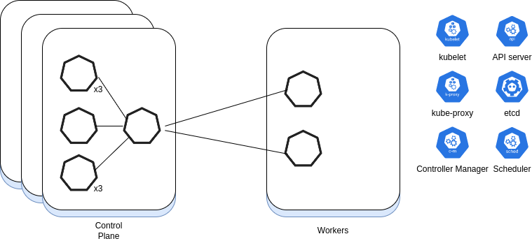
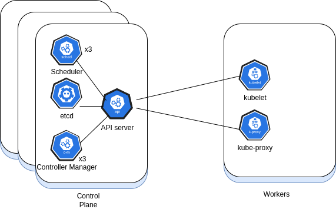
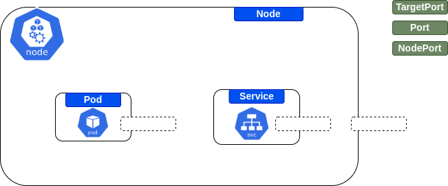
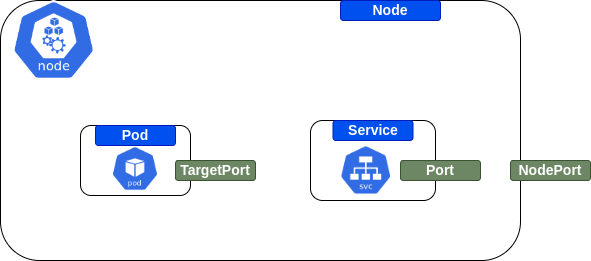

<a name="kubernetes"></a>
# Kubernetes

<!--  -->

你的目标是什么？

* 我想准备 CKA 认证
  * 参见 [CKA](CKA.md) 页面
* 我想学习 Kubernetes 通过理论和实践材料的练习
  * 解决 [练习](#kubernetes-exercises)
  * 解决 [问题](#kubernetes-questions)
* 我想学习实用的 Kubernetes
  * 解决 [练习](#kubernetes-exercises)

- [Kubernetes](#kubernetes)
  - [Kubernetes 练习](#kubernetes-exercises)
    - [Pods](#pods)
    - [服务](#service)
    - [ReplicaSet](#replicaset)
    - [标签和选择器](#labels-and-selectors)
    - [Scheduler](#scheduler)
    - [Kustomize](#kustomize)
  - [Kubernetes 问题](#kubernetes-questions)
    - [Kubernetes 101](#kubernetes-101)
    - [集群与架构](#cluster-and-architecture)
      - [Kubelet](#kubelet)
      - [节点命令](#nodes-commands)
    - [Pods](#pods-1)
      - [静态 Pods](#static-pods)
      - [Pods 命令](#pods-commands)
      - [Pods 故障排除和调试](#pods-troubleshooting-and-debugging)
    - [标签和选择器](#labels-and-selectors-1)
    - [Deployments](#deployments)
      - [Deployments 命令](#deployments-commands)
    - [服务](#services)
    - [Ingress](#ingress)
    - [ReplicaSets](#replicasets)
    - [DaemonSet](#daemonset)
      - [DaemonSet - 命令](#daemonset---commands)
    - [StatefulSet](#statefulset)
    - [存储](#storage)
      - [卷](#volumes)
    - [网络](#networking)
    - [NetworkPolicy（网络策略）](#network-policies)
    - [etcd](#etcd)
    - [Namespaces](#namespaces)
      - [Namespaces - 命令](#namespaces---commands)
      - [资源配额](#resources-quota)
    - [Operator](#operators)
    - [Secret](#secrets)
    - [卷](#volumes-1)
    - [访问控制](#access-control)
    - [模式](#patterns)
    - [定时任务](#cronjob)
    - [杂项](#misc)
    - [Gatekeeper](#gatekeeper)
    - [Policy Testing](#policy-testing)
    - [Helm](#helm)
      - [命令](#commands)
    - [安全性](#security)
    - [故障排除场景](#troubleshooting-scenarios)
    - [Istio](#istio)
    - [控制器](#controllers)
    - [Scheduler](#scheduler-1)
      - [Node Affinity](#node-affinity)
    - [Taints](#taints)
    - [资源限制](#resource-limits)
      - [资源限制 - 命令](#resources-limits---commands)
    - [监控](#monitoring)
    - [Kustomize](#kustomize-1)
    - [部署策略](#deployment-strategies)
    - [应用场景](#scenarios)

<a name="kubernetes-exercises"></a>
## Kubernetes 练习

<a name="pods"></a>
### Pods

|名称|主题|目的与说明|解决方案|评论|
|--------|--------|------|----|----|
| 我的第一次 Pod | Pods | [练习](pods_01.md) | [解决方案](solutions/pods_01_solution.md)
| “杀死”容器 | Pods | [练习](killing_containers.md) | [解决方案](solutions/killing_containers.md)

<a name="service"></a>
### 服务

|名称|主题|目的与说明|解决方案|评论|
|--------|--------|------|----|----|
| 创建服务 | 服务 | [练习](services_01.md) | [解决方案](solutions/services_01_solution.md)

<a name="replicaset"></a>
### ReplicaSet

|名称|主题|目的与说明|解决方案|评论|
|--------|--------|------|----|----|
| 创建一个 ReplicaSet | ReplicaSet | [练习](replicaset_01.md) | [解决方案](solutions/replicaset_01_solution.md)
| 运营 ReplicaSets | ReplicaSet | [练习](replicaset_02.md) | [解决方案](solutions/replicaset_02_solution.md)
| ReplicaSets 选择器 | ReplicaSet | [练习](replicaset_03.md) | [解决方案](solutions/replicaset_03_solution.md)

<a name="labels-and-selectors"></a>
### 标签和选择器

|名称|主题|目的与说明|解决方案|评论|
|--------|--------|------|----|----|
| 标签和选择器 101 | 标签、选择器 | [练习](exercises/labels_and_selectors/exercise.md) | [解决方案](exercises/labels_and_selectors/solution.md)
| 节点选择器 | 标签、选择器 | [练习](exercises/node_selectors/exercise.md) | [解决方案](exercises/node_selectors/solution.md)


<a name="scheduler"></a>
### Scheduler

|名称|主题|目的与说明|解决方案|评论|
|--------|--------|------|----|----|
| Taints 101 | Taints | [练习](exercises/taints_101/exercise.md) | [解决方案](exercises/taints_101/solution.md)

<a name="kustomize"></a>
### Kustomize

|名称|主题|目的与说明|解决方案|评论|
|--------|--------|------|----|----|
| 常用标签 | Kustomize | [练习](exercises/kustomize_common_labels/exercise.md) | [解决方案](exercises/kustomize_common_labels/solution.md)

<a name="kubernetes-questions"></a>
## Kubernetes 问题

<a name="kubernetes-101"></a>
### Kubernetes 101

<details>
<summary>什么是 Kubernetes？为什么组织使用它？</summary><br><b>

Kubernetes 是一个开源的容器编排系统，用于部署、扩缩容和管理容器化应用。

要理解 Kubernetes 适合解决什么问题，可以看几个典型场景：

* 同一个应用需要以容器形式运行在多个节点上，并保持配置和版本一致
* 需要对大量容器做滚动更新、回滚和生命周期管理
* 业务负载变化时，需要自动或手动扩缩容

</b></details>

<details>
<summary>什么情况下不适合使用 Kubernetes？</summary><br><b>

  - 如果你的主要工作是管理底层基础设施或裸机，而不是运行容器化应用，Kubernetes 可能不是最合适的抽象层。
  - 如果团队很小、容器数量也很少，Kubernetes 可能会带来过高的运维复杂度。即使需要扩缩容或滚动发布，也应该先评估托管 Kubernetes 或更轻量方案是否更合适。

</b></details>

<details>
<summary>Kubernetes 有哪些主要特性？</summary><br><b>

  - 自愈：通过健康检查发现异常，并在容器失败时重新启动、替换或重新调度。
  - 服务发现与负载均衡：把访问请求分发到后端 Pod，并隐藏 Pod 的动态变化。
  - 声明式管理：用户声明期望状态，控制平面持续协调实际状态向期望状态靠拢。
  - 滚动发布与回滚：逐步发布新版本，出现问题时可以回滚。
  - 水平扩缩容：根据负载或自定义指标增加或减少副本数。
  - Secret 管理：以 Kubernetes 对象形式保存密码、令牌等敏感信息，并配合权限控制访问。

</b></details>

<details>
<summary>Kubernetes 中有哪些常见对象？</summary><br><b>

  * Pod
  * Service
  * ReplicationController
  * ReplicaSet
  * DaemonSet
  * Namespace
  * ConfigMap
  ...
</b></details>

<details>
<summary>Kubernetes 对象通常需要哪些必填字段？</summary><br><b>

`apiVersion`、`kind` 和 `metadata`。

</b></details>

<details>
<summary>什么是 kubectl？</summary><br><b>

kubectl 是 Kubernetes 的命令行工具，用来向 Kubernetes 集群发送请求。你可以用它部署应用、查看和管理资源、排查问题以及查看日志。

</b></details>

<details>
<summary>在 Kubernetes 中部署应用时，通常会用到哪些对象？</summary><br><b>

* Deployment：管理应用副本，并通过 ReplicaSet 创建和维护 Pod。
* Service：为一组 Pod 提供稳定访问入口，并在集群内部转发流量。
* Ingress：从集群外部暴露 HTTP/HTTPS 访问入口。

</b></details>

<details>
<summary>为什么 Kubernetes 里没有 <code>kubectl get containers</code> 这样的命令？</summary><br><b>

因为容器不是 Kubernetes API 中独立管理的顶层对象。Kubernetes 中最小的可部署计算单元是 Pod，一个 Pod 内可以包含一个或多个容器。

</b></details>

<details>
<summary>使用 Kubernetes 时有哪些常见最佳实践？</summary><br><b>

  - 确保 Kubernetes YAML 清单有效，并在 CI/CD 流程中加入自动校验。
  - 为容器设置资源请求和限制，避免单个工作负载耗尽节点资源并导致 OOM 等问题。
  - 使用标签对 Pod、Deployment 等资源做逻辑分组，便于选择、查询和自动化管理。

</b></details>

<a name="cluster-and-architecture"></a>
### 集群与架构

<details>
<summary>什么是 Kubernetes 集群？</summary><br><b>

Red Hat 的定义是：Kubernetes 集群是一组用于运行容器化应用的节点机器。只要你在运行 Kubernetes，本质上就是在运行一个集群。

一个集群至少包含控制平面以及用于运行工作负载的节点。旧资料里常把控制平面节点称为 master node。

[更多说明](https://www.redhat.com/en/topics/containers/what-is-a-kubernetes-cluster)
</b></details>

<details>
<summary>什么是 Node（节点）？</summary><br><b>

Node 是 Kubernetes 集群中的一台工作机器，可以是物理机，也可以是虚拟机。Pod 最终会被调度到某个 Node 上运行。<br>
生产环境通常会部署多个节点，以提高可用性和容量。
</b></details>

<details>
<summary>控制平面负责什么？</summary><br><b>

控制平面负责协调和管理整个集群，例如：

* 接收和验证 API 请求
* 调度 Pod 到合适的节点
* 持续协调实际状态与期望状态
* 管理滚动更新、节点状态、控制器等集群行为

</b></details>

<details>
<summary>简要说明执行 <code>kubectl get nodes</code> 时发生了什么</summary><br><b>

1. kubectl 使用当前 kubeconfig 中的身份信息向 API Server 发起请求。
2. API Server 对用户进行认证、鉴权，并校验请求。
3. API Server 从 etcd 读取节点信息并返回结果。
</b></details>

<details>
<summary>判断题：每个集群都必须有 0 个或多个控制平面节点，并且至少有 1 个工作节点</summary><br><b>

错误。Kubernetes 集群至少需要控制平面；技术上可以没有工作节点，尽管这样的集群通常没有实际运行应用负载的价值。

</b></details>

<details>
<summary>控制平面通常由哪些组件组成？</summary><br><b>

  * API Server：暴露 Kubernetes API，所有组件都通过它与集群交互。
  * Scheduler：为尚未绑定节点的 Pod 选择合适的 Node。
  * Controller Manager：运行各类控制器，负责副本维护、节点状态处理等控制循环。
  * etcd：保存集群配置和状态数据。

</b></details>

<details>
<summary>工作节点通常由哪些组件组成？</summary><br><b>

  * kubelet：运行在每个 Node 上的代理，负责与 API Server 通信，并确保 Pod 中的容器按期望运行。
  * kube-proxy：维护节点上的网络转发规则，使 Service 能够把流量转发到后端 Pod。
  * 容器运行时：真正负责运行容器的软件，例如 containerd、CRI-O、Docker 等。

</b></details>

<details>
<summary>将镜像右侧的组件放置在绘图中的正确位置<br>

</summary><br><b>


</b></details>

<details>
<summary>你正在管理多个 Kubernetes 集群，如何用 kubectl 快速切换集群？</summary><br><b>

`kubectl config use-context`
</b></details>

<details>
<summary>如何避免 Kubernetes 集群中出现内存占用过高、内存泄漏或 OOM 等问题？</summary><br><b>

为工作负载设置资源请求（requests）和资源限制（limits），尤其是第三方应用或资源消耗不确定的组件。
</b></details>

<details>
<summary>你是否部署过 Kubernetes 集群？如果部署过，请概括说明流程</summary><br><b>

1. 准备多台机器作为 Kubernetes 节点，其中一部分运行控制平面组件，另一部分运行工作负载。机器可以来自云主机、虚拟机或裸金属。
2. 准备证书颁发机构，用来为 kubelet、etcd、API Server 等组件签发 TLS 证书。
   1. 为各组件生成证书和私钥。
3. 生成 kubeconfig，让不同客户端能够定位 API Server 并完成认证。
4. 生成用于加密集群数据的密钥。
5. 部署 etcd 集群，并启动控制平面和工作节点组件。
</b></details>

<details>
<summary>哪个命令可以列出集群支持的所有资源类型？</summary><br><b>

`kubectl api-resources`
</b></details>

<details>
<summary><code>kubectl get componentstatus</code> 是做什么的？</summary><br><b>

输出各控制平面组件的健康状态。注意：`componentstatus` 在较新的 Kubernetes 版本中已经逐步废弃。
</b></details>

<a name="kubelet"></a>
#### Kubelet

<details>
<summary>如果停止工作节点上的 kubelet，正在运行的 Pod 会发生什么？</summary><br><b>

停止某个工作节点上的 kubelet 后，该节点将无法继续向 API Server 汇报状态。控制平面通常会把该节点标记为 `NotReady`，该节点上的 Pod 状态可能变为 `Unknown`。随后，控制平面会根据控制器和调度策略，尝试在其他可用节点上重新创建这些 Pod。
</b></details>

<a name="nodes-commands"></a>
#### 节点命令

<details>
<summary>运行命令查看集群中的所有节点</summary><br><b>

`kubectl get nodes`

提示：可以创建别名（`alias k=kubectl`），并熟悉 `k get no` 这样的简写。
</b></details>

<details>
<summary>以 JSON 格式导出所有节点，并保存到 `some_nodes.json`</summary><br><b>

`k get nodes -o json > some_nodes.json`
</b></details>

<details>
<summary>检查集群中某个节点有哪些标签</summary><br><b>

`k get no minikube --show-labels`
</b></details>

<a name="pods-1"></a>
### Pods

<details>
<summary>解释什么是 Pod</summary><br><b>

Pod 是 Kubernetes 中最小的可部署计算单元。一个 Pod 可以包含一个或多个容器，这些容器共享网络命名空间、存储卷，并由同一份 Pod 规格描述如何运行。

在 Kubernetes 中，你通常不会直接管理单个容器，而是通过 Pod 来管理容器组。

</b></details>

<details>
<summary>使用 `nginx:alpine` 镜像运行一个名为 `my-pod` 的 Pod</summary><br><b>

`kubectl run my-pod --image=nginx:alpine`

如果你刚开始学习 Kubernetes，需要知道：生产中通常不会直接用 `kubectl run` 管理 Pod。更常见的方式是创建 Deployment，再由 Deployment 管理 ReplicaSet 和 Pod。

另外，Pod、Deployment 等对象通常会写在 YAML 清单文件中，再通过 `kubectl apply` 创建或更新，而不是长期依赖命令行参数。
</b></details>

<details>
<summary>如何理解“通常不应该直接创建 Pod”？</summary><br><b>

一般情况下确实不建议直接创建裸 Pod。Pod 往往由 Deployment、ReplicaSet、StatefulSet、Job 等更高层对象创建和管理。

如果你直接创建的 Pod 退出或被删除，Kubernetes 不会自动为它创建替代 Pod。使用 ReplicaSet 或 Deployment 时，控制器会维护期望副本数，确保 Pod 失败后能够重新创建。
</b></details>

<details>
<summary>一个 Pod 可以包含多少个容器？</summary><br><b>

一个 Pod 可以包含多个容器，但最常见的情况是一个 Pod 只运行一个主容器。

在某些模式下，一个 Pod 会运行多个紧密协作的容器。例如 sidecar 模式中，可以让一个辅助容器负责日志收集、代理、配置同步等工作，并与主应用容器共享网络或卷。
</b></details>

<details>
<summary>哪些场景适合在单个 Pod 中运行多个容器？</summary><br><b>

例如，一个 Web 应用可以把主应用放在一个容器里，把日志采集、监控代理或反向代理放在另一个容器里。<br>
再比如 CI/CD 系统（如 Tekton）中，一个 Task 可能需要多个步骤，每个步骤由同一个 Pod 中的不同容器完成。
</b></details>

<details>
<summary>Pod 有哪些可能的阶段（phase）？</summary><br><b>

  * `Running`：Pod 已绑定到某个节点，并且至少有一个容器正在运行、启动中或重启中。
  * `Failed`：Pod 中所有容器都已终止，并且至少有一个容器以失败状态退出。
  * `Succeeded`：Pod 中所有容器都已成功终止，并且不会再重启。
  * `Unknown`：无法获取 Pod 状态，通常是因为节点通信异常。
  * `Pending`：Pod 已被集群接受，但还没有全部容器开始运行，可能是尚未调度或仍在拉取镜像。
</b></details>

<details>
<summary>判断题：默认情况下，Pod 是隔离的，因此不能接收任何来源的流量</summary><br><b>

错误。默认情况下，Pod 是非隔离的，可以接收来自任意来源的流量；需要 NetworkPolicy 等机制才能限制流量。
</b></details>

<details>
<summary>判断题：`Pending` 表示 Pod 尚未被 Kubernetes 集群接受，因此调度器不能调度它</summary><br><b>

错误。`Pending` 表示 Pod 已被集群接受，但还没有全部容器开始运行；原因可能是尚未调度、镜像仍在拉取、资源不足等。
</b></details>

<details>
<summary>判断题：单个 Pod 可以拆分到多个节点上运行</summary><br><b>

错误。一个 Pod 只能运行在一个节点上。
</b></details>

<details>
<summary>你运行了一个 Pod，并看到状态为 <code>ContainerCreating</code>，这通常表示什么？</summary><br><b>

这通常表示 Pod 已经被调度到节点上，但容器还在创建过程中。常见原因包括镜像正在拉取、卷正在挂载、CNI 网络还在配置等。
</b></details>

<details>
<summary>判断题：Pod 中定义的卷可以被该 Pod 内的所有容器访问</summary><br><b>

正确。是否挂载到某个容器，取决于该容器的 `volumeMounts` 配置。
</b></details>

<details>
<summary>使用 kubectl 创建 Pod 时，集群内部大致会发生什么？</summary><br><b>

1. kubectl 向 API Server 发送创建 Pod 的请求。
   1. API Server 对用户进行认证、鉴权，并校验请求内容。
   2. API Server 将 Pod 对象写入 etcd。
2. Scheduler 通过监听 API Server 发现有未绑定节点的 Pod。
3. Scheduler 为 Pod 选择一个合适的节点，并把调度结果写回 API Server。
4. 目标节点上的 kubelet 监听到有 Pod 分配给自己。
5. kubelet 调用容器运行时（例如 containerd）拉取镜像、创建并启动容器。
6. kubelet 持续向 API Server 汇报 Pod 状态，API Server 再把状态更新保存到 etcd。
</b></details>

<details>
<summary>执行 <code>kubectl run web --image nginxinc/nginx-unprivileged</code> 后，如何确认容器正在运行？</summary><br><b>

* 运行 `kubectl describe pods <POD_NAME>` 查看容器状态，例如：
`Status:       Running`
* 也可以在容器内执行命令验证：`kubectl exec web -- ls`
</b></details>

<details>
<summary>执行 <code>kubectl run database --image mongo</code> 后，Pod 进入 “CrashLoopBackOff” 状态。可能是什么原因？如何确认？</summary><br><b>

“CrashLoopBackOff” 表示容器反复启动又崩溃，Kubernetes 正在按退避策略重启它。<br>
导致该状态的原因很多，例如进程启动命令错误、权限不足、初始化容器配置错误、依赖的持久卷不可用等。

一种排查方式是执行 `kubectl describe po <POD_NAME>`，查看上一次容器退出的原因和退出码：

```
 Last State:     Terminated
   Reason:       Error
   Exit Code:    100
```

另一种方式是执行 `kubectl logs <POD_NAME>` 查看容器日志。如果 Pod 中有多个容器，需要通过 `-c <CONTAINER_NAME>` 指定容器。
</b></details>

<details>
<summary>解释以下几行的目的

```
livenessProbe:
  exec:
    command:
    - cat
    - /appStatus
  initialDelaySeconds: 10
  periodSeconds: 5
```
</summary><br><b>

这段配置定义了一个存活探针（liveness probe）。存活探针用于判断容器是否仍处于可继续运行的状态；如果探测失败，kubelet 会终止该容器，并按照 Pod 的重启策略处理。<br>
在这个例子中，kubelet 会执行 `cat /appStatus`。如果命令失败，容器会被重启。`initialDelaySeconds: 10` 表示容器启动后等待 10 秒再进行第一次探测；`periodSeconds: 5` 表示之后每 5 秒探测一次。
</b></details>

<details>
<summary>解释以下几行的目的

```
readinessProbe:
      tcpSocket:
        port: 2017
      initialDelaySeconds: 15
      periodSeconds: 20
```
</summary><br><b>

这段配置定义了一个就绪探针（readiness probe）。在 kubelet 能够连接到容器的 2017 端口之前，该 Pod 不会被标记为 “Ready”，也不会作为 Service 的可用后端接收流量。第一次探测会在容器启动 15 秒后进行，之后每 20 秒探测一次，直到探测成功。
</b></details>

<details>
<summary>Pod 的 “ErrImagePull” 状态是什么意思？</summary><br><b>

它表示 kubelet 无法拉取容器所需的镜像。常见原因包括镜像名称或标签写错、镜像仓库不可访问、私有仓库认证失败等。<br>
可以通过 `kubectl describe po <POD_NAME>` 查看更具体的事件信息。
</b></details>

<details>
<summary>删除一个 Pod 时会发生什么？</summary><br><b>

1. kubelet 会向 Pod 中各容器的主进程发送 `TERM` 信号。
2. 容器会获得一段宽限期（默认 30 秒）用于优雅退出。
3. 如果宽限期结束后进程仍未退出，kubelet 会发送 `KILL` 信号强制终止进程和容器。
</b></details>

<details>
<summary>解释存活探针（liveness probe）</summary><br><b>

存活探针用于判断容器是否仍然“活着”。当用户定义的探测连续失败时，kubelet 会认为容器已经不可恢复，并重启该容器。<br>
例如，可以让 kubelet 每隔一段时间执行 `cat /app/status`；一旦该命令失败，容器就会被重启。

更多信息可参考 [Kubernetes 官方文档](https://kubernetes.io/zh-cn/docs/tasks/configure-pod-container/configure-liveness-readiness-startup-probes/)。
</b></details>

<details>
<summary>解释就绪探针（readiness probe）</summary><br><b>

就绪探针用于判断容器是否已经准备好对外提供服务。只有就绪探针成功的 Pod，才会被加入 Service 的可用端点并接收流量。<br>
例如，就绪探针可以尝试连接容器的 8080 端口；当 kubelet 能够成功连接时，Pod 会被标记为 Ready。

更多信息可参考 [Kubernetes 官方文档](https://kubernetes.io/zh-cn/docs/tasks/configure-pod-container/configure-liveness-readiness-startup-probes/)。
</b></details>

<details>
<summary>Pod 通过 Service 暴露时，就绪探针状态会如何影响流量？</summary><br><b>

只有就绪探针成功的 Pod 才会作为 Service 的可用端点接收请求。未就绪的 Pod 会从 Service 后端中暂时移除。
</b></details>

<details>
<summary>为什么大多数情况下一个 Pod 里只运行一个主容器？</summary><br><b>

一个重要原因是 Pod 是 Kubernetes 调度、扩缩容和生命周期管理的基本单位。如果把多个不需要强耦合的容器放进同一个 Pod，当只想扩容其中一个容器时会变得困难。多容器 Pod 通常用于 sidecar、adapter、ambassador 等紧密协作的场景。
</b></details>

<details>
<summary>判断题：Pod 一旦被调度到某个工作节点，就只会在该节点上运行；即使它失败并重新启动，也仍在这个节点上。</summary><br><b>

正确。单个 Pod 被绑定到某个节点后，不会被“迁移”到其他节点；如果容器崩溃，kubelet 会在同一节点上按策略重启容器。若该 Pod 被删除，控制器可能会创建一个新的 Pod，新 Pod 才可能被调度到其他节点。
</b></details>

<details>
<summary>判断题：每个 Pod 创建后都会获得自己的公网 IP 地址。</summary><br><b>

错误。每个 Pod 会获得一个 Pod IP，但通常是集群内部网络地址，不会直接暴露到公网。

如果要让 Pod 对集群外部可访问，通常需要通过 Service、Ingress 或网关等方式暴露服务。
</b></details>

<a name="static-pods"></a>
#### 静态 Pods

<details>
<summary>什么是静态 Pod？</summary><br><b>

[Kubernetes 官方文档](https://kubernetes.io/zh-cn/docs/tasks/configure-pod-container/static-pod/)：“静态 Pod 直接由特定节点上的 kubelet 守护进程管理，不需要 API 服务器看到它们。” 与由控制平面管理的普通 Pod 不同，静态 Pod 的清单文件由 kubelet 在本地监视；如果静态 Pod 失败，kubelet 会尝试重新启动它。
</b></details>

<details>
<summary>判断题：既然有 “静态 Pod”，Kubernetes 也有 “静态 Deployment” 和 “静态 ReplicaSet”。</summary><br><b>

错误。静态 Pod 是 kubelet 直接管理本地 Pod 清单的机制；Deployment、ReplicaSet 等控制器资源仍由 API Server 和控制平面管理。
</b></details>

<details>
<summary>静态 Pod 有哪些常见使用场景？</summary><br><b>

典型场景是运行控制平面组件，例如 `kube-apiserver`、`kube-scheduler`、`kube-controller-manager` 等。这些组件需要固定运行在特定节点上，并且在 API Server 尚不可用时也要能由 kubelet 拉起。
</b></details>

<details>
<summary>如何识别哪些 Pod 是静态 Pod？</summary><br><b>

静态 Pod 在 API Server 中通常会以镜像 Pod（mirror Pod）的形式出现，名称一般会带上所在节点名作为后缀。也可以在节点上的 `staticPodPath` 目录中查看 kubelet 正在监视的静态 Pod 清单。
</b></details>

<details>
<summary>以下哪项不是静态 Pod？：

* kube-scheduler
* kube-proxy
* kube-apiserver
</summary><br><b>

`kube-proxy`。它通常由 DaemonSet 管理，因为它需要在集群中每个节点上运行，而不是作为某个特定节点上的静态 Pod 存在。
</b></details>

<details>
<summary>静态 Pod 的清单文件通常位于哪里？</summary><br><b>

常见路径是 `/etc/kubernetes/manifests`。可以通过下面的命令查看 kubelet 配置中的 `staticPodPath`：

`grep staticPodPath /var/lib/kubelet/config.yaml`

如果 kubelet 配置文件不在这个位置，可以先执行 `ps -ef | grep kubelet`，查看 kubelet 进程的 `--config` 参数指向哪个配置文件。
</b></details>

<details>
<summary>如何删除静态 Pod？
</summary><br><b>

先通过 kubelet 配置文件中的 `staticPodPath` 找到静态 Pod 清单目录。

然后删除对应的清单文件，例如：`rm <STATIC_POD_PATH>/<POD_DEFINITION_FILE>`。kubelet 发现清单被移除后，会删除对应的静态 Pod。
</b></details>

<a name="pods-commands"></a>
#### Pods 命令

<details>
<summary>如何查看 Pod 被调度到了哪个工作节点？</summary><br><b>

`kubectl get pods -o wide`
</b></details>

<details>
<summary>如何删除一个 Pod？</summary><br><b>

`kubectl delete pod pod_name`
</b></details>

<details>
<summary>列出所有带有 “env=prod” 标签的 Pod</summary><br><b>

`k get po -l env=prod`

统计数量：`k get po -l env=prod --no-headers | wc -l`
</b></details>

<details>
<summary>如何列出当前命名空间中的 Pod？</summary><br><b>

`kubectl get po`
</b></details>

<details>
<summary>如何查看所有命名空间中运行的所有 Pod？</summary><br><b>

`kubectl get pods --all-namespaces`
</b></details>

<a name="pods-troubleshooting-and-debugging"></a>
#### Pods 故障排除和调试

<details>
<summary>你尝试运行一个 Pod，但它一直处于 “Pending” 状态。可能是什么原因？</summary><br><b>

一种可能原因是调度器没有正常运行，导致 Pod 无法被调度到节点。可以执行 `kubectl get po -A | grep scheduler`，或者直接查看 `kube-system` 命名空间中的调度器 Pod 状态。也可能是资源不足、节点污点不匹配、节点选择器或亲和性规则无法满足等原因。
</b></details>

<details>
<summary><code>kubectl logs [pod-name]</code> 命令有什么作用？</summary><br><b>

输出 Pod 中容器的日志。如果 Pod 中有多个容器，需要用 `-c <CONTAINER_NAME>` 指定要查看的容器。
</b></details>

<details>
<summary><code>kubectl describe pod [pod-name]</code> 命令有什么作用？</summary><br><b>

显示指定 Pod 的详细信息，包括节点、状态、容器状态、事件、卷、标签、注解等，常用于排查调度失败、镜像拉取失败、探针失败等问题。
</b></details>

<details>
<summary>使用 <code>python</code> 镜像创建一个静态 Pod，并运行命令 <code>sleep 2017</code></summary><br><b>

首先切换到 kubelet 监视的静态 Pod 清单目录：`cd /etc/kubernetes/manifests`。具体路径可以通过 kubelet 配置文件确认。

然后在该目录中生成 Pod 清单：

`kubectl run some-pod --image=python --command -- sleep 2017 --restart=Never --dry-run=client -o yaml > static-pod.yaml`
</b></details>

<a name="labels-and-selectors-1"></a>
### 标签和选择器

<details>
<summary>解释标签（Labels）</summary><br><b>

[Kubernetes 官方文档](https://kubernetes.io/zh-cn/docs/concepts/overview/working-with-objects/labels/)：“标签（Labels）是附加到 Kubernetes 对象（比如 Pod）上的键值对。” 标签用于标识、组织和筛选对象，例如用 `env=prod` 表示生产环境，用 `app=nginx` 表示某个应用。标签可以在对象创建时添加，也可以之后修改；同一个对象上的每个标签键必须唯一。
</b></details>

<details>
<summary>解释选择器（Selectors）</summary><br><b>

[Kubernetes 官方文档](https://kubernetes.io/zh-cn/docs/concepts/overview/working-with-objects/labels/#label-selectors)：“与名称和 UID 不同，标签并不提供唯一性。” 多个对象通常会带有相同标签。

标签选择器用于根据标签筛选一组对象，是 Kubernetes 中非常核心的分组机制。例如 Service 用选择器找到要转发流量的 Pod，ReplicaSet 用选择器找到自己管理的 Pod。

Kubernetes API 支持两类选择器：基于等值的选择器和基于集合的选择器。多个条件用逗号分隔时，表示逻辑与（AND），必须全部满足。
</b></details>

<details>
<summary>举例说明标签的实际用途</summary><br><b>

* Service 通过标签选择器找到后端 Pod。
* ReplicaSet 通过标签选择器跟踪并维持目标副本数。
* 运维人员可以用标签按环境、应用、版本等维度筛选资源，例如 `kubectl get pods -l env=prod`。
</b></details>

<details>
<summary>什么是注释？</summary><br><b>

[Kubernetes 官方文档](https://kubernetes.io/zh-cn/docs/concepts/overview/working-with-objects/annotations/)：“你可以使用 Kubernetes 注解为对象附加任意的非标识的元数据。” 这些元数据通常供工具、控制器或客户端读取，例如构建信息、发布说明、外部系统 ID 等。
</b></details>

<details>
<summary>注解与标签有何不同？</summary><br><b>

标签用于标识和筛选对象，因此适合放环境、应用、版本这类短小且可查询的信息。注解不用于选择对象，更适合存放补充元数据；这些数据可以更长，也可以是结构化或非结构化内容，并且可以包含标签不允许的字符。
</b></details>

<details>
<summary>如何查看 Pod 中容器的日志？</summary><br><b>

`k logs POD_NAME`
</b></details>

<details>
<summary>名为 “some-pod” 的 Pod 中有两个容器。执行 <code>kubectl logs some-pod</code> 会发生什么？</summary><br><b>

命令会失败或要求你指定容器名，因为该 Pod 中有多个容器。应使用 `kubectl logs some-pod -c <CONTAINER_NAME>` 查看指定容器的日志。
</b></details>

<a name="deployments"></a>
### Deployments

<details>
<summary>Kubernetes 中的 Deployment 是什么？</summary><br><b>

Kubernetes Deployment 用于声明应用的期望状态，并由控制器负责创建、更新和维护承载应用的 Pod。
Deployment 可以扩缩 Pod 副本数，以受控方式发布新版本，也可以在需要时回滚到之前的版本。

从实现上看，Deployment 会管理 ReplicaSet，再由 ReplicaSet 维持对应数量的 Pod。
</b></details>

<details>
<summary>如何使用镜像“nginx:alpine”创建部署？</code></summary><br><b>

`kubectl create deployment my-first-deployment --image=nginx:alpine`

OR

```
cat << EOF | kubectl create -f -
apiVersion: apps/v1
kind: Deployment
metadata:
  name: nginx
spec:
  replicas: 1
  selector:
    matchLabels:
      app: nginx
  template:
    metadata:
      labels:
        app: nginx
    spec:
      containers:
      - name: nginx
        image: nginx:alpine
```
</b></details>

<details>
<summary>如何验证 Deployment 是否已创建？</code></summary><br><b>

`kubectl get deployments` 或 `kubectl get deploy`

该命令会列出集群中的 Deployment 对象。注意，“对象已创建”不等于应用已经可用；还需要查看 `READY`、`UP-TO-DATE` 和 `AVAILABLE` 等列来判断副本是否已经就绪。
</b></details>

<details>
<summary>如何编辑 Deployment？</code></summary><br><b>

`kubectl edit deployment <DEPLOYMENT_NAME>`
</b></details>

<details>
<summary>编辑 Deployment 并修改镜像后会发生什么？</summary><br><b>

Deployment 会触发一次滚动更新：新的 ReplicaSet 会被创建，使用新镜像的 Pod 会逐步启动。

随着新 Pod 就绪，旧 ReplicaSet 下的 Pod 会逐步被缩减。查看 ReplicaSet 时，通常可以看到旧 ReplicaSet 副本数降低，新 ReplicaSet 承接当前版本。
</b></details>

<details>
<summary>如何删除 Deployment？</summary><br><b>

一种方法是指定 Deployment 名称：`kubectl delete deployment [deployment_name]`

另一种方法是使用配置文件删除：`kubectl delete -f deployment.yaml`
</b></details>

<details>
<summary>删除 Deployment 时会发生什么？</summary><br><b>

Deployment 及其管理的 ReplicaSet 会被删除，相关 Pod 也会被终止。
</b></details>

<details>
<summary>创建一个 Deployment 对象时，集群内部大致会发生什么？</summary><br><b>

以执行 `kubectl create deployment some_deployment --image=nginx` 为例：

1. kubectl 向 Kubernetes API Server 发送创建 Deployment 的请求。
2. Deployment 控制器创建对应的 ReplicaSet。
3. ReplicaSet 控制器创建 Pod，并由调度器把 Pod 调度到某个工作节点。
4. 目标节点上的 kubelet 发现新 Pod 后，调用容器运行时从镜像仓库拉取 `nginx` 镜像。
5. 容器运行时基于该镜像创建并启动容器，kubelet 持续回报状态。
</b></details>

<details>
<summary>如何让应用可以在集群内网或外部网络中访问？</summary><br><b>

通常使用 Service；如果要处理 HTTP/HTTPS 路由，也常配合 Ingress 或网关使用。
</b></details>

<details>
<summary>可以用 Deployment 运行有状态应用吗？</summary><br><b>

可以，但通常不推荐作为首选。Deployment 更适合无状态应用；有状态应用通常需要稳定的网络标识、有序部署/伸缩和持久存储语义，Kubernetes 中更常使用 StatefulSet。
</b></details>

<details>
<summary>修复以下部署清单

```yaml
apiVersion: apps/v1
kind: Deploy
metadata:
  creationTimestamp: null
  labels:
    app: dep
  name: dep
spec:
  replicas: 3
  selector:
    matchLabels:
      app: dep
  strategy: {}
  template:
    metadata:
      creationTimestamp: null
      labels:
        app: dep
    spec:
      containers:
      - image: redis
        name: redis
        resources: {}
status: {}
```
</summary><br><b>

把 `kind: Deploy` 改成 `kind: Deployment`。
</b></details>

<details>
<summary>修复以下部署清单

```yaml
apiVersion: apps/v1
kind: Deployment
metadata:
  creationTimestamp: null
  labels:
    app: dep
  name: dep
spec:
  replicas: 3
  selector:
    matchLabels:
      app: depdep
  strategy: {}
  template:
    metadata:
      creationTimestamp: null
      labels:
        app: dep
    spec:
      containers:
      - image: redis
        name: redis
        resources: {}
status: {}
```
</summary><br><b>

选择器与 Pod 模板中的标签不匹配（`depdep` 与 `dep`）。应把 `matchLabels.app` 改为 `dep`，使选择器能匹配模板标签。
</b></details>

<a name="deployments-commands"></a>
#### Deployments 命令

<details>
<summary>生成一个名为 “dep” 的 Deployment 清单，包含 3 个副本，并使用 “redis” 镜像</summary><br><b>

`k create deploy dep -o yaml --image=redis --dry-run=client --replicas 3 > deployment.yaml `

</b></details>

<details>
<summary>删除部署 `depdep`</summary><br><b>

`k delete deploy depdep`

</b></details>

<details>
<summary>使用 “redis” 镜像创建名为 “pluck” 的 Deployment，并确保它运行 5 个副本</summary><br><b>

`kubectl create deployment pluck --image=redis`

`kubectl scale deployment pluck --replicas=5`
</b></details>

<details>
<summary>创建具有以下属性的部署：

* 名为 “blufer”
* 使用 “python” 镜像
* 运行 3 个副本
* 所有 Pod 都调度到带有 “blufer” 标签的节点上
</summary><br><b>

`kubectl create deployment blufer --image=python --replicas=3 -o yaml --dry-run=client > deployment.yaml`

编辑 `deployment.yaml`，在 Pod 模板的 `spec` 下添加节点亲和性配置，例如：

```
spec:
  affinity:
    nodeAffinity:
      requiredDuringSchedulingIgnoredDuringExecution:
        nodeSelectorTerms:
        - matchExpressions:
          - key: blufer
            operator: Exists
```

`kubectl apply -f deployment.yaml`
</b></details>

<a name="services"></a>
### 服务

<details>
<summary>Kubernetes 中的 Service 是什么？</summary><br><b>

[Kubernetes 官方文档](https://kubernetes.io/zh-cn/docs/concepts/services-networking/service/)：“Service 是将运行在一组 Pod 上的应用程序公开为网络服务的抽象方法。”

简单说，Service 为一组后端 Pod 提供稳定的访问入口。即使 Pod 被重建、IP 发生变化，客户端仍可以通过 Service 访问对应应用。
</b></details>

<details>
<summary>根据 Kubernetes Service 的工作方式，把组件放到正确位置<br>

</summary><br><b>



</b></details>


<details>
<summary>如何为名为 “alle” 的现有 Deployment 创建一个 8080 端口的 Service，使其可通过负载均衡器访问？</summary><br><b>

命令式写法：

`kubectl expose deployment alle --type=LoadBalancer --port 8080`
</b></details>

<details>
<summary>判断题：Pod 和 Service 的生命周期并不绑定，所以 Pod 消失后，Service 仍然可以存在。</summary><br><b>

正确。Service 是独立资源，不会因为某个后端 Pod 被删除而自动删除。它会继续存在，并根据选择器匹配新的后端 Pod。
</b></details>

<details>
<summary>创建服务后，如何查看服务是否已创建？</summary><br><b>

`kubectl get svc`
</b></details>

<details>
<summary>默认的服务类型是什么？</summary><br><b>

ClusterIP，用于集群内部访问。
</b></details>

<details>
<summary>有哪些服务类型？</summary><br><b>

* ClusterIP
* NodePort
* LoadBalancer
* ExternalName

更多信息可参考 [Kubernetes 官方文档](https://kubernetes.io/zh-cn/docs/concepts/services-networking/service/#publishing-services-service-types)。
</b></details>

<details>
<summary>Service 和 Deployment 是如何关联的？</summary><br><b>

严格来说，Service 并不会直接关联 Deployment。Service 通过标签选择器匹配 Pod；只要 Pod 的标签符合选择器，就可以成为 Service 的后端。Deployment 只是通常负责创建这些带有匹配标签的 Pod。
</b></details>

<details>
<summary>定义 Service 时有哪些关键点？</summary><br><b>

1. 确认 Service 的 `targetPort` 指向容器实际监听的端口。
2. 确认 Service 的 `selector` 至少能匹配一个目标 Pod 的标签。

</b></details>

<details>
<summary>Kubernetes 默认的 Service 类型是什么？它有什么用途？</summary><br><b>

默认类型是 ClusterIP，用于在集群内部暴露服务。它适合 Pod 之间或集群内组件之间通信，同时避免直接暴露给集群外部。

</b></details>

<details>
<summary>如何获取某个服务的信息？</summary><br><b>

`kubectl describe service <SERVICE_NAME>`

更常见的简写是 `kubectl describe svc <SERVICE_NAME>`。

</b></details>

<details>
<summary>以下命令的作用是什么？

```
kubectl expose rs some-replicaset --name=replicaset-svc --target-port=2017 --type=NodePort
```
</summary><br><b>

它会为 `some-replicaset` 创建一个名为 `replicaset-svc` 的 Service。Service 会把流量转发到后端 Pod 的 2017 端口；类型是 NodePort，因此可以通过集群节点上的 NodePort 从集群外访问。
</b></details>

<details>
<summary>判断题：执行以下命令后，目标端口只会暴露在 Kubernetes 集群的某一个节点上，但会路由到所有后端 Pod。

```
kubectl expose rs some-replicaset --name=replicaset-svc --target-port=2017 --type=NodePort
```
</summary><br><b>

错误。NodePort 会在集群每个节点上开放一个端口，并把请求转发到匹配 Service 选择器的某个后端 Pod。
</b></details>

<details>
<summary>如何验证某个 Service 是否会把请求转发到指定 Pod？</summary><br><b>

执行 `kubectl describe service <SERVICE_NAME>`，查看 `Endpoints` 中的 IP 是否与 `kubectl get pod -o wide` 输出里的目标 Pod IP 匹配。也可以执行 `kubectl get endpoints <SERVICE_NAME>` 查看端点列表。
</b></details>

<details>
<summary>解释在以下块上运行 apply 时会发生什么

```
apiVersion: v1
kind: Service
metadata:
  name: some-app
spec:
  type: NodePort
  ports:
  - port: 8080
    nodePort: 2017
    protocol: TCP
  selector:
    type: backend
    service: some-app
```
</summary><br><b>

这会创建一个 `NodePort` 类型的 Service，因此既可以在集群内部通过 Service 访问，也可以从集群外通过节点 IP 和 NodePort 访问。<br>
Service 端口是 `8080`；这里显式指定 `nodePort: 2017`，表示在每个节点上开放 2017 端口。实际生产中通常让 Kubernetes 自动分配 NodePort，除非确实需要固定端口。<br>
协议是 TCP；TCP 也是默认协议，因此可以不显式声明。<br>
Service 通过选择器决定把请求转发给哪些 Pod。本例会匹配同时带有 `type: backend` 和 `service: some-app` 标签的 Pod。<br>
</b></details>

<details>
<summary>如何将以下服务变成外部服务？

```
spec:
  selector:
    app: some-app
  ports:
    - protocol: TCP
      port: 8081
      targetPort: 8081
```
</summary><br><b>

添加 `type: LoadBalancer`。`nodePort` 可以显式指定，也可以让 Kubernetes 自动分配：

```
spec:
  selector:
    app: some-app
  type: LoadBalancer
  ports:
    - protocol: TCP
      port: 8081
      targetPort: 8081
      nodePort: 32412
```
</b></details>

<details>
<summary>你会用什么把 Kubernetes 集群外部的流量路由到集群内的 Service？</summary><br><b>

Ingress
</b></details>

<details>
<summary>判断题：使用 “NodePort” 类型时，会自动创建 ClusterIP。</summary><br><b>

正确。NodePort Service 会包含 ClusterIP 能力：集群内部仍可通过 ClusterIP 访问，同时每个节点也会开放 NodePort。
</b></details>

<details>
<summary>什么时候会使用 “LoadBalancer” 类型？</summary><br><b>

当你希望云平台或底层基础设施为 Service 分配外部负载均衡器时，通常会使用 `LoadBalancer` 类型。
</b></details>

<details>
<summary>如何将服务映射到外部地址？</summary><br><b>

使用 `ExternalName` 类型的 Service，把集群内的服务名映射到外部 DNS 名称。
</b></details>

<details>
<summary>详细描述创建 Service 时会发生什么</summary><br><b>

1. kubectl 向 API Server 发送请求，创建 Service 对象。
2. 端点相关控制器根据 Service 的选择器找到匹配的 Pod。
3. 控制器为这些后端生成或更新 Endpoints/EndpointSlice 对象。
4. kube-proxy 观察到 Service 和端点变化后，在节点上更新 iptables、IPVS 或其他代理规则，把发往 Service 的流量转发到后端端点。
5. CoreDNS 观察到新的 Service 后，为它提供集群内 DNS 解析记录。
</b></details>

<details>
<summary>如何列出某个应用程序的端点？</summary><br><b>

`kubectl get ep <name>`
</b></details>

<details>
<summary>如果只能使用 <code>kubectl exec <POD_NAME> -- </code>，如何在 Pod 内查看与某个 Service 相关的信息？</summary><br><b>

可以执行 `kubectl exec <POD_NAME> -- env` 查看注入到容器环境变量中的 Service 信息。<br>
例如 `[SERVICE_NAME]_SERVICE_HOST`、`[SERVICE_NAME]_SERVICE_PORT` 等。
</b></details>

<details>
<summary>描述容器第一次尝试连接对应 Service 时会发生什么，并说明相关组件由谁配置</summary><br><b>

  - 容器读取 `/etc/resolv.conf` 中配置的 nameserver。
  - 容器向 nameserver 查询 Service 域名，并解析到 Service 的 ClusterIP。
  - 发往 Service IP 的请求会被 kube-proxy 配置的规则转发到后端端点。

相关组件来源：

  - 容器内的 DNS 配置由 kubelet 在创建 Pod 沙箱时写入。
  - Service 的 DNS 记录由 CoreDNS 根据 API Server 中的 Service 信息提供。
  - 转发规则由 kube-proxy 根据 Service 和 EndpointSlice/Endpoints 信息在节点上维护。
</b></details>

<details>
<summary>概括描述执行 <code>kubectl expose deployment remo --type=LoadBalancer --port 8080</code> 时会发生什么</summary><br><b>

1. kubectl 向 Kubernetes API Server 发送请求，创建一个 `LoadBalancer` 类型的 Service。
2. 云控制器管理器请求云厂商（如 AWS、GCP、Azure）为该 Service 创建外部负载均衡器。
3. 外部负载均衡器把进入的流量转发到相关工作节点，再由节点上的 Service 转发规则把流量送到后端 Pod。
</b></details>

<details>
<summary>创建用于转发外部流量到容器化应用的 Service 后，如何确认它正常工作？</summary><br><b>

可以执行 `curl <SERVICE_IP>:<SERVICE_PORT>` 检查返回结果。对于 `LoadBalancer` 类型，通常使用 Service 的外部 IP 或域名；对于 `NodePort` 类型，则使用节点 IP 和 NodePort。
</b></details>

<details>
<summary>Kubernetes 中的内部负载均衡抽象称为 <code>____</code>，七层外部 HTTP/HTTPS 路由通常称为 <code>____</code></summary><br><b>

内部负载均衡抽象是 Service；面向 HTTP/HTTPS 的外部路由通常使用 Ingress。
</b></details>

<a name="ingress"></a>
### Ingress

<details>
<summary>什么是 Ingress？</summary><br><b>

Kubernetes 官方文档：“Ingress 公开从集群外部到集群内 Service 的 HTTP 和 HTTPS 路由。流量路由由 Ingress 资源上定义的规则控制。”

更多信息可参考 [Kubernetes 官方文档](https://kubernetes.io/zh-cn/docs/concepts/services-networking/ingress/)。
</b></details>

<details>
<summary>补全下面的配置，使其成为一个 Ingress 资源

```
metadata:
  name: someapp-ingress
spec:
```
</summary><br><b>
有多种写法，下面是基于 `networking.k8s.io/v1` 的示例：

```
apiVersion: networking.k8s.io/v1
kind: Ingress
metadata:
  name: someapp-ingress
spec:
  rules:
  - host: my.host
    http:
      paths:
      - path: /
        pathType: Prefix
        backend:
          service:
            name: someapp-internal-service
            port:
              number: 8080
```
</b></details>


<details>
<summary>解释 “http”、“host” 和 “backend” 字段的含义

```
apiVersion: networking.k8s.io/v1
kind: Ingress
metadata:
  name: someapp-ingress
spec:
  rules:
  - host: my.host
    http:
      paths:
      - path: /
        pathType: Prefix
        backend:
          service:
            name: someapp-internal-service
            port:
              number: 8080
```
</summary><br><b>

`host` 指定匹配的域名，请求的 Host 头符合该域名时才会命中这条规则。<br>
`http` 表示该规则按 HTTP 路径进行路由，下面可以定义一个或多个 `paths`。<br>
`backend` 指定流量最终转发到哪个 Service 以及 Service 的哪个端口。
</b></details>

<details>
<summary>为什么在 Ingress host 中滥用通配符可能导致问题？</summary><br><b>

如果把 host 配得过于宽泛，相当于让大量甚至所有匹配不到更精确规则的 HTTP 流量都进入同一个后端，可能造成错误路由、服务过载或安全边界失效。通配符域名应谨慎使用，并配合明确的路径和后端规则。
</b></details>

<details>
<summary>什么是 Ingress 控制器？</summary><br><b>

Ingress 控制器是 Ingress 规则的具体实现。Ingress 资源本身只是规则声明，真正监听流量、解析规则并把请求转发到后端 Service 的，是集群中部署的 Ingress 控制器。

常见实现包括 ingress-nginx、NGINX Ingress Controller、Traefik、HAProxy Ingress 以及各云厂商提供的控制器。
</b></details>

<details>
<summary>Ingress 有哪些常见使用场景？</summary><br><b>

* 多个子域名分别路由到不同 Service。
* 同一个域名下的不同路径路由到不同 Service 或应用。
* 统一处理 HTTP/HTTPS 入口、TLS 证书和七层路由规则。
</b></details>

<details>
<summary>如何列出当前命名空间中的 Ingress？</summary><br><b>

`kubectl get ingress`
</b></details>

<details>
<summary>什么是 Ingress 默认后端？</summary><br><b>

默认后端用于处理没有命中任何 Ingress 规则的请求。如果请求没有匹配到明确的 host/path 规则，Ingress 控制器可以把它转发到默认后端，从而返回统一的错误页或提示，而不是让用户看到不清晰的失败结果。
</b></details>

<details>
<summary>如何配置默认后端？</summary><br><b>

创建一个用于默认后端的 Service，然后在 Ingress 或 Ingress 控制器配置中引用它。具体配置方式取决于 Ingress 控制器；可以通过 `kubectl describe ingress ...` 查看当前默认后端和规则解析情况。
</b></details>

<details>
<summary>如何为 Ingress 配置 TLS？</summary><br><b>

在 Ingress 规格中添加 `tls` 配置，并引用保存证书和私钥的 Secret：

```
spec:
  tls:
  - hosts:
    - some_app.com
    secretName: someapp-secret-tls
```
</b></details>

<details>
<summary>判断题：为 Ingress 配置 TLS 时，保存证书的 Secret 必须和 Ingress 位于同一个命名空间。</summary><br><b>

正确。Ingress 引用的 TLS Secret 必须位于同一命名空间。
</b></details>

<details>
<summary>要在 IP 地址或端口层面控制 Pod 间流量，应该使用哪个 Kubernetes 概念？</summary><br><b>

NetworkPolicy（网络策略）。
</b></details>

<details>
<summary>如何扩展一个应用（Deployment），让它运行多个实例？</summary><br><b>

例如，让应用运行两个实例：

`kubectl scale deployment <DEPLOYMENT_NAME> --replicas=2`

只要应用本身支持横向扩展，就可以把 `replicas` 设置为其他合适的数字。
</b></details>

<a name="replicasets"></a>
### ReplicaSets

<details>
<summary>ReplicaSet 的作用是什么？</summary><br><b>

[Kubernetes 官方文档](https://kubernetes.io/zh-cn/docs/concepts/workloads/controllers/replicaset/)：“ReplicaSet 的目的是维护一组在任何时候都处于运行状态的 Pod 副本的稳定集合。” 它通常用于保证指定数量的相同 Pod 可用。

简单说，ReplicaSet 会确保匹配选择器的 Pod 副本数等于期望值。如果匹配的 Pod 太多，它会删除一部分；如果太少，它会创建新的 Pod。
</b></details>

<details>
<summary>下面这几行代码块的作用是什么？

```
spec:
  replicas: 2
  selector:
    matchLabels:
      type: backend
  template:
    metadata:
      labels:
        type: backend
    spec:
      containers:
      - name: httpd-yup
        image: httpd
```
</summary><br><b>

它定义了一个 ReplicaSet：选择标签 `type=backend` 的 Pod，并通过模板创建同样带有该标签的 Pod。`replicas: 2` 表示期望始终有 2 个匹配的 Pod 副本在运行。
</b></details>

<details>
<summary>直接用 <code>kubectl delete po ...</code> 删除 ReplicaSet 创建的 Pod，会发生什么？</summary><br><b>

ReplicaSet 会创建一个新的 Pod，以重新达到期望副本数。
</b></details>

<details>
<summary>判断题：如果 ReplicaSet 定义了 2 个副本，但当前有 3 个匹配其选择器的 Pod 正在运行，它不会做任何事。</summary><br><b>

错误。ReplicaSet 会删除其中一个匹配的 Pod，使实际副本数回到期望的 2 个。
</b></details>

<details>
<summary>描述创建 ReplicaSet 时的大致事件顺序</summary><br><b>

* 客户端（例如 kubectl）向 API Server 发送请求，创建 ReplicaSet。
* ReplicaSet 控制器发现新的 ReplicaSet，并根据期望副本数创建 Pod。
* 调度器发现尚未绑定节点的 Pod，并为它们选择合适的节点。
* 目标节点上的 kubelet 监听到分配给自己的 Pod。
* kubelet 调用容器运行时创建 Pod 中的容器。
* kubelet 持续向 API Server 回报 Pod 状态。
</b></details>

<details>
<summary>如何列出当前命名空间中的 ReplicaSet？</summary><br><b>

`kubectl get rs`
</b></details>

<details>
<summary>是否可以删除 ReplicaSet，但保留它创建的 Pod？</summary><br><b>

可以，使用 `--cascade=false`。

`kubectl delete -f rs.yaml --cascade=false`
</b></details>

<details>
<summary>如果没有明确指定，默认副本数是多少？</summary><br><b>

1
</b></details>

<details>
<summary>下面的 <code>kubectl get rs</code> 输出是什么意思？

NAME                    DESIRED   CURRENT   READY   AGE
web                     2         2         0       2m23s
</summary><br><b>

ReplicaSet `web` 的期望副本数和当前副本数都是 2，但 `READY` 为 0，说明这两个 Pod 还没有进入就绪状态。可能只是容器启动需要时间，也可能存在镜像拉取、探针失败或应用启动错误。可以执行 `kubectl describe po <POD_NAME>` 或 `kubectl logs <POD_NAME>` 继续排查。
</b></details>

<details>
<summary>判断题：ReplicaSet 选择器匹配到的 Pod 必须由这个 ReplicaSet 自己创建。</summary><br><b>

错误。Pod 可以是已经存在的，也可以最初由其他方式创建。只要标签匹配 ReplicaSet 的选择器，ReplicaSet 就可能接管并监控它们。
</b></details>

<details>
<summary>判断题：如果 ReplicaSet 选择器匹配不到任何 Pod，它会等待这些 Pod 出现后才开始工作。</summary><br><b>

错误。ReplicaSet 会根据 Pod 模板创建缺失的 Pod，使实际副本数达到期望值。
</b></details>

<details>
<summary>ReplicaSet 的 spec 中哪个字段是必填的？</summary><br><b>

`template` 字段是必填的。ReplicaSet 在需要创建新 Pod 时，会使用这个 Pod 模板。
</b></details>

<details>
<summary>创建 ReplicaSet 后，如何检查它是接管了已有 Pod，还是创建了新的 Pod？</summary><br><b>

`kubectl describe rs <ReplicaSet Name>`

查看输出末尾的 `Events` 部分，可以看到 ReplicaSet 相关的创建、扩缩容等事件。
</b></details>

<details>
<summary>判断题：删除 ReplicaSet 会删除它创建的 Pod。</summary><br><b>

正确。默认级联删除会删除 ReplicaSet 管理的 Pod。若不想删除 Pod，需要显式使用非级联删除方式。
</b></details>

<details>
<summary>判断题：从一个被 ReplicaSet 跟踪的 Pod 上移除匹配标签，会导致 ReplicaSet 创建新的 Pod。</summary><br><b>

正确。当 Pod 不再匹配 ReplicaSet 的选择器时，它就不再计入该 ReplicaSet 的副本数。ReplicaSet 会认为少了一个副本，并创建新的 Pod 补足期望数量。
</b></details>

<details>
<summary>如何将部署扩展到 8 个副本？</code></summary><br><b>

`kubectl scale deploy <DEPLOYMENT_NAME> --replicas=8`
</b></details>

<details>
<summary>判断题：用户执行创建命令（例如 <code>kubectl create -f rs.yaml</code>）后，ReplicaSet 会立刻全部运行就绪。</summary><br><b>

错误。创建资源对象后，Pod 调度、镜像拉取和容器启动都需要时间。可以执行 `kubectl get rs` 并观察 `READY` 列判断是否就绪。
</b></details>

<details>
<summary>如何把 ReplicaSet 暴露为一个新的 Service？</summary><br><b>

`kubectl expose rs <ReplicaSet Name> --name=<Service Name> --target-port=<Port to expose> --type=NodePort`

几点注意事项：
  - `target-port` 应该对应容器内应用实际监听的端口。
  - Service 类型不一定必须是 `NodePort`，也可以根据场景选择 `ClusterIP`、`LoadBalancer` 等。
</b></details>

<details>
<summary>修复下面的 ReplicaSet 定义

```yaml
apiVersion: apps/v1
kind: ReplicaCet
metadata:
  name: redis
  labels:
    app: redis
    tier: cache
spec:
  selector:
    matchLabels:
      tier: cache
  template:
    metadata:
      labels:
        tier: cachy
    spec:
      containers:
      - name: redis
        image: redis
```
</summary><br><b>

`kind` 应该是 `ReplicaSet`，不是 `ReplicaCet`。
</b></details>

<details>
<summary>修复下面的 ReplicaSet 定义

```yaml
apiVersion: apps/v1
kind: ReplicaSet
metadata:
  name: redis
  labels:
    app: redis
    tier: cache
spec:
  selector:
    matchLabels:
      tier: cache
  template:
    metadata:
      labels:
        tier: cachy
    spec:
      containers:
      - name: redis
        image: redis
```
</summary><br><b>

选择器与 Pod 模板标签不匹配（`cache` 与 `cachy`）。应把模板中的 `tier: cachy` 改为 `tier: cache`，或者反过来让两者保持一致。
</b></details>

<details>
<summary>如何查看名为 “repli” 的 ReplicaSet 使用了哪个容器镜像？</summary><br><b>

`kubectl describe rs repli | grep -i image`
</b></details>

<details>
<summary>如何查看名为 “repli” 的 ReplicaSet 中有多少 Pod 已就绪？</summary><br><b>

`kubectl describe rs repli | grep -i "Pods Status"`
</b></details>

<details>
<summary>如何删除名为“rori”的副本集？</summary><br><b>

`k delete rs rori`
</b></details>

<details>
<summary>如何修改名为 “rori” 的 ReplicaSet，使其使用不同的镜像？</summary><br><b>

`kubectl edit rs rori`
</b></details>

<details>
<summary>把名为 “rori” 的 ReplicaSet 扩容到 5 个 Pod，而不是 2 个</summary><br><b>

`k scale rs rori --replicas=5`
</b></details>

<details>
<summary>把名为 “rori” 的 ReplicaSet 缩容到 1 个 Pod，而不是 5 个</summary><br><b>

`k scale rs rori --replicas=1`
</b></details>

<a name="daemonset"></a>
### DaemonSet

<details>
<summary>什么是 DaemonSet？</summary><br><b>

[Kubernetes 官方文档](https://kubernetes.io/zh-cn/docs/concepts/workloads/controllers/daemonset/)：“DaemonSet 确保全部（或者某些）节点上运行一个 Pod 的副本。” 当新节点加入集群时，符合条件的节点会自动运行该 Pod；当节点移除时，对应 Pod 会被垃圾回收。删除 DaemonSet 时，它创建的 Pod 也会被清理。
</b></details>

<details>
<summary>ReplicaSet 和 DaemonSet 有什么区别？</summary><br><b>

ReplicaSet 关注“总共有多少个副本”，用于维持一组稳定数量的 Pod。DaemonSet 关注“哪些节点上应该各运行一个副本”，用于确保每个符合条件的节点都运行一个 Pod。
</b></details>

<details>
<summary>DaemonSet 有哪些常见使用场景？</summary><br><b>

* 监控 Agent：例如在每个节点上运行 Datadog、node-exporter 等采集组件。
* 日志采集 Agent：例如在每个节点上运行 Fluent Bit、Filebeat 等日志组件。
* 网络组件：例如某些 CNI 插件或节点级网络代理需要在每个节点上运行。
</b></details>

<details>
<summary>DaemonSet 是如何工作的？</summary><br><b>

历史上，在 Kubernetes 1.12 之前，DaemonSet 主要通过设置 `nodeName` 来把 Pod 绑定到节点。

从 1.12 开始，DaemonSet Pod 由默认调度器结合节点亲和性等机制进行调度。
</b></details>

<a name="daemonset---commands"></a>
#### DaemonSet - 命令

<details>
<summary>如何列出当前命名空间中的所有 DaemonSet？</summary><br><b>

`kubectl get ds`
</b></details>

<a name="statefulset"></a>
### StatefulSet

<details>
<summary>解释 StatefulSet</summary><br><b>

StatefulSet 是用于管理有状态应用的工作负载 API 对象。它负责部署和扩缩一组 Pod，并为这些 Pod 提供稳定的网络标识、稳定存储以及有序部署、扩缩和滚动更新等保证。更多信息可参考 [Kubernetes 官方文档](https://kubernetes.io/zh-cn/docs/concepts/workloads/controllers/statefulset/)。
</b></details>

<a name="storage"></a>
### 存储

<a name="volumes"></a>
#### 卷

<details>
<summary>Kubernetes 中的卷（Volume）是什么？</summary><br><b>

卷是 Pod 中容器可以挂载和访问的一段存储。它可以用于在同一 Pod 的多个容器之间共享文件，也可以在一定程度上解决容器文件系统随容器重启而丢失的问题。卷如何创建、挂载和回收，取决于具体的卷类型。

</b></details>

<details>
<summary>你熟悉哪些 Volume 类型？</summary><br><b>

* `emptyDir`：当 Pod 被分配到节点时创建，Pod 从该节点移除后删除，适合临时数据。
* `hostPath`：把节点主机上的某个路径挂载到 Pod 中。由于安全风险较高，不建议随意使用，但在需要访问 `/sys`、`/var/lib` 等主机路径的场景中可能会用到。

</b></details>

<details>
<summary>Kubernetes 中的卷解决了哪些问题？</summary><br><b>

1. 让同一个 Pod 中的多个容器共享文件。
2. 缓解容器文件系统的临时性问题。容器重建后，其可写层数据通常会丢失；通过合适的卷类型，尤其是 PersistentVolume，可以保存需要持久化的数据。

</b></details>

<details>
<summary>从 Pod 生命周期角度解释临时卷和持久卷的区别</summary><br><b>

临时卷的生命周期通常与 Pod 绑定，Pod 删除后卷中的数据也会随之消失。持久卷（PersistentVolume）的生命周期独立于 Pod，可以在 Pod 删除或重建后继续保留数据。

</b></details>

<details>
<summary>为以下每种卷类型至少提供一个用例：

* emptyDir
* hostPath
</summary><br><b>

* `emptyDir`：用于可以随 Pod 删除而丢弃的临时数据，例如一次性任务的中间文件、同一 Pod 内容器之间的临时共享目录。
* `hostPath`：用于访问节点主机路径，例如读取 `/sys` 中的系统信息，或访问节点上特定组件写入 `/var/lib` 的数据。
</b></details>

<a name="networking"></a>
### 网络

<details>
<summary>判断题：默认情况下，位于两个不同命名空间的 Pod 之间不能通信</summary><br><b>

错误。默认情况下，位于不同命名空间的两个 Pod 可以相互通信。

自己尝试一下：

```
kubectl run test-prod -n prod --image ubuntu -- sleep 2000000000
kubectl run test-dev -n dev --image ubuntu -- sleep 2000000000
```

运行 `kubectl describe pod test-prod -n prod` 获取 `test-prod` Pod 的 IP。

进入 `test-dev` Pod：

```
kubectl exec --stdin --tty test-dev -n dev -- /bin/bash
```

然后 ping 前面获取到的 `test-prod` Pod IP。你会看到，即使两个 Pod 位于不同的命名空间，它们之间默认也可以通信。

</b></details>

<a name="network-policies"></a>
### NetworkPolicy（网络策略）

<details>
<summary>解释 NetworkPolicy（网络策略）</summary><br><b>

[Kubernetes 文档](https://kubernetes.io/zh-cn/docs/concepts/services-networking/network-policies/)：“网络策略是以应用为中心的结构，允许你设置如何允许 Pod 与网络上的各类网络实体通信。”

简单来说，NetworkPolicy 用来声明 Pod 之间，以及 Pod 与其他网络端点之间，哪些流量允许通过，哪些流量需要被阻止。

</b></details>

<details>
<summary>NetworkPolicy 有哪些常见使用场景？</summary><br><b>

  - 安全隔离：只允许指定来源访问某个 Pod，避免所有 Pod 都能直接访问它
  - 流量控制：限制特定 Pod、命名空间或 IP 网段之间的入站或出站流量

</b></details>

<details>
<summary>判断题：如果没有给 Pod 应用任何 NetworkPolicy，那么该 Pod 不允许任何入站或出站连接</summary><br><b>

错误。默认情况下，Pod 是非隔离的；没有 NetworkPolicy 选择它时，通常允许所有入站和出站流量。
</b></details>

<details>
<summary>两个 Pod 通信时，如果源 Pod 的 egress policy 拒绝该流量，而目标 Pod 的 ingress policy 允许该流量，最终会允许还是拒绝？</summary><br><b>

会被拒绝。一次连接需要源端 egress policy 和目标端 ingress policy 同时允许，流量才会被放行。
</b></details>

<details>
<summary>Kubernetes 集群状态存储在哪里？</summary><br><b>

etcd
</b></details>

<a name="etcd"></a>
### etcd

<details>
<summary>什么是 etcd？</summary><br><b>

etcd 是一个开源的分布式键值存储。Kubernetes 使用 etcd 保存集群的关键状态数据，例如对象配置、期望状态和当前状态等。

[更多说明](https://www.redhat.com/en/topics/containers/what-is-etcd)

</b></details>

<details>
<summary>判断题：etcd 保存 Kubernetes 组件和资源对象的当前状态</summary><br><b>

正确。
</b></details>

<details>
<summary>判断题：API Server 是唯一直接与 etcd 通信的 Kubernetes 组件</summary><br><b>

正确。
</b></details>

<details>
<summary>判断题：应用自身的数据不应该存储在 etcd 中</summary><br><b>

正确。etcd 用于保存 Kubernetes 集群状态，不是应用的数据存储。
</b></details>

<details>
<summary>为什么 Kubernetes 选择 etcd，而不是普通的 SQL 或 NoSQL 数据库？</summary><br><b>

Kubernetes 需要的是一个可靠、强一致、适合保存集群元数据的分布式存储。etcd 满足这些要求：

* 高可用：可以部署多个 etcd 成员组成集群
* 全量复制：集群成员保存完整数据副本
* 强一致：读取结果反映最新提交的数据
* 安全：支持 TLS 加密和证书认证
* 性能好：适合高频读写小规模元数据
</b></details>

<a name="namespaces"></a>
### Namespaces

<details>
<summary>什么是 Namespace（命名空间）？</summary><br><b>

Namespace 用来在同一个 Kubernetes 集群内划分逻辑隔离的资源范围。你可以按团队、环境或应用对资源分组；同名资源可以存在于不同的 Namespace 中。
</b></details>

<details>
<summary>为什么要使用 Namespace？只使用 default 命名空间有什么问题？</summary><br><b>

如果所有资源都放在 `default` 命名空间里，随着应用数量增加，集群会很难浏览和管理。Namespace 可以把资源按用途分组，例如监控、安全、业务应用、测试环境等。

Namespace 也常用于区分环境。比如蓝绿发布时，可以把不同版本的应用放在不同 Namespace 中，同时复用日志、监控等公共能力。

另一个常见场景是多团队共享同一个集群。不同团队使用不同 Namespace，可以降低命名冲突和误操作的风险，并配合 RBAC、ResourceQuota 等机制做权限和资源控制。
</b></details>

<details>
<summary>判断题：删除 Namespace 时，其中的资源不会被删除，而是会移动到 default 命名空间</summary><br><b>

错误。删除 Namespace 时，其中的 namespaced 资源也会被删除。
</b></details>

<details>
<summary>创建 Kubernetes 集群时，默认会有哪些特殊 Namespace？</summary><br><b>

* `default`
* `kube-system`
* `kube-public`
* `kube-node-lease`
</b></details>

<details>
<summary>`kube-system` 命名空间中通常有什么？</summary><br><b>

* Kubernetes 控制平面和系统组件相关的 Pod
* 集群插件，例如 CoreDNS、网络插件、存储插件等
</b></details>

<details>
<summary>判断题：Namespace 提供资源作用域，但默认不提供网络隔离</summary><br><b>

正确。例如在两个不同 Namespace 中创建 Pod，默认情况下它们仍然可以通过 Pod IP 互相访问。需要 NetworkPolicy 等机制才能实现网络层面的隔离。
</b></details>

<a name="namespaces---commands"></a>
#### Namespaces - 命令

<details>
<summary>如何列出所有 Namespace？</code></summary><br><b>

`kubectl get namespaces` 或 `kubectl get ns`

</b></details>

<details>
<summary>创建一个名为 `alle` 的 Namespace</summary><br><b>

`k create ns alle`

</b></details>

<details>
<summary>检查当前集群中有多少个 Namespace</summary><br><b>

`kubectl get ns --no-headers | wc -l`

</b></details>

<details>
<summary>检查“dev”命名空间中存在多少个 Pod</summary><br><b>

`k get po -n dev`

</b></details>

<details>
<summary>在 `dev` Namespace 中创建一个名为 `kratos` 的 Pod，镜像使用 `redis`</summary><br><b>

如果命名空间尚不存在： `k create ns dev`

`k run kratos --image=redis -n dev`

</b></details>

<details>
<summary>你在查找名为 `atreus` 的 Pod，如何确认它运行在哪个 Namespace？</summary><br><b>

`kubectl get pod -A | grep atreus`

</b></details>

<details>
<summary>`kube-public` 通常包含什么？</summary><br><b>

* 包含集群信息的 ConfigMap
* 可公开访问的数据
</b></details>

<details>
<summary>如何查看当前上下文使用的 Namespace？</code></summary><br><b>

`kubectl config view | grep namespace`
</b></details>

<details>
<summary>`kube-node-lease` 包含什么？</summary><br><b>

它保存节点租约（Lease）对象，用于记录节点心跳信息。每个节点通常都有一个对应的 Lease 对象，帮助控制平面判断节点是否可用。
</b></details>

<details>
<summary>判断题：可以基于 Namespace 限制用户或团队消耗的资源</summary><br><b>

正确。可以通过 ResourceQuota、LimitRange 等对象限制 Namespace 内的 CPU、内存、存储以及对象数量。
</b></details>

<details>
<summary>如何切换当前上下文使用的 Namespace？</code></summary><br><b>

`kubectl config set-context --current --namespace=some-namespace`，然后用 `kubectl config view --minify | grep namespace:` 验证。

或者使用：

`kubens some-namespace`
</b></details>

<a name="resources-quota"></a>
#### ResourceQuota（资源配额）

<details>
<summary>什么是 ResourceQuota？</code></summary><br><b>

ResourceQuota 用于限制单个 Namespace 中的总体资源消耗。它既可以限制某类对象的数量，也可以限制该 Namespace 内资源可消耗的 CPU、内存、存储等总量。
</b></details>

<details>
<summary>如何创建 ResourceQuota？</code></summary><br><b>

`kubectl create quota some-quota --hard-cpu=2,pods=2`
</b></details>

<details>
<summary>哪些资源可以从其他 Namespace 访问？</code></summary><br><b>

Service。跨 Namespace 访问时通常使用完整 DNS 名称，例如 `service-name.namespace.svc.cluster.local`。
</b></details>

<details>
<summary>以下文件引用哪个服务以及哪个命名空间？

```
apiVersion: v1
kind: ConfigMap
metadata:
  name: some-configmap
data:
  some_url: samurai.jack
```
</summary><br><b>

它引用的是 `jack` Namespace 中名为 `samurai` 的 Service。
</b></details>

<details>
<summary>哪些资源不是 namespaced，不能创建在某个 Namespace 内？</code></summary><br><b>

Node 和 PersistentVolume 等集群级资源。
</b></details>

<details>
<summary>如何列出所有 namespaced 资源类型？</code></summary><br><b>

`kubectl api-resources --namespaced=true`
</b></details>

<details>
<summary>如何在指定 Namespace 中创建资源？</code></summary><br><b>

一种方法是在命令中指定 `--namespace`：`kubectl apply -f my_component.yaml --namespace=some-namespace`

另一种方法是在 YAML 的 `metadata.namespace` 中声明：

```
apiVersion: v1
kind: ConfigMap
metadata:
  name: some-configmap
  namespace: some-namespace
```

可以通过 `kubectl get configmap -n some-namespace` 验证。
</b></details>

<details>
<summary>如何在现有的 pod 中执行命令“ls”？</code></summary><br><b>

kubectl exec some-pod -it -- ls
</b></details>

<details>
<summary>如何创建公开部署的服务？</code></summary><br><b>

kubectl expose deploy some-deployment --port=80 --target-port=8080
</b></details>

<details>
<summary>如何用一条命令创建一个pod和一个service？</code></summary><br><b>

kubectl run nginx --image=nginx --restart=Never --port 80 --expose
</b></details>

<details>
<summary>详细描述以下命令的作用：<code>kubectl create deployment kubernetes-httpd --image=httpd</code></summary><br><b>
</b></details>

<details>
<summary>如果 Pod 可以通过 ReplicaSet 启动，为什么还需要 Deployment？</summary><br><b>
</b></details>

<details>
<summary>如何获取未绑定到特定命名空间的资源列表？</code></summary><br><b>

kubectl api-resources --namespaced=false
</b></details>

<details>
<summary>如何删除所有状态不是“正在运行”的 Pod？</code></summary><br><b>

kubectl delete pods --field-selector=status.phase!='Running'
</b></details>

<details>
<summary>如何显示Pod的资源使用情况？</summary><br><b>

kubectl top pod
</b></details>

<details>
<summary>怀疑某个 Pod 有问题，但暂时不知道具体原因。你会如何排查？</summary><br><b>

首先检查 Pod 状态。可以执行 `kubectl get pods`；如果要查看系统 Namespace 中的 Pod，可以加 `--all-namespaces`。<br>

如果看到 `Error`、`CrashLoopBackOff`、`ImagePullBackOff` 等状态，可以继续执行 `kubectl describe pod [name]` 查看事件。如果仍然没有足够线索，可以用 `kubectl logs` 或 stern 跟踪日志。<br>

如果确认是临时异常，并且该 Pod 由 Deployment 管理，可以通过缩容再扩容触发重建：`kubectl scale deployment [name] --replicas=0`<br>

随后执行 `kubectl scale deployment [name] --replicas=1` 恢复副本数。生产环境中还应考虑副本数、可用性和变更窗口。
</b></details>

<details>
<summary>如果 Pod 使用过多内存会发生什么情况？ （超过其限制）</summary><br><b>

他们成为解雇的候选人。
</b></details>

<details>
<summary>描述回滚的工作原理</summary><br><b>
</b></details>

<details>
<summary>判断题：内存是一种可压缩资源，因此容器达到内存限制后仍会继续运行。</summary><br><b>

错误。CPU 是可压缩资源，可以通过限流继续运行；内存是不可压缩资源，容器超过内存限制时通常会被 OOMKilled。
</b></details>

<a name="operators"></a>
### Operator

<details>
<summary>什么是 Operator？</summary><br><b>

[Kubernetes 官方文档](https://kubernetes.io/zh-cn/docs/concepts/extend-kubernetes/operator/)：“Operator 是 Kubernetes 的软件扩展，它利用自定义资源来管理应用及其组件。Operator 遵循 Kubernetes 的理念，特别是控制循环。”

简单说，Operator 是把某个应用的运维知识写进控制器里，让 Kubernetes 能以声明式方式安装、升级、备份、恢复或扩缩这个应用。
</b></details>

<details>
<summary>为什么我们需要Operator？</summary><br><b>

在 Kubernetes 中管理有状态应用通常比管理无状态应用复杂。无状态应用的副本大多可以按相同方式创建、替换和升级；而有状态应用的每个副本可能有不同数据、不同角色和不同升级顺序，需要更多领域知识。

Operator 的价值就是把这些人工运维步骤自动化，封装成控制循环，在多个 Kubernetes 集群中稳定、可重复地执行。
</b></details>

<details>
<summary>Operator 由哪些组件组成？</summary><br><b>

1. CRD（CustomResourceDefinition，自定义资源定义）：用于扩展 Kubernetes API，让集群认识新的资源类型。
2. 控制器：监听这些自定义资源及相关对象的变化，并执行调谐逻辑，让实际状态接近期望状态。

</b></details>

<details>
<summary>解释一下 CRD</summary><br><b>

CRD 是 CustomResourceDefinition 的缩写，即自定义资源定义。它允许你向 Kubernetes API 添加新的资源类型，例如 `KafkaCluster`、`Prometheus`、`Certificate` 等。创建 CRD 后，用户就可以像使用内置资源一样，通过 kubectl 创建和管理这些自定义资源。

TODO（abregman）：添加更多信息。

</b></details>

<details>
<summary>操作员如何工作？</summary><br><b>

Operator 和 Kubernetes 内置控制器一样，基于控制循环工作：观察当前状态，比较期望状态和实际状态，然后执行必要操作。

不同之处在于，Operator 通常会通过 CRD 扩展 Kubernetes API，并把应用特有的运维逻辑写进自定义控制器中。

</b></details>

<details>
<summary>判断题：Kubernetes Operator 常用于管理有状态应用。</summary><br><b>

正确。Operator 尤其适合把数据库、消息队列、监控系统等有状态应用的运维流程自动化。当然，它也可以用于无状态应用或其他集群自动化场景。
</b></details>

<details>
<summary>解释一下什么是 OLM （Operator Lifecycle Manager）及其用途</summary><br><b>

</b></details>

<details>
<summary>什么是Operator框架？</summary><br><b>

Operator Framework 是一组用于构建、打包和管理 Operator 的开源工具，目标是让 Kubernetes 原生应用的生命周期管理更自动化、更标准化。

</b></details>

<details>
<summary>Operator Framework 由哪些组件组成？</summary><br><b>

1. Operator SDK：帮助开发者构建 Operator。
2. Operator Lifecycle Manager（OLM）：帮助安装、升级和管理 Operator 生命周期。
3. Operator Metering：为提供专门服务的 Operator 提供使用量报告能力。
</b></details>

<details>
<summary>详细描述什么是Operator Lifecycle Manager</summary><br><b>

Operator Lifecycle Manager（OLM）是 Operator Framework 的一部分，用于管理 Operator 的安装、升级和依赖关系。它扩展了 Kubernetes，使用户可以用声明式方式管理 Operator 的生命周期。

</b></details>

<details>
<summary>openshift-operator-lifecycle-manager 命名空间包含哪些内容？</summary><br><b>

它包括：

  * `catalog-operator`：解析并安装 ClusterServiceVersion 所描述的资源。
  * `olm-operator`：部署和管理 ClusterServiceVersion 定义的应用。

</b></details>

<details>
<summary>什么是 kubeconfig？它有什么用途？</summary><br><b>

kubeconfig 是 kubectl 和其他 Kubernetes 客户端用来访问集群的配置文件。它组织了集群地址、用户凭据、命名空间、上下文和认证机制等信息，方便在多个集群和身份之间切换。
</b></details>

<details>
<summary>创建 Operator 时会选择 Helm、Go，还是其他方式？</summary><br><b>

取决于 Operator 的范围和成熟度。如果主要需求是安装、升级和渲染配置，Helm-based Operator 可能已经足够。如果需要复杂控制逻辑、状态感知、自动修复或更完整的生命周期管理，通常会使用 Go 和 controller-runtime/Kubebuilder。
</b></details>

<details>
<summary>您是否使用任何工具、项目来构建 Operator？</summary><br><b>

这个更多的是基于个人的经验和品味......

* Operator Framework
* Kubebuilder
* controller-runtime
...
</b></details>

<a name="secrets"></a>
### Secret

<details>
<summary>解释一下 Kubernetes Secret</summary><br><b>

Secret 用于存储和管理敏感信息，例如密码、令牌、SSH 密钥、TLS 证书等。相比把敏感数据直接写进 Pod 或镜像，Secret 更便于集中管理和引用。

</b></details>

<details>
<summary>如何从键和值创建 Secret？</summary><br><b>

`kubectl create secret generic some-secret --from-literal=password='donttellmypassword'`

</b></details>

<details>
<summary>如何从文件创建 Secret？</summary><br><b>

`kubectl create secret generic some-secret --from-file=/some/file.txt`
</b></details>

<details>
<summary>Secret 文件中的 <code>type: Opaque</code> 是什么意思？还有哪些其他类型？</summary><br><b>

`Opaque` 是通用键值对 Secret 的默认类型。其他常见类型包括 `kubernetes.io/tls`、`kubernetes.io/dockerconfigjson`、`kubernetes.io/basic-auth`、`kubernetes.io/ssh-auth` 等。
</b></details>

<details>
<summary>判断题：把数据存进 Secret 后，它会自动变得安全。</summary><br><b>

错误。Secret 的 `data` 字段只是 base64 编码，不等于加密。还需要结合 etcd 静态加密、RBAC 权限控制、审计、避免泄露到日志等措施来保护敏感数据。
</b></details>

<details>
<summary>以下 Secret 文件有什么问题：

```
apiVersion: v1
kind: Secret
metadata:
    name: some-secret
type: Opaque
data:
    password: mySecretPassword
```
</summary><br><b>

`data.password` 的值必须是 base64 编码后的内容，而示例里直接写了明文。可以执行 `echo -n 'mySecretPassword' | base64`，把输出结果填入 `data.password`。

如果想直接写明文，应使用 `stringData` 字段，让 API Server 在保存时帮你编码。

</b></details>

<details>
<summary>下面的 Deployment 配置片段是什么意思？

```
spec:
  containers:
    - name: USER_PASSWORD
      valueFrom:
        secretKeyRef:
          name: some-secret
          key: password
```
</summary><br><b>

它把名为 `some-secret` 的 Secret 中 `password` 这个键的值注入为容器环境变量 `USER_PASSWORD`。换句话说，容器运行时可以通过环境变量读取 Kubernetes Secret 中的值。

</b></details>

<details>
<summary>如何把 Secret 安全地提交到 Git？一般如何使用加密 Secret？</summary><br><b>

一种可能的过程如下：

1. 在本地创建 Kubernetes Secret，但不要把明文 Secret 提交到 Git。
2. 使用 Sealed Secrets、SOPS 等工具对 Secret 加密。
3. 把加密后的 SealedSecret 或加密文件提交到 Git。
4. 集群中的控制器或部署流程在授权环境中解密并创建真正的 Secret。
5. 应用通过 Secret 引用敏感数据，而不是把明文写在仓库里。
</b></details>

<a name="volumes-1"></a>
### 卷

<details>
<summary>判断题：Kubernetes 开箱即用地提供数据持久性，所以重启 Pod 后数据一定会保留。</summary><br><b>

错误。容器自身文件系统是临时的。若需要持久化数据，需要使用 PersistentVolume、外部存储或其他持久化机制。
</b></details>

<details>
<summary>解释 PersistentVolume。为什么需要它？</summary><br><b>

PersistentVolume（PV，持久卷）是集群中的一段存储资源，它的生命周期独立于 Pod。我们需要它来保存不能随 Pod 删除而丢失的数据，例如数据库文件、上传内容或应用状态。
</b></details>

<details>
<summary>判断题：持久卷必须能被所有节点访问，因为 Pod 可能在任意节点上重建。</summary><br><b>

不一定。是否需要所有节点访问取决于卷的访问模式、调度约束和底层存储类型。某些存储只支持单节点读写（ReadWriteOnce），这时 Kubernetes 会把使用该卷的 Pod 调度到能够挂载该卷的节点。
</b></details>

<details>
<summary>有哪些类型的持久卷？</summary><br><b>

* NFS
* iSCSI
* CephFS
* ...
</b></details>

<details>
<summary>什么是 PersistentVolumeClaim？</summary><br><b>

PersistentVolumeClaim（PVC，持久卷声明）是用户对存储的请求。用户通过 PVC 声明需要多大容量、什么访问模式、哪类 StorageClass；Kubernetes 再把 PVC 绑定到合适的 PV，或通过动态制备创建新的 PV。
</b></details>

<details>
<summary>解释 Volume Snapshot</summary><br><b>

Volume Snapshot 用于在某个时间点创建卷的快照副本，常用于备份、恢复或基于已有数据快速创建新卷。它通常依赖 CSI 驱动支持。
</b></details>

<details>
<summary>判断题：Kubernetes 自身负责管理底层数据持久性。</summary><br><b>

错误。Kubernetes 提供 PV/PVC/StorageClass/CSI 等抽象和编排能力，但真正的数据持久性由底层存储系统负责，例如云盘、NFS、Ceph、SAN 等。
</b></details>

<details>
<summary>解释存储类</summary><br><b>

StorageClass 用于描述一类可动态制备的存储，例如使用哪个 CSI 驱动、磁盘类型、回收策略、卷绑定模式等。PVC 可以指定 StorageClass，让 Kubernetes 按需创建符合要求的 PV。
</b></details>

<details>
<summary>解释“动态配置”和“静态配置”</summary><br><b>

静态制备是管理员提前创建好 PV，用户创建 PVC 后与已有 PV 绑定。动态制备是用户创建 PVC 时，由 StorageClass 和 CSI 驱动按需创建新的 PV。需要预置数据或特殊存储配置时常用静态制备；希望按需自动创建存储时常用动态制备。
</b></details>

<details>
<summary>解释访问模式</summary><br><b>

访问模式描述卷可以如何被节点挂载。常见模式包括 `ReadWriteOnce`（单节点读写）、`ReadOnlyMany`（多节点只读）、`ReadWriteMany`（多节点读写）和 `ReadWriteOncePod`（单个 Pod 读写，较新版本支持）。具体支持哪些模式取决于底层存储。
</b></details>

<details>
<summary>什么是 CSI 卷克隆？</summary><br><b>

CSI 卷克隆允许基于已有 PVC 创建一个新的 PVC，并复制原卷数据。它适合快速创建测试环境、复制数据集或做应用迁移，但需要底层 CSI 驱动支持卷克隆能力。
</b></details>

<details>
<summary>解释一下“临时卷”</summary><br><b>

临时卷是生命周期与 Pod 绑定的卷。它适合缓存、临时文件、中间结果等不需要在 Pod 删除后保留的数据。
</b></details>

<details>
<summary>Kubernetes 支持哪些临时卷类型？</summary><br><b>

常见类型包括 `emptyDir`、`configMap`、`secret`、`downwardAPI`，以及 CSI 临时卷和通用临时卷（generic ephemeral volumes）。
</b></details>

<details>
<summary>什么是 Reclaim Policy？</summary><br><b>

Reclaim Policy 定义 PVC 释放后，绑定的 PV 应该如何处理。它决定底层存储是保留、删除，还是使用已废弃的回收方式清理。
</b></details>

<details>
<summary>Reclaim Policy 有哪些取值？</summary><br><b>

* Retain：保留 PV 和底层数据，需要管理员手动处理。
* Delete：删除 PV 以及关联的底层存储资源。
* Recycle：简单清理后复用，已废弃，不建议使用。
</b></details>

<a name="access-control"></a>
### 访问控制

<details>
<summary>什么是 RBAC？</summary><br><b>

RBAC（Role-Based Access Control，基于角色的访问控制）是 Kubernetes 中常用的授权机制。它通过 Role/ClusterRole 定义一组权限，再通过 RoleBinding/ClusterRoleBinding 把这些权限授予用户、用户组或 ServiceAccount。

简单说，RBAC 用来回答“谁可以在什么范围内，对哪些 Kubernetes 资源执行哪些操作”。
</b></details>

<details>
<summary>解释 <code>Role</code> 和 <code>RoleBinding</code></summary><br><b>

`Role` 定义某个 Namespace 内的一组权限，例如允许读取 Pod、创建 ConfigMap 或更新 Deployment。

`RoleBinding` 把 Role 授予某个主体，例如用户、用户组或 ServiceAccount。Role 只描述权限本身，RoleBinding 才决定这些权限给谁用。
</b></details>

<details>
<summary><code>Role</code> 和 <code>ClusterRole</code> 有什么区别？</summary><br><b>

`Role` 作用于单个 Namespace，只能授予该 Namespace 内资源的权限。

`ClusterRole` 是集群级资源，可以用于集群范围的权限，例如管理 Node、PersistentVolume，也可以通过 RoleBinding 绑定到某个 Namespace 中使用。
</b></details>

<details>
<summary>什么是 ServiceAccount？什么时候会使用它？</summary><br><b>

[Kubernetes 官方文档](https://kubernetes.io/zh-cn/docs/concepts/security/service-accounts/)：“ServiceAccount 为 Pod 中运行的进程提供身份标识。”

典型场景是让运行在 Pod 中的程序访问 Kubernetes API。例如 CI/CD pipeline 需要读取 Secret、创建 Job 或更新 Deployment，就应该为它创建专门的 ServiceAccount，并通过 RBAC 授予最小必要权限。
</b></details>

<details>
<summary>创建 Pod 时没有指定 ServiceAccount，会发生什么？</summary><br><b>

Pod 会使用所在 Namespace 中的 `default` ServiceAccount，除非你显式设置 `automountServiceAccountToken: false` 或使用其他配置阻止挂载 token。
</b></details>

<details>
<summary>ServiceAccount 和普通用户账号有什么不同？</summary><br><b>

* 用户账号通常代表真实用户或外部客户端，ServiceAccount 通常代表运行在 Pod 中的程序。
* ServiceAccount 是 Kubernetes API 对象，并且属于某个 Namespace；用户账号通常由外部身份系统管理，不是普通的 Kubernetes API 对象。
* 两者都可以通过 RBAC 授权，但 ServiceAccount 更常用于自动化、控制器、Operator、CI/CD 等场景。
</b></details>

<details>
<summary>如何列出 ServiceAccount？</summary><br><b>

`kubectl get serviceaccounts`
</b></details>

<details>
<summary>什么是 SecurityContext？</summary><br><b>

[Kubernetes 官方文档](https://kubernetes.io/zh-cn/docs/tasks/configure-pod-container/security-context/)：“安全上下文定义 Pod 或 Container 的特权与访问控制设置。”

常见配置包括以哪个用户运行容器、是否允许特权模式、是否只读 root filesystem、Linux capabilities、SELinux/AppArmor/seccomp 等。
</b></details>

<a name="patterns"></a>
### 模式


<a name="cronjob"></a>
### CronJob

<details>
<summary>什么是 CronJob？它有什么用途？</summary><br><b>

CronJob 用来按时间计划周期性创建 Job。它类似 Linux crontab 中的一行配置，使用 cron 表达式定义执行时间。

常见用途包括定时备份、周期性报表、清理过期数据、定期同步外部系统等。
</b></details>

<details>
<summary>使用以下规范可能会出现什么问题以及如何解决它？

```
apiVersion: batch/v1beta1
kind: CronJob
metadata:
  name: some-cron-job
spec:
  schedule: '*/1 * * * *'
  startingDeadlineSeconds: 10
  concurrencyPolicy: Allow
```
</summary><br><b>

如果前一次 Job 执行时间超过 1 分钟，`concurrencyPolicy: Allow` 会允许下一次 Job 继续创建，因此可能出现多个 Job 并发运行。如果任务不可重入，或者失败任务持续堆积，就可能造成资源耗尽。

可以根据业务语义改成 `Forbid`（上一轮未结束就跳过新一轮）或 `Replace`（用新 Job 替换仍在运行的旧 Job）。
</b></details>

<details>
<summary>使用以下 CronJob 可能会出现什么问题以及如何解决？

```
apiVersion: batch/v1beta1
kind: CronJob
metadata:
  name: "some-cron-job"
spec:
  schedule: '*/1 * * * *'
jobTemplate:
  spec:
    template:
      spec:
      restartPolicy: Never
      concurrencyPolicy: Forbid
      successfulJobsHistoryLimit: 1
      failedJobsHistoryLimit: 1
```
</summary><br><b>

这些字段放错了层级：

```
concurrencyPolicy: Forbid
successfulJobsHistoryLimit: 1
failedJobsHistoryLimit: 1
```

`concurrencyPolicy`、`successfulJobsHistoryLimit` 和 `failedJobsHistoryLimit` 应该放在 CronJob 的 `spec` 下，而不是 `jobTemplate.spec.template.spec` 下。放错位置后，这些限制不会生效，历史 Job 可能持续累积，最终占用大量资源。<br>
修复方式是把这些字段移动到 CronJob `spec.schedule` 同级的位置。
</b></details>

<a name="misc"></a>
###  杂项

<details>
<summary>解释命令式管理与声明式管理</summary><br><b>

</b></details>

<details>
<summary>Kubernetes 中的 Service Discovery 是什么？</summary><br><b>

Service Discovery 指的是客户端如何找到并访问后端服务。在 Kubernetes 中，最常见方式是通过 Service 提供稳定的虚拟 IP 和 DNS 名称，例如 `my-service.my-namespace.svc.cluster.local`。客户端不需要感知后端 Pod 的动态 IP 变化。
</b></details>

<details>
<summary>多个团队共用一个 Kubernetes 集群时，如何限制每个团队可消耗的资源？</summary><br><b>

通常会结合 Namespace 和 ResourceQuota。Namespace 用于隔离团队的资源边界，ResourceQuota 用于限制该 Namespace 内可使用的 CPU、内存、Pod 数量、Service 数量、PVC 数量等。
</b></details>

<details>
<summary>kube-proxy 有什么作用？</summary><br><b>

`kube-proxy` 运行在每个 Node 上，负责根据 Service 和 EndpointSlice/Endpoints 维护节点上的网络转发规则。它通常通过 iptables、IPVS 或其他后端，把发往 Service 的流量转发到后端 Pod。
</b></details>

<details>
<summary>ResourceQuota 的用途是什么？如何使用？</summary><br><b>

ResourceQuota 用于限制某个 Namespace 中可消耗的资源总量，例如 CPU、内存、Pod 数量、Service 数量、PVC 数量等。

使用方式是创建 `ResourceQuota` 对象并放到目标 Namespace 中；之后该 Namespace 内创建或更新资源时，API Server 会检查是否超出配额。
</b></details>

<details>
<summary>解释一下 ConfigMap</summary><br><b>

ConfigMap 用于把配置从容器镜像和 Pod 定义中解耦出来。
当你需要修改配置，但不希望重新构建镜像时，可以把配置放进 ConfigMap，再通过环境变量或卷挂载的方式提供给 Pod 使用。

总的来说，它适合：
* 在不同的 Pod 之间共享相同的配置
* 保存不包含敏感信息的应用配置
</b></details>

<details>
<summary>如何使用 ConfigMap？</summary><br><b>

1. 使用字面量、文件或 env 文件创建 ConfigMap。
2. 在 Pod 中通过环境变量、命令行参数或 Volume 挂载引用 ConfigMap。
</b></details>

<details>
<summary>判断题：敏感数据（例如凭证）应该存储在 ConfigMap 中。</summary><br><b>

错误。ConfigMap 不适合存储敏感数据，应使用 Secret，并结合 RBAC、加密静态数据、外部密钥管理系统等方式加强保护。
</b></details>

<details>
<summary>什么是 HorizontalPodAutoscaler（HPA）？</summary><br><b>

HorizontalPodAutoscaler 根据指标自动调整工作负载的副本数，例如根据 CPU、内存或自定义指标扩缩 Deployment、ReplicaSet 或 StatefulSet。
</b></details>

<details>
<summary>当你删除 Pod 时，它会立即被删除吗？ （运行命令后不久）</summary><br><b>
</b></details>

<details>
<summary>Cloud Native（云原生）是什么意思？</summary><br><b>

Cloud Native 是一种构建和运行应用的方式，强调容器化、声明式 API、自动化运维、弹性伸缩、可观测性和面向故障设计，让应用更适合在云环境或动态基础设施中运行。
</b></details>

<details>
<summary>解释基础设施中的 Pets vs Cattle 思路，以及它和 Kubernetes 的关系</summary><br><b>

Pets 指把服务器当作独特、长期维护的个体；Cattle 指把实例当作可替换、可重建的资源。Kubernetes 更偏 Cattle 模式：Pod 可能随时被删除、重建或迁移，应用应通过声明式配置、Service、持久化存储和自动恢复机制来适应这种动态性。
</b></details>

<details>
<summary>如何在 Kubernetes 中运行一个可通过公网 URL 访问的容器化 Web 应用？</summary><br><b>

常见做法是创建 Deployment 运行应用 Pod，创建 Service 暴露后端端口，再通过 Ingress 或云厂商 LoadBalancer 对外提供访问入口。如果需要 HTTPS，还需要配置 TLS 证书和域名解析。
</b></details>

<details>
<summary>如果某些应用程序无法再访问，您将如何对集群进行故障排除？</summary><br><b>

可以按访问链路逐层排查：

1. 检查 Pod 是否 Running/Ready：`kubectl get pods -o wide`、`kubectl describe pod <pod>`、`kubectl logs <pod>`。
2. 检查 Service 是否选中了正确的 Pod：确认 selector 和 Pod labels 是否匹配，并查看 EndpointSlice/Endpoints。
3. 检查 Ingress、LoadBalancer、防火墙、安全组、DNS 和 TLS 配置。
4. 检查 NetworkPolicy、应用监听端口、探针失败、资源不足等问题。
</b></details>

<details>
<summary>Kubernetes 中的 CustomResourceDefinition（CRD）是什么？可以用来做什么？</summary><br><b>

CRD 用来扩展 Kubernetes API，让集群可以识别和存储自定义资源类型。Operator 通常会结合 CRD 和自定义 Controller，把某个应用或平台能力抽象成 Kubernetes 原生风格的 API。
</b></details>

<details>
<summary>Kubernetes 中的 Scheduling 是如何工作的？</summary><br><b>

控制平面组件 `kube-scheduler` 会持续监听尚未绑定 Node 的 Pod，然后执行调度流程：

1. 过滤不满足条件的 Node，例如资源不足、nodeSelector 不匹配、taint/toleration 不匹配等。
2. 对剩余 Node 打分，例如考虑资源利用率、亲和性、拓扑分布等。
3. 选择最合适的 Node，并把绑定结果写回 API Server。

查看更多 [这里](https://www.youtube.com/watch?v=rDCWxkvPlAw)
</b></details>

<details>
<summary> 如何使用标签和选择器？</summary><br><b>
</b></details>

<details>
<summary>Kubernetes 有哪些 QoS Class？</summary><br><b>

* `Guaranteed`
* `Burstable`
* `BestEffort`
</b></details>

<details>
<summary>解释 Labels。它们是什么？为什么要使用？</summary><br><b>

Labels 是附加在 Kubernetes 对象上的键值对，用于标识、分组和选择对象。Service selector、Deployment selector、kubectl 查询过滤、调度规则等都经常依赖 Labels。
</b></details>

<details>
<summary>解释 Selectors</summary><br><b>

Selector 用来根据 Labels 选择一组对象。例如 Service 使用 selector 找到后端 Pod，Deployment 使用 selector 管理自己创建的 Pod。常见形式包括等值选择和集合选择。
</b></details>

<details>
<summary>什么是 Kubeconfig？</summary><br><b>

kubeconfig 是 kubectl 和其他 Kubernetes 客户端使用的配置文件，包含 cluster、user、context 等信息。它让客户端知道要连接哪个 API Server、使用什么凭据、默认访问哪个 Namespace。
</b></details>

<a name="gatekeeper"></a>
### Gatekeeper

<details>
<summary>什么是 Gatekeeper？</summary><br><b>

[Gatekeeper 文档](https://open-policy-agent.github.io/gatekeeper/website/docs)：Gatekeeper 是基于 Open Policy Agent（OPA）的 policy controller，通常以 validating admission webhook 的形式在 Kubernetes 中执行 policy。
</b></details>

<details>
<summary>解释 Gatekeeper 是如何工作的</summary><br><b>

当请求提交到 Kubernetes API Server 时，Admission 阶段会调用 Gatekeeper。Gatekeeper 根据已配置的 constraint/template，把资源对象交给 OPA/Rego 规则进行评估。如果违反 policy，请求会被拒绝并返回错误；如果没有违反，请求继续进入集群。
</b></details>

<a name="policy-testing"></a>
### Policy Testing

<details>
<summary>什么是 Conftest？</summary><br><b>

Conftest 允许你使用 OPA/Rego 为结构化配置文件编写 policy test。它常用于检查 Kubernetes YAML、Terraform、Dockerfile 等配置是否符合团队规范。<br>
典型使用场景包括 CI pipeline、本地 pre-commit hook 或 GitOps 流程中的配置校验。
</b></details>

<details>
<summary>什么是 Datree？它和 Conftest 有什么不同？</summary><br><b>

Datree 也用于 policy testing 和配置校验，尤其面向 Kubernetes manifest。和 Conftest 相比，Datree 提供了更多开箱即用的内置 policy；Conftest 更偏通用框架，需要你自己编写 Rego policy。
</b></details>

<a name="helm"></a>
### Helm

<details>
<summary>什么是 Helm？</summary><br><b>

Helm 是 Kubernetes 的包管理工具。它把一组 Kubernetes manifest 模板、默认配置和元数据组织成 Chart，方便安装、升级、回滚和分发应用。

可以把它类比成操作系统里的包管理器：Fedora/RHEL 常用 `dnf`，Ubuntu 常用 `apt`，Kubernetes 应用则常用 Helm Chart 来打包和安装。
</b></details>

<details>
<summary>为什么我们需要 Helm？使用它的用例是什么？</summary><br><b>

部署一个完整应用时，往往需要多份 manifest，例如 Deployment、Service、Secret、ConfigMap、Ingress、RBAC 等。Helm 可以把这些资源打包成一个 Chart，并通过 values 文件为不同环境提供不同参数。

常见场景包括：

* 同一套应用部署到 dev/staging/prod，只调整 values。
* 把复杂应用发布成可复用的 Chart，让其他团队或社区用户安装。
* 通过 Helm release 管理升级、回滚和历史版本。
</b></details>

<details>
<summary>什么是 Helm Chart？</summary><br><b>

Helm Chart 是 Helm 的应用包格式，通常包含模板文件、默认 values、Chart 元数据和依赖声明。你可以使用公开 Chart，也可以为内部应用创建并发布自己的 Chart。
</b></details>

<details>
<summary>据说 Helm 也是模板引擎。这意味着什么？</summary><br><b>

Helm 模板允许你把通用的 Kubernetes manifest 写成模板，把环境相关或应用相关的值放到 `values.yaml` 中。这样同一个 Chart 可以通过不同 values 渲染出不同配置。

模板文件可能类似这样：

```
apiVersion: v1
kind: Pod
metadata:
  name: {[ .Values.name ]}
spec:
  containers:
  - name: {{ .Values.container.name }}
  image: {{ .Values.container.image }}
  port: {{ .Values.container.port }}
```

这些值本身将位于单独的文件中：

```
name: some-app
container:
  name: some-app-container
  image: some-app-image
  port: 1991
```
</b></details>

<details>
<summary>Helm 模板文件有哪些常见用例？</summary><br><b>

* 跨多个不同环境部署相同的应用程序
* CI/CD
</b></details>

<details>
<summary>解释 Helm Chart 的目录结构</summary><br><b>

```text
some-chart/
  Chart.yaml      # Chart 元数据，例如名称、版本、依赖等
  values.yaml     # 默认 values
  charts/         # 依赖的子 Chart
  templates/      # Kubernetes manifest 模板
```
</b></details>

<details>
<summary>Helm 如何支持 release 管理？</summary><br><b>

Helm 会把每次安装或升级记录为 release revision，因此可以查看历史、执行升级、回滚到旧 revision 或卸载 release。Helm 2 依赖 Tiller，Helm 3 移除了 Tiller，客户端直接与 Kubernetes API 交互。
</b></details>

<a name="commands"></a>
#### 命令

<details>
<summary>如何搜索 Chart？</summary><br><b>

`helm search hub [some_keyword]`
</b></details>

<details>
<summary>安装 Chart 时可以覆盖 <code>values.yaml</code> 中的值吗？</summary><br><b>
可以。你可以传入另一个 values 文件：
`helm install --values=override-values.yaml [CHART_NAME]`

或者直接在命令行上： `helm install --set some_key=some_value`
</b></details>

<details>
<summary>如何列出已部署的 Helm release？</summary><br><b>

`helm ls` 或 `helm list`
</b></details>

<details>
<summary>如何执行回滚？</summary><br><b>

`helm rollback RELEASE_NAME REVISION_ID`
</b></details>

<details>
<summary>如何查看某个版本的修订历史？</summary><br><b>

`helm history RELEASE_NAME`
</b></details>

<details>
<summary>如何升级 Helm release？</summary><br><b>

`helm upgrade RELEASE_NAME CHART_NAME`
</b></details>

<a name="security"></a>
### 安全性

<details>
<summary>Kubernetes 集群中有哪些安全最佳实践？</summary><br><b>

* 使用 RBAC 做最小权限授权。
* 使用 NetworkPolicy 限制 Pod 间东西向流量。
* 不在镜像或 ConfigMap 中保存敏感信息，Secret 静态数据应启用加密。
* 使用受支持的 container runtime，例如 containerd 或 CRI-O。
* 对 manifest 做 policy testing，例如 Conftest、Datree、OPA Gatekeeper。
* 使用 Falco 等工具做运行时威胁检测。
* 对服务间通信启用 mTLS，例如通过 Istio 或其他 service mesh。
</b></details>

<a name="troubleshooting-scenarios"></a>
### 故障排除场景

<details>
<summary>执行 <code>kubectl get pods</code> 时看到 Pod 处于 “Pending” 状态。你会怎么排查？</summary><br><b>

一种常见路径是先执行 `kubectl describe pod <pod name>` 查看事件和调度失败原因。<br>
你可能会看到以下情况：
  * 集群资源不足，此时需要扩容节点或释放资源。
  * ResourceQuota 已达到限制，此时需要调整配额或减少资源使用。
  * PersistentVolumeClaim 仍处于 Pending，导致卷无法挂载。

如果这些都不是原因，可以执行 `kubectl get pods -o wide` 查看 Pod 是否已经分配节点。如果没有分配节点，继续检查 scheduler、node selector、affinity、taint/toleration 等调度条件。
</b></details>

<details>
<summary>用户无法访问运行在 Kubernetes Pod 上的应用。可能是什么问题？如何检查？</summary><br><b>

可以从应用到网络入口逐层检查：

1. Pod 是否 Running 且 Ready：`kubectl get pods`、`kubectl describe pod <pod>`、`kubectl logs <pod>`。
2. 应用是否监听了正确端口，containerPort、Service targetPort 是否匹配。
3. Service 是否有 endpoints：`kubectl get endpoints <svc>` 或 `kubectl get endpointslice`。
4. Ingress/LoadBalancer/NodePort 是否配置正确，外部 DNS、防火墙、安全组是否放通。
5. 是否有 NetworkPolicy、认证、TLS 或应用自身配置阻断访问。
</b></details>

<a name="istio"></a>
### Istio

<details>
<summary>什么是 Istio？它有什么用？</summary><br><b>

Istio 是一个开源 service mesh，用于管理微服务之间的通信。它可以在不大量改造业务代码的情况下提供流量治理、mTLS、安全策略、可观测性、熔断、重试、灰度发布等能力。
</b></details>

<a name="controllers"></a>
### 控制器

<details>
<summary>什么是控制器？</summary><br><b>

[Kubernetes 官方文档](https://kubernetes.io/zh-cn/docs/concepts/architecture/controller/)：“在 Kubernetes 中，控制器是通过监视集群的公共状态，并致力于将当前状态转变为期望状态的控制循环。”
</b></details>

<details>
<summary>说出两个你熟悉的 Controller</summary><br><b>

1. Node Controller：监控 Node 健康状态，并在 Node 不可达时更新状态、触发后续处理。
2. ReplicaSet Controller：确保实际运行的 Pod 副本数接近期望副本数。
</b></details>

<details>
<summary>哪个组件负责运行 Kubernetes 内置 Controller？</summary><br><b>

`kube-controller-manager`。
</b></details>

<details>
<summary>什么是 control loop（控制循环）？它是如何工作的？</summary><br><b>

Controller 会不断观察集群当前状态，与期望状态比较，然后执行必要动作让实际状态接近期望状态。例如 Deployment Controller 会观察 ReplicaSet 和 Pod 数量，如果实际副本少于期望副本，就创建新的 Pod。

更多解释可参考 [这里](https://www.youtube.com/watch?v=i9V4oCa5f9I)。
</b></details>

<details>
<summary>控制循环通常包含哪些阶段？</summary><br><b>

* Observe：观察当前状态。
* Diff：比较当前状态与期望状态。
* Act：执行创建、更新、删除等动作，让实际状态接近期望状态。
</b></details>

<a name="scheduler-1"></a>
### Scheduler

<details>
<summary>判断题：Scheduler 负责决定 Pod 运行在哪个 Node，并实际启动该 Pod。</summary><br><b>

错误。Scheduler 只负责为尚未绑定 Node 的 Pod 选择合适的 Node；真正拉取镜像、创建容器并运行 Pod 的是目标 Node 上的 kubelet 和 container runtime。
</b></details>

<details>
<summary>如何在名为“node1”的节点上调度 Pod？</summary><br><b>

`kubectl run some-pod --image=redis -o yaml --dry-run=client > pod.yaml`

`vi pod.yaml` 并添加：

```
spec:
  nodeName: node1
```

`kubectl apply -f pod.yaml`

注意：如果集群中不存在 `node1`，Pod 会保持 `Pending` 状态。
</b></details>

<a name="node-affinity"></a>
#### Node Affinity

<details>
<summary>使用 Node Affinity，设置 Pod 调度到键为 “region” 且值为 “asia” 或 “emea” 的节点上</summary><br><b>

`vi pod.yaml`

```yaml
affinity:
  nodeAffinity:
    requiredDuringSchedulingIgnoredDuringExecution:
      nodeSelectorTerms:
      - matchExpressions:
        - key: region
          operator: In
          values:
          - asia
          - emea
```
</b></details>

<details>
<summary>使用 Node Affinity，设置 Pod 不要调度到键为 “region” 且值为 “neverland” 的节点上</summary><br><b>

`vi pod.yaml`

```yaml
affinity:
  nodeAffinity:
    requiredDuringSchedulingIgnoredDuringExecution:
      nodeSelectorTerms:
      - matchExpressions:
        - key: region
          operator: NotIn
          values:
          - neverland
```
</b></details>

<details>
<summary>判断题：使用 Node Affinity 类型 “requiredDuringSchedulingIgnoredDuringExecution” 表示只有满足规则时调度器才能调度。</summary><br><b>

正确。
</b></details>

<details>
<summary>判断题：使用 Node Affinity 类型 “preferredDuringSchedulingIgnoredDuringExecution” 表示只有满足规则时调度器才能调度。</summary><br><b>

错误。`preferredDuringSchedulingIgnoredDuringExecution` 是软性偏好。调度器会优先寻找满足规则的节点；如果找不到，仍然可以把 Pod 调度到其他节点。
</b></details>

<details>
<summary>可以部署多个 Scheduler 吗？</summary><br><b>

可以。你可以运行一个带有不同 `--scheduler-name` 的自定义 Scheduler，例如：

```
spec:
  containers:
  - command:
    - kube-scheduler
    - --address=127.0.0.1
    - --leader-elect=true
    - --scheduler-name=some-custom-scheduler
...
```
</b></details>

<details>
<summary>如果集群中有多个 Scheduler，如何查看某个 Pod 使用了哪个 Scheduler？</summary><br><b>

可以查看 Pod spec 中的 `schedulerName`，或者通过 `kubectl get events` 查看调度事件。
</b></details>

<details>
<summary>希望某个新 Pod 由自定义 Scheduler 调度，如何实现？</summary><br><b>

在 Pod spec 中设置 `schedulerName`：

```
spec:
  schedulerName: some-custom-scheduler
```
</b></details>

<a name="taints"></a>
### Taints

<details>
<summary>检查节点 “master” 上是否有 taint</summary><br><b>

`kubectl describe node master | grep -i taints`
</b></details>

<details>
<summary>使用键 “app”、值 “web” 和 effect “NoSchedule” 在集群中的某个节点上创建 taint，并确认它已应用</summary><br><b>

`kubectl taint node minikube app=web:NoSchedule`

`kubectl describe node minikube | grep -i taints`
</b></details>

<details>
<summary>你在集群唯一节点上执行 <code>kubectl taint node minikube app=web:NoSchedule</code>，然后执行 <code>kubectl run some-pod --image=redis</code>。会发生什么？</summary><br><b>

Pod 会保持 `Pending` 状态，因为集群中唯一节点带有 `app=web:NoSchedule` taint，而该 Pod 没有对应的 toleration。
</b></details>

<details>
<summary>你在集群唯一节点上执行 <code>kubectl taint node minikube app=web:NoSchedule</code>，然后执行 <code>kubectl run some-pod --image=redis</code>，但 Pod 处于 Pending。如何修复？</summary><br><b>

给 Pod 添加匹配的 toleration，例如执行 `kubectl edit po some-pod` 并添加：

```
  - effect: NoSchedule
    key: app
    operator: Equal
    value: web
```

保存后，调度器就可以把该 Pod 调度到带有对应 taint 的节点上。
</b></details>

<details>
<summary>从集群中的某个节点移除已有 taint</summary><br><b>

`k taint node minikube app=web:NoSchedule-`
</b></details>

<details>
<summary>Taint 有哪些 effect？逐一解释</summary><br><b>

`NoSchedule`：没有匹配 toleration 的 Pod 不能调度到该节点。<br>
`PreferNoSchedule`：调度器会尽量避免把没有匹配 toleration 的 Pod 调度到该节点，但不是强制要求。<br>
`NoExecute`：不仅阻止新的 Pod 调度到该节点，还会驱逐已经运行但没有匹配 toleration 的 Pod。
</b></details>

<a name="resource-limits"></a>
### Resource Requests And Limits

<details>
<summary>为什么要为 Pod 中的容器设置 resource requests 和 limits？</summary><br><b>

* `requests` 帮助 Scheduler 判断某个 Node 是否有足够资源运行该 Pod。
* `limits` 限制容器最多能使用多少 CPU/内存，避免单个工作负载挤占整个 Node。
* 配合 ResourceQuota 和 LimitRange，可以让多团队共享集群时更可控。
</b></details>

<details>
<summary>判断题：resource limits 是 Pod 级别的；如果限制是 2Gi 内存且 Pod 有两个容器，则每个容器各得到 1Gi。</summary><br><b>

错误。CPU 和内存的 `requests`/`limits` 通常配置在容器级别；Pod 的总请求或限制是所有容器相加后的结果。
</b></details>

<a name="resources-limits---commands"></a>
#### 资源限制 - 命令

<details>
<summary>检查集群中的某个 Pod 是否设置了 resource limits</summary><br><b>

`kubectl describe po <POD_NAME> | grep -i limits`
</b></details>

<details>
<summary>运行一个名为 “yay” 的 Pod，镜像为 “python”，resource requests 为 64Mi 内存和 250m CPU</summary><br><b>

`kubectl run yay --image=python --dry-run=client -o yaml > pod.yaml`

`vi pod.yaml`

```
spec:
  containers:
  - image: python
    imagePullPolicy: Always
    name: yay
    resources:
      requests:
        cpu: 250m
        memory: 64Mi
```

`kubectl apply -f pod.yaml`
</b></details>

<details>
<summary>使用 “python” 镜像运行名为 “yay2” 的 Pod。确保资源请求为 64Mi 内存和 250m CPU，资源限制为 128Mi 内存和 500m CPU</summary><br><b>

`kubectl run yay2 --image=python --dry-run=client -o yaml > pod.yaml`

`vi pod.yaml`

```
spec:
  containers:
  - image: python
    imagePullPolicy: Always
    name: yay2
    resources:
      limits:
        cpu: 500m
        memory: 128Mi
      requests:
        cpu: 250m
        memory: 64Mi
```

`kubectl apply -f pod.yaml`
</b></details>

<a name="monitoring"></a>
### 监控

<details>
<summary>你熟悉哪些 Kubernetes 监控方案？</summary><br><b>

常见方案包括：

* metrics-server：提供基础资源指标，常用于 `kubectl top` 和 HPA。
* Prometheus：云原生生态中常见的时序指标采集和查询系统。
* Grafana：常用于展示监控仪表盘。
* Datadog：商业可观测性平台。
* OpenTelemetry：用于采集和标准化 metrics、logs、traces。

</b></details>

<details>
<summary>描述你使用的监控方案如何监控 Kubernetes</summary><br><b>

不同方案实现不同。以 metrics-server 和 Prometheus 为例：

* metrics-server 从 kubelet Summary API 获取 Node 和 Pod 的 CPU/内存指标，并通过 Metrics API 提供给 `kubectl top` 和 HPA 使用。
* Prometheus 通常通过 ServiceMonitor/PodMonitor 或 scrape config 拉取组件和应用暴露的 `/metrics`，再配合 Alertmanager 和 Grafana 做告警与展示。

TODO：添加更多监控解决方案

</b></details>

<a name="kustomize-1"></a>
### Kustomize

<details>
<summary>什么是 Kustomize？</summary><br><b>

Kustomize 是 Kubernetes 原生风格的配置定制工具。它不使用模板语法，而是通过 base、overlay、patch、generator 等方式组合和修改 manifest。`kubectl apply -k` 可以直接使用 Kustomize 配置。
</b></details>

<details>
<summary>结合实际场景说明为什么需要 Kustomize</summary><br><b>

* 同一套 manifest 需要部署到 dev/staging/prod，但每个环境的 replicas、image tag、Ingress host 不同。
* 多个团队共享一套 base 配置，但每个团队需要添加自己的 labels、annotations 或 resource limits。
* 需要对第三方 manifest 做局部 patch，但不想直接修改上游原始文件。
</b></details>

<details>
<summary>概括说明 Kustomize 是如何工作的</summary><br><b>

1. 在目录中创建 `kustomization.yaml`，声明 base resources、patches、images、configMapGenerator 等。
2. 执行 `kustomize build APP_PATH` 或 `kubectl apply -k APP_PATH`。
3. Kustomize 会渲染出最终 manifest，再交给 Kubernetes API 应用。
</b></details>

<a name="deployment-strategies"></a>
### 部署策略

<details>
<summary>你熟悉哪些 release/deployment strategy？</summary><br><b>

* Blue/Green Deployment：同时维护旧版本和新版本，验证新版本后一次性切换流量。
* Canary Deployment：先把少量流量切到新版本，观察稳定后逐步扩大比例。
* Rolling Update：逐步替换旧 Pod，是 Kubernetes Deployment 默认支持的更新方式。
</b></details>

<details>
<summary>详细解释 Blue/Green Deployment</summary><br><b>

Blue/Green Deployment 的典型流程：

1. 当前所有用户流量都进入旧版本（Blue）。

`User -> Load Balancer -> Blue`

2. 部署新版本（Green），但暂不承接正式流量。

`User -> Load Balancer -> Blue`
`                         Green`

3. 验证 Green 正常后，把流量从 Blue 切到 Green。

`User -> Load Balancer -> Green`

4. Blue 可以保留一段时间用于快速回滚，也可以在确认稳定后下线。

优点：
  * 切换和回滚都很快，发布过程清晰。
缺点：
  * 需要同时运行两套环境，资源成本更高；如果验证不足，切换后可能影响全部用户。

</b></details>

<details>
<summary>详细解释 Canary Deployment</summary><br><b>

Canary Deployment 的典型流程：

1. 当前所有用户流量都进入旧版本。

`User -> Load Balancer -> v1`

2. 部署新版本，并把少量流量切给新版本。

`User -> Load Balancer -> 95% v1`
`                      ->  5% v2`

3. 如果指标、日志和用户反馈正常，逐步提高新版本流量比例。

`User -> Load Balancer -> 70% v1`
`                      -> 30% v2`

4. 最终把 100% 流量切到新版本，并下线旧版本。

`User -> Load Balancer -> v2`


优点：
  * 新版本有问题时影响面较小，可以基于真实流量逐步验证。
缺点：
  * 需要更完善的流量控制、监控、告警和回滚机制。

</b></details>

<details>
<summary>在 Kubernetes 中可以用哪些方式实现 Canary、Blue/Green 等发布策略？</summary><br><b>

常见方式包括 Argo Rollouts、Flagger、service mesh（如 Istio）流量规则、Ingress Controller 的 canary annotation，或通过多套 Deployment/Service 手动切换流量。
</b></details>

<a name="scenarios"></a>
### 应用场景

<details>
<summary>某位工程师只想查看自己团队的 Kubernetes 资源，但现在能看到多个团队的资源。可以用什么机制处理？</summary><br><b>

可以使用 Namespace 做资源边界，再结合 RBAC 限制该工程师只能访问自己团队的 Namespace。更多内容可参考 [Namespace 问答](#namespaces-use-cases)。
</b></details>

<details>
<summary>团队中的工程师看到 Pod 状态为 “CrashLoopBackOff”。这意味着什么？如何定位问题？</summary><br><b>

这表示容器反复启动失败，Kubernetes 正在按退避策略等待一段时间后再次重启容器。

常见原因包括：
  - 启动命令或参数错误。
  - 应用配置错误、依赖不可用或权限不足。
  - 镜像内程序启动后立即退出。
  - 挂载的 Secret、ConfigMap、PV/PVC 不可用。

排查方法：

1. `kubectl describe pod POD_NAME`
   查看 Events、`State` 和 `Last State`，确认退出码、信号和失败原因。
2. 运行 `kubectl logs mypod`
   查看应用日志；如果是多容器 Pod，添加 `-c CONTAINER_NAME`。
</b></details>

<details>
<summary>团队里有工程师询问：是否可以阻止某些 Pod 调度到集群中的某个节点上？你的回答是：</summary><br><b>

可以使用 taint/toleration。比如给 `node1` 添加 taint：`kubectl taint node node1 app=web:NoSchedule`。这样没有匹配 toleration 的 Pod 就不会被调度到该节点。注意 taint 作用于节点，是否能调度取决于 Pod 是否具备对应 toleration，而不是 Pod 标签本身。
</b></details>

<details>
<summary>希望限制某个 Namespace 中资源对象数量，例如最多 4 个 ReplicaSet、2 个 Service，该如何实现？</summary><br><b>

使用 ResourceQuota。
</b></details>

<!--  -->
